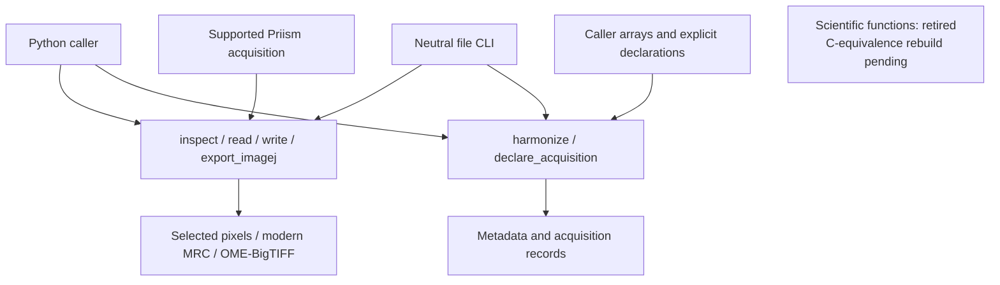

# SIMrecon

**A Python library for structured illumination microscopy (SIM) data intake and conversion.**

**Reconstruction and the former scientific APIs are temporarily unavailable.**
CE01 retires the earlier numerical stack while it is rebuilt to perform the same
mathematical algorithm as the retained C reference. This includes phase separation,
optical transfer function (OTF) preparation, calibration, estimation, simulation
and reconstruction. The [C-equivalence roadmap](docs/plans/c-equivalence-roadmap.md)
defines the replacement sequence. No C-equivalent reconstruction is claimed yet.

## What you can use today

| Capability | Public entry points | Limits |
|---|---|---|
| Inspect and read acquisition files | `inspect`, `read` | Supported Priism-style MRC sources and selected blocks; explicit layout configuration. |
| Resolve metadata and convert files | `harmonize`, `write`; `simrecon inspect`, `simrecon convert` | Preserve pixels and declared metadata in modern MRC output. No scientific correction, reconstruction or modern-MRC input decoding. |
| Declare an acquisition array | `declare_acquisition` | Own a bit-preserving array and explicit acquisition metadata. Declaration estimates no scientific parameters. |
| View all illumination settings in Fiji | `export_imagej`; `simrecon export-imagej` | A supported Priism acquisition becomes an OME-BigTIFF viewing copy. OME means Open Microscopy Environment. Keep the original for opaque metadata recovery. |
| Develop and verify the package | `delivery doctor`, Make commands below | Delivery tools and their verification gates remain installed. |

The retained library functions are `inspect`, `read`, `harmonize`, `write`,
`declare_acquisition` and `export_imagej`, with their required records and errors.
Historical scientific guides and comparison reports remain evidence of their
original models and observed failures. Their old commands do not run in the
current package; a historical passing result is not proof of C equivalence.

## Software boundaries

This is a **conceptual CE01 boundary diagram**, not a numerical result:



`inspect` describes a source without loading its pixels. `read` loads selected
blocks. `harmonize` resolves metadata and layout from explicit configuration.
`declare_acquisition` copies and labels caller arrays. The file writers stream a
described source into a conversion or viewing copy. These operations perform no
scientific image correction or reconstruction. Records hold values rather than
open file handles; NumPy buffers are not deeply immutable.

The [project record](docs/PROJECT.md), [library design](docs/architecture/library-design.md)
and [data flow](docs/architecture/data-flow.md) describe the active boundaries.
Concrete behavior comes from the public contracts, beginning with
[MRC conversion](docs/contracts/mrc-conversion-v1.md).

## Get started

The project targets **Python 3.13**. Its development environment uses
**Python 3.13.12** and **uv 0.12.19**, with dependencies pinned by `uv.lock` and
one isolated `.venv` per worktree.

```sh
git clone https://github.com/david-hoffman/simrecon.git
cd simrecon
uv sync --locked --all-groups
uv run --locked simrecon --help
```

Use the [conversion contract and configuration examples](docs/contracts/mrc-conversion-v1.md),
[acquisition declaration guide](docs/usage/raw-acquisition-declarations.md) and
[Fiji export guide](docs/usage/imagej-export.md). Do not infer phase, orientation
or Z ordering from a flattened stack. The [environment guide](docs/operations/environment.md)
covers development setup and prerequisite checks.

## Rebuild sequence

The [replacement roadmap](docs/plans/c-equivalence-roadmap.md) supersedes the old
RA scientific execution plan. CE01 removes incompatible scientific components
and their stale tests while retaining neutral I/O, historical evidence and all
accepted Agentic Software Delivery (ASD) improvements. CE02 begins the rebuild:
preprocessing and separation, then transfer preparation, known-parameter
reconstruction, finite parameter fitting, remaining defined modes, public workflow
composition and independent acceptance.

Mathematical equivalence permits declared invertible representation and unit
conversions. It does not permit a different estimator or data-dependent fitted
normalization to conceal disagreement. Bitwise agreement is not required.
The [common contract](docs/contracts/c-equivalence-common-v1.md) governs each stage.
No replacement stage is available merely because it appears in the roadmap.

## Development and verification

From the repository root:

```sh
make preflight  # Locked setup, interpreter/import and build-tool health
make check      # Locked setup, lint, formatting and type checks
make verify     # Full tests, coverage reports, wheel/import checks and audit
```

`make verify` remains the full local exact-candidate gate. It runs pytest with
exactly two workers using pinned pytest-xdist 3.8.0 and execnet 2.1.2, deterministic
whole-file grouping and no automatic worker restart. Nested fixture tests retain
their serial commands. Every required phase, test omission guard, report, wheel,
import and vulnerability audit remains required. The retained MRC conversion
measurement M25 must export same-run evidence and satisfy its unchanged
**33,554,432-byte (32 MiB)** memory-increment limit.

Full checks include Fiji reader interoperability tests. They require a Java
Development Kit (JDK) **21.0.7** with source-file launching; `SIMRECON_JAVA` selects
the executable. Setup authenticates and caches pinned ImageJ/Bio-Formats jars.
See the [reader environment guide](docs/operations/imagej-reader-environment.md).
The library's file conversion and Fiji export do not require Java.

Continuous integration repeats full verification independently on Ubuntu 24.04
and macOS 15. Native statement and branch coverage are measured globally and per
owned package; percentages are advisory. Complete current reports and exact
native integers remain required. See the [project policy](docs/PROJECT.md),
[verification guide](docs/operations/verification.md) and [AGENTS.md](AGENTS.md).

## Historical context

The [migration history](docs/MIGRATION-ROADMAP.md) and
[scientific context](docs/SCIENTIFIC-CONTEXT.md) preserve earlier claims and limits.
The Python implementation is independently written. Local legacy source under
`SIMrecon_svn/` is ignored, unshipped study material. Source study and comparison
with owner-provided outputs are permitted; building, running, linking or importing
the C reference or bundled executables remains prohibited.
