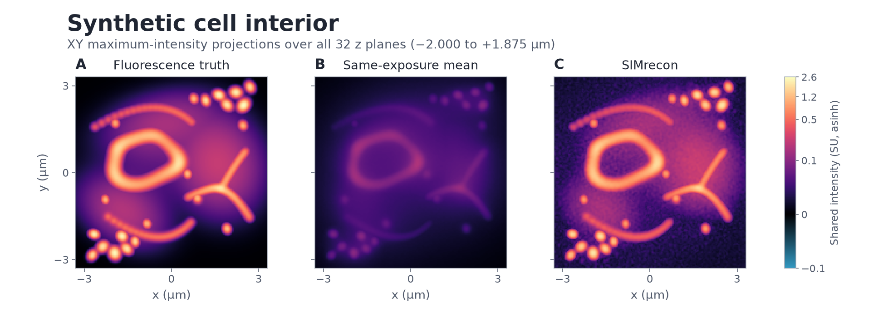
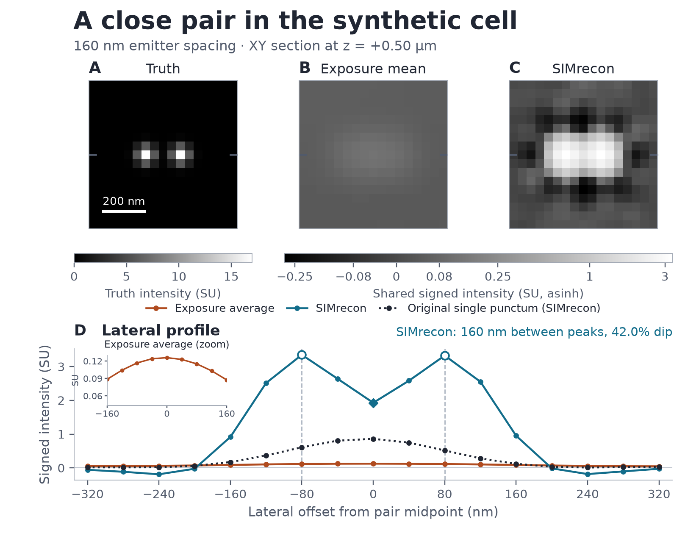
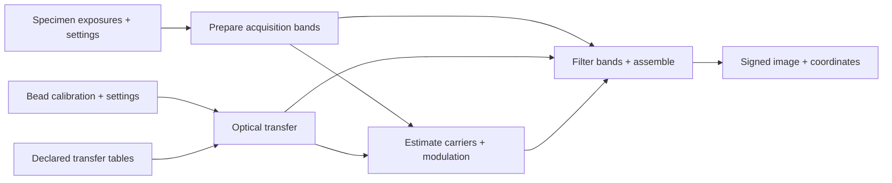
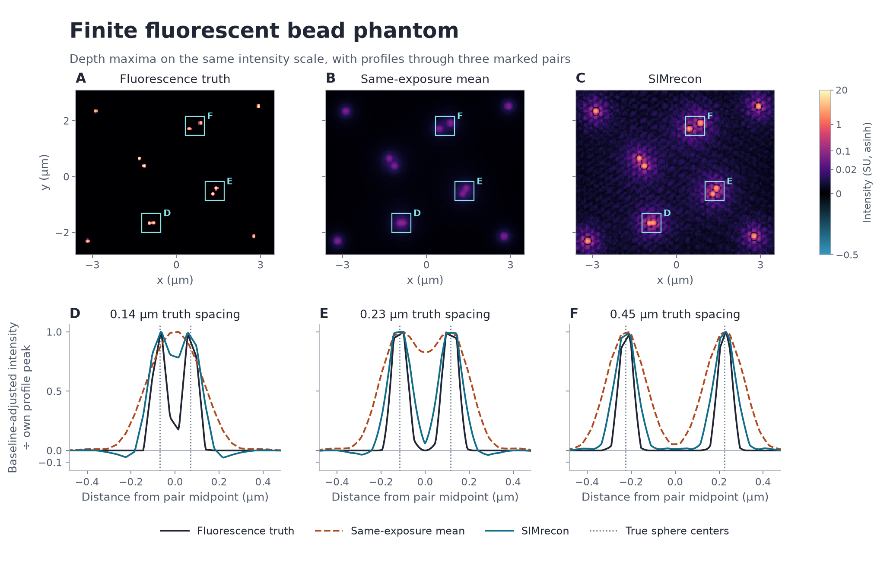

# SIMrecon

SIMrecon is a Python library for reconstructing structured illumination
microscopy (SIM) images. It takes specimen exposures, acquisition settings,
and either raw bead calibration or a prepared optical transfer. It returns a
signed image and physical coordinates in micrometres.



*For the original cell, each panel projects the brightest signed sample over
all 32 z planes at each XY coordinate. The panels share an intensity scale. The exposure average
uses the same 15 simulated exposures as the reconstruction.*



*In a cell variant, SIMrecon separated two emitters **160 nm** apart, below
the modeled widefield Rayleigh reference of 229 nm. The two reconstructed
peaks were **160 nm** apart with a **42.0%** dip below the weaker peak.
The same-exposure average left the pair unresolved.*

## Install and run the quick start

SIMrecon requires Python 3.13. From a checkout, use [uv](https://docs.astral.sh/uv/)
to install the locked environment and run the example.

```sh
git clone https://github.com/david-hoffman/simrecon.git
cd simrecon
uv sync --locked
uv run --locked --no-sync python examples/reconstruct_simulated.py
```

The example generates a small noiseless acquisition and its matched transfer
in memory. It prints the signed image shape `(1, 4, 16, 16)` in
`(time, z, y, x)` order and the physical sampling.

## Reconstruct your data

Pass specimen counts in `(time, direction, phase, z, y, x)` order. For raw
bead calibration, pass counts in `(phase, z, y, x)` order. Use the
acquisition and optical settings for your experiment, including each
stack's own pixel and z spacing.

```python
from simrecon import reconstruct_workflow

def reconstruct(specimen_counts, bead_counts, settings):
    calibration = {**settings["calibration"], "raw": bead_counts}
    result = reconstruct_workflow(
        specimen_counts, **{**settings, "calibration": calibration}
    )
    return result.image, (result.x_um, result.y_um, result.z_um)
```

The [workflow guide](docs/usage/c-workflow.md) shows the required settings
and the alternative entry point for a prepared transfer. See the
[acquisition guide](docs/usage/raw-acquisition-declarations.md) for reading
and declaring supported microscopy files.

## Follow the reconstruction



*Conceptual data flow through `reconstruct_workflow`. Optical transfer describes
how the microscope transmits spatial frequencies. The workflow resolves it before
preparing specimen bands. File reading/declaration happens before this array
pipeline; saving its output is a separate caller operation.*

- [Mathematical walkthrough](docs/architecture/reconstruction-walkthrough.md):
  phase separation, transfer sampling, parameter fitting, filtering and assembly,
  with equations, conceptual figures and links to the executing functions.
- [Detailed data routes](docs/architecture/data-flow.md): array and file boundaries,
  with historical routes labeled separately.
- [Contributor module map](docs/plans/human-readable-restructure.md#explicit-old-to-new-module-map):
  current paths, intended destinations and preserved public exports.
- [Project setup and checks](docs/PROJECT.md#commands-and-evidence) and
  [ordered readability tasks](docs/tasks/readability-stack.md): development workflow
  and the status of the staged refactor.

## Run a simulation

Generate and reconstruct the close-pair cell variant from the repository root.
The commands write the arrays and reconstruction to a fresh temporary
directory. Remove it after inspecting or exporting the results.

```sh
study=docs/studies/simulation-capstone
run=$(mktemp -d "${TMPDIR:-/tmp}/simrecon-cell.XXXXXX")
printf 'Run directory %s\n' "$run"
export VECLIB_MAXIMUM_THREADS=1 OPENBLAS_NUM_THREADS=1 OMP_NUM_THREADS=1

uv run --locked --no-sync python "$study/inputs/generate.py" cell-detail "$run/input"
uv run --locked --no-sync python "$study/reconstruction/run_study.py" cell-detail "$run/input" "$run/output"
```

The [simulation study](docs/studies/simulation-capstone/README.md) gives the
complete reproduction commands, optical settings, and results. Use `cell`
for the original cell and its single-punctum control. The study also includes
paired clean and noisy acquisitions, cell sections and residuals, and a
[logarithmic Wiener sweep](docs/studies/simulation-capstone/README.md#wiener-sweep).



*In this simulated bead phantom, the reconstruction separated the **0.14 µm**
pair under the study's two-peak rule and measured **0.125 µm** between peaks.
The exposure average left the pair unresolved. Each noisy specimen uses one
simulated noise draw.*

## Scientific references

- M. G. L. Gustafsson. *Surpassing the lateral resolution limit by a factor
  of two using structured illumination microscopy.* Journal of Microscopy
  **198**, 82–87 (2000). [Article](https://pubmed.ncbi.nlm.nih.gov/10810003/)
- M. G. L. Gustafsson et al. *Three-dimensional resolution doubling in
  wide-field fluorescence microscopy by structured illumination.*
  Biophysical Journal **94**, 4957–4970 (2008). [Article](https://pmc.ncbi.nlm.nih.gov/articles/PMC2397368/)

## License

[MIT](LICENSE)
