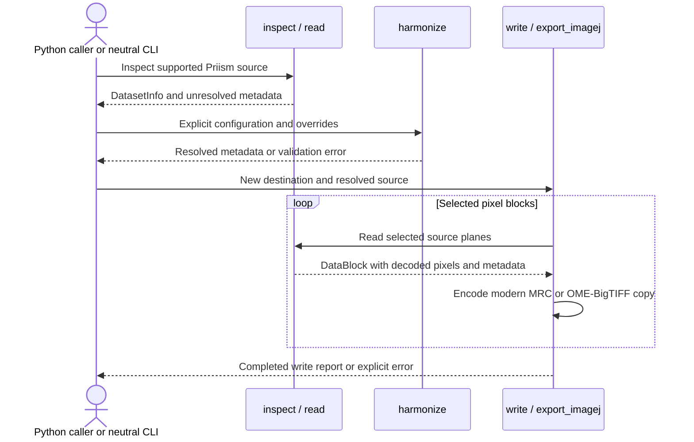
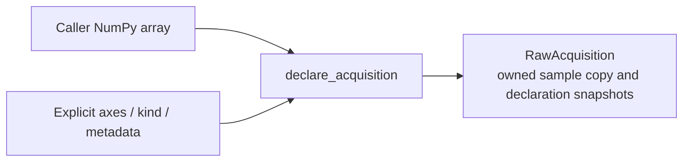
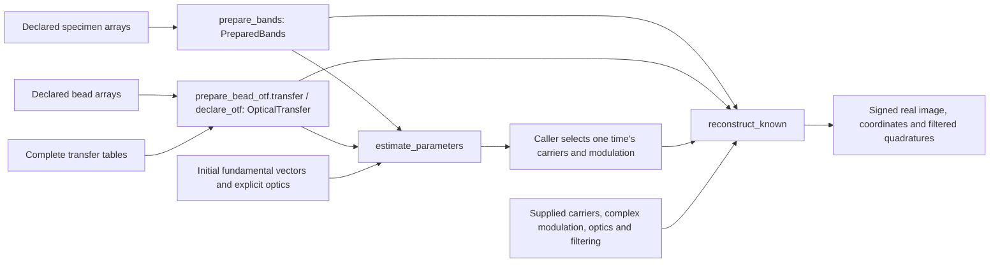
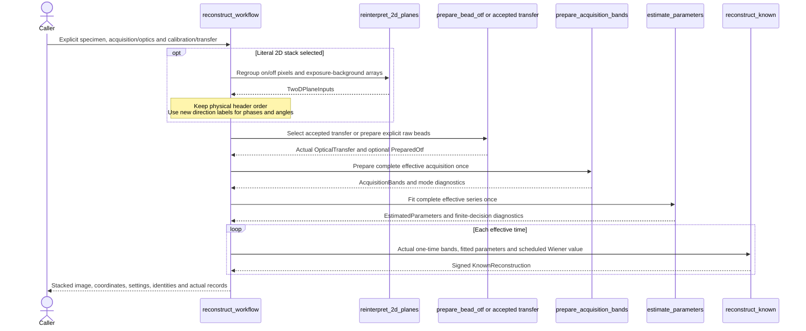
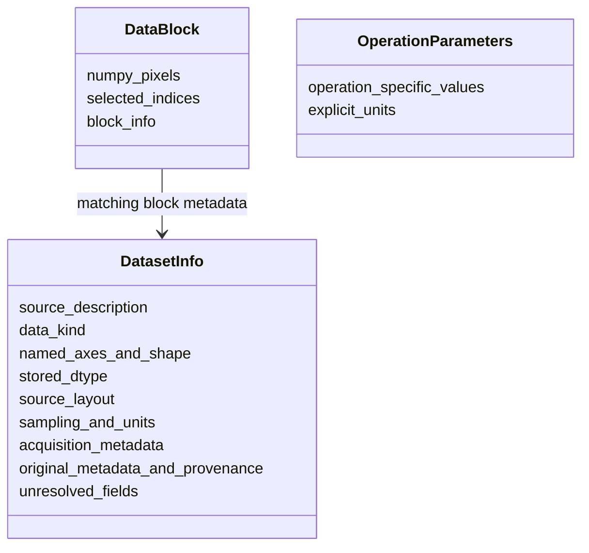

# Data flow: explicit file and array operations

**Version 1.0. CE02–CE07 product boundary.** [PROJECT](../PROJECT.md) records
the active boundaries; the linked public contracts define exact behavior.
The following diagrams are conceptual.

Estimation and known-parameter reconstruction are explicit array routes through
accepted preparation and transfer records. The public workflow composes selected
acquisition modes and per-time reconstruction from explicit declarations. The former scientific APIs remain retired.
The [C-equivalence rebuild roadmap](../plans/c-equivalence-roadmap.md) supersedes
the old numerical route. Neutral file and declaration operations remain available.

## File inspection, conversion and viewing copies



The CLI exposes `inspect`, `convert` and `export-imagej` through these boundaries.
`harmonize` resolves metadata/layout without image correction. Conversion and
export perform no calibration, estimation, phase separation or reconstruction.
Modern MRC is an output, not a newly supported input decoder. ImageJ export
accepts the sources and layouts in its
[contract](../contracts/imagej-export-v1.md), rather than arbitrary arrays or
reconstruction results. Original sources remain necessary for opaque-byte recovery.

Resources stay scoped to each call. Selected reads and streamed writes avoid a
whole-acquisition pixel load; metadata growth and caller-requested full reads
still consume memory. Failure and partial-output behavior come from the public
contract, not from this diagram. See [library design](library-design.md).

### Follow the file path in source

| Operation | Executing source | What stays explicit |
| --- | --- | --- |
| Inspect a Priism source | [`inspect`](../../src/simrecon/io/priism.py) | Header/payload description and unresolved acquisition meaning; no pixel load |
| Resolve a layout | [`harmonize`](../../src/simrecon/io/metadata.py) | Supplied axis order, micrometre sampling, nanometre wavelength overrides and provenance |
| Read selected planes | [`read`](../../src/simrecon/io/pixels.py) | Owned `(selected planes, y, x)` buffers and canonical coordinates; integer-word endian conversion |
| Convert to modern MRC | [`write`](../../src/simrecon/io/mrc_writer.py) | Exclusive destination creation, embedded source metadata and bounded pixel blocks |
| Make a viewing copy | [`export_imagej`](../../src/simrecon/io/imagej.py) and [carrier metadata](../../src/simrecon/io/imagej_metadata.py) | Separate orientation/phase series and declared `(time, channel, z, y, x)` layout |
| Invoke a neutral command | [`main`](../../src/simrecon/cli.py) | The same file operations and JSON reports; no reconstruction command |

These implementation modules support the [root facade](../../src/simrecon/__init__.py);
helper names do not create additional stable APIs. Exclusive creation protects an
existing destination. A later write failure can leave a partial **new** file;
source identity checks are not an atomic snapshot. See the exact
[MRC](../contracts/mrc-conversion-v1.md) and
[viewing-copy](../contracts/imagej-export-v1.md) contracts before relying on output
or metadata guarantees.

## Explicit caller-array declaration



Declaration preserves samples and orders declared axes. It infers no optical
truth and calls no scientific kernel or automatic file adapter. A caller may
explicitly compose an MRC read with declaration as shown in the
[current guide](../usage/raw-acquisition-declarations.md). The full owned copy
has no whole-volume memory bound.

## Estimated or supplied parameters in the array route



This conceptual route uses the accepted complex transfer sampling operation.
Filtering occurs at native frequencies before centered real-space carrier
relocation. The array result has no implicit file writer or CLI command.
[Exact equations and boundaries](../contracts/c-equivalence-known-parameters-v1.md)
and [usage](../usage/c-known-reconstruction.md) distinguish mathematical agreement
from historical executable agreement and physical recovery.
`estimate_parameters` returns per-time values; callers construct a one-time
`PreparedBands` and pass that time's carriers/modulation to `reconstruct_known`.
The [estimation guide](../usage/c-parameter-estimation.md) gives the public
record construction and keeps the upstream scale unchanged. Estimation success
does not guarantee acceptance by the filter's separate domain. CE06 also supplies the selected acquisition-mode bands and layout adapter. The
CE07 workflow performs the accepted composition below. Independent recovery
acceptance remains CE08; historical executable agreement stays unqualified.

## Public acquisition workflow



The [workflow contract](../contracts/c-equivalence-workflow-v1.md) fixes the exact
ordering, array ownership, errors and source policies. Raw bead preparation occurs
only for the selected raw calibration path. An accepted or precomputed transfer
is consumed directly. Complete transfer declaration and explicit decoded-section
selection follow their distinct rules. A caller can explicitly read and declare
file pixels before this array/value boundary. No output writer or reconstruction
CLI is added. The [usage guide](../usage/c-workflow.md) describes required metadata
and the separate historical-binary, physical-recovery and resolution limits.

### Follow the workflow in source

| Responsibility | Executing operation | Boundary |
| --- | --- | --- |
| Entry and stage order | [`reconstruct_workflow`](../../src/simrecon/workflow/reconstruct.py#L33) | Resolve declarations, prepare once, fit once, then reconstruct each effective time. |
| Explicit channel and layout | [`select_specimen_channel`](../../src/simrecon/workflow/adapters.py#L26) | Adapt named raw axes without a file decoder; delay metadata snapshots until validation. |
| Resolved settings and geometry | [`resolve_workflow_settings`](../../src/simrecon/workflow/config.py#L196) | Validate exact schemas, units and native extents before materializing scientific inputs. |
| Transfer alternatives | [`resolve_optical_transfer`](../../src/simrecon/workflow/transfer.py#L371) | Use the selected accepted transfer or execute explicit bead preparation once. |
| Identity and ownership | [`array_identity`](../../src/simrecon/workflow/identity.py#L96) | Hash validated original arrays with little-endian normalization before numerical conversion. |
| One-time reconstruction input | [`select_time_bands`](../../src/simrecon/workflow/adapters.py#L170) | Retain the selected time and already-computed scientific state. |
| Failure translation | [`extract_stage_error_indices`](../../src/simrecon/workflow/result.py#L85) | Preserve actual acquisition/estimation traceback context without replaying a stage. |

The array stages retain their own records and mutability rules. The workflow
snapshots declarations separately from owned read-only image, coordinate and
identity storage; it does not make every nested stage buffer immutable.
The contextual-failure adapter retains its literal module whitelist and `t`/`d`
lookup. These source helpers remain implementation details behind the supported
root exports.

## Historical numerical routes

The original diagrams below are retained verbatim from
`8f6b35ceda362944f00de44acbf7098989f157e4:docs/architecture/data-flow.md`.
Their numerical participants, return types, candidate status and “future” paths
are historical descriptions. Their old entry points remain retired.
Replacement numerical stages require their own source-derived contract and
independent C-equivalence evidence before joining a public workflow.

<details>
<summary>Historical proposed conversion and reconstruction flow</summary>

# Proposed UML data flow

**Version 1.0** Git versions revisions. Architecture approval is pending. These Unified Modeling Language (UML) diagrams explain the [proposed design](library-design.md); they do not approve function signatures, format contracts, or scientific algorithms.

## Main pipeline: conversion and reconstruction are separate routes

The first MRC slice converts harmonized image data to modern MRC output without calling reconstruction or requiring optical transfer function (OTF) calibration. A caller requesting reconstruction takes a separate route through the numerical stage. The historical placeholder is superseded by the separately approved [known-parameter first-harmonic 2D contract](../contracts/known-parameter-reconstruction-v1.md), with [public usage](../usage/reconstruction.md) and [actual comparison](../reports/reconstruction-comparison.md). Its owner-authorized candidate is stacked above verified, independently reviewed, unmerged calibration PR #7; exact candidate verification/review and owner integration remain pending. The broader 3D/adaptor flow below remains architectural context.

```mermaid
sequenceDiagram
    actor Caller as Python caller or command-line user
    participant Input as Input adapters
    participant Pure as Pure harmonization
    participant Numeric as reconstruct(images, explicit keywords)
    participant Output as Output adapters

    Caller->>Input: Inspect image source
    Input-->>Caller: Dataset description and recorded metadata
    Caller->>Pure: Resolve metadata overrides and acquisition profile
    Pure-->>Caller: Resolved description or validation error

    alt Convert: first MRC slice
        Caller->>Output: Begin modern MRC output
        loop Selected image blocks
            Caller->>Input: Read selected stored pixels
            Input-->>Caller: Decoded pixels and source indices
            Caller->>Pure: Harmonize block axes and metadata
            Pure-->>Caller: Harmonized image block
            Caller->>Output: Write image block
        end
        Caller->>Output: Finalize metadata and close file
        Output-->>Caller: Output file and conversion report
    else Reconstruct: separate numerical route
        Caller->>Input: Read image acquisition unit and OTF calibration
        Input-->>Caller: Image and frequency-domain calibration data
        Caller->>Pure: Harmonize image and OTF independently
        Pure-->>Caller: Image unit and OTF with resolved axes and units
        Caller->>Numeric: Image unit, OTF calibration, explicit parameters
        alt Invalid inputs or specified numerical failure
            Numeric--xCaller: Explicit error; no partial result
            Note over Caller,Output: No reconstructed result is available to write
        else Contracted 2D candidate
            Note over Numeric: Pure numerical functions; no file access
            Numeric-->>Caller: Reconstruction2D signed complex arrays and sampling
            Caller->>Output: Write reconstructed result
            Output-->>Caller: Output file and reconstruction write report
        end
    end
```

Input and output functions in the broad pipeline diagram describe responsibilities. The concrete 2D candidate consumes plain `(R,N,Ny,Nx)` arrays, a matching `Otf2D` and all required explicit keyword parameters. It composes public `separate_phases` per orientation, Fourier-series bands, closed-axis interpolation, complex transfer weighting and explicit ridge/mask. It returns independently owned signed complex image/spectrum and frequency axes at half spacing and unchanged field. This pure numerical operation performs no file I/O; no reconstruction adapter or CLI command is introduced.

Conversion is complete only when its output and report are produced. Reconstruction has its own [task evidence pointer](../tasks/known-parameter-reconstruction.md) and independent acceptance requirements. Neither `read`, `harmonize`, `write`, nor the CLI conversion path calls `reconstruct` implicitly. Conversion output remains image data of its original kind; it is not labeled as reconstructed data.

## First MRC slice: inspect, resolve, and convert

The sequence diagram reads from top to bottom. Arrows carry requests or returned data. The Python caller and command-line interface use the same public functions. Input/output adapters perform file access; harmonization operates on explicit values.

```mermaid
sequenceDiagram
    actor User as Python caller or command-line user
    participant API as Public functions
    participant Input as Input adapter
    participant Pure as Pure harmonization
    participant Output as Output adapter

    User->>API: inspect(source)
    API->>Input: Read headers, extended metadata, and payload description
    Note over Input: Open source, inspect, close; no pixel loading
    Input-->>API: DatasetInfo: recorded metadata and unresolved fields
    API-->>User: DatasetInfo for inspection

    User->>API: harmonize(info, overrides, acquisition profile)
    API->>Pure: Resolve layout and units; apply explicit overrides
    Note over Pure: Retain original values and record every override
    Pure-->>API: Resolved DatasetInfo or explicit validation error
    API-->>User: Resolved info or fields that need correction

    alt Required layout or schema remains unknown, or payload is inconsistent
        Note over User,Output: Inspection is available; conversion does not start
    else Metadata and payload description are consistent
        User->>API: write(destination, source description, selection)
        API->>Output: Begin modern MRC output with documented metadata
        loop Selected pixel blocks until conversion completes
            API->>API: read(source, selected region, resolved info)
            API->>Input: Decode selected stored pixels
            Note over Input: File resources remain scoped to the read call
            Input-->>API: Decoded pixels and source indices
            API->>Pure: Harmonize block axes and attach resolved metadata
            Pure-->>API: DataBlock: NumPy pixels plus matching metadata
            API->>Output: Encode and write this block
        end
        API->>Output: Finalize output metadata and close file
        Output-->>API: Write result or explicit I/O error
        API-->>User: Output location and conversion report
    end
```

This illustrates a streamed file-to-file conversion. A Python caller can instead call `read` to obtain one selected `DataBlock`, inspect or process that block, and pass it to `write`. Caller-supplied NumPy arrays enter through `harmonize` with explicit metadata; they do not need a file adapter. Function argument lists above illustrate data dependencies, not settled signatures.

An output handle necessarily exists during a write call, and scratch arrays may be reused inside a call. These are local implementation resources. No long-lived reconstruction session, open handle in a data record, or changing global parameter object is proposed. The loop bounds pixel memory by selected blocks; it does not make a later whole-volume reconstruction automatically bounded-memory.

## Data records: values, not processing engines

The class diagram shows fields and associations. It describes small value records even though the proposed operations are functions. It introduces no stateful image-processing class or method-based workflow.



- `DatasetInfo` can describe spatial image data or frequency-domain optical transfer function (OTF) data. Its data kind, axes, and units distinguish them. A header filename alone does not choose the interpretation.
- `DataBlock` contains only the selected pixels and their corresponding metadata/index selection. A small dataset descriptor does not imply that the whole acquisition is loaded.
- `OperationParameters` illustrates future per-operation parameter records. Parameters remain separate inputs; no generic all-algorithm settings object or new executable parameter API is approved.
- Metadata records are treated as values. This does not make NumPy buffers deeply immutable. Pure functions must not mutate caller-owned arrays.

## Reconstruction detail: concrete 2D candidate and future 3D context

The concrete 2D operation is defined by the linked contract and usage above. The
following broader 3D diagram is future architectural context; it supplies no 3D
implementation, estimation or adapter authorization.

The proposed numerical data flow is:

```mermaid
sequenceDiagram
    actor Caller
    participant Intake as Same intake functions
    participant Numeric as Future 3D numerical operation
    participant Writer as Same output functions

    Caller->>Intake: Select one channel and time point's raw 3D acquisition
    Intake-->>Caller: Image unit with required Z, orientation, and phase data
    Caller->>Intake: Read and harmonize OTF calibration independently
    Intake-->>Caller: Frequency-domain calibration with declared axes and units
    Caller->>Numeric: Image unit, OTF calibration, explicit algorithm parameters
    Note over Numeric: Future 3D context; concrete candidate currently accepts 2D acquisition arrays
    Numeric-->>Caller: Reconstructed spatial image and result metadata
    Caller->>Writer: Write result through selected output adapter
    Writer-->>Caller: Output file and write report
```

The 3D processing unit contains all required phase/orientation exposures for one channel/time point. It is not one arbitrary input/output block. Future scientific contracts settle transform working sets, scratch staging, and valid subdivisions. Reconstruction, OTF generation/estimation, and scientific defaults remain outside the first file-intake slice.

Modern MRC preserves full logical-axis metadata in a documented extended header. The initial ImageJ path uses the reader support actually established by its contract; it may expose a flattened stack. Preservation is not a promise that ImageJ interprets X/Y/Z/channel/time automatically. A later adapter or reader integration addresses that goal; see the [compatibility evidence](library-design.md).

</details>
