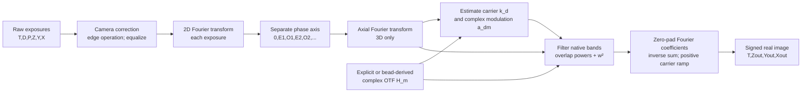
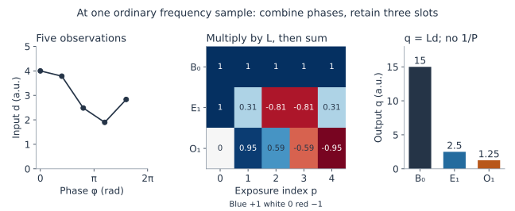
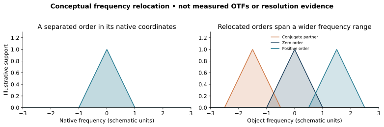

# Reconstruction: mathematics alongside the executing code

**Task 01 reader guide, 2026-11-10.** Checked against runtime baseline
`0ea11a5876549bf26a3a813009b97c09decc806d`, preserved in preparation commit
`ac2b0d65f239fb5f628792ae58af13ea1da868bf`. This explains the current Python
implementation; it changes no algorithm or scientific contract. Relative source
line links refer to this checkout and must move with functions in later tasks.

Start with the diagram and phase-separation section, then follow filtering and
assembly. The detailed boundary notes explain places where an idealized SIM
formula alone would misdescribe this implementation. Existing
[usage guides](../usage/c-workflow.md) explain calls, and
[contracts](../contracts/c-equivalence-workflow-v1.md) remain the behavior authority.
The [module map](../plans/human-readable-restructure.md) records
where later tasks will place these responsibilities; all source links here use current paths.

This is a source-derived explanation, not a new numerical validation, physical
recovery result, or historical C-executable comparison. The retained C reference
was not compiled, run, imported or copied for this analysis.

## Pipeline overview

The [README data-flow diagram](../../README.md#follow-the-reconstruction) gives
the short reading path; the expanded stage diagram below includes the array axes.

`reconstruct_workflow` composes these stages. A caller may instead supply known
carriers/modulation to `reconstruct_known`, bypassing estimation. Supported file
reads and acquisition declarations are explicit caller-side operations before
this array pipeline. Neutral conversion/export is a separate route; this diagram
does not introduce a reconstruction CLI, automatic file decoder or output writer.

## Follow the executing stages

[`reconstruct_workflow`](../../src/simrecon/workflow/reconstruct.py#L27) resolves an explicit single-channel declaration, optional physical-stream regrouping, and exactly one optical-transfer route. It resolves the transfer first, calls [`prepare_acquisition_bands`](../../src/simrecon/acquisition/modes.py#L409), calls [`estimate_parameters`](../../src/simrecon/reconstruction/parameter_estimation.py#L933), then calls [`reconstruct_known`](../../src/simrecon/reconstruction/known_parameters.py#L882) separately for each time using that time's fitted carriers and modulation. The call sites are `workflow/reconstruct.py:212`, `:222`, `:237`, `:255`; concatenation is `:273`.

This matters: the workflow does **not** directly call `prepare_bands`. That original 3D public entry remains available, and both preparation entries share [`build_phase_separation_matrices`](../../src/simrecon/acquisition/preparation.py#L159). Acquisition preparation adds selected 2D/3D, phase-step, drift and off-exposure branches. The explanation below follows the no-drift/no-off 3D path first, then describes selected extensions.

The diagram below is conceptual. Arrows show the data dependencies; the workflow resolves the transfer before specimen preparation.

Transfer/calibration is a separate branch: calibration is not inferred from specimen frames.

## Axes, units and Fourier conventions

Let raw dimensions be `(T,D,P,Z,Y,X)`, retained order count `M = norders` (including zero), number of stored slots `Q=2M-1`, lateral enlargement `s_xy`, axial enlargement `s_z`, detector pitches `dxy`, `dz` in µm. Require even X, Q≤P; workflow-supported reconstruction uses M≥2, 3D search additionally requires M≥3. Native 2D has Z=1, native 3D Z≥2.

| Quantity | Shape | Meaning |
|---|---|---|
| Raw specimen | T,D,P,Z,Y,X | Detector-count observations |
| Prepared quadratures | T,D,Q,Z,Y,X/2+1 | complex128, unshifted kz,ky,kx half storage |
| Acquisition separator | T,D,Z,Q,P | Real matrix, possibly varying with drift-adjusted phase design |
| Acquisition phase angles | T,D,Z,P | Radians |
| Acquisition scalar noise | T,D,M | Variance factors, not full covariance |
| Estimated carriers | T,D,2 | `(kx,ky)` in cycles/µm |
| Estimated modulation | T,D,M−1 | Complex factors for positive orders |
| Output | T,s_z Z,s_xy Y,s_xy X | Signed float64 samples |

`prepare_bands` instead stores its separator `(D,Q,P)` and noise `(D,M)` because its phase design is time/z independent. Acquisition records are defined at `acquisition/modes.py:49`, array allocations at `:617` and `:688`; downstream validation is `:110`.

Native Fourier spacing is

$$
\Delta k_x=1/(X\,dxy),\qquad \Delta k_y=1/(Y\,dxy),\qquad
\Delta k_z=1/(Z\,dz).
$$

For true 2D with dz=0, downstream code uses the declared transfer's positive axial frequency increment for internal sampling; this does not invent an axial specimen pitch (`reconstruction/known_parameters.py:1035`). Frequencies are cycles/µm; wavelengths enter in nm and are divided by 1000 when a µm expression is needed.

Forward transforms are unnormalized sums with the usual negative exponential. If `f` is a corrected frame,

$$
\widehat f[n_y,n_x]=\sum_{y=0}^{Y-1}\sum_{x=0}^{X-1}
 f(y,x)\exp[-2\pi i(n_y y/Y+n_x x/X)].
$$

Here `n_y,n_x` are integer Fourier-bin indices; their physical frequencies are `n_y Δk_y,n_x Δk_x`.

Preparation uses `np.fft.rfft2`, then (for 3D) an unnormalized `np.fft.fft` over z. Half storage saves only nonnegative x frequencies, **not** radial frequencies; all y,z bins are stored. See `acquisition/modes.py:776`, `:902` and `acquisition/preparation.py:444`.

The upstream scale is

$$
\alpha = 1/(XYZ s_{xy}^2 s_z D).
$$

It already includes the enlarged output volume and direction count. It is not `1/P`; phase separation has its own convention. The zoom factors affect this scale before any grid enlargement occurs. See `acquisition/modes.py:680`, `acquisition/preparation.py:400`. The inverse assembly later is an unnormalized sum, so do not silently insert an additional output-voxel division or direction average.

## Camera correction, edges and equalization

Ignoring the explicitly recorded corner sentinel for one line, the correction is

$$
f_{tdpz}(y,x)=\alpha\,s(y,x)
 [r_{tdpz}(y,x)-b(y,x)-e_{tdpz}],
$$

where b and e are count offsets and s is a multiplicative flat-field slope. It is not a flat-field divisor. `CameraCorrectionState.load` executes this at `acquisition/modes.py:346`; the original entry does it at `acquisition/preparation.py:421`.

The exact bottom-right raw −1 sentinel copies the left neighbor, copies the neighbor's background into the owned corner background, and sets the corner slope to 1. These owned maps persist into later loads. Ordinary negative values elsewhere remain data. On/off stream load order matters in acquisition mode. Avoid implying arbitrary negative pixels are clipped.

[`apodize_frame_edges_inplace`](../../src/simrecon/acquisition/preparation.py#L239) has three distinct meanings:

- width −1 multiplies by `sin(π(y+1/2)/Y) sin(π(x+1/2)/X)`;
- positive width w applies additive opposite-edge updates, y first then x. For one axis, Δ=(last−first)/2 and weight `1−sin(π(k+1/2)/(2w))`; add Δ·weight to the near edge and subtract it from the opposite edge. Sequential overlaps remain sequential;
- width 0 or below −1 bypasses this operation.

This is not uniformly a multiplicative apodization. Frame sums are measured **after** correction and edge handling. With equalization, each exposure is multiplied by anchor/current_sum; the anchor is direction 0, phase 0, with z=0 and/or t=0 when corresponding sharing flags are enabled. Zero sums reject; signed nonzero sums are permitted. `equalize_frame_sums_inplace` is at `acquisition/modes.py:364`, original branch `acquisition/preparation.py:428`.

## Band separation: phase measurements to quadratures

A moving sinusoidal illumination pattern mixes shifted specimen Fourier components into the same measured frequency. Changing illumination phase changes their phase factors. The same specimen components can therefore be separated by combining exposures along the phase axis; this is different from moving those components to their final object-frequency locations. The code represents the separated positive harmonic at native frequency k as corresponding to object frequency k+m·k_d. This is the convention used by both its filter and its assembly, not a claim that every declared dataset satisfies an ideal forward model.

At each fixed time, direction, z and lateral frequency, stack the P Fourier exposures into a vector

$$
\mathbf d=(\widehat f_0,\ldots,\widehat f_{P-1})^T.
$$

The separator acts along **phase only**, independently at each such location:

$$
\mathbf q=L\mathbf d,
\qquad \mathbf q=(B_0,E_1,O_1,\ldots,E_{M-1},O_{M-1})^T.
$$

The matrix builder is [`build_phase_separation_matrices`](../../src/simrecon/acquisition/preparation.py#L159). The application is [`prepare_acquisition_bands`, phase design and contraction](../../src/simrecon/acquisition/modes.py#L860): `einsum("qp,pyx->qyx", row, on_fft[..., :-1])` at :881. In the simpler entry it is `einsum("qp,pzyx->qzyx",...)` at `acquisition/preparation.py:447`.

For default uniform phases `φ_p=2πp/P`, the rows are exactly

$$
L_{0p}=1,\quad L_{2m-1,p}=\cos(m\phi_p),\quad L_{2m,p}=\sin(m\phi_p).
$$

Therefore

$$
B_0=\sum_p\widehat f_p,\quad
E_m=\sum_p\widehat f_p\cos(m\phi_p),\quad
O_m=\sum_p\widehat f_p\sin(m\phi_p).
$$

There is **no `1/P` in these specimen separation rows**. A phase response `a+b cos φ+c sin φ` yields B0=Pa, E1=Pb/2, O1=Pc/2. This is a normalization convention, not an omitted transform normalization to repair later.

Define signed harmonic combinations

$$
B_m^+=E_m+iO_m,\qquad B_m^-=E_m-iO_m.
$$

For uniform phases, `B_m^+=Σ_p d_p exp(+imφ_p)`. The phase expansion consistent with these definitions is

$$
\widehat f_p=\frac1P\left[B_0+
\sum_{m=1}^{M-1}\big(B_m^+e^{-im\phi_p}+B_m^-e^{+im\phi_p}\big)\right]
$$

when the data lie in the retained phase model. With more phases than Q this expresses the model component, not an assertion that arbitrary data have no residual.

E and O are **both complex Fourier arrays**. They are not “real and imaginary parts” of a Fourier image; they are the Fourier transforms of cosine- and sine-weighted real exposure combinations. Their combination creates a complex harmonic band. For a real underlying quadrature field,

$$
B_m^-(\mathbf k)=\overline{B_m^+(-\mathbf k)}.
$$

The minus sign affects all axes, not just x. Code reconstructs half-space reads by reflecting z,y,x and conjugating each quadrature separately before forming E+iO (`reconstruction/parameter_estimation.py:382`, `reconstruction/known_parameters.py:715`, `:834`).

### Explicit phases are a left-inverse problem

For supplied phase angles, the code builds the forward model

$$
A_{p0}=1/P,\quad A_{p,2m-1}=2\cos(m\phi_p)/P,\quad
A_{p,2m}=2\sin(m\phi_p)/P,
\qquad \mathbf d=A\mathbf q.
$$

It computes `L=A^{-1}` for P=Q. For P>Q, it obtains the unweighted least-squares left inverse from reduced QR, `A=UR`, `L=R^{-1}U^T`; it does not form normal equations, use noise-weighted fitting, or regularize. The forward-model scaling deliberately returns the same quadrature convention as the uniform rows. Source `acquisition/preparation.py:205–214`.

A full-column-rank design is required. Repeated phases can be legitimate when enough distinct phase information remains in an overdetermined acquisition. Numerical resolution is also checked: the observed residual `LA−I` must remain below a binary64 roundoff envelope and have infinity norm <1. This is an inverse-resolution check, not a promised accuracy bound. No small-singular-value truncation or lower-rank fallback occurs (`:216–230`).

The reported normalized noise factors are

$$
\nu_0=\frac1P\sum_p L_{0p}^2,\qquad
\nu_m=\frac1P\sum_p\left(L_{2m-1,p}^2+L_{2m,p}^2\right).
$$

They equal one for the uniform design. These are scalar order variance factors, not the full covariance `LΣLᵀ`; the downstream filter uses `1/ν_m`. Explicit phase irregularity can couple quadratures, but no cross-order covariance matrix is propagated. Source `acquisition/preparation.py:231–236`.

In acquisition preparation, rows/phase values can vary with z, while `noise[t,d]` is overwritten at each z: the returned per-time/direction noise vector is the final-z result. That is an implementation convention to mention if explaining drift-varying designs (`acquisition/modes.py:864–868`).

### The lateral Nyquist exception must be visible

All the equations above describe ordinary separated samples, **except the stored x-Nyquist column**. Code applies L only to `[..., :-1]`. At x=X/2, it copies the first Q exposure Fourier coefficients directly into the Q slots:

$$
q_q(z,k_y,X/2)=\widehat f_q(z,k_y,X/2),\quad q=0,\ldots,Q-1.
$$

Then that column also receives the axial FFT in 3D. This deliberately preserves the selected source mapping; those entries do not have the usual separated-harmonic interpretation. Source `acquisition/modes.py:881–888`, `acquisition/preparation.py:447–451`. A diagram that colors every pixel as a separated harmonic without this exception would misdescribe the code.

### Exact illustrative 3-phase algebra (not pipeline evidence)

Use `P=3`, `M=2`, `φ=(0,2π/3,4π/3)`:

$$
L=\begin{pmatrix}1&1&1\\1&-1/2&-1/2\\0&\sqrt3/2&-\sqrt3/2\end{pmatrix}.
$$

For the illustrative phase signal `d_p=10+4cosφ_p+2sinφ_p`, exposures are `(14,8+√3,8−√3)` and separated outputs are `B0=30`, `E1=6`, `O1=3`, hence `B1+=6+3i` and `B1−=6−3i`. This isolates the separator; it does not include camera scale, spatial transforms, Nyquist behavior, optics or reconstruction. Both examples illustrate ordinary separated samples; neither represents the stored x-Nyquist exception.

*Conceptual illustration of one ordinary separated sample. This second example
uses P=5, M=2, φp=2πp/5 and dp=3+cos φp+0.5 sin φp. The three matrix rows give
B0=15, E1=2.5 and O1=1.25. Values are arbitrary units, before any camera/spatial
pipeline. The plot is analytical, not observed reconstruction evidence.*

## Selected acquisition extensions

Phase policy precedence is steps > supplied array > uniform (`acquisition/modes.py:671`). Steps construct `φ_dp = p·step_d`. Linked drift phase adjustment overrides the selected phase design at each acquisition cell. Its vector is `(cosθ_d,sinθ_d)/linespacing`, and

$$
\phi_{tdzp}=\phi_{\mathrm{base},p}
 +2\pi\,dxy\,\boldsymbol\delta_{tdzp}\cdot\mathbf k_{\mathrm{phase},d}.
$$

Here δ is in detector pixels, so dxy converts it to µm. The branch and exact header indexing are `acquisition/modes.py:837–862`.

Within-exposure correction occurs before separation and multiplies lateral Fourier samples by a **positive** phase ramp. Between-direction correction happens after the axial transform. [`build_drift_correction_ramp`](../../src/simrecon/acquisition/drift.py#L37) computes `exp(+2πi(δx kx_index/X + δy ky_index/Y + δz kz_index/Z))`; this uses a first-sample origin, distinct from the centered labels used for final carrier assembly. Correlation, optional cubic fitting, off-exposure pairing and permitted branches have explicit restrictions; do not imply general motion correction.

Off frames have `(T,D,P,Z,N,Y,X)` shape, are summed before edge treatment, separated similarly, and selected orders are combined using statistics from explicit inside/outside frequency masks. `combine_off_orders_inplace` computes nonnegative clipped signal powers and noise powers; weights are proportional to sqrt(signal_power)/noise_power. When both clipped signal powers are zero, the implementation substitutes one for both before forming the weights. It adds off to on for order zero and subtracts it for positive orders. The literal combination writes z=0, even when called while traversing another z (`acquisition/modes.py:223–326`). No need to bury the initial reader in this branch, but do not silently replace it with generic background subtraction.

## Optical transfer: explicit tables or bead calibration

An optical transfer function (OTF) H describes the frequency-dependent microscope response used for matching and filtering each order. [`declare_otf`](../../src/simrecon/optical_transfer.py#L316) accepts complete radial `(order,radius,z)` or full `(order,z,y,x-half)` complex tables, explicit positive frequency increments in cycles/µm, and performs no normalization. The declared samples must be exactly complex64-representable; owned computation uses complex128.

[`sample_otf`](../../src/simrecon/optical_transfer.py#L563) / [`interpolate_transfer_queries`](../../src/simrecon/optical_transfer.py#L661) use

$$
u=r/\Delta k_{r,H}\quad\text{(radial)},\qquad
(u,v)=(k_x,k_y)/\Delta k_{r,H}\quad\text{(full)},\qquad
\tau = k_{z,\mathrm{index}}\Delta k_{z,\mathrm{native}}/\Delta k_{z,H}.
$$

Radial sampling is bilinear in (u,τ). Full sampling is trilinear, reflecting and conjugating for negative x. Negative y/z coordinates receive a once-only adjustment; literal flat addresses govern admissibility, including deterministic cross-row aliases. This is not repeated periodic wrapping or per-axis clipping. It interpolates complex samples, not their magnitudes. Every literal stencil vertex is checked, including zero-weight vertices; allocation boundary failures are errors rather than silent zero extension. Source [`interpolate_radial_stencil`](../../src/simrecon/optical_transfer.py#L470), [`interpolate_full_stencil`](../../src/simrecon/optical_transfer.py#L506).

Workflow transfer selection resolves raw bead calibration, a PreparedOtf, an OpticalTransfer, or explicitly decoded sections (`workflow/transfer.py:339`). Raw beads call [`prepare_bead_otf`](../../src/simrecon/optical_transfer.py#L1229), with correction/edge/centering, normalized phase separation, 3D Fourier transform, optional sphere-response compensation, radial averaging, cleanup and normalization. The bead separator **does divide by P**, unlike specimen separation: `optical_transfer.py:863–921`. Do not reuse one formula for both stages.

For bead diameter a in µm, compensation uses the order-shifted frequency norm,
not the native frequency magnitude. With odd bead phase count P_b, line spacing
L in µm, orientation θ and slot order m=(slot+1)//2,

$$
\rho_m=\left\|(k_x,k_y,k_z)+
\frac{m}{\lfloor P_b/2\rfloor L}(\cos\theta,\sin\theta,0)\right\|.
$$

All k components and ρ_m are in cycles/µm. For each slot, compensation divides
by the sphere response (ρ=ρ_m below)

$$
S(u)=3(\sin u-u\cos u)/u^3,\qquad u=\pi a\rho,\quad S(0)=1.
$$

The implementation uses an equivalent convergent small-u series and rejects zero/undefined divisors (`:1000–1029`). Radial averaging is nearest integer-radius bin assignment, not interpolation (`:1031–1041`). `normalize_and_combine_bead_quadratures` normalizes by empirical maxima (per slot or shared zero-slot scale according to settings), estimates quadrature-combination angles and combines `C cosθ−S sinθ`; it is not simply specimen-style E+iO (`:1129–1225`).

## Carrier and modulation estimation

Initial carrier vectors in the workflow are derived explicitly, not inferred from array shape alone:

$$
\mathbf k_d^{(0)}=\frac{(\cos\theta_d,\sin\theta_d)}
 {\mathrm{linespacing}\times c},\quad
c=1\ (2D),\quad c=\lfloor P/2\rfloor\ (3D).
$$

Unless explicit direction angles are supplied, `θ_d=start±dπ/D`. The 3D denominator comes from the number of input phases (`norders_in=P//2+1`), not necessarily the number of retained orders. Linked phase adjustment separately uses 1/linespacing. `workflow/reconstruct.py:120–135`.

[`_ParameterEstimator.build_order_overlap`](../../src/simrecon/reconstruction/parameter_estimation.py#L417) constructs two order-overlap arrays from band coefficients and the other order's OTF, weighted by `1/sqrt(|H_lower|²+|H_higher|²)` and gated by optical support and literal amplitude thresholds. It inverse-transforms them using an unnormalized sum. In 3D, the higher-order OTF threshold multiplier is 5; in 2D it is 1. This is an implemented finite procedure, not an unrestricted optimizer.

[`_ParameterEstimator.fit_overlap_modulation`](../../src/simrecon/reconstruction/parameter_estimation.py#L510) applies the positive centered ramp for the order difference to the higher overlap. With lower spatial array u and ramped higher v,

$$
S_X=\sum|u|^2,\qquad S_Y=\sum|v|^2,\qquad C=\sum\bar u v,
\qquad a_{\rm forward}=C/S_X.
$$

The carrier-search objective is `|a_forward|²`. Reverse and combined fits and normalized correlation are diagnostics; the returned modulation is the forward factor, after requested postprocessing. Evaluation computes the combined fit too, so equal energies SX=SY raise even if a forward ratio alone could exist (`:566–591`).

Coarse search cross-correlates order 0 with order 1 in 2D or order 2 in 3D, uses the first strict maximum in traversal order, neighboring parabolic peak offsets and finite alias decisions (`_ParameterEstimator.estimate_coarse_carrier`, :620). Refinement walks angle in 0.001-radian steps, then magnitude in `0.1/(max(X,Y)dxy)` cycles/µm, stops when strict improvement fails, and uses a three-point parabola (`_ParameterEstimator.search_carrier_and_modulation`, :694). It is not a generic global least-squares fit or guaranteed global optimum.

Searching may be disabled; modulation is still fitted using supplied carriers. Reusing time-zero carriers still fits fresh modulation per time (`estimate_parameters`, :1059–1074). 2D performs its literal cumulative order-factor products, optional magnitude floors preserve phase, and `fit_all_phases=False` replaces higher-order phase with m times the order-one phase (`:1077–1120`). Preserve the distinction between raw fitted factors, adjusted modulation, and reused carriers in the explanation.

## Filter the native bands

The most useful conceptual picture is “several noisy measurements of the same object frequency.” A native detector frequency k in order m/d corresponds to object-frequency lateral coordinate

$$
\mathbf K=\mathbf k_{xy}+m\mathbf k_d.
$$

For another direction e and signed order n, the matching native coordinate is

$$
\mathbf q_{en}=\mathbf K-n\mathbf k_e.
$$

**Filtering happens on native coefficients before relocation.** It does not first move spectra to a giant grid and divide by an interpolated combined image.

In the filter equations, `z` denotes a signed integer axial Fourier-bin label, not a spatial coordinate; the transfer is sampled at axial frequency `z Δk_z`. All lateral vectors are in cycles/µm. With modulation `a_d0=1`, complex transfer H_m, scalar inverse-noise/damping weight g, taper T, and positive Wiener parameter w, [`_Filter.native_filter_scale`](../../src/simrecon/reconstruction/known_parameters.py#L541) computes

$$
W_{dm}(\mathbf k,z)=
\frac{T(\mathbf K,z)\,g_{dm}(|\mathbf k|,z)\,
 \overline{H_m(\mathbf k,z)}\,\overline{a_{dm}}}
 {|H_m(\mathbf k,z)|^2|a_{dm}|^2g_{dm}(|\mathbf k|,z)
 +\sum_{(e,n)\ne(d,m),\ |\mathbf q_{en}|<R}
 |H_{|n|}(\mathbf q_{en},z)|^2|a_{e,|n|}|^2g_{e,|n|}(|\mathbf q_{en}|,z)+w^2}.
$$

For m=0, the modulation conjugate is effectively 1. The sums range e=0…D−1 and n=−(M−1)…M−1. Denominator powers use the positive-order OTF indexed by |n|; there is no extra negative-order complex conjugation in these powers. Other-order axial support is not retested. Self support uses radius ≤R while eligible other overlaps use strict radius <R. If `filter_overlaps=False`, only other center-order powers remain for a center self-order; side orders keep their self term only.

The radial support limit is

$$
R=\min\{2\,NA/(\lambda_{nm}/1000),\ 1/(2dxy)\}.
$$

Let λe=λnm/(1000nimm), λx=0.88λe, θ=asin(NA/nimm), c̃0=ceil(((1−cosθ)/λe)/Δkz). Intermediate order axial cutoffs truncate `(1+λe/λx)c̃0`; the last order truncates `1.3c̃0`. Each is independently clipped when ≥floor(Z/2) to max(floor(Z/2)−1,0). Below, `c0` and `c1` mean the resulting **clipped** order-zero and order-one cutoffs; the initial ceiling value is only the construction input. For M=2, its only side order is the last-order 1.3 case. [`calculate_native_support`](../../src/simrecon/reconstruction/known_parameters.py#L619).

The base weight is `g=1/ν_dm`. [`_Filter.inverse_noise_weight`](../../src/simrecon/reconstruction/known_parameters.py#L469) optionally multiplies near-origin weights by

$$
s(r)=1/[1+1000/(r^2+0.2)].
$$

The outer application radius is `suppression_radius_bins·min(Δkx,Δky)`, but the r inside this formula is the physical cycles/µm radius: do not normalize it by that radius. Center-order damping instead uses `(r/R)²+|z/c0|³`; omission and kz=0 omission have ordered branches. Damping acts once in numerator and once in each corresponding denominator term, not only on data after division.

For the ordinary cosine taper, `R_p=R+(M−1)|k_0|`, `Z_p=c_1`,

$$
\rho=\sqrt{(|\mathbf K|/R_p)^2+(|z|/Z_p)^2},\quad
T=\cos(\tfrac\pi2\min(\rho,1)),
$$

with no axial term when Zp=0. None gives T=1; power gives `(1−min(ρ,1))^η`; the selected precise 2D mode computes sector/circle intersections. Ordinary taper uses the first direction's carrier magnitude for its radius, another concrete convention (`reconstruction/known_parameters.py:1046`).

Workflow time-dependent w is `w_t=w_base+(t+1)·increment/T`, i.e. increment starts before time zero's reconstruction; the workflow passes that value with zero further increment to the per-time known stage (`workflow/reconstruct.py:137–139`, `:262–273`).

### Filtering and reconstruction of the quadrature pair

[`filter_native_quadratures`](../../src/simrecon/reconstruction/known_parameters.py#L672) reads original E/O, forms `B+=E+iO` over full native x using all-axis reflected reads, and applies W. Write `F(k)=W_dm(k) B_m⁺(k)` on visited support; the full-native working array starts at zero. It then stores

$$
E'=(F(\mathbf k)+\overline{F(-\mathbf k)})/2,\qquad
O'=(F(\mathbf k)-\overline{F(-\mathbf k)})/(2i).
$$

This retains the pair representation required for later half-storage reconstruction. It is not “filter E and O independently with the same real scalar,” since W can be complex and depend on the positive-side object frequency.

There is a literal odd-Y traversal quirk: the y set is `1−floor(Y/2),…,floor(Y/2)`. For even Y it covers all rows; for odd Y it omits one row. Center values there remain prepared; side reflected zero writes can touch parts of it, but normal recombination omits it. Y=1 yields empty filter/recombination loops. This behavior is visible in `:703` and `:742`. Present as a current limitation/source convention, not a theorem about SIM.

## Assemble the signed image

[`assemble_signed_image`](../../src/simrecon/reconstruction/known_parameters.py#L777) rebuilds each full native harmonic from half storage and embeds it in an enlarged zero Fourier array. Its signed lift is `j` for `j≤floor(N/2)`, else `j−N`: the even native Nyquist endpoint stays positive and is not split (`signed_fourier_index`, :754). Grid enlargement changes sampling density; it does not itself prove resolution gain.

For each embedded C_dm, compute the positive-exponential, unnormalized inverse sum

$$
u_{dm}(h,i,j)=\sum_{l,v,w}C_{dm}(l,v,w)
 e^{2\pi i(lh/Z_{out}+vi/Y_{out}+wj/X_{out})}.
$$

Implementation is `ifftn(..., norm="forward")`, :851–856. Then

$$
I(h,i,j)=\sum_d\left[\Re u_{d0}(h,i,j)+
\sum_{m=1}^{M-1}2\Re\left\{u_{dm}(h,i,j)
 e^{+2\pi i\,m\,\mathbf k_d\cdot\mathbf r_{ij}}\right\}\right],
$$

omitting the center term if requested. `explode_factor` multiplies the phase in this last expression only; filter overlap coordinates still use the original carriers. The factor 2 supplies the signed harmonic partner through real-part assembly. **No absolute value, positivity clipping, fitted global gain or final average is applied.** See :858–871.

The phase uses centered coordinate labels

$$
x_j=(j-\lfloor X_{out}/2\rfloor)dxy/s_{xy},\quad
y_i=(i-\lfloor Y_{out}/2\rfloor)dxy/s_{xy},\quad
z_h=(h-\lfloor Z_{out}/2\rfloor)dz/s_z.
$$

The inverse array itself is unshifted. There is no fftshift/checkerboard origin repair. Centered labels and unshifted finite-sum indices must not be conflated (`:1100–1105`). Noninteger carriers are implemented by this spatial complex ramp; they are not rounded to Fourier bins.

True 2D uses only a lateral inverse on output plane zero and leaves extra axial planes zero if s_z>1 (`:851–854`). It does not manufacture axial information.

*Conceptual one-dimensional support cartoon, not an OTF measurement. The illustrative
profile max(1−|q|,0) is copied to centers −1.5, 0 and +1.5 in arbitrary frequency
units. Actual complex transfers, amplitudes, overlaps, support and discrete
boundary rules differ. This shows why carrier relocation expands coverage; it
provides no resolution or recovery claim.*

## Interpretation limits and source map

The present code implements a selected finite mathematical mapping with explicit
source conventions. Independent recovery evidence is recorded separately in
[CE08 acceptance studies](../reports/c-equivalence-independent-acceptance.md) and the
[simulation capstone](../studies/simulation-capstone/README.md), with their own
inputs and limits. The workflow's emitted limits still defer physical acceptance
to CE08 (`workflow/reconstruct.py:303–310`); that string is not a current study-status summary.
Historical binary C agreement remains unqualified. This walkthrough, its algebra
illustrations and source traces add no physical recovery or C-binary evidence.

Use these source entry points to read one stage at a time:

| Reader question | Executing function |
|---|---|
| What public stages actually run? | [`reconstruct_workflow`](../../src/simrecon/workflow/reconstruct.py#L27) |
| How are detector counts corrected? | [`CameraCorrectionState.load`](../../src/simrecon/acquisition/modes.py#L346) |
| What is the edge operation? | [`apodize_frame_edges_inplace`](../../src/simrecon/acquisition/preparation.py#L239) |
| What are the phase weights/inverse? | [`build_phase_separation_matrices`](../../src/simrecon/acquisition/preparation.py#L159) |
| Where do weights multiply exposures? | [`prepare_acquisition_bands`, separation](../../src/simrecon/acquisition/modes.py#L860) |
| How is E+iO reconstructed from half storage? | [`_ParameterEstimator.reconstruct_complex_band`](../../src/simrecon/reconstruction/parameter_estimation.py#L382) |
| How are complete transfer tables declared? | [`declare_otf`](../../src/simrecon/optical_transfer.py#L316) |
| How are transfer values sampled? | [`interpolate_transfer_queries`](../../src/simrecon/optical_transfer.py#L661), [`interpolate_radial_stencil`](../../src/simrecon/optical_transfer.py#L470), [`interpolate_full_stencil`](../../src/simrecon/optical_transfer.py#L506) |
| How is the bead center found before background subtraction? | [`locate_bead_center`](../../src/simrecon/optical_transfer.py#L803) |
| How are bead quadratures separated and transformed? | [`separate_bead_phase_quadratures`](../../src/simrecon/optical_transfer.py#L863), [`build_bead_radial_quadratures`](../../src/simrecon/optical_transfer.py#L946) |
| How are bead support and normalization applied? | [`mask_bead_support_inplace`](../../src/simrecon/optical_transfer.py#L1045), [`normalize_and_combine_bead_quadratures`](../../src/simrecon/optical_transfer.py#L1129) |
| How is modulation fitted? | [`_ParameterEstimator.fit_overlap_modulation`](../../src/simrecon/reconstruction/parameter_estimation.py#L510) |
| What finite carrier search executes? | [`_ParameterEstimator.estimate_coarse_carrier`](../../src/simrecon/reconstruction/parameter_estimation.py#L620), [`_ParameterEstimator.search_carrier_and_modulation`](../../src/simrecon/reconstruction/parameter_estimation.py#L694) |
| What is the filter numerator/denominator? | [`_Filter.native_filter_scale`](../../src/simrecon/reconstruction/known_parameters.py#L541) |
| What exact samples are visited? | [`filter_native_quadratures`](../../src/simrecon/reconstruction/known_parameters.py#L672) |
| Where are carriers relocated and the image summed? | [`assemble_signed_image`](../../src/simrecon/reconstruction/known_parameters.py#L777) |

The central conventions are: specimen separator is unnormalized; E/O are complex arrays; B+=E+iO and positive assembly ramp share one sign convention; x Nyquist bypasses phase separation; filter acts before relocation; output is signed; zoom is sampling enlargement, not recovery evidence.

## Figure provenance

The two SVG figures were generated with NumPy and Matplotlib 3.10.8 from the
explicit analytical formulas in their captions. They use no microscopy dataset,
product reconstruction output or fitted values. The inputs and illustrative
scales are completely specified above; SVG metadata also records them. They are
standalone conceptual artifacts, with accessible text labels and prose captions.

The captions specify the analytical inputs so the illustrations can be checked
without running reconstruction. Task 01 corrects the phase-slot labels to B₀,
E₁ and O₁: zero phase order is not necessarily zero spatial frequency. Keep exact
mode admission and representation rules in the linked contracts rather than
turning this explanation into a second specification. Future explanatory examples
or extraction tasks must retain this distinction from scientific validation.
