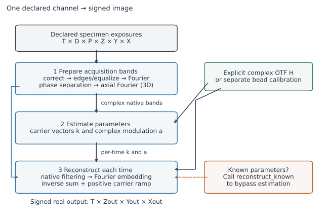
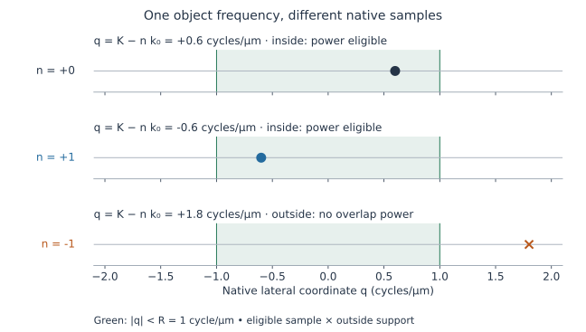
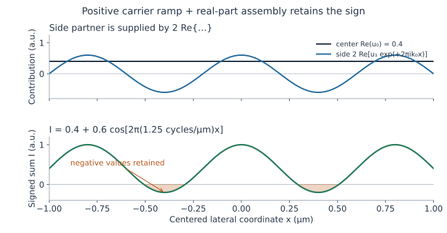

# Reconstruction: from phase exposures to a signed image

**Reader guide, checked 2026-11-11.** This follows the current Python implementation
and its mathematical contracts. Start with the figures and short explanations;
open the deep reads for exact equations, units and discrete boundary conventions.
[Usage](../usage/c-workflow.md) explains calls; the
[workflow contract](../contracts/c-equivalence-workflow-v1.md) and linked stage
contracts define the accepted behavior. Source links refer to this checkout.

The figures are conceptual analytical illustrations. They use no microscopy data
or product reconstruction output. Independent recovery studies are linked at the
[end](#interpretation-limits-and-source-map); this guide adds no recovery,
resolution or historical C-executable evidence.

## Pipeline overview

Structured illumination microscopy (SIM) records the specimen under several
illumination phases and directions. Phase separation distinguishes the mixed
harmonics. Filtering weights their native detector-frequency coefficients.
Assembly relocates each harmonic to object-frequency coordinates and sums a
signed real image.



*Figure 1 · Data dependencies, not execution timing. T = time, D = direction,
P = phase, Z = axial sample, Y/X = lateral samples. The workflow resolves its
optical transfer before specimen preparation. The left blue branch carries prepared bands
to reconstruction; known carriers and modulation bypass estimation. File decoding, acquisition
declaration and export are explicit operations outside this array pipeline.*

## Follow the executing stages

The workflow runs acquisition preparation, parameter estimation, then known-
parameter reconstruction once per time. Transfer calibration is a separate input;
it is not inferred from the specimen frames.

<details>
<summary>Deep read: executing functions and the preparation entry points</summary>

[`reconstruct_workflow`](../../src/simrecon/workflow/reconstruct.py#L33) resolves an explicit single-channel declaration, optional physical-stream regrouping, and exactly one optical-transfer route. It resolves the transfer first, calls [`prepare_acquisition_bands`](../../src/simrecon/acquisition/modes.py#L409), calls [`estimate_parameters`](../../src/simrecon/reconstruction/parameter_estimation.py#L933), then calls [`reconstruct_known`](../../src/simrecon/reconstruction/known_parameters.py#L882) separately for each time using that time's fitted carriers and modulation. The call sites are `workflow/reconstruct.py:267`, `:279`, `:298`, `:318`; concatenation is `:336`.

The separate 3D entry `prepare_bands` remains available; it is not called directly by the workflow. Both entries share [`build_phase_separation_matrices`](../../src/simrecon/acquisition/preparation.py#L159). The main path here is 3D without drift or off exposures; selected acquisition extensions are described below.

</details>

## Axes, units and Fourier conventions

Raw exposures have axes `(time, direction, phase, z, y, x)`. Prepared arrays
replace phase with slots `B₀,E₁,O₁,…` and retain only nonnegative x Fourier
frequencies. All y/z bins remain stored. Spatial pitches are in µm; carrier and
transfer frequencies are in cycles/µm. The output is signed `float64`, with axes
`(time, z, y, x)`.

<details>
<summary>Deep read: shapes, Fourier signs and the upstream normalization</summary>

Let raw dimensions be `(T,D,P,Z,Y,X)`, retained order count `M = norders` (including zero), number of stored slots `Q=2M-1`, lateral enlargement `s_xy`, integer axial enlargement `s_z`, detector pitches `dxy`, `dz` in µm. Require even X, Q≤P; workflow-supported reconstruction uses M≥2, 3D search additionally requires M≥3. Native 2D has Z=1, native 3D Z≥2. Lateral enlargement is ≥1 and may be fractional when both enlarged lateral extents are exact integers.

| Quantity | Shape | Meaning |
|---|---|---|
| Raw specimen | T,D,P,Z,Y,X | Detector-count observations |
| Prepared quadratures | T,D,Q,Z,Y,X/2+1 | complex128, unshifted kz,ky,kx half storage |
| Acquisition separator | T,D,Z,Q,P | Real matrix, possibly varying with drift-adjusted phase design |
| Acquisition phase angles | T,D,Z,P | Radians |
| Acquisition scalar noise | T,D,M | Variance factors, not full covariance |
| Estimated carriers | T,D,2 | `(kx,ky)` in cycles/µm |
| Estimated modulation | T,D,M−1 | Complex factors for positive orders |
| Output | T,s_z Z,s_xy Y,s_xy X | Signed float64 samples |

`prepare_bands` instead stores its separator `(D,Q,P)` and noise `(D,M)` because its phase design is time/z independent. Acquisition records are defined at `acquisition/modes.py:49`, array allocations at `:617` and `:688`; downstream validation is `:110`.

Native Fourier spacing is

$$
\Delta k_x=1/(X\,dxy),\qquad \Delta k_y=1/(Y\,dxy),\qquad
\Delta k_z=1/(Z\,dz).
$$

For true 2D with dz=0, downstream code uses the declared transfer's positive axial frequency increment for internal sampling; this does not invent an axial specimen pitch (`reconstruction/known_parameters.py:1035`). Frequencies are cycles/µm; wavelengths enter in nm and are divided by 1000 when a µm expression is needed.

Forward transforms are unnormalized sums with the usual negative exponential. If `f` is a corrected frame,

$$
\widehat f[n_y,n_x]=\sum_{y=0}^{Y-1}\sum_{x=0}^{X-1}
 f(y,x)\exp[-2\pi i(n_y y/Y+n_x x/X)].
$$

Here `n_y,n_x` are integer Fourier-bin indices; their physical frequencies are `n_y Δk_y,n_x Δk_x`.

Preparation uses `np.fft.rfft2`, then (for 3D) an unnormalized `np.fft.fft` over z. Half storage saves only nonnegative x frequencies, **not** radial frequencies; all y,z bins are stored. See `acquisition/modes.py:776`, `:902` and `acquisition/preparation.py:444`.

The upstream scale is

$$
\alpha = 1/(XYZ s_{xy}^2 s_z D).
$$

This includes enlarged output volume and direction count before grid enlargement, but no phase division. Assembly uses an unnormalized inverse sum without another voxel-count division or direction average (`acquisition/modes.py:680`, `acquisition/preparation.py:400`).

</details>

## Camera correction, edges and equalization

Preparation subtracts camera offsets, multiplies by the flat-field slope and
applies the upstream scale. Edge treatment precedes optional frame-sum
equalization. These steps determine the coefficients that phase separation sees.

<details>
<summary>Deep read: correction scale, corner sentinel and ordered edge operations</summary>

Apart from the corner sentinel below, correction is

$$
f_{tdpz}(y,x)=\alpha\,s(y,x)
 [r_{tdpz}(y,x)-b(y,x)-e_{tdpz}],
$$

b/e are count offsets; s is a multiplicative flat-field slope. `CameraCorrectionState.load` executes this at `acquisition/modes.py:346`; the original entry does it at `acquisition/preparation.py:421`.

The exact bottom-right raw −1 sentinel copies the left neighbor, copies the neighbor's background into the owned corner background, and sets the corner slope to 1. These owned maps persist into later loads. Other negative values remain data. On/off load order matters because the owned maps persist.

[`apodize_frame_edges_inplace`](../../src/simrecon/acquisition/preparation.py#L239) has three distinct meanings:

- width −1 multiplies by `sin(π(y+1/2)/Y) sin(π(x+1/2)/X)`;
- positive width w applies additive opposite-edge updates, y first then x. For one axis, Δ=(last−first)/2 and weight `1−sin(π(k+1/2)/(2w))`; add Δ·weight to the near edge and subtract it from the opposite edge. Sequential overlaps remain sequential;
- width 0 or below −1 bypasses this operation.

This is not uniformly a multiplicative apodization. Frame sums are measured **after** correction and edge handling. With equalization, each exposure is multiplied by anchor/current_sum; the anchor is direction 0, phase 0, with z=0 and/or t=0 when corresponding sharing flags are enabled. Zero sums reject; signed nonzero sums are permitted. `equalize_frame_sums_inplace` is at `acquisition/modes.py:364`, original branch `acquisition/preparation.py:428`.

</details>

## Band separation: phase measurements to quadratures

At a fixed frequency, changing illumination phase changes the mixture of object
harmonics. The separator combines exposures along the **phase axis only**.
It produces a zero-order slot B₀ and cosine/sine quadrature pairs Eₘ/Oₘ.
Here “zero order” refers to illumination order, not zero spatial frequency.


*Figure 2 · Ordinary separated sample, before camera/spatial processing.
P=5, M=2, φₚ=2πp/5 and dₚ=3+cosφₚ+0.5sinφₚ, in arbitrary units (a.u.).
Multiplication by rows 1, cosφₚ and sinφₚ gives B₀=15, E₁=2.5, O₁=1.25.
The specimen rows have no 1/P. This real-valued toy isolates the algebra;
actual E/O are both complex Fourier arrays.*

The positive harmonic is **Bₘ⁺=Eₘ+iOₘ**. E and O are not the real and imaginary
parts of a Fourier image. They are transforms of two differently weighted
exposure combinations. The x-Nyquist column is a visible exception: it copies
exposures into slots and does not receive the separator. Those entries lack
the ordinary separated-harmonic interpretation.

<details>
<summary>Deep read: separator equations, explicit phases, noise and the Nyquist exception</summary>

At each fixed time, direction, z and lateral frequency, stack the P Fourier exposures into a vector

$$
\mathbf d=(\widehat f_0,\ldots,\widehat f_{P-1})^T.
$$

The separator acts along **phase only**, independently at each such location:

$$
\mathbf q=L\mathbf d,
\qquad \mathbf q=(B_0,E_1,O_1,\ldots,E_{M-1},O_{M-1})^T.
$$

The matrix builder is [`build_phase_separation_matrices`](../../src/simrecon/acquisition/preparation.py#L159). The application is [`prepare_acquisition_bands`, phase contraction](../../src/simrecon/acquisition/modes.py#L881): `einsum("qp,pyx->qyx", row, on_fft[..., :-1])` at :881. In the simpler entry it is `einsum("qp,pzyx->qzyx",...)` at `acquisition/preparation.py:447`.

For default uniform phases `φ_p=2πp/P`, the rows are exactly

$$
L_{0p}=1,\quad L_{2m-1,p}=\cos(m\phi_p),\quad L_{2m,p}=\sin(m\phi_p).
$$

Therefore

$$
B_0=\sum_p\widehat f_p,\quad
E_m=\sum_p\widehat f_p\cos(m\phi_p),\quad
O_m=\sum_p\widehat f_p\sin(m\phi_p).
$$

A phase response `a+b cosφ+c sinφ` yields `B₀=Pa`, `E₁=Pb/2`, `O₁=Pc/2`; specimen separation does not divide by P.

Define signed harmonic combinations

$$
B_m^+=E_m+iO_m,\qquad B_m^-=E_m-iO_m.
$$

For uniform phases, `B_m^+=Σ_p d_p exp(+imφ_p)`. The phase expansion consistent with these definitions is

$$
\widehat f_p=\frac1P\left[B_0+
\sum_{m=1}^{M-1}\big(B_m^+e^{-im\phi_p}+B_m^-e^{+im\phi_p}\big)\right]
$$

when the data lie in the retained phase model. With more phases than Q this expresses the model component, not an assertion that arbitrary data have no residual.

The cosine/sine-weighted exposure fields are real, so their complex Fourier quadratures obey

$$
B_m^-(\mathbf k)=\overline{B_m^+(-\mathbf k)}.
$$

Half-space reads reflect **all** axes z,y,x and conjugate each quadrature before forming E+iO (`reconstruction/parameter_estimation.py:382`, `reconstruction/known_parameters.py:715`, `:834`).

### Explicit phases are a left-inverse problem

For supplied phase angles, the code builds the forward model

$$
A_{p0}=1/P,\quad A_{p,2m-1}=2\cos(m\phi_p)/P,\quad
A_{p,2m}=2\sin(m\phi_p)/P,
\qquad \mathbf d=A\mathbf q.
$$

For P=Q, `L=A^{-1}`. For P>Q, reduced QR gives `A=UR`, `L=R^{-1}U^T`: an unweighted least-squares left inverse with the same quadrature scale as uniform rows. No normal equations or regularization are used (`acquisition/preparation.py:205–214`).

Full column rank is required; repeated phases are allowed if an overdetermined design retains enough information. The observed `LA−I` must fit a binary64 roundoff envelope with infinity norm <1. This checks inverse resolution, not accuracy; there is no singular-value truncation or lower-rank fallback (`:216–230`).

The reported normalized noise factors are

$$
\nu_0=\frac1P\sum_p L_{0p}^2,\qquad
\nu_m=\frac1P\sum_p\left(L_{2m-1,p}^2+L_{2m,p}^2\right).
$$

Uniform factors equal one. Filtering uses `1/ν_m`; no full covariance `LΣLᵀ` or cross-order covariance is propagated (`acquisition/preparation.py:231–236`).

In acquisition preparation, rows/phase values can vary with z, while `noise[t,d]` is overwritten at each z: the returned per-time/direction noise vector is the final-z result. That is an implementation convention to mention if explaining drift-varying designs (`acquisition/modes.py:864–868`).

### The lateral Nyquist exception must be visible

L acts only on `[..., :-1]`. At stored x-Nyquist x=X/2, the first Q exposure Fourier coefficients are copied directly into slots:

$$
q_q(z,k_y,X/2)=\widehat f_q(z,k_y,X/2),\quad q=0,\ldots,Q-1.
$$

That column also receives the axial FFT in 3D, but lacks the ordinary separated-harmonic interpretation (`acquisition/modes.py:881–888`, `acquisition/preparation.py:447–451`).

### Exact illustrative 3-phase algebra (not pipeline evidence)

Use `P=3`, `M=2`, `φ=(0,2π/3,4π/3)`:

$$
L=\begin{pmatrix}1&1&1\\1&-1/2&-1/2\\0&\sqrt3/2&-\sqrt3/2\end{pmatrix}.
$$

For the illustrative phase signal `d_p=10+4cosφ_p+2sinφ_p`, exposures are `(14,8+√3,8−√3)` and separated outputs are `B0=30`, `E1=6`, `O1=3`, hence `B1+=6+3i` and `B1−=6−3i`. Like Figure 2, this isolates an ordinary separated sample; camera scale, spatial transforms, Nyquist copying and optics are excluded.

</details>

## Selected acquisition extensions

Acquisition preparation also admits selected 2D/3D, explicit phase-step, drift
and off-exposure branches. Their phase, indexing and order-combination rules
matter; they do not imply general motion correction or background subtraction.

<details>
<summary>Deep read: phase precedence, drift signs and off-exposure combination</summary>

Phase precedence is steps > supplied array > uniform (`acquisition/modes.py:671`); steps give `φ_dp=p·step_d`. Linked drift adjustment replaces that design at each acquisition cell. In 2D its base is the absolute first-off header phase; in 3D it is uniform `2πp/P`. The phase vector is `(cosθ_d,sinθ_d)/linespacing`, with θ_d from start/step geometry even when estimation uses explicit direction angles. Thus

$$
\phi_{tdzp}=\phi_{\mathrm{base},p}
 +2\pi\,dxy\,\boldsymbol\delta_{tdzp}\cdot\mathbf k_{\mathrm{phase},d}.
$$

δ is in detector pixels; dxy converts it to µm. Exact header indexing is at `acquisition/modes.py:837–862`.

Within-exposure correction occurs before separation and multiplies lateral Fourier samples by a **positive** phase ramp. Between-direction correction happens after the axial transform. [`build_drift_correction_ramp`](../../src/simrecon/acquisition/drift.py#L37) computes `exp(+2πi(δx kx_index/X + δy ky_index/Y + δz kz_index/Z))`; this uses a first-sample origin, distinct from the centered labels used for final carrier assembly. Correlation, optional cubic fitting, off-exposure pairing and permitted branches have explicit restrictions; do not imply general motion correction.

Off frames have `(T,D,P,Z,N,Y,X)` shape, are summed before edge treatment, separated similarly, and selected orders are combined using statistics from explicit inside/outside frequency masks. `combine_off_orders_inplace` computes nonnegative clipped signal powers and noise powers; weights are proportional to sqrt(signal_power)/noise_power. When both clipped signal powers are zero, the implementation substitutes one for both before forming the weights. It adds off to on for order zero and subtracts it for positive orders. The literal combination writes z=0, even when called while traversing another z (`acquisition/modes.py:223–326`). This is a selected order combination, not generic background subtraction.

</details>

## Optical transfer: explicit tables or bead calibration

The optical transfer function (OTF) H describes the complex response used to
compare and filter each order. The caller supplies a transfer table or a separate
bead calibration. Sampling interpolates complex values, including phase.
A declared table is not normalized on entry; bead preparation has its own
normalization, including a 1/P in bead separation that the specimen separator
does not use.

<details>
<summary>Deep read: transfer sampling, stencil boundaries and bead compensation</summary>

An optical transfer function (OTF) H describes the frequency-dependent microscope response used for matching and filtering each order. [`declare_otf`](../../src/simrecon/optical_transfer.py#L316) accepts complete radial `(order,radius,z)` or full `(order,z,y,x-half)` complex tables, explicit positive frequency increments in cycles/µm, and performs no normalization. The declared samples must be exactly complex64-representable; owned computation uses complex128.

[`sample_otf`](../../src/simrecon/optical_transfer.py#L563) / [`interpolate_transfer_queries`](../../src/simrecon/optical_transfer.py#L661) use

$$
u=r/\Delta k_{r,H}\quad\text{(radial)},\qquad
(u,v)=(k_x,k_y)/\Delta k_{r,H}\quad\text{(full)},\qquad
\tau = k_{z,\mathrm{index}}\Delta k_{z,\mathrm{native}}/\Delta k_{z,H}.
$$

Radial sampling is bilinear in (u,τ). Full sampling is trilinear, reflecting and conjugating for negative x. Negative y/z coordinates receive a once-only adjustment; literal flat addresses govern admissibility, including deterministic cross-row aliases. This is not repeated periodic wrapping or per-axis clipping. It interpolates complex samples, not their magnitudes. Every literal stencil vertex is checked, including zero-weight vertices; allocation boundary failures are errors rather than silent zero extension. Source [`interpolate_radial_stencil`](../../src/simrecon/optical_transfer.py#L470), [`interpolate_full_stencil`](../../src/simrecon/optical_transfer.py#L506).

Workflow transfer selection resolves raw bead calibration, a PreparedOtf, an OpticalTransfer, or explicitly decoded sections (`workflow/transfer.py:371`). Raw beads call [`prepare_bead_otf`](../../src/simrecon/optical_transfer.py#L1229), with correction/edge/centering, normalized phase separation, 3D Fourier transform, optional sphere-response compensation, radial averaging, cleanup and normalization. The bead separator **does divide by P**, unlike specimen separation: `optical_transfer.py:863–921`. Do not reuse one formula for both stages.

For bead diameter a in µm, compensation uses the order-shifted frequency norm,
not the native frequency magnitude. With odd bead phase count P_b, line spacing
L in µm, orientation θ and slot order m=(slot+1)//2,

$$
\rho_m=\left\|(k_x,k_y,k_z)+
\frac{m}{\lfloor P_b/2\rfloor L}(\cos\theta,\sin\theta,0)\right\|.
$$

For this bead calculation, the lateral components use `k_x=n_x Δk_r,H` and
`k_y=n_y Δk_r,H`, with `Δk_r,H=1/(Y_bead dxy_bead)` on **both**
lateral axes, even for rectangular bead images. This differs from the specimen
`Δk_x=1/(X dxy)` convention above. The axial component is
`k_z=n_z/(Z_bead dz_bead)`, where n_y and n_z are signed Fourier-bin labels and n_x≥0. See
[`build_bead_radial_quadratures`](../../src/simrecon/optical_transfer.py#L946)
and the increment construction at
[`prepare_bead_otf`](../../src/simrecon/optical_transfer.py#L1407).
All k components and ρ_m are in cycles/µm. For each slot, compensation divides
by the sphere response (ρ=ρ_m below)

$$
S(u)=3(\sin u-u\cos u)/u^3,\qquad u=\pi a\rho,\quad S(0)=1.
$$

The implementation uses an equivalent convergent small-u series and rejects zero/undefined divisors (`:1000–1029`). Radial averaging is nearest integer-radius bin assignment, not interpolation (`:1031–1041`). `normalize_and_combine_bead_quadratures` normalizes by empirical maxima (per slot or shared zero-slot scale according to settings), estimates quadrature-combination angles and combines `C cosθ−S sinθ`; it is not simply specimen-style E+iO (`:1129–1225`).

</details>

## Carrier and modulation estimation

A carrier vector **k_d** sets a direction's frequency displacement in cycles/µm.
Complex modulation **a_dm** supplies each positive order's amplitude and phase.
The estimator compares overlapping order information using the OTF, searches
finite carrier candidates when requested, and fits modulation. It is a specific
finite procedure, with no guarantee of a global optimum. Time-zero carrier reuse
still fits fresh modulation at each time.

<details>
<summary>Deep read: carrier initialization, overlap regression and finite search</summary>

Initial carrier vectors in the workflow are derived explicitly, not inferred from array shape alone:

$$
\mathbf k_d^{(0)}=\frac{(\cos\theta_d,\sin\theta_d)}
 {\mathrm{linespacing}\times c},\quad
c=1\ (2D),\quad c=\lfloor P/2\rfloor\ (3D).
$$

Unless explicit direction angles are supplied, `θ_d=start±dπ/D`. The 3D denominator comes from the number of input phases (`norders_in=P//2+1`), not necessarily the number of retained orders. Linked phase adjustment separately uses 1/linespacing. `workflow/reconstruct.py:156–181`.

[`_ParameterEstimator.build_order_overlap`](../../src/simrecon/reconstruction/parameter_estimation.py#L417) constructs two order-overlap arrays from band coefficients and the other order's OTF, weighted by `1/sqrt(|H_lower|²+|H_higher|²)` and gated by optical support and literal amplitude thresholds. It inverse-transforms them using an unnormalized sum. In 3D, the higher-order OTF threshold multiplier is 5; in 2D it is 1. This is an implemented finite procedure, not an unrestricted optimizer.

[`_ParameterEstimator.fit_overlap_modulation`](../../src/simrecon/reconstruction/parameter_estimation.py#L510) applies the positive centered ramp for the order difference to the higher overlap. With lower spatial array u and ramped higher v,

$$
S_X=\sum|u|^2,\qquad S_Y=\sum|v|^2,\qquad C=\sum\bar u v,
\qquad a_{\rm forward}=C/S_X.
$$

The carrier-search objective is `|a_forward|²`. Reverse and combined fits and normalized correlation are diagnostics; the returned modulation is the forward factor, after requested postprocessing. Evaluation computes the combined fit too, so equal energies SX=SY raise even if a forward ratio alone could exist (`:566–591`).

Coarse search cross-correlates order 0 with order 1 in 2D or order 2 in 3D, uses the first strict maximum in traversal order, neighboring parabolic peak offsets and finite alias decisions (`_ParameterEstimator.estimate_coarse_carrier`, :620). Refinement walks angle in 0.001-radian steps, then magnitude in `0.1/(max(X,Y)dxy)` cycles/µm, stops when strict improvement fails, and uses a three-point parabola (`_ParameterEstimator.search_carrier_and_modulation`, :694). It is not a generic global least-squares fit or guaranteed global optimum.

Searching may be disabled; modulation is still fitted using supplied carriers. Reusing time-zero carriers still fits fresh modulation per time (`estimate_parameters`, :1059–1074). 2D performs its literal cumulative order-factor products, optional magnitude floors preserve phase, and `fit_all_phases=False` replaces higher-order phase with m times the order-one phase (`:1077–1120`). Raw fitted factors, adjusted modulation and reused carriers are distinct outputs.

</details>

## Filter the native bands

Different orders can measure the same object frequency. For a native coefficient
**k** in direction d and order m, the lateral object coordinate is

$$
\mathbf K=\mathbf k_{xy}+m\mathbf k_d.
$$

Another direction e and signed order n contributes overlap power by sampling
its transfer at **q_en=K−n k_e**. The filter combines those powers, the complex
self transfer/modulation, scalar noise weights and a Wiener term w². It applies
the resulting weight **to native coefficients before relocation**.



*Figure 3 · One-dimensional slice at axial bin zero, one direction,
K=0.6, k₀=1.2 and R=1, all in cycles/µm. The candidate other-order coordinates
are +0.6, −0.6 and +1.8 cycles/µm. Green marks strict other-order radial
eligibility |q|&lt;R. This shows where powers are sampled, not their values.
The actual self term, complex transfers, direction sum and axial rules remain
in the deep read.*

Filtering a positive harmonic can mix its quadrature pair because the weight
is complex. The code reconstructs E+iO, filters that harmonic, then recombines
E′/O′ for half storage. Self-support uses ≤R; other-order eligibility uses &lt;R.
The current odd-Y traversal also omits one row (and is empty for Y=1).

<details>
<summary>Deep read: full filter, support, taper and quadrature recombination</summary>

In the filter equations, `z` denotes a signed integer axial Fourier-bin label, not a spatial coordinate; the transfer is sampled at axial frequency `z Δk_z`. All lateral vectors are in cycles/µm. With modulation `a_d0=1`, complex transfer H_m, scalar inverse-noise/damping weight g, taper T, and positive Wiener parameter w, [`_Filter.native_filter_scale`](../../src/simrecon/reconstruction/known_parameters.py#L541) computes

$$
W_{dm}(\mathbf k,z)=
\frac{T(\mathbf K,z)\,g_{dm}(|\mathbf k|,z)\,
 \overline{H_m(\mathbf k,z)}\,\overline{a_{dm}}}
 {|H_m(\mathbf k,z)|^2|a_{dm}|^2g_{dm}(|\mathbf k|,z)
 +\sum_{(e,n)\ne(d,m),\ |\mathbf q_{en}|<R}
 |H_{|n|}(\mathbf q_{en},z)|^2|a_{e,|n|}|^2g_{e,|n|}(|\mathbf q_{en}|,z)+w^2}.
$$

For m=0, the modulation conjugate is effectively 1. The sums range e=0…D−1 and n=−(M−1)…M−1. Denominator powers use the positive-order OTF indexed by |n|; there is no extra negative-order complex conjugation in these powers. Other-order axial support is not retested. Self support uses radius ≤R while eligible other overlaps use strict radius <R. If `filter_overlaps=False`, only other center-order powers remain for a center self-order; side orders keep their self term only.

The radial support limit is

$$
R=\min\{2\,NA/(\lambda_{nm}/1000),\ 1/(2dxy)\}.
$$

Let λe=λnm/(1000nimm), λx=0.88λe, θ=asin(NA/nimm), c̃0=ceil(((1−cosθ)/λe)/Δkz). Intermediate order axial cutoffs truncate `(1+λe/λx)c̃0`; the last order truncates `1.3c̃0`. Each is independently clipped when ≥floor(Z/2) to max(floor(Z/2)−1,0). Below, `c0` and `c1` mean the resulting **clipped** order-zero and order-one cutoffs; the initial ceiling value is only the construction input. For M=2, its only side order is the last-order 1.3 case. [`calculate_native_support`](../../src/simrecon/reconstruction/known_parameters.py#L619).

The base weight is `g=1/ν_dm`. [`_Filter.inverse_noise_weight`](../../src/simrecon/reconstruction/known_parameters.py#L469) optionally multiplies near-origin weights by

$$
s(r)=1/[1+1000/(r^2+0.2)].
$$

The outer application radius is `suppression_radius_bins·min(Δkx,Δky)`, but the r inside this formula is the physical cycles/µm radius: do not normalize it by that radius. Center-order damping instead uses `(r/R)²+|z/c0|³`; omission and kz=0 omission have ordered branches. Damping acts once in numerator and once in each corresponding denominator term, not only on data after division.

For the ordinary cosine taper, `R_p=R+(M−1)|k_0|`, `Z_p=c_1`,

$$
\rho=\sqrt{(|\mathbf K|/R_p)^2+(|z|/Z_p)^2},\quad
T=\cos(\tfrac\pi2\min(\rho,1)),
$$

with no axial term when Zp=0. None gives T=1; power gives `(1−min(ρ,1))^η`; the selected precise 2D mode computes sector/circle intersections. Ordinary taper uses the first direction's carrier magnitude for its radius, another concrete convention (`reconstruction/known_parameters.py:1046`).

Workflow time-dependent w is `w_t=w_base+(t+1)·increment/T`, i.e. increment starts before time zero's reconstruction; the workflow passes that value with zero further increment to the per-time known stage (`workflow/reconstruct.py:183–189`, `:325–336`).

### Filtering and reconstruction of the quadrature pair

[`filter_native_quadratures`](../../src/simrecon/reconstruction/known_parameters.py#L672) reads original E/O, forms `B+=E+iO` over full native x using all-axis reflected reads, and applies W. Write `F(k)=W_dm(k) B_m⁺(k)` on visited support; the full-native working array starts at zero. It then stores

$$
E'=(F(\mathbf k)+\overline{F(-\mathbf k)})/2,\qquad
O'=(F(\mathbf k)-\overline{F(-\mathbf k)})/(2i).
$$

This preserves the half-storage pair; complex W depends on positive-side object frequency and need not act independently on E/O.

There is a literal odd-Y traversal quirk: the y set is `1−floor(Y/2),…,floor(Y/2)`. For even Y it covers all rows; for odd Y it omits one row. Center values there remain prepared; side reflected zero writes can touch parts of it, but normal recombination omits it. Y=1 yields empty filter/recombination loops. This behavior is visible in `:703` and `:742`. This is a current source convention and limitation, not a theorem about SIM.

</details>

## Assemble the signed image

Phase separation identifies harmonics; relocation places their information at
their object frequencies. The diagram separates these two coordinate systems.


*Figure 4 · Conceptual support envelopes max(1−|k|/R,0), with R=1 cycle/µm
and carrier k₀=1.2 cycles/µm. The signed-order centers move by n k₀.
The envelopes are illustrative, not measured OTFs. Their union illustrates
possible coverage, not a resolution or recovery result.*

Assembly reconstructs full harmonics, embeds them in an enlarged zero Fourier
grid, takes an **unnormalized inverse sum**, then applies a positive spatial
carrier ramp. Noninteger carriers use this ramp; they are not rounded to bins.
With the ordinary `explode_factor=1`, the per-direction sum is

$$
\Re u_{d0}(\mathbf r)+
\sum_{m=1}^{M-1}2\Re\left\{u_{dm}(\mathbf r)
 e^{+2\pi i m\mathbf k_d\cdot\mathbf r}\right\}.
$$

The factor two supplies the signed harmonic partner. There is no final absolute
value, positivity clipping, fitted gain or direction average. Centered coordinate
labels drive the ramp; the inverse array itself is unshifted.



*Figure 5 · Analytical spatial functions chosen only to expose the sign and ramp:
u₀=0.4, u₁=0.3exp[2πi(0.5 cycles/µm)x] and k₀=0.75 cycles/µm.
Their sum is 0.4+0.6cos[2π(1.25 cycles/µm)x], ranging from −0.2 to +1 a.u.
These continuous functions are imposed, not computed from a prepared dataset
or finite inverse transform. The orange shading marks retained negative values.*

Grid enlargement changes output sampling, not evidence of resolution. True 2D
transforms only plane zero; additional axial output planes remain zero.

<details>
<summary>Deep read: exact embedding, inverse scale, coordinate origin and assembly</summary>

[`assemble_signed_image`](../../src/simrecon/reconstruction/known_parameters.py#L777) rebuilds each full native harmonic from half storage and embeds it in an enlarged zero Fourier array. Its signed lift is `j` for `j≤floor(N/2)`, else `j−N`: the even native Nyquist endpoint stays positive and is not split (`signed_fourier_index`, :754). Grid enlargement changes sampling density; it does not itself prove resolution gain.

For each embedded C_dm, compute the positive-exponential, unnormalized inverse sum

$$
u_{dm}(h,i,j)=\sum_{l,v,w}C_{dm}(l,v,w)
 e^{2\pi i(lh/Z_{out}+vi/Y_{out}+wj/X_{out})}.
$$

Implementation is `ifftn(..., norm="forward")`, :851–856. Then

$$
I(h,i,j)=\sum_d\left[\Re u_{d0}(h,i,j)+
\sum_{m=1}^{M-1}2\Re\left\{u_{dm}(h,i,j)
 e^{+2\pi i\,m\,\mathbf k_d\cdot\mathbf r_{ij}}\right\}\right],
$$

omitting the center term if requested. `explode_factor` multiplies the phase in this last expression only; filter overlap coordinates still use the original carriers. The factor 2 supplies the signed harmonic partner through real-part assembly. **No absolute value, positivity clipping, fitted global gain or final average is applied.** See :858–871.

The phase uses centered coordinate labels

$$
x_j=(j-\lfloor X_{out}/2\rfloor)dxy/s_{xy},\quad
y_i=(i-\lfloor Y_{out}/2\rfloor)dxy/s_{xy},\quad
z_h=(h-\lfloor Z_{out}/2\rfloor)dz/s_z.
$$

The inverse array itself is unshifted. There is no fftshift/checkerboard origin repair. Centered labels and unshifted finite-sum indices must not be conflated (`:1100–1105`). Noninteger carriers are implemented by this spatial complex ramp; they are not rounded to Fourier bins.

True 2D uses only a lateral inverse on output plane zero and leaves extra axial planes zero if s_z>1 (`:851–854`). It does not manufacture axial information.

</details>

## Interpretation limits and source map

The walkthrough describes a selected finite mathematical mapping. The
[CE08 acceptance studies](../reports/c-equivalence-independent-acceptance.md)
report independent expectations and recovery of specified periodic modes.
The [simulation capstone](../studies/simulation-capstone/README.md) reports
simulated specimens, calibration, noise cases and a Wiener sweep. Their stated
inputs, unit maps and limits govern those observations.

The workflow emits a general `recovery-and-resolution-unqualified` limit
([source](../../src/simrecon/workflow/reconstruct.py#L371)); it does not summarize
or supersede the separate studies. Historical C-binary agreement remains
unqualified. Conceptual plots and source traces provide neither experimental
resolution nor C-executable comparison evidence.

<details>
<summary>Source map: executing functions by reader question</summary>

| Reader question | Executing function |
|---|---|
| What public stages actually run? | [`reconstruct_workflow`](../../src/simrecon/workflow/reconstruct.py#L33) |
| How are detector counts corrected? | [`CameraCorrectionState.load`](../../src/simrecon/acquisition/modes.py#L346) |
| What is the edge operation? | [`apodize_frame_edges_inplace`](../../src/simrecon/acquisition/preparation.py#L239) |
| What are the phase weights/inverse? | [`build_phase_separation_matrices`](../../src/simrecon/acquisition/preparation.py#L159) |
| Where do weights multiply exposures? | [`prepare_acquisition_bands`, separation](../../src/simrecon/acquisition/modes.py#L881) |
| How is E+iO reconstructed from half storage? | [`_ParameterEstimator.reconstruct_complex_band`](../../src/simrecon/reconstruction/parameter_estimation.py#L382) |
| How are complete transfer tables declared? | [`declare_otf`](../../src/simrecon/optical_transfer.py#L316) |
| How are transfer values sampled? | [`interpolate_transfer_queries`](../../src/simrecon/optical_transfer.py#L661), [`interpolate_radial_stencil`](../../src/simrecon/optical_transfer.py#L470), [`interpolate_full_stencil`](../../src/simrecon/optical_transfer.py#L506) |
| How is the bead center found before background subtraction? | [`locate_bead_center`](../../src/simrecon/optical_transfer.py#L803) |
| How are bead quadratures separated and transformed? | [`separate_bead_phase_quadratures`](../../src/simrecon/optical_transfer.py#L863), [`build_bead_radial_quadratures`](../../src/simrecon/optical_transfer.py#L946) |
| How are bead support and normalization applied? | [`mask_bead_support_inplace`](../../src/simrecon/optical_transfer.py#L1045), [`normalize_and_combine_bead_quadratures`](../../src/simrecon/optical_transfer.py#L1129) |
| How is modulation fitted? | [`_ParameterEstimator.fit_overlap_modulation`](../../src/simrecon/reconstruction/parameter_estimation.py#L510) |
| What finite carrier search executes? | [`_ParameterEstimator.estimate_coarse_carrier`](../../src/simrecon/reconstruction/parameter_estimation.py#L620), [`_ParameterEstimator.search_carrier_and_modulation`](../../src/simrecon/reconstruction/parameter_estimation.py#L694) |
| What is the filter numerator/denominator? | [`_Filter.native_filter_scale`](../../src/simrecon/reconstruction/known_parameters.py#L541) |
| What exact samples are visited? | [`filter_native_quadratures`](../../src/simrecon/reconstruction/known_parameters.py#L672) |
| Where are carriers relocated and the image summed? | [`assemble_signed_image`](../../src/simrecon/reconstruction/known_parameters.py#L777) |


</details>

## Figure provenance

All five figures are reproducible with
[`generate_figures.py`](../figures/readable-reconstruction/generate_figures.py),
using Python, NumPy 2.3.5 and Matplotlib 3.10.8. No product code, dataset or fitted
value is imported. The captions specify the analytical inputs; the SVGs retain
text labels plus accessible titles and descriptions. Pipeline arrows show
conceptual data dependencies; plotted axes state units and illustrative scales.

From the repository root, in a plotting environment with NumPy and Matplotlib:

```sh
MPLCONFIGDIR=/tmp/simrecon-walkthrough-mpl python docs/figures/readable-reconstruction/generate_figures.py
```

Add `--preview-dir artifacts/readability-09-walkthrough/renderproof` to also save
900-pixel-wide PNGs for inspection. These are documentation render proofs, not
scientific validation. Exact admission and representation rules remain in the
linked contracts.
