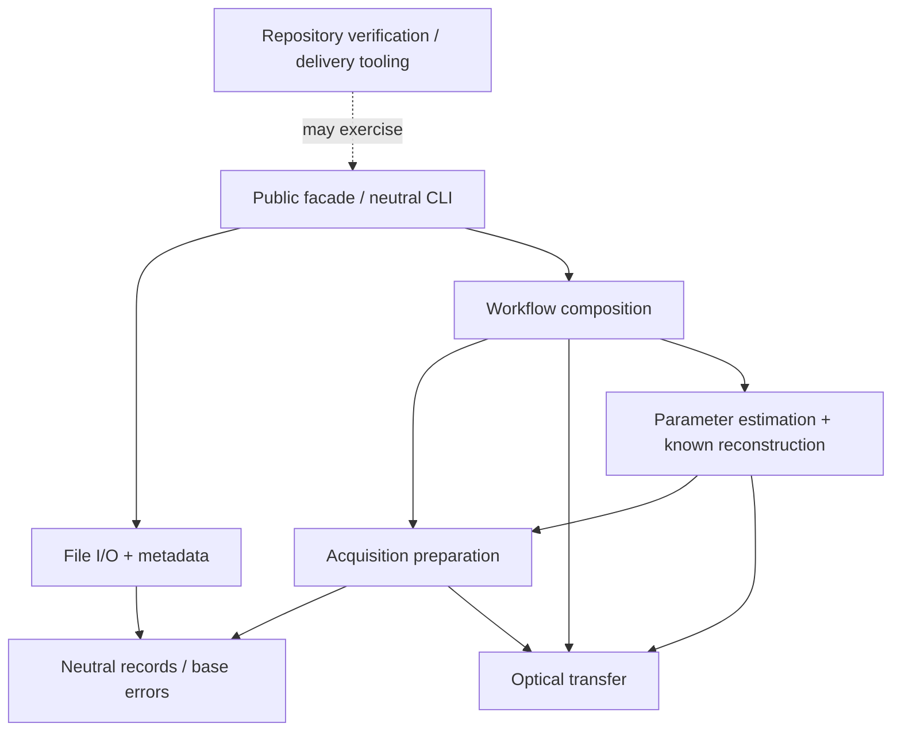

# A readable scientific codebase: analysis and proposed task specification

**Status: proposal, not an approved replacement architecture or implementation.**
Source reviewed: `edcf53b5d5c0f494c388944d3cfda5c04b9fda97`, 2026-11-09.
This task changes documentation only. Existing contracts, public APIs, numerical
behavior, verification gates and delivery policy remain in force.

**Implementation kickoff:** the owner subsequently authorized the proposed work
as stacked PRs, each started in a new cloud task. The
[stack handoff](../tasks/readability-stack.md) records that authorization,
dependencies and settled choices. The analysis below retains its original source
snapshot; its earlier no-code restriction no longer applies to the authorized
implementation tasks. The handoff's Current state is the active execution pointer.

## Purpose and scope

A scientist should be able to follow an exposure through reconstruction, find the
function implementing each mathematical step, and understand its inputs without
reading delivery history. A fresh coding agent should follow the same map.

The requested outcome is an analysis, an initial scientific explanation, and a
reviewable specification for later restructuring. No Python source, tests,
configuration, dependencies, entry points or README are changed by this task.
Serena was installed externally for this investigation; durable repository setup
is tracked in [issue #86](https://github.com/david-hoffman/simrecon/issues/86).

[Issue #81](https://github.com/david-hoffman/simrecon/issues/81) is narrower: rename
single-underscore implementation **modules**, preserve documented package exports
and CLI behavior, retain Python special filenames, and run `make verify`.
The owner's present request adds function readability, package organization,
product/tooling separation, and scientific documentation. Keep those additions
explicitly scoped rather than silently expanding #81 into a numerical rewrite.

## What the current source actually shows

The inventory below is an AST/text inspection of the reviewed source, not a
quality score or a new coverage policy. Counts include methods and nested
functions, exclude generated caches, and cover `src/simrecon/*.py` only.

| Observation | Consequence |
| --- | --- |
| 25 Python files; all 24 non-`__init__` filenames start with `_`; no subpackages | Browsing does not expose responsibility boundaries. |
| 7,754 source lines; 207 function definitions, 113 with a single leading underscore (121 including dunder methods) | Internal implementation dominates the navigation surface. |
| 138 definitions have no docstring; 58 have a one-line docstring; 11 have a multiline docstring | Documentation is uneven; removing underscores alone will not explain the science. |
| Optical transfer: 1,061 lines; parameter estimation: 933; known reconstruction: 877; acquisition modes: 841 | These files contain multiple substantial operations worth naming explicitly. |
| `_preparation.py` documents all 11 functions and explains QR inversion and dtype checks | There is already a useful local style to build on; comments are not uniformly absent. |
| The installed wheel is configured to include `_delivery.py` and `_pytest_policy.py` | Repository maintenance is distributed inside the scientific runtime. |
| Current internal imports form an acyclic graph | Preserve that useful property when moving code. |

Evidence: [package exports](../../src/simrecon/__init__.py),
[packaging and tool configuration](../../pyproject.toml),
[preparation](../../src/simrecon/_preparation.py),
[optical transfer](../../src/simrecon/_optical_transfer.py),
[estimation](../../src/simrecon/_parameter_estimation.py), and
[known reconstruction](../../src/simrecon/_known_reconstruction.py).

The README already provides a useful quick start and scientific examples.
[Data flow](../architecture/data-flow.md), [PROJECT](../PROJECT.md), contracts,
and usage pages already explain important boundaries. The missing piece is a
short, current reading path from the README to the actual kernels. Historical
material is often explicitly marked, but embedding long historical sections in
current architecture pages still increases navigation effort.

### What the doctor does, and whether it needs a script

[`_delivery.main`](../../src/simrecon/_delivery.py) launches a fresh Codex process
with a fixed doctor prompt and mode, then propagates output and exit status.
It is not a reconstruction stage or a lesson-processing algorithm. The
[doctor prompt](../agentic-software-delivery-v1.0/DOCTOR-PROMPT.md) can also be given
to a fresh session directly. The wrapper provides repeatable invocation; it is
not intrinsically necessary to the scientific product.

Keep the procedure for now, move its launcher out of the product, and evaluate
retiring the shortcut separately if it has no useful users. Deleting the wrapper
must not accidentally delete the underlying development procedure. Similarly,
[`_pytest_policy`](../../src/simrecon/_pytest_policy.py) belongs to verification,
not image reconstruction. Importing either through `simrecon` currently also
executes the package's eager scientific imports.

## Options and recommendation

1. **Rename in place.** Lowest migration cost and sufficient for #81; leaves
   flat navigation, large mixed-responsibility modules, and shipped harness code.
2. **Shallow scientific packages with separate development tooling. Recommended.**
   Group by the scientist's task, keep the functional array API, and expose a
   readable orchestration path. Move whole modules before splitting kernels.
3. **A general pipeline/backend framework or separate distribution per stage.**
   Not justified by the present problem. Adds configuration, abstractions and
   packaging that obscure the existing array transformations.

### Proposed destination map

Names below are proposals. They do not create supported imports today. Empty or
minimal subpackage `__init__.py` files should avoid eager aggregate imports.

```text
src/simrecon/
    __init__.py                 # existing supported exports remain the facade
    models.py                   # neutral file records and common base error
    cli.py                      # existing neutral file commands
    io/
        priism.py               # current _legacy inspection/decoding
        pixels.py               # selected source reads
        metadata.py             # explicit layout/metadata resolution
        mrc_writer.py           # current _modern output
        imagej.py
        imagej_metadata.py
    acquisition/
        declarations.py         # current _acquisition
        preparation.py          # camera/edge/phase preparation
        layout.py               # current _acquisition_layout
        drift.py                # current _acquisition_drift
        modes.py                # selected acquisition-mode composition
    optical_transfer.py         # move intact first; see optional split below
    reconstruction/
        parameter_estimation.py
        known_parameters.py     # current _known_reconstruction
    workflow/
        reconstruct.py          # reconstruct_workflow composition
        adapters.py
        config.py
        identity.py
        result.py
        transfer.py
scripts/
    delivery.py                 # proposed repository-only doctor invocation
    pytest_policy.py            # proposed explicit local pytest plugin
    ...                        # existing verification and fixture tools
```

Do not manufacture a singleton `optics/` directory merely for symmetry. Once the
first moves are verified, a useful real split is `optics/transfer.py` (records and
declaration), `optics/sampling.py` (coordinate/interpolation rules), and
`optics/beads.py` (bead calibration). Similarly, only split estimation and known
reconstruction after naming their algorithmic seams and documenting shared state.
These are later extraction tasks, not incidental edits during file moves.

The existing `scripts/` location is the least disruptive initial home for two
small development utilities. Its scope is already measured. Loading the pytest
plugin must be configured explicitly from that location; do not assume import
resolution will happen automatically. Preserve the doctor operation with a
documented repository command, for example
`uv run python scripts/delivery.py doctor --check`. The moved launcher would also
need an explicit `__main__` guard; moving today's function-only file is insufficient.
The `delivery` executable would no longer belong to the product installation.
If keeping the exact `delivery doctor` spelling is required, use a separately
installed local development-tools package instead; account for its lock inputs,
installation and verification separately. Do not keep a product shim that imports
repository-only files. This command-compatibility choice must be settled in the
future tooling task before removing the installed entry point.

### Dependency direction and record ownership



This is the proposed package dependency direction, not an image-data-flow graph.
Acquisition currently obtains source-reference metadata from optical transfer;
retain that edge during whole-file moves and consider decoupling provenance later.
Optical transfer has its own `OtfError(ValueError)`; preserve that error hierarchy
rather than forcing it into the common `SimreconError` hierarchy during a move.
Product modules must not import delivery tooling, pytest policy, lessons, or
verification scripts. Leave `PreparedBands`, `OpticalTransfer`, and scientific
result records with their producing domains. Avoid a universal models module
that imports every stage or an unstructured `utils.py` dumping ground.

Simulation needs classification by responsibility: public scientific simulation
capabilities would be product code; the present capstone's inputs, reconstruction
drivers, and figures are reproducible study material. Do not label all simulation
or scientific diagnostics as agent harness code. Leave retained reference sources
and historical studies outside the runtime distribution.

## Naming, function boundaries and documentation

Use ordinary readable names for meaningful scientific operations and for helpers
shared between modules. Removing `_` is not itself a promise of a stable public
API: retain the documented package exports as the compatibility boundary and
explicitly describe other import paths as implementation details. Keep Python
dunders and truly local implementation details where useful; do not use privacy
as a reason to hide the scientific steps again.

Examples to evaluate with callers, rather than apply by blind substitution:

| Current symbol | Suggested name | Meaning to make visible |
| --- | --- | --- |
| `_preparation._phase_matrices` | `build_phase_separation_matrices` | Separation weights and order noise factors, with distinct phase policies |
| `_preparation._edge` | `apodize_frame_edges_inplace` | Ordered y/x mutation, including overlap behavior |
| `_workflow_adapters._time_bands` | `select_time_bands` | Construct the one-time input for known reconstruction |
| `_workflow_transfer._resolve_transfer` | `resolve_optical_transfer` | Choose declared transfer or explicit bead preparation |
| `_workflow_result._context` | `extract_stage_error_indices` | Read failing stage indices without replaying the operation |

Single-letter mathematical locals are fine inside a short equation when the
notation is defined. Long orchestration code should use `acquisition`, `optics`,
`carrier`, and `filtering` rather than forcing the reader to remember `a/o/c/f`.
Do not merge validators across stages solely because their names look similar;
their accepted domains, error types and exact-representation rules can differ.

Every scientific stage and cross-module numerical helper should explain:

- purpose and physical meaning; its equation/section in the walkthrough;
- array axes, shapes, dtype/domain, units and Fourier sign/normalization;
- output ownership, mutation, normalization and retained intermediate records;
- supported modes, boundary cases and failure conditions;
- why non-obvious operations are ordered or implemented that way.

Use the existing NumPy docstring style. Small validators need concise intent and
domain explanations, not boilerplate parameter essays. Inline comments should
explain reasons such as QR instead of normal equations, a retained Nyquist-column
rule, or a signed-coordinate convention. Do not narrate obvious indexing.
Descriptions must be checked against executing code, not generated from names.

## Documentation deliverables and reading path

| Location | Audience and responsibility |
| --- | --- |
| Root `README.md` (future edit) | Small data-flow diagram, existing quick start, links to science and contributor maps |
| [Reconstruction walkthrough](../architecture/reconstruction-walkthrough.md) (initial draft now) | Actual stage order, equations, shapes, conceptual figures, source links |
| `docs/architecture/data-flow.md` | Detailed active routes: neutral files, arrays, calibration, workflow; move historical narrative to a clearly linked history page in a later docs task |
| `docs/architecture/library-design.md` | Package responsibilities and dependency rules once the restructure is accepted |
| `docs/usage/` | Runnable public-boundary examples and parameter guidance |
| `docs/contracts/` | Exact behavior authority; retain links rather than duplicating every validation rule |
| `docs/operations/` | Contributor setup, verification and Serena navigation |
| `docs/figures/` | Small labeled conceptual/scientific figures used by the walkthrough |
| This specification | Proposed work, sequencing, migration risks and acceptance conditions |

The walkthrough includes a README-sized diagram ready for a later README edit.
Link by both symbol name and source path. Update these links in the same change
that moves a symbol; retain the reviewed source revision in scientific prose.
Current source links may drift until that maintenance is implemented.

## Proposed work sequence and acceptance

Each row is a separately reviewable task; none is executed by this analysis.

| Step | Deliverable | Acceptance evidence |
| --- | --- | --- |
| 1. Establish the reader map | Review the initial walkthrough against code/contracts; add README navigation and diagram; identify current versus historical docs | Equations, axis transitions and links independently reviewed; conceptual figures labeled; no implied reconstruction CLI or output writer |
| 2. Finish #81 narrowly | Remove implementation-module prefixes in place; update all qualified consumers | Existing top-level exports and CLI preserved; dunders retained; `make verify`; no algorithm changes |
| 3. Separate repository tooling | Relocate doctor and pytest plugin, settle development command spelling, update tool discovery/coverage | Product-only install imports and runs neutral CLI without Codex/pytest; development doctor and strict pytest outcomes preserved; all moved owned tools remain measured |
| 4. Group whole modules | Apply shallow packages and descriptive filenames with minimal import edits | No cycles or new facade exports; installed-wheel/resource checks and all affected public routes pass; docs links updated; `make verify` |
| 5. Name and explain operations | Rename semantic helpers, enrich docstrings/comments, then extract cohesive scientific operations | Explicit old→new symbol map; no changed signs/scales/order/boundaries/ownership/errors; representative equations matched to source; independent scientific review and existing gates |
| 6. Standardize navigation tooling | Implement [#86](https://github.com/david-hoffman/simrecon/issues/86) with pinned Serena setup and external/ignored state | Fresh install and MCP handshake, symbol/definition/reference lookup, unchanged tracked tree after read-only navigation |

Step 6 can proceed independently of the code moves; its paths/examples must be
updated afterwards. Steps 3 and 4 may be combined only if their combined migration
is clearer than two moves. Complete #81 first if retaining its narrow review scope
is valuable; alternatively explicitly amend that task to combine final paths and
prefix removal, rather than making the same import migration twice unnoticed.

### Concrete migration hazards to include in future contracts

- `_workflow_result._context` matches literal module names and local `t`/`d`
  names when extracting error context. Module **or local-variable** renames can
  silently lose context without breaking imports. Preserve/test these outcomes.
- Entry points and pytest `-p` names are strings, not ordinary symbol references.
  Tests and fixture subprocess configuration also contain qualified names.
  Serena reference lookup alone cannot find all of them; also search text.
- Public `inspect`, `read`, `harmonize`, and `write` lack function docstrings.
  Making their modules unprefixed may reveal previously suppressed Ruff D rules.
  Supply useful docs; do not disable the existing rules to make a rename pass.
- `scripts/verify.py` and `pyproject.toml` explicitly measure `src/simrecon` and
  `scripts`. Moves must preserve per-file/per-package accounting, never-imported
  files and subprocess measurement. Percentages remain advisory under current
  policy; mandatory reports and integrity checks remain binding.
- Verification expects one product wheel. A separate tooling distribution needs
  isolated artifacts and explicit verification; a second wheel in `dist/` is not
  a harmless side effect. Check installed contents, not only checkout imports.
- Source moves may change resources, package discovery, pickled module paths,
  monkeypatch targets and undocumented imports. Inventory actual consumers;
  do not promise compatibility aliases without evidence they are needed.
- Do not algebraically simplify the phase separation, half-spectrum handling,
  interpolation, finite search, filtering, or inverse FFT during a move. Even
  attractive rewrites can change scaling, rounding, selected maxima or failure
  behavior. Any discovered numerical defect needs its own task.
- Preserve the distinction between mathematical mappings, simulated study
  results, historical C-executable agreement, and physical validation. A clearer
  diagram provides no additional scientific acceptance evidence.

## Completed analysis before implementation authorization

Eight fresh-context agent tasks covered setup, architecture, mathematics, tooling,
readability, general design advice, and two independent document reviews. The
reviews corrected inventory/launcher/dependency details and mathematical notation;
no core phase, filtering or assembly sign/normalization error was found. Serena 2.1.0 was installed outside
the repository and exercised through an MCP client with read-only tools; native
tool registration in this already-running chat was not required. Issue #86 records
durable setup work. No restructuring or delivery-policy activation is performed.

Completed checks: source/equation review, 54 local link targets and source-line
bounds, balanced Markdown code/math blocks, whitespace checks, SVG XML parsing,
and visual inspection of both rendered figures. Git confirms only two new
Markdown documents and two new SVG figures, all under `docs/`; tracked files are
unchanged. It does not claim a new passing `make verify`
run or revalidation of the numerical product. No commit, PR, push or merge is
part of this request. Future implementation must select the applicable repository
review route and complete its required checks.

The initial recommendation is actionable without another requirements interview.
Before implementation, settle the desired compatibility of the `delivery` command
and whether #81 should land alone or with package moves. Neither decision blocks
this documentation analysis. Human-set budget/review limits: not set; per-agent
token and monetary measurements: unavailable. External Serena installation is
retained as requested; task-only analysis drafts, figure previews, temporary browser profile and plotting
cache were removed, and task-owned servers/browser processes were stopped. The
external Serena helper/configuration and installation remain available; shared
environments and existing evidence were preserved.
