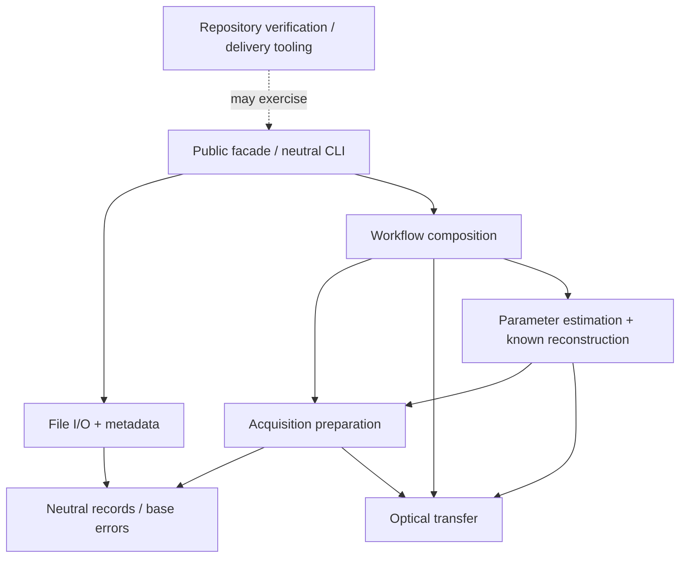

# A readable scientific codebase: restructuring map

**Task 01 documentation foundation, 2026-11-10.** The owner authorized the
restructuring direction as stacked PRs. The November 10 execution-location
revision uses one cloud session and one fresh-context per-PR coordinator at a
time; other delivery requirements remain. The
[stack handoff](../tasks/readability-stack.md) is the execution order and sole
Current state. Later tasks still require narrow contracts, review and verification;
this document changes no runtime behavior, public API or delivery policy.

Original analysis: `edcf53b5d5c0f494c388944d3cfda5c04b9fda97`.
Historical inventory refreshed against actual Task 01 runtime baseline
`0ea11a5876549bf26a3a813009b97c09decc806d`, retained in preparation commit
`ac2b0d65f239fb5f628792ae58af13ea1da868bf`. PR #87's newer verification changes
are preserved. Source links follow the current checkout. Task 02 separated the two development
modules; Task 03 moves whole product modules to the shallow packages below. The inventory below remains the Task 01 baseline.

## Purpose and scope

A scientist should be able to follow an exposure through reconstruction, find the
function implementing each mathematical step, and understand its inputs without
reading delivery history. A fresh coding agent should follow the same map.

Task 01 supplies the README reading path, scientific walkthrough and conceptual
figures, complete module map and successor handoff. It changes documentation only;
Python source, tests, configuration, dependencies and verification gates are outside
its scope. Durable Serena setup remains Task 09 and
[issue #86](https://github.com/david-hoffman/simrecon/issues/86).

[Issue #81](https://github.com/david-hoffman/simrecon/issues/81) is narrower: rename
single-underscore implementation **modules**, preserve documented package exports
and CLI behavior, retain Python special filenames, and run `make verify`.
The owner's present request adds function readability, package organization,
product/tooling separation, and scientific documentation. Keep those additions
explicitly scoped rather than silently expanding #81 into a numerical rewrite.

## What the current source actually shows

The inventory below is an AST/text inspection of the reviewed source, not a
quality score or a new coverage policy. Counts include methods and nested
functions, exclude generated caches, and cover `src/simrecon/*.py` only.

| Observation | Consequence |
| --- | --- |
| 25 Python files; all 24 non-`__init__` filenames start with `_`; no subpackages | Browsing does not expose responsibility boundaries. |
| 7,805 source lines; 207 function definitions, 113 with a single leading underscore (121 including dunder methods) | Internal implementation dominates the navigation surface. |
| 138 definitions have no docstring; 58 have a one-line docstring; 11 have a multiline docstring | Documentation is uneven; removing underscores alone will not explain the science. |
| Optical transfer: 1,061 lines; parameter estimation: 933; known reconstruction: 877; acquisition modes: 841 | These files contain multiple substantial operations worth naming explicitly. |
| `_preparation.py` documents all 11 functions and explains QR inversion and dtype checks | There is already a useful local style to build on; comments are not uniformly absent. |
| At Task 01, the installed wheel included `_delivery.py` and `_pytest_policy.py` | Task 02 separates this maintenance code from the scientific runtime. |
| Current internal imports form an acyclic graph | Preserve that useful property when moving code. |

Evidence: [package exports](../../src/simrecon/__init__.py),
[packaging and tool configuration](../../pyproject.toml),
[preparation](../../src/simrecon/acquisition/preparation.py),
[optical transfer](../../src/simrecon/optical_transfer.py),
[estimation](../../src/simrecon/reconstruction/parameter_estimation.py), and
[known reconstruction](../../src/simrecon/reconstruction/known_parameters.py).

The README already provides a useful quick start and scientific examples.
[Data flow](../architecture/data-flow.md), [PROJECT](../PROJECT.md), contracts,
and usage pages already explain important boundaries. The missing piece is a
short, current reading path from the README to the actual kernels. Historical
material is often explicitly marked, but embedding long historical sections in
current architecture pages still increases navigation effort.

### What the doctor does, and whether it needs a script

[`delivery.main`](../../devtools/src/simrecon_devtools/delivery.py) launches a fresh Codex process
with a fixed doctor prompt and mode, then propagates output and exit status.
It is not a reconstruction stage or a lesson-processing algorithm. The
[doctor prompt](../agentic-software-delivery-v1.0/DOCTOR-PROMPT.md) can also be given
to a fresh session directly. The wrapper provides repeatable invocation; it is
not intrinsically necessary to the scientific product.

Keep the procedure for now, move its launcher out of the product, and evaluate
retiring the shortcut separately if it has no useful users. Deleting the wrapper
must not accidentally delete the underlying development procedure. Similarly,
[`pytest_policy`](../../devtools/src/simrecon_devtools/pytest_policy.py) belongs to verification,
not image reconstruction. Task 02 installs both through `simrecon_devtools`,
independently of the product’s eager scientific imports.

## Options and recommendation

1. **Rename in place.** Lowest migration cost and sufficient for #81; leaves
   flat navigation, large mixed-responsibility modules, and shipped harness code.
2. **Shallow scientific packages with separate development tooling. Recommended.**
   Group by the scientist's task, keep the functional array API, and expose a
   readable orchestration path. Move whole modules before splitting kernels.
3. **A general pipeline/backend framework or separate distribution per stage.**
   Not justified by the present problem. Adds configuration, abstractions and
   packaging that obscure the existing array transformations.

### Intended destination structure

Task 03 installs these destinations. Only the root facade exports are supported
public APIs; the other import paths remain implementation details. Minimal
subpackage `__init__.py` files avoid eager aggregate imports.

```text
src/simrecon/
    __init__.py                 # existing supported exports remain the facade
    models.py                   # neutral file records and common base error
    cli.py                      # existing neutral file commands
    io/
        priism.py               # current _legacy inspection/decoding
        pixels.py               # selected source reads
        metadata.py             # explicit layout/metadata resolution
        mrc_writer.py           # current _modern output
        imagej.py
        imagej_metadata.py
    acquisition/
        declarations.py         # current _acquisition
        preparation.py          # camera/edge/phase preparation
        layout.py               # current _acquisition_layout
        drift.py                # current _acquisition_drift
        modes.py                # selected acquisition-mode composition
    optical_transfer.py         # move intact first; see optional split below
    reconstruction/
        parameter_estimation.py
        known_parameters.py     # current _known_reconstruction
    workflow/
        reconstruct.py          # reconstruct_workflow composition
        adapters.py
        config.py
        identity.py
        result.py
        transfer.py
devtools/src/simrecon_devtools/ # Task 02 local development distribution
    delivery.py                 # preserves installed delivery doctor command
    pytest_policy.py            # preserves strict pytest behavior
scripts/                        # existing verification and fixture tools
```

Do not manufacture a singleton `optics/` directory merely for symmetry. Once the
first moves are verified, a useful real split is `optics/transfer.py` (records and
declaration), `optics/sampling.py` (coordinate/interpolation rules), and
`optics/beads.py` (bead calibration). Similarly, only split estimation and known
reconstruction after naming their algorithmic seams and documenting shared state.
These are later extraction tasks, not incidental edits during file moves.

Task 02 moves the two development utilities into a separately installed local
development-only package and preserves the exact `delivery doctor` command.
This settled choice replaces the analysis's scripts-only alternative. Task 02
uses `devtools/src/simrecon_devtools`, installed through the locked development
group, measured as its own package, with artifacts in `artifacts/devtools/dist/`.
The import name `simrecon_devtools` is development infrastructure, not a supported
scientific API. The product wheel must exclude these utilities and must not import repository-only
files through a compatibility shim.

### Explicit old-to-new module map

All 25 existing files are accounted for below. Paths in the first two columns
are relative to `src/simrecon/`, except the two development-package destinations.
No move was performed in Task 01. Task 03 combines whole-module moves and issue
#81 prefix removal once and adds minimal package `__init__.py` files.

| Current module | Intended destination | Task |
| --- | --- | --- |
| `__init__.py` | `__init__.py` (retain facade) | 03 |
| `_model.py` | `models.py` | 03 |
| `_cli.py` | `cli.py` | 03 |
| `_legacy.py` | `io/priism.py` | 03 |
| `_pixels.py` | `io/pixels.py` | 03 |
| `_metadata.py` | `io/metadata.py` | 03 |
| `_modern.py` | `io/mrc_writer.py` | 03 |
| `_imagej.py` | `io/imagej.py` | 03 |
| `_imagej_metadata.py` | `io/imagej_metadata.py` | 03 |
| `_acquisition.py` | `acquisition/declarations.py` | 03 |
| `_preparation.py` | `acquisition/preparation.py` | 03 |
| `_acquisition_layout.py` | `acquisition/layout.py` | 03 |
| `_acquisition_drift.py` | `acquisition/drift.py` | 03 |
| `_acquisition_modes.py` | `acquisition/modes.py` | 03 |
| `_optical_transfer.py` | `optical_transfer.py` | 03 |
| `_parameter_estimation.py` | `reconstruction/parameter_estimation.py` | 03 |
| `_known_reconstruction.py` | `reconstruction/known_parameters.py` | 03 |
| `_workflow.py` | `workflow/reconstruct.py` | 03 |
| `_workflow_adapters.py` | `workflow/adapters.py` | 03 |
| `_workflow_config.py` | `workflow/config.py` | 03 |
| `_workflow_identity.py` | `workflow/identity.py` | 03 |
| `_workflow_result.py` | `workflow/result.py` | 03 |
| `_workflow_transfer.py` | `workflow/transfer.py` | 03 |
| `_delivery.py` | Development-only package: `delivery.py` | 02 |
| `_pytest_policy.py` | Development-only package: `pytest_policy.py` | 02 |

The supported compatibility boundary is the 36 names in
[`simrecon.__all__`](../../src/simrecon/__init__.py#L39), preserved by every task.
Newly unprefixed module/helper names do not become stable public APIs. Current
imports are acyclic; preserve that property, the existing exception hierarchies
and the neutral CLI while moving files. Larger kernel extractions require
separate scope after the initial moves.

### Dependency direction and record ownership



This is the proposed package dependency direction, not an image-data-flow graph.
Acquisition currently obtains source-reference metadata from optical transfer;
retain that edge during whole-file moves and consider decoupling provenance later.
Optical transfer has its own `OtfError(ValueError)`; preserve that error hierarchy
rather than forcing it into the common `SimreconError` hierarchy during a move.
Product modules must not import delivery tooling, pytest policy, lessons, or
verification scripts. Leave `PreparedBands`, `OpticalTransfer`, and scientific
result records with their producing domains. Avoid a universal models module
that imports every stage or an unstructured `utils.py` dumping ground.

Simulation needs classification by responsibility: public scientific simulation
capabilities would be product code; the present capstone's inputs, reconstruction
drivers, and figures are reproducible study material. Do not label all simulation
or scientific diagnostics as agent harness code. Leave retained reference sources
and historical studies outside the runtime distribution.

## Naming, function boundaries and documentation

Use ordinary readable names for meaningful scientific operations and for helpers
shared between modules. Removing `_` is not itself a promise of a stable public
API: retain the documented package exports as the compatibility boundary and
explicitly describe other import paths as implementation details. Keep Python
dunders and truly local implementation details where useful; do not use privacy
as a reason to hide the scientific steps again.

Examples to evaluate with callers, rather than apply by blind substitution:

| Current symbol | Suggested name | Meaning to make visible |
| --- | --- | --- |
| `acquisition.preparation._phase_matrices` | `build_phase_separation_matrices` | Separation weights and order noise factors, with distinct phase policies |
| `acquisition.preparation._edge` | `apodize_frame_edges_inplace` | Ordered y/x mutation, including overlap behavior |
| `workflow.adapters._time_bands` | `select_time_bands` | Construct the one-time input for known reconstruction |
| `workflow.transfer._resolve_transfer` | `resolve_optical_transfer` | Choose declared transfer or explicit bead preparation |
| `workflow.result._context` | `extract_stage_error_indices` | Read failing stage indices without replaying the operation |

Single-letter mathematical locals are fine inside a short equation when the
notation is defined. Long orchestration code should use `acquisition`, `optics`,
`carrier`, and `filtering` rather than forcing the reader to remember `a/o/c/f`.
Do not merge validators across stages solely because their names look similar;
their accepted domains, error types and exact-representation rules can differ.

Every scientific stage and cross-module numerical helper should explain:

- purpose and physical meaning; its equation/section in the walkthrough;
- array axes, shapes, dtype/domain, units and Fourier sign/normalization;
- output ownership, mutation, normalization and retained intermediate records;
- supported modes, boundary cases and failure conditions;
- why non-obvious operations are ordered or implemented that way.

Use the existing NumPy docstring style. Small validators need concise intent and
domain explanations, not boilerplate parameter essays. Inline comments should
explain reasons such as QR instead of normal equations, a retained Nyquist-column
rule, or a signed-coordinate convention. Do not narrate obvious indexing.
Descriptions must be checked against executing code, not generated from names.

## Documentation deliverables and reading path

| Location | Audience and responsibility |
| --- | --- |
| Root `README.md` | Small data-flow diagram, existing quick start, links to science and contributor maps |
| [Reconstruction walkthrough](../architecture/reconstruction-walkthrough.md)  | Actual stage order, equations, shapes, conceptual figures, source links |
| `docs/architecture/data-flow.md` | Detailed active routes: neutral files, arrays, calibration, workflow; move historical narrative to a clearly linked history page in a later docs task |
| `docs/architecture/library-design.md` | Package responsibilities and dependency rules once the restructure is accepted |
| `docs/usage/` | Runnable public-boundary examples and parameter guidance |
| `docs/contracts/` | Exact behavior authority; retain links rather than duplicating every validation rule |
| `docs/operations/` | Contributor setup, verification and Serena navigation |
| `docs/figures/` | Small labeled conceptual/scientific figures used by the walkthrough |
| This map | Intended destinations, migration risks and acceptance conditions |

The README now links the walkthrough and this map. Link by both symbol name and
source path; update links in the same change that moves a symbol and retain the
reviewed baseline. Historical studies and plans remain evidence for their own
commits, not descriptions of future package paths.

## Ordered implementation and acceptance

The [nine-task handoff](../tasks/readability-stack.md#ordered-tasks) is the sole
ordered execution list: documentation → development tooling → package moves and
#81 together → preparation → optical transfer → estimation → filtering/assembly
→ workflow/I/O → Serena. Under the owner's November 10 execution-location
revision, each PR has one fresh-context coordinator, worktree and isolated
environment in the same cloud session and targets its verified predecessor
(Task 01 targets `main`). No separate underscore-only move,
combined second PR in a task, merge or auto-merge is authorized.

Task 01 acceptance requires independently checked equations, axes, source links,
figures and inventory, with no implied reconstruction CLI or output writer.
Later moves preserve public exports, CLI, scientific signs/scales/order, accepted
input domains, ownership, errors and diagnostics. Relevant installed-product,
pytest/doctor and source-navigation checks accompany their narrow contracts;
every PR requires the exact committed candidate's full `make verify`.

### Concrete migration hazards to include in future contracts

- `workflow.result._context` matches literal module names and local `t`/`d`
  names when extracting error context. Module **or local-variable** renames can
  silently lose context without breaking imports. Preserve/test these outcomes.
- Entry points and pytest `-p` names are strings, not ordinary symbol references.
  Tests and fixture subprocess configuration also contain qualified names.
  Serena reference lookup alone cannot find all of them; also search text.
- Public `inspect`, `read`, `harmonize`, and `write` lack function docstrings.
  Making their modules unprefixed may reveal previously suppressed Ruff D rules.
  Supply useful docs; do not disable the existing rules to make a rename pass.
- `scripts/verify.py` and `pyproject.toml` explicitly measure `src/simrecon`,
  `scripts` and `devtools/src/simrecon_devtools`. Moves must preserve per-file and
  per-package accounting, never-imported files and subprocess measurement. Percentages remain advisory under current
  policy; mandatory reports and integrity checks remain binding.
- Verification expects one product wheel. A separate tooling distribution needs
  isolated artifacts and explicit verification; a second wheel in `dist/` is not
  a harmless side effect. Check installed contents, not only checkout imports.
- Source moves may change resources, package discovery, pickled module paths,
  monkeypatch targets and undocumented imports. Inventory actual consumers;
  do not promise compatibility aliases without evidence they are needed.
- Do not algebraically simplify the phase separation, half-spectrum handling,
  interpolation, finite search, filtering, or inverse FFT during a move. Even
  attractive rewrites can change scaling, rounding, selected maxima or failure
  behavior. Any discovered numerical defect needs its own task.
- Preserve the distinction between mathematical mappings, simulated study
  results, historical C-executable agreement, and physical validation. A clearer
  diagram provides no additional scientific acceptance evidence.

## Completed analysis before implementation authorization

Eight fresh-context agent tasks covered setup, architecture, mathematics, tooling,
readability, general design advice, and two independent document reviews. The
reviews corrected inventory/launcher/dependency details and mathematical notation;
no core phase, filtering or assembly sign/normalization error was found. Serena 2.1.0 was installed outside
the repository and exercised through an MCP client with read-only tools; native
tool registration in this already-running chat was not required. Issue #86 records
durable setup work. No restructuring or delivery-policy activation is performed.

The original analysis reported source/equation review, 54 local link targets and
source-line bounds, balanced Markdown code/math blocks, whitespace checks, SVG
XML parsing and visual inspection of both figures. Those were preparation checks,
not verification of the eventual PR candidate. The preparation branch was labeled
incomplete and had no full `make verify` claim.

Task 01 refreshes the inventory and explanation against its actual baseline.
The command-compatibility and #81 sequencing decisions are settled above; there
is no outstanding interview on those points. Fresh advisory/review results,
verification identities and cumulative accounting belong to the
[handoff](../tasks/readability-stack.md#current-state) and PR evidence. Historical
analysis and kickoff charges remain retained there. Human-set budgets: not set;
unavailable token/cost measurements remain unknown.
