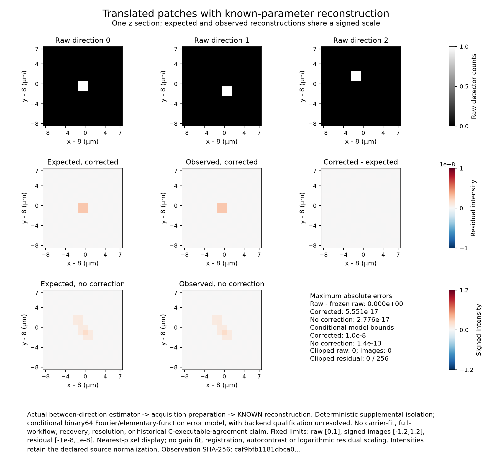
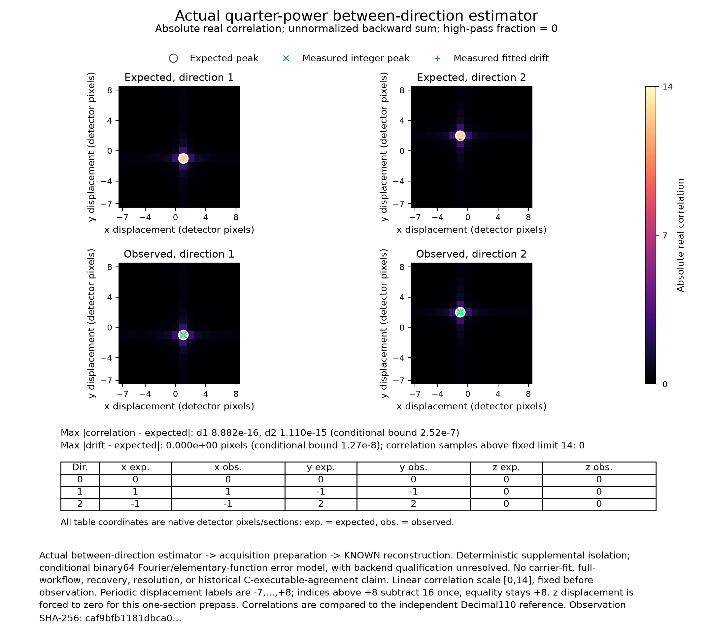

# A fixed between-direction drift control

This control isolates the actual between-direction estimator, acquisition
preparation and known-parameter reconstruction. It uses declared unit transfer
tables and supplied carriers/modulation. Carrier fitting, a complete file
workflow, physical recovery/resolution and historical C executable agreement
remain separate outcomes.

The raw array has shape `(1,3,5,2,16,16)` in time, direction, phase, z, y, x order.
Every sample is exactly 0 or 1. All five phases and both z sections within a
direction are identical. The nonzero samples are adjacent 2-by-2 patches:

| Direction | x columns | y rows | Expected displacement (x,y,z) |
| --- | --- | --- | --- |
| 0 | 7,8 | 7,8 | (0,0,0) |
| 1 | 8,9 | 6,7 | (1,-1,0) |
| 2 | 6,7 | 9,10 | (-1,2,0) |

Displacements use detector pixels and native axial sections. Detector pitch is
1 micrometre (um) laterally and axially. Wavelength is 500 nanometres, numerical
aperture and immersion index are 1, with three retained orders, unit zooms, zero
background, no equalization or within-exposure drift, and resolved drift-filter
fraction 0. The independent control disables only between-direction drift.
Known reconstruction uses zero carrier vectors, unit complex modulation,
Wiener parameter 0.5, no taper/suppression/order-zero damping/omission.

Raw edges are zero. The fixed10 prepass edge differences vanish. Its middle
substack has one section, so axial drift is not challenged by this figure.
The prepass transform uses patch amplitude 1/512 and quarter-power cross
weighting. Its independent peak is about 12.7701662254, with largest competing
absolute value about 2.78956700156. The image is the source's signed filtered
mapping, rather than an intensity-normalized rendering of the input.

For signed Fourier indices -7 through +8, the independent image expectation uses
multiplier 20/61 at the 193 modes with kx^2+ky^2<64, multiplier 4 at the two boundary
modes, and zero elsewhere. Both boundary patch coefficients are zero. The
corrected expectation uses direction 0's patch; the disabled control uses the
mean of all three patches. Independent Decimal80 complex-root sums and
Decimal110 real-cosine convolution agree within 6.47e-80. Both output z planes
must match their expectation.

The raw scale is 0–1. Signed expected and observed images share fixed limits
-1.2 to 1.2. The corrected residual scale is fixed at ±1e-8 intensity units.
Coordinates are `(x-8,y-8)` um. There is no fitted gain, registration or
output-dependent contrast.

Expected and observed absolute real correlations share a fixed 0–14 scale.
Displacement labels use -7 through +8 pixels, retaining the positive half-period
endpoint. The displayed maps and drift vectors come from the actual
quarter-power estimator. Fourier, weighted cross-spectrum, signed correlation
and both reconstructed z planes are checked in the retained numerical evidence.

The measured displacements were exactly `(0,0,0)`, `(1,-1,0)` and `(-1,2,0)`
in the returned native coordinates. Both z planes gave the same maximum absolute
image errors. The estimator's maximum errors were:

| Quantity | Maximum observed absolute error | Frozen absolute bound |
| --- | ---: | ---: |
| Drift component, detector pixels | 0 | 1.27e-8 |
| Prepass center value | 0 | 2.61e-18 |
| Fourier coefficient modulus | 1.227e-18 | 6.7e-17 |
| Weighted cross-spectrum modulus | 3.103e-17 | 8.12e-9 |
| Signed or absolute correlation | 1.110e-15 | 2.52e-7 |
| Corrected intensity, each z plane | 5.551e-17 | 1e-8 |
| No correction intensity, each z plane | 2.776e-17 | 1.4e-13 |

One transfer declaration, two preparation calls and two known-parameter
reconstructions returned. All 4,934 recorded comparisons and structural checks
passed, including coordinates, diagnostic order, ownership and caller input
preservation. No warnings or failed calls were captured. The observation used
Python 3.13.12 and NumPy 2.5.3. Its SHA-256 digest is
`caf9bfb1181dbca0824518ea6a9438f1734c813404127e94a45fc14f9da15f73`.
The evidence index binds the observation to the code commit, input, independent
reference and runtime hashes. The figures use that same observation.

The frozen conditional absolute budgets are 1.27e-8 pixels per drift component,
1e-8 corrected intensity,1.4e-13 disabled-control intensity,6.7e-17 Fourier
coefficient modulus,8.12e-9 weighted cross-spectrum modulus and2.52e-7 signed or
absolute correlation. They assume the documented binary64 rounding, Fourier
and elementary-function envelopes. They do not certify an arbitrary or actual
backend. The detailed derivation propagates zero Fourier cells separately
through the quarter power and resolves the peak/parabola margins.

Frozen inputs, expectations and bounds preceded the observations. The selector and diagnostic correction was observed once with the same
inputs and bounds. Its numerical values and comparison results matched the
prior run exactly. Earlier observations, renders and expectation drafts
remain in the evidence. The inputs, seeds, references, tolerances and
parameters stayed fixed. Final candidate and check identities belong in
the PR/evidence record outside these tracked report bytes.
