# CE08: independently derived reconstruction and physical mode recovery

The actual reconstruction recovers declared spatial modes removed by the
conventional optical transfer in two frozen periodic studies. In the larger
24 × 24 × 8 micrometre (µm) field, nine high-frequency modes retain
98.8313–99.9078% of their source amplitudes. The full signed image has 0.274341%
relative Euclidean error against the source. Its maximum numerical difference
from the independent quantized-input expectation is
1.01474 × 10⁻¹³ density unit/µm³, below the predeclared
3.28888 × 10⁻⁵ density unit/µm³ bound.

These are separate results: numerical agreement with the declared source
mathematics, and recovery of the specified physical modes. They establish no
experimental resolution, noise performance or agreement with a historical
executable. Delivery acceptance and exact candidate checks are recorded through
the [task evidence pointer](../tasks/c-equivalence-independent-acceptance.md),
separately from this scientific observation.

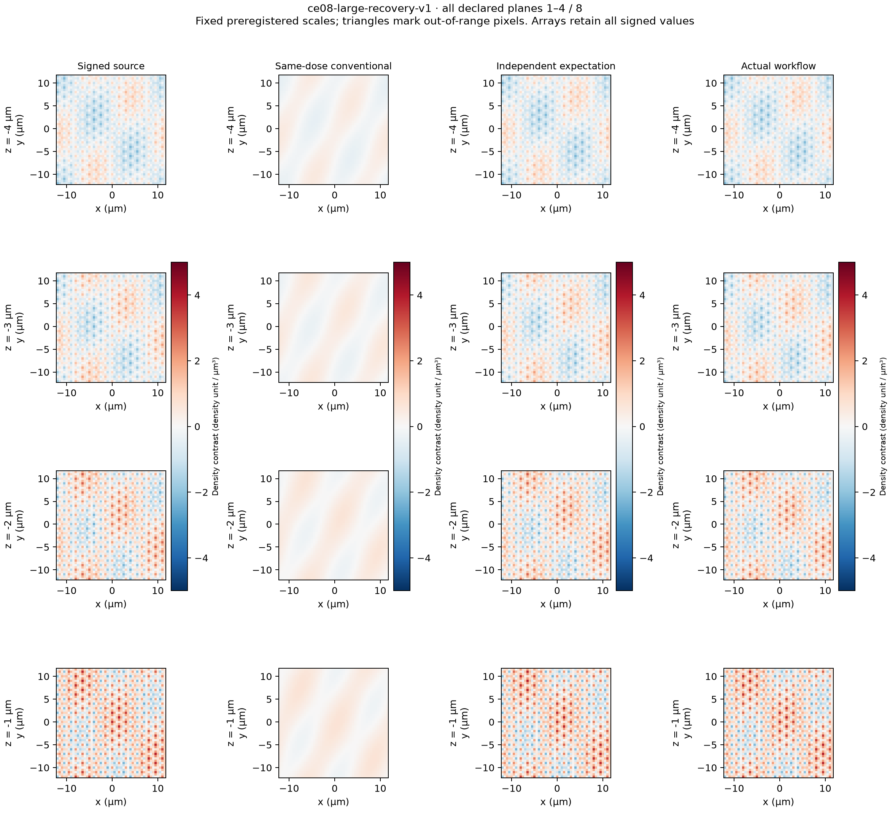

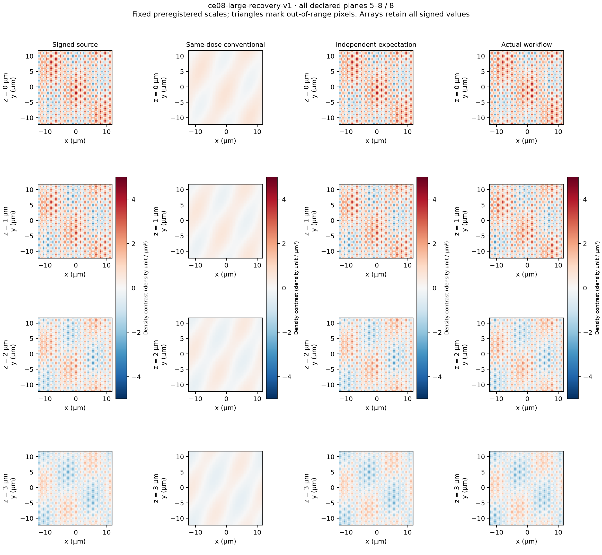

All eight planes appear at their physical coordinates. Columns show signed
source density, conventional reconstruction from the same acquired exposures,
independent mathematical expectation, and actual workflow output in common
density unit/µm³. Every image uses the preregistered −5 to +5 range. No image
pixel exceeds that range. Actual extrema are −2.88437 and +3.99866 density
unit/µm³. There is no fitted gain, registration, crop or per-result scaling.

## Acquisition and physical meaning

Both studies model a calibrated **analog difference before one digitization**.
The reference density is 16 density unit/µm³; the specimen density is 16 plus
the declared signed contrast. Both are continuously nonnegative, as is the
illumination. The optical transfer acts on the illuminated continuous Fourier
modes before detector sampling at 1 µm pitch. An unfiltered object raster at
that pitch would alias high source frequencies and would not prove this result.

Each member of the reference/specimen pair receives 1 second (s) per physical
plane exposure. Corrected counts are 0.8 times the transferred illuminated
density. The camera forms their calibrated analog difference, applies slope 2,
background 7 counts and exposure offset 3 counts, then digitizes once to float32.
This is an ideal differential observation map. It does **not** represent
subtraction of two separately digitized frames. The conventional image averages
the same quantized phase/direction observations with the predeclared count-to-
density conversion; it receives no additional exposure or favorable photon
budget. No stochastic inference follows from these noiseless data.

| Frozen quantity | Small matched study | Larger study |
| --- | --- | --- |
| Periodic field (x, y, z), µm | 8 × 8 × 4 | 24 × 24 × 8 |
| Native array (z, y, x) | 4 × 8 × 8 | 8 × 24 × 24 |
| Output array (z, y, x) | 4 × 16 × 16 | 8 × 48 × 48 |
| Output pitch (x, y, z), µm | 0.5, 0.5, 1 | 0.5, 0.5, 1 |
| Directions / phases / retained orders | 1 / 5 / 3 | 3 / 5 / 3 |
| Total physical plane exposures, both members | 40 × 1 s | 240 × 1 s |
| Source modes, including conjugate partners | 9 | 25 |
| High positive modes outside conventional support | 2 | 9 |
| Fixed density / workflow output factor | 1 | 3 |

The [small preregistration](../../tests/data/ce08-matched-recovery-v1.json) and
[larger preregistration](../../tests/data/ce08-large-recovery-v1.json) specify all
coordinates, counts, illumination phases, source coefficients, transfer cells,
settings, representation premises, criteria and display ranges. They retain
historical pre-execution status fields; the observed results are in the
[public observation record](data/ce08-independent-acceptance.json).

The larger source has three crossed rib orientations with lateral period
1.6 µm and axial envelope `1 + 0.4 cos(2πz/8)`, plus three low-frequency modes.
The nine high modes have lateral radius 0.625 cycles/µm, outside conventional
support at 0.5 cycles/µm. Their associated illumination directions shift them
into support through order 2. The nominal carrier vectors are
`(5,0)/24`, `(3,4)/24` and `(-3,4)/24` cycles/µm. The actual supplied binary64
angles, rather than snapped vectors, define the calculations. This is a known-
carrier study. Search is disabled, but all six actual complex modulation fits
are computed from the prepared data and consumed by reconstruction. It does
not test carrier-search accuracy or arbitrary angle sets.

The rounded radial table and complex axial table define finite periodic optics.
The selected acquired intensities and illumination are nonnegative; this does
not establish a generally positive imaging operator or authenticate an
experimental calibration. The accepted library also permits arbitrary declared
complex transfer inputs. The present fixture adds no new product rejection rule.

## Fixed units and predicted bias

The larger study independently derives its direction normalization. With
`N = 24 × 24 × 8 = 4608`, direction count `D = 3`, lateral zoom `L = 2` and
axial zoom `A = 1`, the preparation factor is

```text
alpha = 1 / (N L² A D) = 1 / 55296.
```

For an interior source coefficient `c`, literal signed eligibility and the
all-direction denominator give

```text
workflow coefficient = (c / 3) × power / (power + w²),  w = 0.002.
density coefficient  = 3 × workflow coefficient.
```

Here `power` includes every eligible signed direction/order contribution before
assembly. The factor 3 is the **preregistered count-to-density unit map**. It is
not a fitted result gain. As a sanity check, the actual workflow zero-frequency
(DC) coefficient is approximately 0.0416666, and the common-density coefficient
is approximately 0.125, matching the source DC. A response near 3 from separate
per-direction denominators would be a dimensionless gain error, not a DC
coefficient. The conventional conversion averages both direction and phase
counts before dividing by 0.8.

Output taper is `none`. Wiener attenuation was derived before product calls.
The simple mode response above applies only to the declared interior modes;
the full numerical expectation uses literal accepted boundaries and the actual
six fitted factors. It includes float32 raw quantization and complex64 transfer
representation. Quantization bias, regularization bias and product numerical
discrepancy remain separately recorded. Counts, point density, cell quadrature
and integrated mass are distinct quantities in the preregistrations.

## Residuals and complete mode evidence

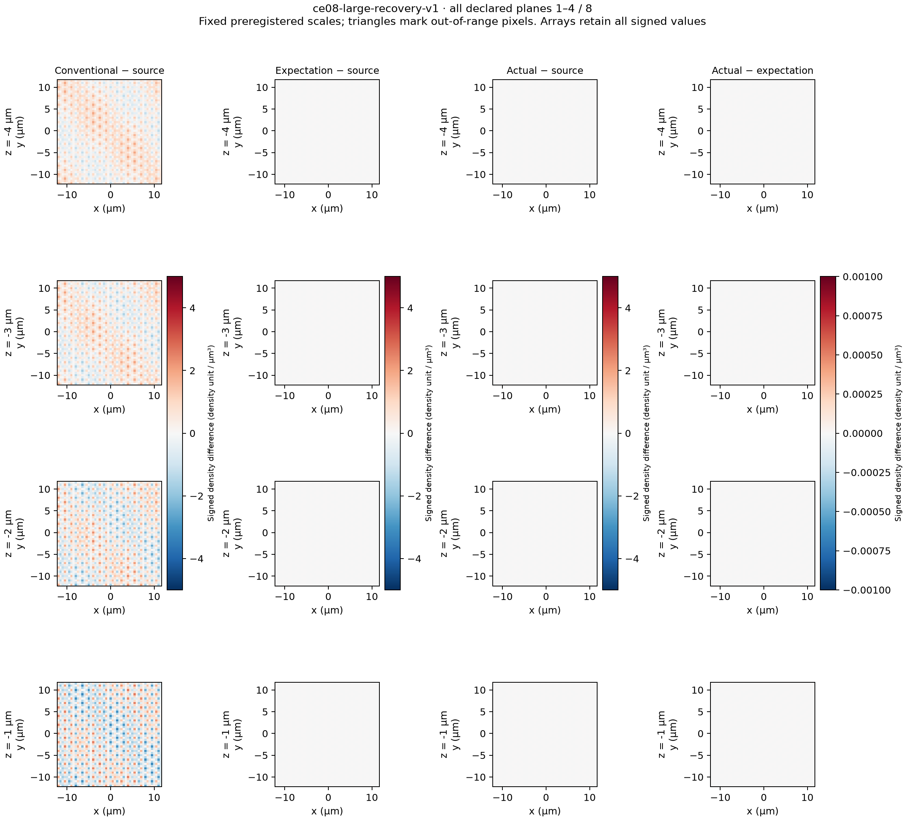

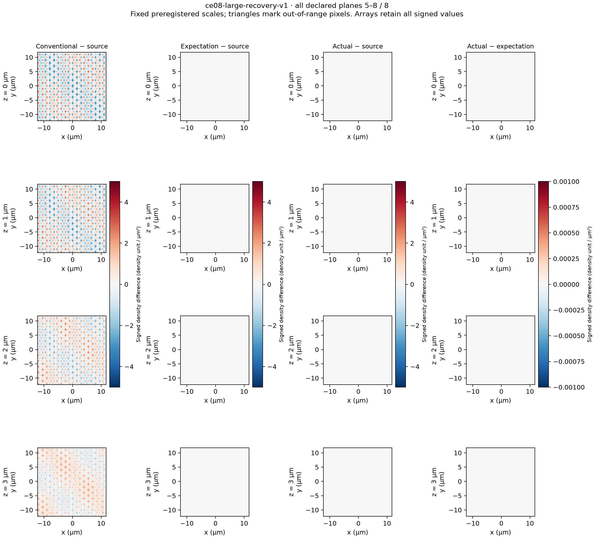

The first three residual columns use the same fixed −5 to +5 density unit/µm³
range, preserving the conventional comparison. The last column is actual minus
independent expectation on the separate fixed ±0.001 density unit/µm³ range.
All counters for pixels outside these ranges are zero.

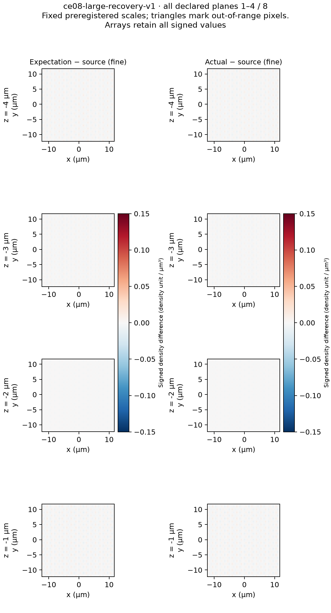

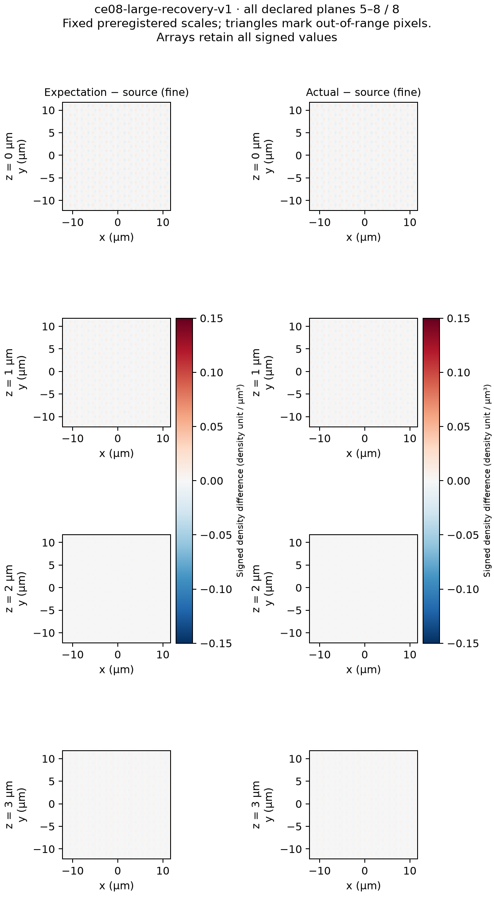

The supplemental ±0.15 density unit/µm³ range was preregistered before any
product call. It exposes the predicted source bias without changing the broad
comparison above. Both pages retain all signed values; no pixel exceeds the
range. The observed numerical agreement is much tighter than the source bias.

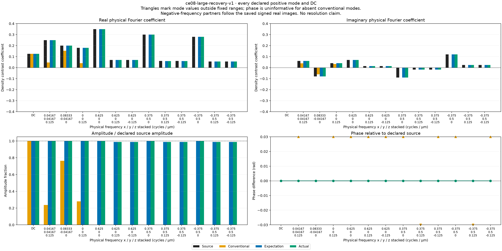

All 13 DC/positive representatives appear. Frequency labels stack x, y and z
in cycles/µm. Their negative-frequency partners are retained in the saved real
images and the complete 25-entry signed coefficient table in the
[public observation record](data/ce08-independent-acceptance.json).
The coefficient scale is ±0.4 density unit/µm³, amplitude fraction 0–1.05,
and phase ±0.03 radians (rad), all fixed in advance. Coefficient/amplitude
exceedances are zero. Conventional phase has 11 marked exceedances: nine high
modes have effectively absent amplitude, making their phases uninformative;
two nonzero low axial modes have real phase shifts from the complex transfer.
Those two phases are not discarded as meaningless. Expected and actual phases
have zero range exceedances.

| Observed larger metric | Actual value | Frozen criterion |
| --- | ---: | ---: |
| Full-image relative Euclidean error | 0.274341% | ≤3.5% |
| Largest relative complex-mode error | 1.168681% | ≤3.5% |
| Nine high-mode amplitude fractions | 0.988313–0.999078 | 0.965–1.02 |
| Largest high-mode phase error | 3.308 × 10⁻⁶ rad | ≤0.02 rad |
| Largest conventional high-mode amplitude fraction | 2.815 × 10⁻⁸ | ≤0.001 |
| Smallest high-mode error improvement over conventional | 85.5665× | ≥20× |
| Maximum density numerical discrepancy | 1.01474 × 10⁻¹³ density unit/µm³ | ≤3.28888 × 10⁻⁵ |

These are finite-mode recovery criteria, not a two-point resolvability test.
Nonzero axial content is reconstructed within the declared support; no axial
superresolution or resolution gain follows. Output pitch alone is not evidence
of resolution.

## Small matched prerequisite

The smaller acquisition contains high modes `(0.625,0,0)` and
`(0.625,0.125,0)` cycles/µm. Both lie outside the conventional 0.5 cycles/µm
support and enter detection support through order 2; the declared combined
support reaches 0.75 cycles/µm along its carrier. Their actual amplitude
fractions are 0.988566 and 0.983788. Full-image relative Euclidean error is
0.773261%; maximum actual-minus-expectation difference is
9.88098 × 10⁻¹⁵ density unit/µm³. The small study has no nonzero axial modes.

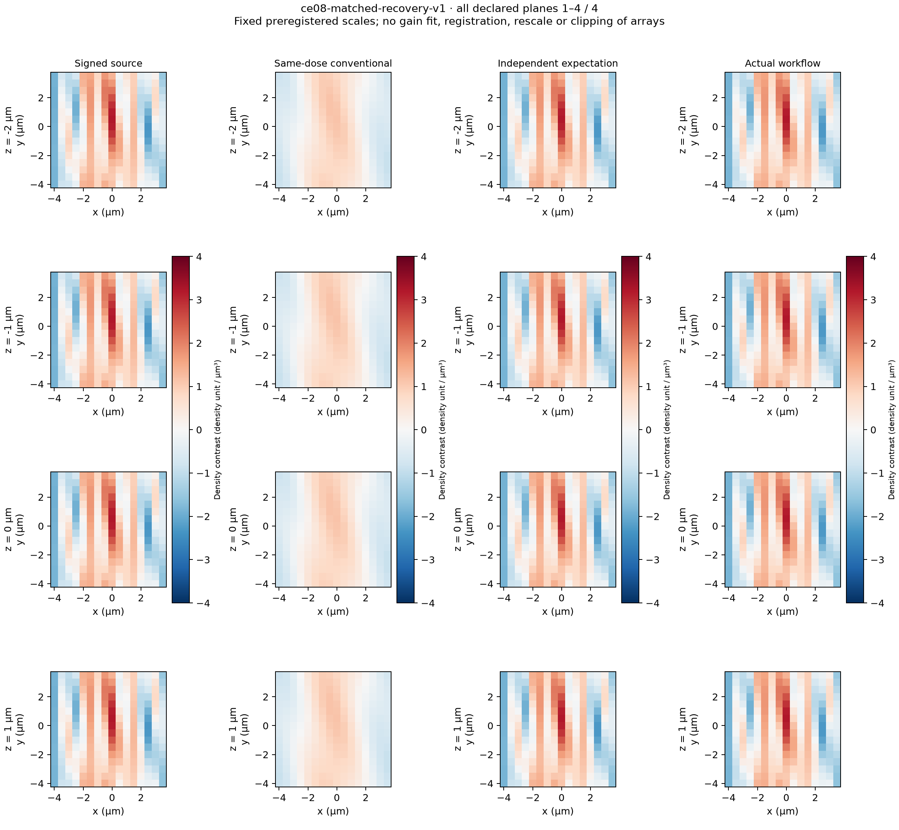

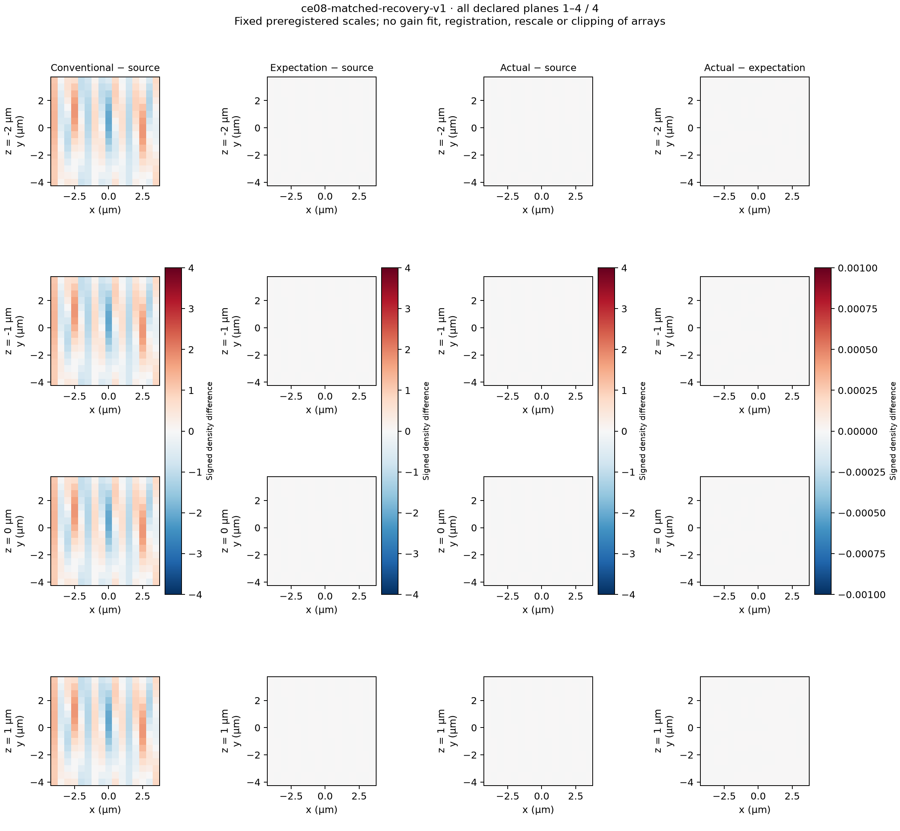

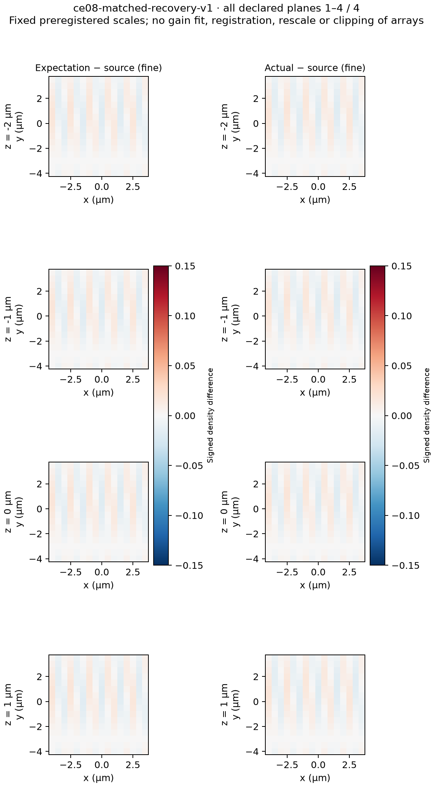

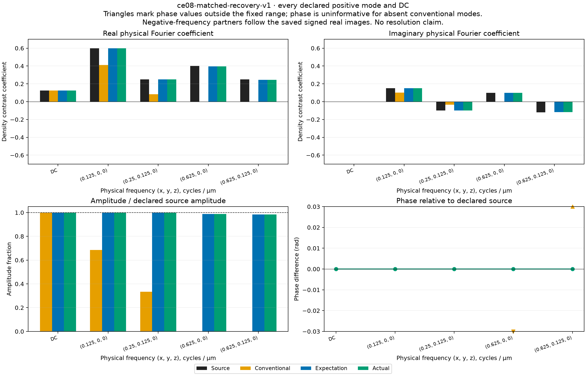

All four planes appear. Images and broad source residuals use ±4 density
unit/µm³; numerical residual uses ±0.001; the supplemental source residual uses
±0.15. Every pixel counter is zero. Two marked conventional phase exceedances
belong to absent high modes. Series colors and legend meanings match the larger
study. All scales were fixed before the relevant product observation.

## Conditioning, representation and scope of proof

Small finite mathematical controls establish the fixed reconstruction mapping
before the finite nuisance procedure and its decision traces. The matched
physical acquisition follows that prerequisite; the larger acquisition follows
the small matched proof. Independent authors derived observations and expectations
without product calls. Independent reviewers accepted each oracle before its
first product call. Restricted implementation assessments found no required
runtime correction.

The larger native denominator minimum is `w² = 4 × 10⁻⁶`. The signal-bearing
support margin is 0.0249269 cycles/µm; its overlap-threshold margin is 0.000530330,
compared with about 3.87 × 10⁻¹⁴ transfer observer uncertainty. All six fitted
energy pairs are positive and unequal by margins well above propagated errors.
The smallest energy gap is about 0.379173, with associated energy error bounds
below 5 × 10⁻¹⁰. These checks address this fixture's conditioning, not global
stability of every accepted input.

Absolute numerical bounds propagate a conditional binary64/elementary-function
model through preparation, overlap fitting, denominator perturbation, native
filtering and assembly. Relative tolerance is zero. Supplemental observer
corrections replaced invalid exact float64 regeneration comparisons with
independently bounded comparisons. The matched observer portability correction
occurred **after its first product call**. It is supplemental and does not
recreate test-first evidence. Fresh combined B5 review then accepted the corrected
checkpoint before the ordered matched and larger product tests passed.
The corrections changed no frozen acquisition array, physical criterion or
product numerical bound. Small exact float32 regeneration
has a midpoint-margin proof. The larger acquisition has two unresolved unique-
rounding cases, so its physical observer uses closed quantization-cell intervals;
it makes **no unique-rounding guarantee**. Frozen float32 samples remain the exact
product input, and observer uncertainty is charged inside the original
quantization ceiling. Alternate trigonometric/FFT calculations independently
challenge the finite-sum oracle. These arithmetic enclosures are conditional,
not universal backend certificates or historical binary32 guarantees.

## Saved evidence and reproduction

The [matched observed archive](data/ce08-matched-observed.npz) and
[larger observed archive](data/ce08-large-observed.npz) are byte-identical public
copies of the actual saved observations. They include raw inputs, independent
expectations, conventional images, actual images, signed residuals and mode
coefficients. Actual images were saved before acceptance assertions; failed
status would preserve the output. Both observed studies passed their unchanged
criteria. Earlier test/tooling failures and rejected observer claims remain in
the durable task evidence; none was reclassified as a physical recovery failure.

The [public provenance](data/ce08-independent-acceptance.json) records all
representative coefficients, the larger complete signed coefficient table,
source runtime hashes, observed metrics, frozen criteria and original receipt
hashes. [Matched rendering](data/ce08-matched-render.json),
[matched visual QA](data/ce08-matched-visual-qa.json),
[larger rendering](data/ce08-large-render.json) and
[larger visual QA](data/ce08-large-visual-qa.json) bind every figure to its saved
arrays and preregistration. Original render receipts keep their pending visual
field; separate visual QA records the actual inspection. Public receipts use
explicit aliases and repository-relative paths; originals remain unchanged in
the task evidence. Plotting used Python 3.13.12, Matplotlib 3.11.0 and NumPy 2.5.1,
separate from product NumPy 2.5.3/SciPy 1.18.1.

Reproduce the public proof from the repository root in its installed environment:

```sh
PYTHONDONTWRITEBYTECODE=1 .venv/bin/python scripts/source_free_check.py --timeout 300 \
  pytest -q -x -p no:cacheprovider --capture=sys \
  tests/test_c_independent_small_controls.py \
  tests/test_c_independent_matched_recovery.py \
  tests/test_c_independent_large_recovery.py
```

This command is a focused scientific proof, not a substitute for the full local
verification, required-platform artifacts or final independent delivery review.
The studies demonstrate the declared mathematical mapping and specified mode
recovery only. Historical executable-output agreement remains **untested**.
