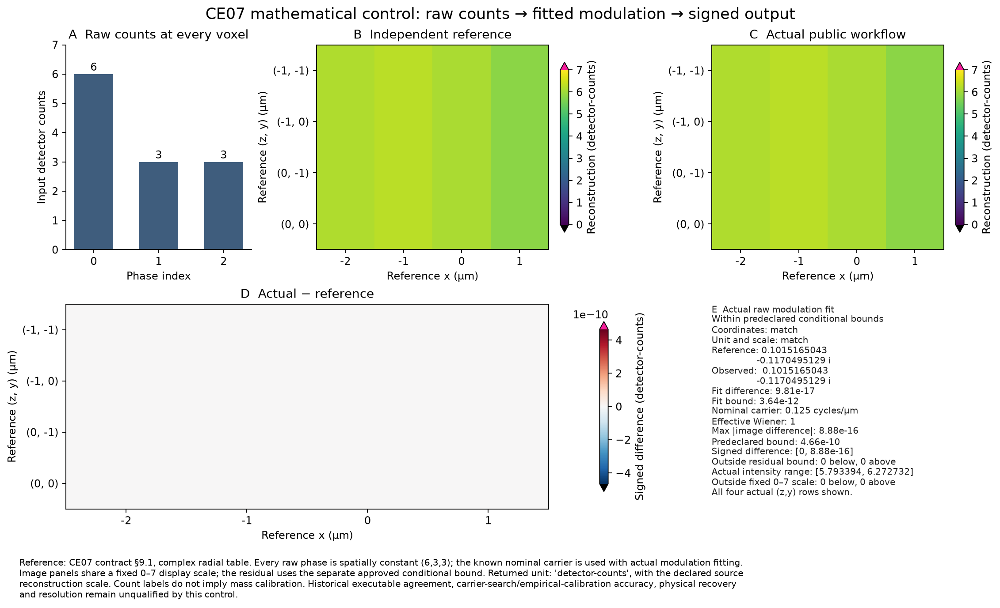

# CE07: one closed mathematical reconstruction control

This records one preregistered synthetic control through `reconstruct_workflow`.
It compares the actual fitted modulation and signed image with the closed
mathematics in [contract section 9.1](../contracts/c-equivalence-workflow-v1.md).
Task completion and full verification live outside this numerical report in the
[task evidence pointer](../tasks/c-equivalence-workflow.md).



Each raw phase is spatially constant, with counts `(6,3,3)`. The declared nominal
carrier is 0.125 cycles per micrometre (µm); modulation is actually fitted. All 16
output samples appear as four `(z,y)` rows. Reference and actual images share the
fixed 0–7 display scale. The signed difference uses the separate fixed conditional
bound ±4.65661287311e-10 source-scaled counts. Maximum absolute
image difference is 8.881784197e-16 counts. Raw fitted
modulation differs by 9.81307786677e-17, below its
3.63797880709e-12 bound. Coordinates and declared units
match exactly. No gain, registration, crop or per-result display scaling is used.

## Frozen input and independent reference

- Raw axes `(time,direction,phase,z,y,x)` have shape `(1,1,3,2,2,4)`, with float32 counts.
- Sampling is 1 µm in x,y,z. Lateral and axial zoom are 1. Coordinates are x=`(-2,-1,0,1)` µm and y=z=`(-1,0)` µm.
- The radial complex table has shape `(2,8,2)`: order 0 is 1 and order 1 is `1+i*r` at both axial cells, for radial index r=0…7. Radial/axial steps are 0.25/0.5 cycles/µm.
- Detection wavelength is 500 nm; numerical aperture and immersion index are 1. Carrier search is disabled, with the explicit 0 rad initial angle and 8 µm line spacing. Modulation fitting remains active.
- Background and edge width are 0; equalization, off exposures and drift are inactive. Wiener parameter is 1 with zero increment. Suppression, order 0 damping/omission and kz0 omission are inactive; overlap filtering is active, output taper is `none`, and explode factor is 1.

With `mu=(1+sqrt(2)-i)/4`, independent fitted modulation is
`a=3*(2-i)*mu/(20*sqrt(2))`. Let `h0=2+2.5*abs(a)**2` and
`h1=2+3*abs(a)**2`. At the four x coordinates the closed image is
`12/h0+6*real(conj(a)*exp(i*pi*x/4))/h1`. Every y/z row has that same profile.
The complete expected and observed arrays are retained in the
[observed data](c-equivalence-workflow-control.json).

The bounds were fixed from the independently accepted test before this observation:
`gamma(65536)*64` for image and `gamma(4096)*8` for raw modulation, where
`gamma(n)=n*u/(1-n*u)` and `u=2**-53`. The independently reviewed provenance regressions changed
no control, expression, numerical premise or bound. These enclosures retain the
declared arithmetic, Fourier-backend, elementary-function, solver and equality
premises; they are conditional rather than universal backend certificates.

Numerical reproduction uses the existing public keeper from the repository root:

```sh
.venv/bin/python -m pytest -q 'tests/test_c_workflow_numerical.py::test_closed_algebra_actual_modulation_and_image[True]'
```

## Provenance and limits

The data records every runtime source-file checksum, frozen reference/bound/test
checkpoint identities, the actual input identities and Python/NumPy/SciPy
versions. The product observation used task Python 3.13.12,
NumPy 2.5.3 and SciPy 1.18.1. The
[render receipt](c-equivalence-workflow-control.render.json) records the separate
plotting environment (Matplotlib 3.11.0, NumPy 2.5.1). Its
original pending visual-status field is retained; the separate
[visual check](c-equivalence-workflow-control.visual-qa.json) records inspection
of this exact image. This observation records the runtime with corrected original
input identities and scalar snapshots. The renderer reads its saved observed arrays,
reference and fixed scales without calling reconstruction.

`detector-counts` is the declared input-unit label under the source reconstruction
scale. It establishes no conserved mass or physical calibration. This control
qualifies its mathematical mapping, not historical executable agreement,
carrier-search or empirical-calibration accuracy, physical recovery or resolution.
Those broader outcomes need their separate evidence. Failed recovery cases must
remain visible in CE08.
