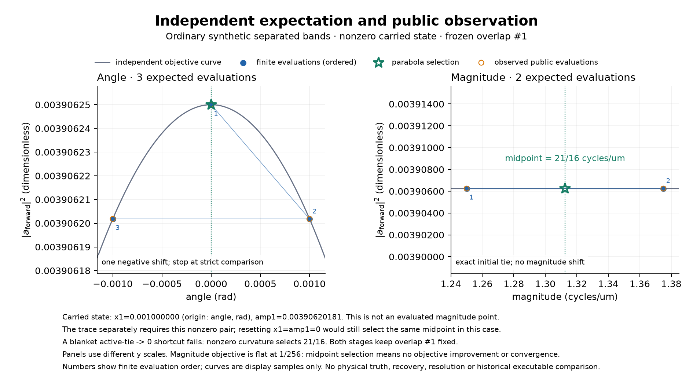

# A finite carrier and modulation control

**Version 1.0.** This small separated-band control illustrates the selected C
procedure. It has one time, one direction, three retained orders and a native
`(Z,Y,X)=(2,4,2)` grid with lateral spacing 0.2 µm and axial spacing 1 µm.
The initial fundamental carrier is `(0.5,0)` cycles/µm. The complete declared
radial transfer is one except for the order-two sample at radius 1.5 cycles/µm,
which is two. The [historical input record](https://github.com/david-hoffman/simrecon/blob/596cf1f736a130cd1f14f4d01c4c9517b4daa973/docs/reports/data/c-estimation-control-inputs.json) contains
all values and resolved settings.



The curves, blue points and green stars are independent expectations. Orange
rings are public evaluations from the committed implementation. Numbers show
evaluation order. The two panels use different vertical scales. The magnitude
objective is flat at `1/256`; the selected midpoint shows the finite procedure,
with no objective improvement or convergence claim. The carried angle coordinate
is bookkeeping, not an evaluated magnitude point.

## Independent expectation and observation

The coarse correlation has values `[1,-4/sqrt(10)]`, so its squared magnitudes
are `[1,8/5]`. The unique maximum gives a fundamental carrier of `5/4`
cycles/µm. Refinement rebuilds the overlap there and holds that pair fixed.
Its lower and higher energies are `SX=16` and `SY=1/8`.

The angle walk evaluates `0,+0.001,-0.001` rad and selects zero. It carries
`x1=0.001` and `amp1=0.003906201808818211` into magnitude search. The active
magnitude samples are `5/4` and `11/8` cycles/µm, each with objective `1/256`.
The general parabola has nonzero curvature and selects their midpoint:

`(5/4 + 11/8)/2 = 21/16 = 1.3125 cycles/µm`.

A blanket rule returning zero for tied active scores gives a different result.
Resetting the carried pair to zero would still select this midpoint; the full
public trace separately checks the required nonzero state.

| Quantity | Independent expectation | Public observation |
| --- | --- | --- |
| Final fundamental vector, cycles/µm | `(21/16,0)` | `(1.3125,0)` |
| Raw/final order-one factor | `1/8 + 0i` | `0.125 + 0i` |
| Raw/final order-two factor | `1/16 + 0i` | `0.0625 + 0i` |
| Ordered events | 19 | 19 |
| Angle/magnitude candidate evaluations | 3 / 2 | 3 / 2 |

For this control, the maximum absolute differences in the final vector, raw
factors and final factors are zero in binary64. The complete records include
three separate overlap builds, seven total regression evaluations, seven bracket
events, two parabolas and two adjustments. Both plotted stage counts match;
no observed point lies outside the fixed axes. These exact local matches supply
no uniform accuracy guarantee for other, ill-conditioned inputs.

## Historical data and provenance

The [published registration](data/c-estimation-control-preregistration.json)
copies the identity of the original freeze at `2026-11-03T18:22:00.578128+00:00`.
The implementation module was absent then. Inputs, full finite expectations,
trace, display grids and axes were fixed before implementation. Their original
manifest digest is
`ec34d4616d6e004ede5e08e54fcc6d89b75628f9deb0753036468f50973a1ba7`.
The accepted five-file test checkpoint is
`8afcd00664dc9ad117c1ce5b7f32afec98c5f48a8daf5e82f0e908f19f15d63e`.

The [historical observation](https://github.com/david-hoffman/simrecon/blob/596cf1f736a130cd1f14f4d01c4c9517b4daa973/docs/reports/data/c-estimation-control-observed.json) identifies code
commit `725b7bd22401c08df977c9f01bbb745502c8ccf4`, its tree, all 16 runtime-file
digests, Python 3.13.12 and NumPy 2.5.3. The [historical full expectation](https://github.com/david-hoffman/simrecon/blob/596cf1f736a130cd1f14f4d01c4c9517b4daa973/docs/reports/data/c-estimation-control-expected.json),
[expected trace summary](data/c-estimation-control-expected-trace.json),
[historical plot specification](https://github.com/david-hoffman/simrecon/blob/596cf1f736a130cd1f14f4d01c4c9517b4daa973/docs/reports/data/c-estimation-control-plot-spec.json) and
[rendering receipt](data/c-estimation-control-rendering.json) retain the values
used here. The original observer called public `estimate_parameters` on the
serialized values without importing the test oracle.

The first artifact call was rejected before fitting because deserialization
created a non-owning transfer-sample view. The corrected consumer restored owned,
read-only complex128 storage. All 53 decoded arrays retain identical values,
dtypes and shapes; the original numerical freeze is unchanged. A later correction
changed only a stale renderer status label. The two successful public observations
have exactly equal estimator outputs. Original tools, failed attempt and repair
receipts remain in the task's retained evidence.

This is an array-stage finite-procedure illustration. It has no physical specimen
truth, historical executable comparison, recovery or resolution claim. The
[contract](../contracts/c-equivalence-carrier-modulation-v1.md),
[usage guide](../usage/c-parameter-estimation.md) and
[task pointer](../tasks/c-equivalence-carrier-modulation.md) give the complete
domain, composition and independent-review limits. Full local, platform and
candidate acceptance evidence is recorded separately from this figure.

## Reproduce the numerical control

From the repository root, run the focused test in the locked environment.

```sh
.venv/bin/python -m pytest -q tests/test_c_estimation_search.py::test_initial_magnitude_tie_preserves_nonzero_angle_state_and_fits_midpoint
```

The test constructs the quadratures and transfer table in memory, calls the
public estimator and checks the midpoint, modulation factors and ordered search
events. The historical records preserve the original observer and rendering
outputs.
