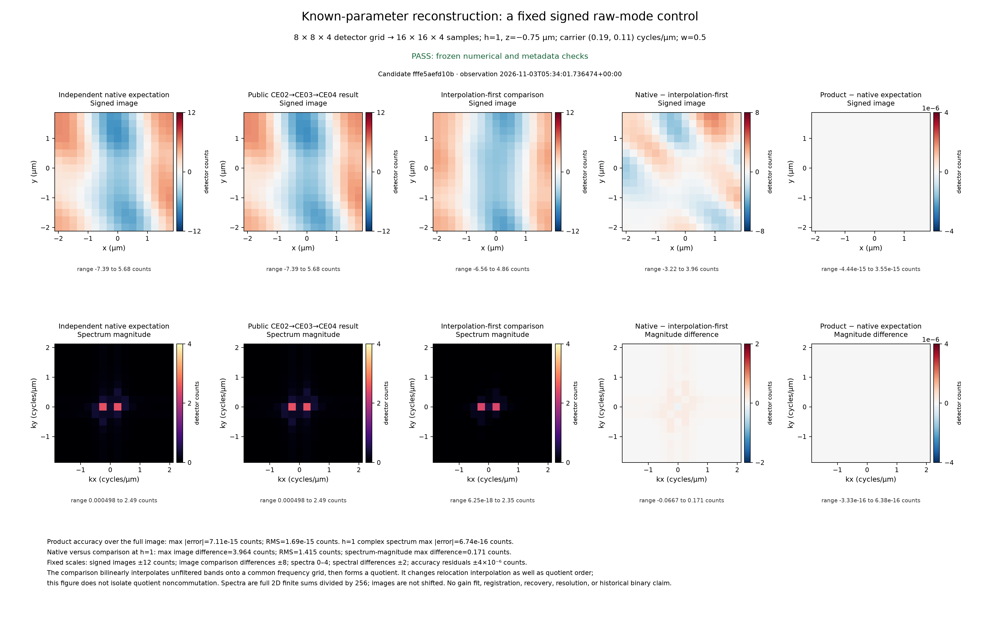

# A fixed control for known-parameter native filtering

**Version 1.0.** Inputs and expectations were registered before product
observation. The public result passed the fixed numerical and metadata checks;
observed residuals and the reviewed figure are reported below. The separate
native-versus-comparison differences describe two specified constructions,
not product accuracy errors.

This control checks the selected known-parameter mapping from prepared specimen
exposures and optical transfer tables to a signed three-dimensional image.
The [public contract](../contracts/c-equivalence-known-parameters-v1.md) defines
the mathematical target. The control keeps the supplied parameters fixed and
compares native filtering followed by centered carrier assembly with one
explicit interpolation-first quotient. It makes no physical recovery or
resolution claim.

The complete inputs, finite-sum derivation, comparison procedure, error budget,
and plot scales were frozen before product observation. They are available as
the byte-identical [scientific specification](data/c-known-control-specification.md)
and [historical independent expected arrays](https://github.com/david-hoffman/simrecon/blob/596cf1f736a130cd1f14f4d01c4c9517b4daa973/docs/reports/data/c-known-control-expected.json).
The [portable registration](data/c-known-control-preregistration.json) records
logical file names, source/copy hashes, the original freeze time, and the
accepted-contract reaffirmation. Renaming these copies does not change their
bytes. The registration is a new portable record, not a copy of the original
local provenance manifest.

## Method

The raw control contains exact integer detector counts in an array with axes
time, direction, phase, z, y, x. It has one time point, one direction, five
uniform phases, four axial planes, and eight samples on each lateral axis.
The raw range is 104–152 counts. A declared background of 128 counts is
subtracted. The resulting signed modes are algebraic controls, not a simulated
specimen or photon-count observation.

| Setting | Fixed value |
| --- | --- |
| Retained orders, including order zero | 2 |
| Detector spacing | 0.5 µm laterally; 0.75 µm axially |
| Output zoom | 2 laterally; 1 axially |
| Output grid | 4 × 16 × 16 samples; 0.25 µm lateral and 0.75 µm axial spacing |
| Fundamental carrier | (0.19, 0.11) cycles/µm |
| Positive-side modulation | 0.75 + 0.25i |
| Wavelength; numerical aperture; immersion index | 500 nm; 0.8; 1.4 |
| Wiener parameter | 0.5; its square enters the denominator |
| Transfer declaration | Complete complex radial table, shape (2,10,4) |
| Transfer increments | 0.25 cycles/µm radially; 1/3 cycles/µm axially |
| Edge treatment, equalization, suppression, taper | Off |
| Order-zero dampening and omission flags | Off |

The public composition used `prepare_bands`, `declare_otf`, and
`reconstruct_known`. Independent finite Fourier sums supply the expected
coefficients and image. Preparation retains its scale of 1/1024; the inverse
sum is unnormalized. Native filtering occurs before the supplied noninteger
carrier is applied with centered physical coordinate labels. Image samples
themselves are not shifted.

The comparison bilinearly interpolates the unfiltered signed bands onto a
common frequency grid and then forms its quotient, using the same supplied
parameters, declared transfer, Wiener parameter, and centered phase origin.
It changes relocation interpolation as well as quotient order. Consequently,
the comparison does not isolate quotient noncommutation. Its complete procedure
is fixed in the specification; it is not fitted to either image.

The displayed plane is h=1, labeled z=-0.75 µm. Its complete two-dimensional
negative-exponential spectrum is divided by 16 × 16 = 256. Spectral values
therefore retain detector-count units, with axes in cycles/µm. Reordering
frequencies for display does not shift image samples. Any complete
three-dimensional normalized spectrum exported with the observation is diagnostic; no new
accuracy bound is assigned to it here.

## Independent comparison values

These values come from the frozen independent arithmetic. The native and
comparison images both contain negative and positive values.

| Independent native minus comparison quantity | Domain | Value (detector counts) |
| --- | --- | --- |
| Maximum absolute image difference | Full 4 × 16 × 16 grid | 6.927524313286466 |
| Root-mean-square image difference | Full grid | 1.7456581879854303 |
| Maximum absolute image difference | Display plane h=1 | 3.9637526521650206 |
| Root-mean-square image difference | Display plane h=1 | 1.4149758996830295 |
| Maximum absolute complex-spectrum difference | Normalized h=1 spectrum | 0.5533646924723518 |
| Maximum absolute spectrum-magnitude difference | Normalized h=1 spectrum | 0.17101213972193396 |

The selected-plane differences exceed the preregistered usefulness minimums
of 0.05 counts for the image and 0.01 counts for spectrum magnitude. That
establishes an informative distinction between the two specified constructions.
It does not establish product accuracy or image recovery.

## Observed product control and fixed accuracy bounds

The observation used the public array composition with the registered inputs.
No input, expected coefficient, tolerance, scale, gain, or registration was
changed to match the product result.

| Product evidence | Observed result (detector counts) |
| --- | --- |
| Prepared-quadrature maximum absolute error | 7.989074937500148e-16 |
| Filtered-quadrature maximum absolute error | 3.818283603795215e-16 |
| Full-image maximum absolute error | 7.105427357601002e-15 |
| Full-image root-mean-square (RMS) error | 1.6915881290306159e-15 |
| Normalized h=1 complex-spectrum maximum absolute error | 6.736447455048117e-16 |
| Coordinates, source, settings, ownership, and input preservation | All exact checks passed |
| Figure layout | Reviewed PNG passed; original overlapping layout retained separately |

The first two columns show independent expectation and public result on the
same fixed scale. The middle column is the explicitly defined interpolation-first
comparison. The fourth column shows native minus comparison; the last shows
product minus independent expectation. The bottom row uses spectrum magnitudes.
Almost uniform accuracy-residual panels reflect errors small relative to the
fixed 4e-6-count scale, rather than exact zero error. All ten panels stay inside
their registered ranges. The comparison changes relocation interpolation as
well as quotient order; it does not isolate quotient noncommutation.

The complete [historical product observation](https://github.com/david-hoffman/simrecon/blob/596cf1f736a130cd1f14f4d01c4c9517b4daa973/docs/reports/data/c-known-control-observed.json) contains
the raw/table inputs, prepared/filtered complex quadratures, image, normalized
spectra, public metadata and unchanged checks. [Rendering provenance](data/c-known-control-rendering.json)
records the fixed scales and byte-identical image export. Portable records omit
local executable/artifact paths while preserving every scientific array/check.
The registration retains its pre-observation pending state at its recorded
timestamp; this observation is the later result.

Python 3.13.12 and NumPy 2.5.3 produced the observation. The installed distribution
version was separately verified as 0.1.0; the package exposes no public version
attribute in that observation. Matplotlib 3.11.2 rendered the saved arrays without
rerunning the product. The clean product commit recorded at observation precedes
the presentation commit; its candidate-source hashes identify the runtime bytes.
Final candidate and full verification identities/results remain outside tracked
bytes in the task evidence and pull request. This control supplies no historical
C executable, physical recovery, resolution, or full-domain accuracy claim.

| Comparison with the independent native expectation | Absolute tolerance (detector counts) |
| --- | --- |
| Prepared complex quadratures | 2 × 10^-10 |
| Filtered complex quadratures | 5 × 10^-9 |
| Signed image | 4 × 10^-6 |
| Normalized h=1 complex spectrum | 4 × 10^-6 |

Relative tolerance is zero. The original budget includes all native
coefficients, including binary64 residuals at ideal zero modes. Actual prepared
residuals must pass through the declared finite assembly without rounding or
removal. The bounds retain their preregistered fixed-branch stable-binary64
assumptions; they are not universal backend or historical binary guarantees.

## Fixed display scales and limits

| Panel | Fixed linear range (detector counts) |
| --- | --- |
| Expected, product, and comparison signed images | -12 to 12 |
| Native minus comparison image | -8 to 8 |
| Expected, product, and comparison spectrum magnitudes | 0 to 4 |
| Native minus comparison spectrum magnitude | -2 to 2 |
| Product minus expected image | -4 × 10^-6 to 4 × 10^-6 |
| Product minus expected spectrum magnitude | -4 × 10^-6 to 4 × 10^-6 |

Any range exceedance must be marked and accompanied by its actual range. No
gain fitting, registration, image shift, or automatic scale adjustment is
permitted by this specification. Product accuracy residuals belong on their
separate fixed scale; the much larger native/comparison differences are not
product errors.

This is a small, well-conditioned control of the selected stationary,
single-objective known-parameter array branch. It does not establish coverage
of every supported branch, physical specimen recovery, resolution, or agreement
with a historical C executable. It uses no retired scene or executable. The
complete scientific acceptance, candidate identity, and verification evidence
remain separate from these frozen presentation inputs.

The observation was renewed after the scalar-validation correction, with the
registered raw inputs, independent expectation, numerical budgets and plot scales
unchanged. The earlier observation and failed/corrected first layout remain
retained as historical evidence. The renewed scientific arrays and checks match
the earlier control; the new source hashes identify the corrected implementation.
