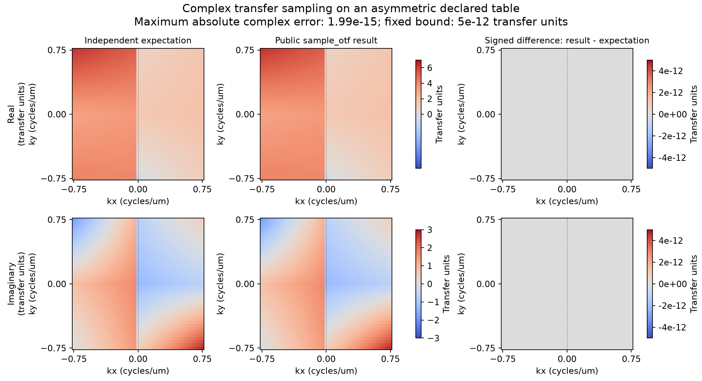

# Small complex transfer-sampling control

**Version 1.0.** The specification was registered before CE03 implementation
observations. Observed results are reported below.

This control checks the public declared-transfer sampler on an asymmetric
complex table. It does not model a pupil, a physical point spread function,
bead recovery or a reconstructed image. Independent empirical bead preparation
and raw-to-transfer-to-sample proofs belong to the accepted CE03 test checkpoint.
No retained C is executed. Binary-output agreement remains untested.

Use two complete full tables, each with `(z,y,x_half)=(4,4,4)`, and unit frequency
increments (1 cycle/um) on all axes. At integer indices define

`F(x,y,z)=1+2*x-3*y+4*z+x*y-2*x*z+3*y*z+0.5*x*y*z`

`+ i*(-2+x+2*y-z+2*x*y+x*z-y*z+0.25*x*y*z)`.

Order0 is F; order1 is F/2. Every table real/imaginary component is exactly
representable in float32. No rescaling or Hermitian repair is applied on
`declare_otf`. Sample order1 on a 41 by41 x/y grid from -0.75 to0.75 cycles/um,
with integer axial index1 and explicit native axial step0.5 cycles/um. For the
exact registered binary64 coordinates, use `(i - 20) * 3 / 80` for indices 0–40.

An independent expectation follows from the exact reproduction of multilinear
polynomials by tensor interpolation. For nonnegative x, the source normalized
x coordinate is x; its y coordinate is y if y>=0, otherwise its seam stencil has
weighted mean -3*y. Its z coordinate is0.5. For negative x, all coordinates
reflect: the normalized x is -x; reflected y has weighted mean -y if y<=0,
otherwise3*y; reflected z crosses the last-to-first seam and has weighted mean
1.5. Evaluate the polynomial at these means, divide by2 and conjugate only
for negative x. No runtime interpolation helper supplies this expectation.
The arbitrary table need not have matching values across x=0; a sign-boundary
jump is intentional and is not an optical discontinuity claim.

The fixed absolute complex error bound is **5e-12 transfer units**. The input
coefficients and integer table samples are exact binary numbers; the registered
grid values are evaluated as their binary64 coordinates. Fewer than100 real
floating operations per component, with weighted absolute terms below100,
give a conservative rounding allowance of order100*100*2^-52=2.23e-12;
5e-12 also covers independent polynomial evaluation/grouping error. This is a
control-specific bound, not a universal accuracy promise or a tuned threshold.
No gain, registration, fitting, parameter selection or per-result adjustment
is allowed after observing product output.

The figure shows real and imaginary expectation/result and signed
result-minus-expectation on common coordinate scales. Expected and observed
values share the fixed real scale [-1,7] and imaginary scale [-3,3] transfer
units for each expectation/result pair. Residuals use the same symmetric
fixed scale of +/-5e-12 transfer units. Pixel density is only display sampling.
The dotted x=0 marker identifies the source reflection branch; the table's
intentional jump there is not a physical optical claim.
All input/query/expected values, the pre-observation specification hash,
observation, maximum error and renderer provenance are retained in the linked
records below and the task evidence. Final candidate and gate results remain
outside tracked bytes.

## Observed control

The public sampler's maximum absolute complex error over all **1,681 queries**
was **1.9860273225978185e-15 transfer units**, below the unchanged preregistered
**5e-12** bound. No input, gain, registration, polynomial coefficient, comparison
scale or tolerance was fitted to this output.

The left and middle columns show independent expectation and observed sampling.
Their real and imaginary components share the fixed scales given above. The
right column shows signed result-minus-expectation differences on the fixed
+/-5e-12 scale. The dotted line marks x=0, where the arbitrary asymmetric table
intentionally exercises the negative-x reflection/conjugation branch. Uniform
grey residual panels reflect errors small relative to that fixed scale. These
are numerical transfer units, not a measured physical response or an image.

The original numerical and provenance records are the [historical expected arrays and queries](https://github.com/david-hoffman/simrecon/blob/596cf1f736a130cd1f14f4d01c4c9517b4daa973/docs/reports/data/c-otf-control-expected.json), [pre-observation specification](data/c-otf-control-specification.md),
[registration](data/c-otf-control-preregistration.json), [historical observed arrays and signed differences](https://github.com/david-hoffman/simrecon/blob/596cf1f736a130cd1f14f4d01c4c9517b4daa973/docs/reports/data/c-otf-control-observed.json), and [rendering record](data/c-otf-control-rendering.json).
The observation used Python3.13.12/NumPy2.5.3; Matplotlib3.11.2 rendered these
same arrays without rerunning the product. Runtime file hashes identify the
observed implementation bytes; the precommit observation's Git HEAD identifies
its prior committed baseline. Final candidate and gate results live outside
tracked bytes in the task evidence and PR. This is a supplemental public sampler
control, not retained-C binary agreement, empirical bead recovery or completed
reconstruction proof.
