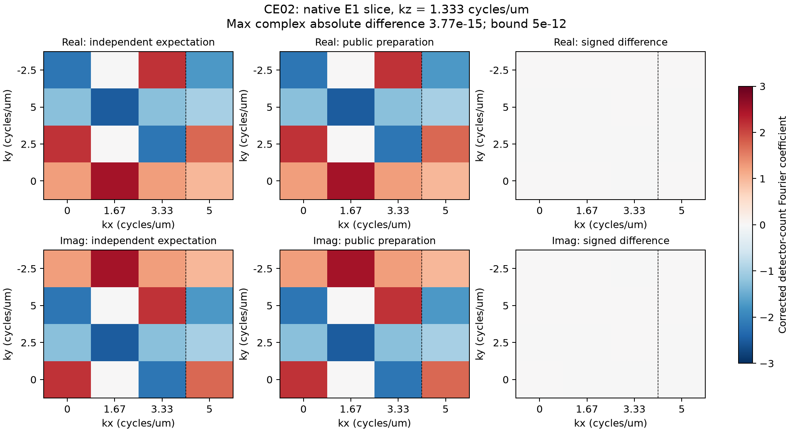

# CE02 numerical preparation control

The figure compares the public preparation result with an independent finite
Fourier expectation. It tests a displaced detector-count impulse and the
stored lateral Nyquist exception. This is a small preparation control.

Real and imaginary E1 quadratures are shown at kz = 1.333 cycles/um. E1 is the
cosine component of the first phase harmonic. All panels use the same fixed
range, -3 to 3 corrected detector-count Fourier units. The right column is
product minus expectation. The dashed boundary marks the stored x Nyquist
column, where the source retains raw phase-slot data. The title reports the
maximum complex absolute error. Full signed values are in the observation
record; a white residual panel alone is not numerical evidence. The grid uses
unshifted frequency-bin ordering. Here um means micrometres.

The [observation record](c-preparation-control.json) identifies inputs, source
hashes, settings, expected and observed values, signed differences, units,
versions and observer identity. Its runtime hashes match the final candidate.
The [CE02 contract](../contracts/c-equivalence-preprocessing-v1.md) supplies the
source mathematics. The configuration and absolute bound **5e-12** were
registered before runtime implementation or numerical product observations.
The actual error is recorded in JSON rather than repeated in mutable status.
No gain, registration or result-dependent normalization was applied.

Input shape is `(1,3,5,3,4,6)` in time/direction/phase/z/y/x order. Raw float32
values have baseline 5, background 3, extra exposure background 2 and
multiplicative slope 4. At voxel `(x,y,z)=(1,1,1)`, add `432*(p+1)` in phase p.
Detector pitches are **0.1 um** laterally and **0.25 um** axially. Retain orders
0/1/2, select lateral/axial zoom 2/2, edge width 0 and disabled equalization.
Supplied phases per direction are `[0,pi/2,pi,3*pi/2,pi/4]` radians.

The scale is `1/(6*4*3*2**2*2*3)=1/1728`. Corrected impulses therefore have
amplitudes p+1. The analytic E1 row gives `(5/4)*(1-3)=-5/2` at ordinary stored
samples; the skipped x endpoint instead retains raw phase slot 1 with amplitude 2.
Multiply that amplitude by `exp(-2*pi*i*(kx/6+ky/4+kz/3))`. This one-term finite
sum supplies the expectation independently of runtime helpers or a shared
simulation model. The displayed slice uses kz bin 1.

The inverse is well conditioned. The predeclared absolute bound includes small
represented-angle and binary64 arithmetic errors. It exceeds
`1000*eps64*norm(E1 row)*5`. This is a fixture comparison budget; it supplies no
universal accuracy, conditioning, source-binary parity, reconstruction recovery
or resolution guarantee. No matching owner C output was supplied. No old full
scene, retained executable or M25 resource test was rerun for this figure.
M25 remains separate same-run MRC conversion evidence.
