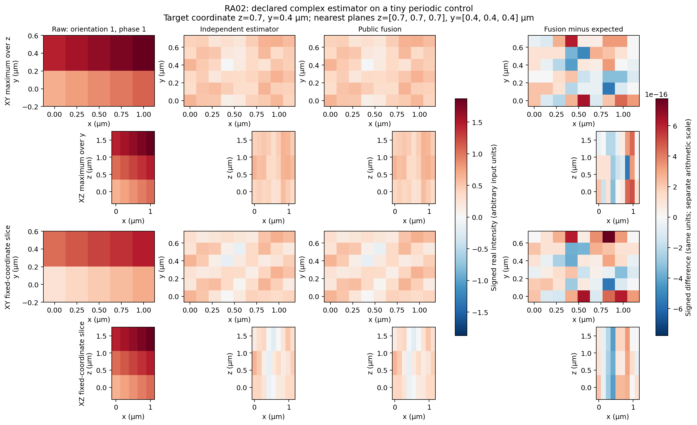
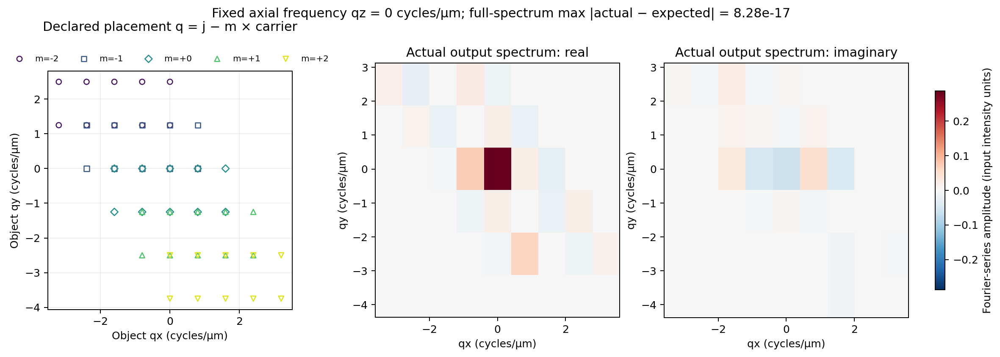

# Five-order conventions and matched periodic inverses

Version 1.0. RA02 comparison.

A reconstruction can use the same illumination harmonics yet solve a different inverse problem. This comparison separates three questions: do known phases recover the intended harmonic coordinates; does spectral fusion implement its declared estimator; and does a separately assembled raw-image inverse give the same answer when its metric, source basis and penalty match?

The [public control contract](../contracts/reference-alignment-ra02-v1.md) records the assumptions before tests. Tiny constant, displaced-point, signed-mode and asymmetric complex-transfer controls protect phase signs, brightness and frequency placement. These are finite periodic algebraic controls. They establish no full-field recovery, continuous-optics accuracy, experimental calibration, resolution gain or reference C parity. The reference program is not executed.

## What is compared

For supplied phases phi, the volume observations follow

`I = dc + 2 Re(c1 exp(i phi) + c2 exp(2i phi))`.

The represented floating-point phase basis uses phasor squaring for order two. Fitted cosine/sine coefficients Bm,Cm therefore mean `cm=(Bm-i Cm)/2`. Unequal phase spacing is valid; its fitted DC generally differs from the image mean. An overdetermined off-model acquisition receives a least-squares projection.

| Quantity | Declared convention |
| --- | --- |
| Array and carrier axes | z/y/x; carrier columns y/x in detector bins |
| Units | distances µm, frequency cycles/µm, phases radians, arbitrary input intensity units |
| Fourier coefficients | negative-exponent finite sum divided by detector sample count |
| Output synthesis | positive-exponent finite sum with no additional divisor |
| Signed placement | specimen q = detector j − m × carrier, without wrapping into the output window |
| Negative orders | conjugate transfer and complete modular frequency reflection on z/y/x |
| Transfer origin and gains | origin phase already encoded; gain multiplies each transfer once |
| Ridge and apodization | squared-transfer ridge in the inverse; a separate output amplitude mask afterward |
| Even Nyquist | one canonical negative endpoint; an expanded selected lift may legitimately be complex |

Spectral fusion forms `U=sum conj(T)*D`, `V=sum abs(T)^2`, and `Q=U/(V+lambda)` where the denominator is positive; otherwise Q=0. The output mask multiplies Q. This declared formula accepts complex transfer records that need not describe a real optical acquisition. A nonzero imaginary output alone establishes no defect.

## Why an exactly matched raw inverse can agree

Write the returned real phase coordinates as `z=[dc,Re(c1),Im(c1),Re(c2),Im(c2)]`. Their represented raw phase matrix is `K=[1,2c,-2s,2c2,-2s2]`. For exactly five full-rank phases define

`G=diag(1,2,2,2,2)`, `W=K^-T G K^-1`.

Then `(K delta_z)^T W (K delta_z) = delta_dc²+2|delta_c1|²+2|delta_c2|²`. Spatial Parseval converts that metric to the five signed Fourier-band residual norm. Negative bands are determined conjugates; the factors of two do not create extra independent acquisitions. Ideal orthogonal phases would give W=I/5. Stored floating-point phase angles require their represented metric or an explicit perturbation allowance.

The independent real observation matrix A uses direct finite circular kernels, carrier modulation and represented phase synthesis. Let B synthesize the chosen real source basis, M count detector samples and P count output samples. It solves

`[A^T (W tensor I) A/M + lambda B^T B/P] theta = A^T (W tensor I) raw/M`.

A constant/cosine/sine basis has penalty diagonal entries 1,1/2,1/2,… . Replacing that matrix with the identity changes the penalty. Equality additionally requires conjugate-closed source support, a compatible real DC transfer, correctly reflected side transfers, unique signed lifts, and consistent observation multiplicities. Output masking is a separate operation.

The matched controls compare independently assembled forward maps, adjoint identities, raw and transformed objectives, normal residuals and actual output coordinates. They include a nonzero deterministic raw residual, so the inverse comparison is stronger than simply recovering a source used to generate noiseless data. A separate rank-deficient control makes unsupported modes explicit. Independent tiny positivity examples show when an inactive constraint agrees and an active one changes the minimizer; public fusion gains no positivity feature.

## Evidence and reproduction

The asymmetric case has two orientations, six unequal phases, native shape `(3,2,5)` and output shape `(3,6,9)` in z/y/x. Native spacing is `(0.7,0.4,0.25) µm`; the field is `(2.1,0.8,1.25) µm`. Carriers are `(1,-1)` and `(-1,1)` detector y/x bins, gains 0.75 and 1.5, ridge 0.5 and a declared nonuniform amplitude mask. The transfer-origin coordinate `(0.7,0.4,0.5) µm` is fixed before output rendering. This fixture has no bead catalogue or fitted peak.



The first column shows the fixed first phase of the first orientation. Columns 2–3 show the independent finite-sum estimator and public fusion. Rows show XY/XZ maxima and XY/XZ slices at the nearest stored z/y planes to the declared coordinate (first index on ties). All three intensity columns share one linear signed scale. The difference column uses the same intensity units on a separately labeled arithmetic scale; its maximum-intensity projection rows subtract the two projections. Physical axes/aspect are retained. Samples are at integer multiples of spacing from index-zero origin; display pixels use half-sample edges. No alignment, fitted scaling, clipping or recentering is applied. Pale output relative to raw input is an actual consequence of this declared ridge/mask/complex estimator, not evidence of physical recovery.



The left panel derives the five signed geometric band placements from the actual first-orientation carrier and native detector grid, using q=j−m×carrier. It is a declared geometry visualization, not an additional measured intermediate. The right panels retain actual real and imaginary output Fourier-series amplitudes on a shared linear scale at fixed qz=0 cycles/µm. The reported error uses the whole spectrum, not a selected peak/plane. Arbitrary accepted transfers need not describe a physically real optical acquisition.

| Comparison | Observed maximum complex-modulus error | Product budget | Separate observer allowance |
| --- | ---: | ---: | ---: |
| Centered spectrum | 8.283304597789254e-17 | 1.1643508339819367e-8 | 5.1298255643996316e-11 |
| Synthesized volume | 7.7981103139771e-16 | 1.8993472979330342e-6 | 8.310317414327403e-9 |

All entries use arbitrary input intensity units. Budgets were derived before product observations from epsilon 2^-52, dimensions N=6, M=30, P=162, input scale 2.222599445787886, represented phase condition 2.0506711178907264 and denominator margin 0.5. The independent roots/sums and least-squares expectations use 70-digit Decimal arithmetic; stored-input/product and observer errors remain separate. These conservative project budgets establish no physical accuracy. The comparison uses product budget plus observer allowance, never a threshold fitted to observed residuals.

The real-coordinate inverse controls use native/output shapes `(1,7)/(2,14)` in 2D and `(3,1,7)/(3,1,11)` in volume, with 3 and 9 real source coordinates respectively. Their phase conditions are 1.5612783539813468 and 1.8394745162552584; normal-system conditions are 2.7980597819327566 and 2.000000000000001. Predeclared assembly/solve comparison tolerances are 5.490760054250515e-8 and 1.5885168921983148e-6. The source Gram penalty has entries 1 and 1/2. A wrong identity penalty must differ by more than 100 times the corresponding allowance. The 2D residual is phase-dependent but spatially constant so its relocated bands remain in that declared source subspace; this is not arbitrary-data equivalence for the full expanded 2D window.

The [frozen array archive](evidence/ra02/arrays.npz) retains input, phases, carriers, gains, transfers, mask, regularization, physical grids, independent expectations, actual outputs and complex signed differences. [Machine-readable measurements and SHA-256 identities](evidence/ra02/summary.json) bind the runtime, lock, reviewed fixture and rendering source; ZIP container byte identity is distinguished from numerical array equality.

Reproduce arrays in the locked project environment, then render them separately:

```sh
.venv/bin/python scripts/source_free_check.py --timeout 300 python tests/reference_alignment_ra02_fixture.py --output docs/reports/evidence/ra02/arrays.npz
uv run --no-project --with matplotlib==3.10.7 --with numpy==2.5.3 python docs/reports/evidence/ra02/plot_comparison.py --arrays docs/reports/evidence/ra02/arrays.npz --output docs/reports/evidence/ra02
```

The renderer calls neither reconstruction nor an oracle. Matplotlib 3.10.7 and NumPy 2.5.3 are isolated plotting inputs; no project dependency changes. The tests cover the mathematical controls through public APIs; images remain explanatory evidence rather than test oracles. The exact-candidate full local gate and fresh independent candidate review are recorded outside tracked candidate bytes through the task pointer.

## Limits of equivalence

Unequal phase spacing changes an unweighted raw metric; diagonal separated-band weighting need not preserve that objective. Arbitrary complex side transfers can still be real-compatible under the stated conjugacy conditions, while a non-Hermitian DC map need not be. Detector aliases can give multiple output lifts for one native source mode. A selected complex Nyquist lift is different from a real interpolation convention. Ridge shrinkage, an asymmetric output mask and active positivity can also change the comparison.

The 2D operation retains its own doubled grid, transfer constraints and integer interpolation endpoints. The volume operation retains native z and its complete nonwrapping lateral output window. No extra real projection, fitted scaling, clipping, peak recentering or interpretation change is introduced to make the outputs agree.

The [task pointer](../tasks/RA02.md) links the sole local state, independent role evidence, full-candidate verification and retained historical accounting. Required platform checks remain separate; missing evidence is reported as missing.
