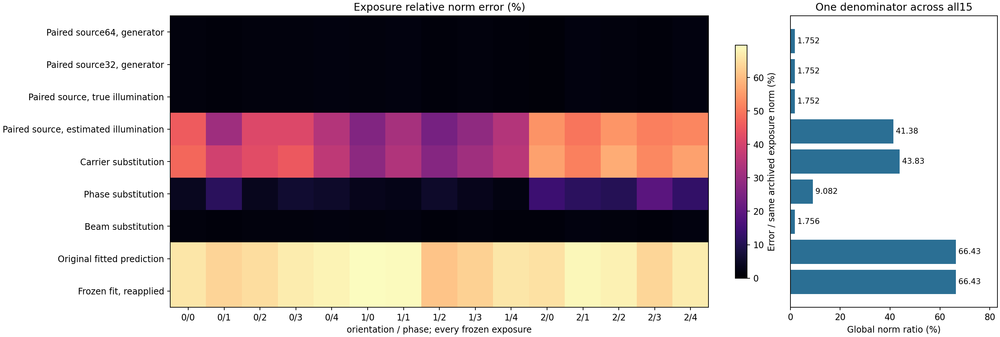
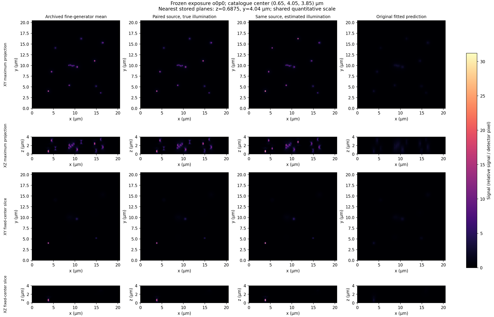
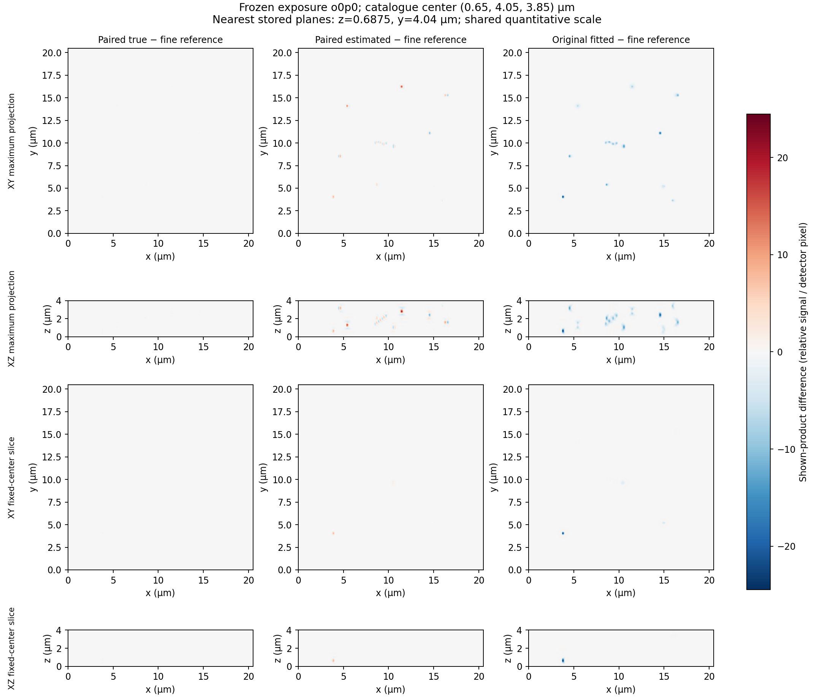
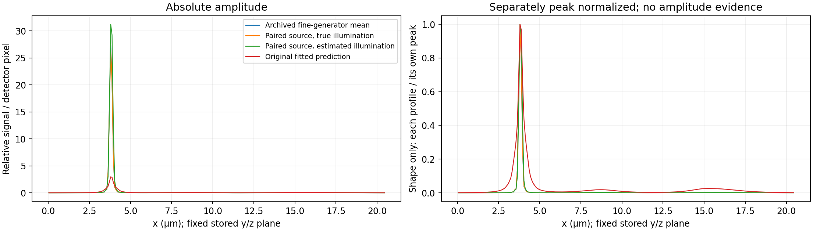
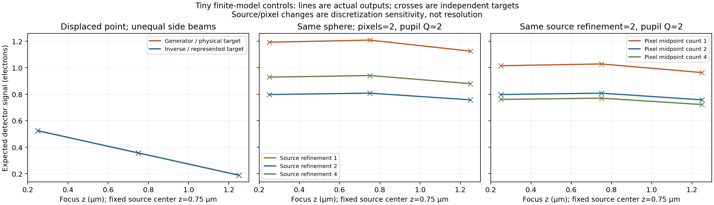

# Source sampling and illumination across all study exposures

**Supplying the paired known source gives 1.7517% image error at true illumination and 41.3784% with the frozen estimated illumination, over all 15 noiseless exposures.** The original fitted-source prediction remains at 66.4298%. These compare against one common archived fine-generator reference. They are conditional forward comparisons, not additive causal shares or recovered-source accuracy.

RA03 adds an evaluator. It keeps the original 27 objects, settings, seeds, archived means, fit and predictions fixed. It performs no source/nuisance fit, alignment, fitted brightness scale or density change. The existing optical generator and inverse operator are unchanged. A newly introduced wrapper phase-reduction defect was diagnosed and corrected before this experiment; that legal large-phase boundary is separate from the ordinary-phase archived study.

Each cell covers one complete detector volume. All arms use the same archived fine reference for that exposure; the bar uses the ratio of global norms across all 15, rather than an average of exposure percentages. Carrier and phase substitutions are anchored at the fixed physical calibration origin. The carrier substitution also recomputes its axial frequency and specimen-origin phase transfer.

| Controlled arm | All 15 relative norm error |
|---|---:|
| Paired float64 source, physical generator, true illumination | 1.75166035% |
| Same generator, explicitly rounded float32 source | 1.75166026% |
| Paired float32 source, inverse map, true illumination | 1.75166169% |
| Same source/map, frozen estimated illumination | 41.37842007% |
| Estimated carrier; true calibration-origin phases/beams | 43.83206561% |
| Estimated calibration-origin phases; true carrier/beams | 9.08233404% |
| Estimated beams; true carrier/phases | 1.75615669% |
| Original archived fitted-source prediction | 66.42975943% |
| Current map reapplied to the original frozen fit | 66.42975943% |

## Actual fixed-center volume comparisons

Rows retain XY/XZ maximum-intensity projections and XY/XZ slices through the predeclared catalogue row 0 center `(0.65, 4.05, 3.85)` µm. Nearest stored planes are z = 0.6875 µm and y = 4.04 µm, with first index on ties. Every column shares the same quantitative intensity scale. Axes and aspect use physical µm. The field is 4 × 20.48 × 20.48 µm in z/y/x. These are blurred detector predictions; agreement does not demonstrate source recovery or improved resolution.

Differences are prediction minus the archived fine reference. For projections, the figure subtracts the corresponding projected images; it does not project a signed-difference volume. The shared signed scale preserves amplitude and sign. No recovered-peak recentering, clipping, registration or rescale is applied. Small paired-true differences are correspondingly faint on this common scale.

Both profiles use the same stored z/y planes over the complete x field. Left retains amplitude. Right divides each profile by its own peak and is **shape only**; it supplies no amplitude evidence. Peak positions stay at their original physical coordinates.

## What the controlled differences measure

Let `D = sqrt(sum of reference² over all 15 exposures) = 1130.15265233747` in relative signal units. Every conditional norm below is divided by this same D. Full per-frame differences, signed means, maximum errors and aggregate counts are in [summary.json](evidence/ra03/summary.json).

| Conditional contrast | Norm of change / D | Meaning and limit |
|---|---:|---|
| Archived fine result→paired64 physical generator | 0.0175166034688998 | Axial-basis relocation plus explicitly recorded pair/gauge and generator arithmetic; not a source-error floor |
| Paired64→paired32 physical generator | 2.38853219816852e-8 | Explicit source cast effect, up to generator arithmetic |
| Paired32 physical generator→matched inverse map | 8.02700741840767e-8 | Joint cache-builder/representation, application and generator-reference arithmetic |
| Paired inverse true→estimated illumination | 0.407695135442351 | Conditional change of frozen illumination on the same source/map |
| True→carrier substitution | 0.431805233912469 | Fixed calibration-origin phase anchor; associated origin transfer/axial frequency change with q |
| True→phase substitution | 0.0881579705730582 | Estimated calibration-origin phases at true carrier/beams |
| True→beam substitution | 0.000868257923501465 | Ordered estimated beams at true carrier/phases |
| Original prediction→current frozen-fit reapplication | 3.97826096001969e-17 | Numerical reproduction; maximum pixel change 1.33226762955019e-15 relative signal units |

Residual vectors can telescope; their norms do not, because cross terms may cancel or reinforce. The combined illumination change is smaller than the carrier substitution here. No percentages of causal blame are inferred.

The paired grid has 125 nm axial spacing, versus 62.5 nm in the archived fine source. Pairing adds adjacent masses and relocates them from coarse-center ±31.25 nm to the coarse center. It is not a freshly rasterized coarse sphere. Source entries are integrated weights, with no source-cell-volume multiplier.

The fixed conversion is `true_gain/estimated_flat_contrast = 1.7/1700.0256946587622 = 0.0009999848857232905`. It selects the historical reference-flat-relative coordinate; it is not an image-fitted scale or a claim of physical photon calibration. The same conversion applies to the fine means and paired known source. Original fitted data already use this coordinate and receive no additional conversion.

[representation-ledger.json](evidence/ra03/representation-ledger.json) separates the exact pair-sum mass-rounding change 1.76214598468505e-12 electrons, gauge-multiplication mass-rounding change −3.49757939300732e-14 relative source units, and float32 cast mass change −2.89623475424605e-6 relative source units. The cast changes 1623 coefficients, loses no nonzero coefficient, and has source-relative norm error 2.97579794829076e-8. Rational numerators/denominators are strings to preserve exact integers for machine-readable output consumers.

The matched generator32 and inverse use **the same four lateral midpoint samples**, so their contrast contains no pixel-quadrature model mismatch. Its cache/application terms are not independently apportioned at full field. The public cache builder's fidelity includes pupil evaluation, transformation and represented storage; isolated storage rounding is unmeasured.

## Independent tiny controls

Q denotes the number of radial-pupil quadrature nodes.

Lines are actual public-operator outputs; crosses are independently calculated finite targets. The displaced unequal-beam point distinguishes source-minus-focus sign. The middle panel holds a sphere, box, brightness, pixels and pupil rule fixed while using source refinements 1, 2, 4. The right holds source refinement 2 and pupil order 2 fixed while changing pixel midpoint counts 1, 2, 4. These controls span focus z = 0.25, 0.75, 1.25 µm in a 1.5 × 1 × 1 µm box; the sphere radius is 0.43 µm. They establish finite discretization sensitivity, not continuum convergence or resolution. No favourable source/grid or seed is selected after measurement.

The independently reconstructed tiny cache differs from its finite-Q physical kernel by 2.96251e-8 of the row/column norm scale. Separately, applying the represented cache differs from its direct finite sum by at most 2.07301e-8 electrons. These measurements apply only to the declared tiny inputs. The full-field matched contrast remains joint. [Tiny arrays, physical geometry, source/actual/expected hashes and limits](evidence/ra03/tiny-controls.json) retain the actual observations; later phase supplements leave those existing helper bodies unchanged.

Fresh blind B validated the finite-sum oracles and risk map. Its first two omissions were corrected before implementation. After implementation, two explicitly labeled supplemental controls revealed incorrect handling of a phase of 1e20 radians and a small origin offset. Fresh B independently validated those failures at 200/260 digits; C corrected only the new evaluator, and all 62 cases pass. This preserves the original test-first checkpoint and does not relabel the supplements as initial evidence.

## Every exposure

| Orientation/phase | Known paired source, true illumination | Same source, estimated illumination | Original fitted prediction |
|---|---:|---:|---:|
| 0/0 | 1.698828% | 45.636694% | 66.307815% |
| 0/1 | 1.634292% | 30.830017% | 63.604112% |
| 0/2 | 1.690116% | 41.609918% | 64.860751% |
| 0/3 | 1.864032% | 41.660782% | 67.101956% |
| 0/4 | 1.923011% | 34.586230% | 68.143115% |
| 1/0 | 1.775007% | 25.932388% | 69.739246% |
| 1/1 | 2.057196% | 32.411511% | 69.362402% |
| 1/2 | 1.454820% | 24.094334% | 61.042537% |
| 1/3 | 1.748900% | 28.570448% | 63.125576% |
| 1/4 | 1.513928% | 34.468090% | 66.361242% |
| 2/0 | 1.353366% | 54.029076% | 65.598367% |
| 2/1 | 1.911863% | 49.715364% | 68.858374% |
| 2/2 | 1.836142% | 54.462785% | 68.052698% |
| 2/3 | 1.600109% | 51.040314% | 63.930314% |
| 2/4 | 1.913212% | 52.046097% | 67.053769% |

Every row covers 2,097,152 samples; the aggregate covers 31,457,280. All nine arm metrics, manifests and conditional per-frame contrasts are retained in [summary.json](evidence/ra03/summary.json). No per-exposure result was omitted or selected for acceptance.

## Reproduction, custody and resources

The original archive is retained locally: 1,706,228,839 bytes, SHA-256 `4de84ac559e2fcf93a2e038eea571366af54207d368cfb2f0bd50e78129257f0`. Exactly 38 named regular members were copied and hash-checked; no links were extracted. Fine source, all 15 means and original fitted outputs match their native manifests. The [frozen full plan](../studies/full-noisy-study-2026-10-26/full-plan.json) reproduces every original fine-source coefficient exactly. Fine means are the **archived generator results**, not newly regenerated fine-optics outputs. No unavailable original was substituted with a derived bundle.

The controlled run used `PYTHONPATH=.:src .venv/bin/python artifacts/ra03/run-study.py` from this task's managed worktree. The retained one-off caller supplies the original arrays/settings explicitly to `scripts.reference_alignment_ra03.evaluate_orientation`, once per orientation, with no fitting. Its exact SHA-256 and all material source/lock/test/fixture/input/output identities are published in [summary.json](evidence/ra03/summary.json). Large arrays, original native manifests, source-reproduction/exact-rounding evidence and literal commands remain locally under the sole task ledger `artifacts/ra03/current-state.json`; they are not uploaded as public large-data assets. Reproduction requires those identified original data or a separately identified regeneration.

The first completed run took 371.503742290981 seconds including input checks, evaluation, serialization and descriptive metrics. Per-orientation times 121.107164167013, 123.482524708001 and 123.229538082989 seconds overlap that total and are not additive. Native macOS process peak resident memory was 2,022,916,096 bytes; physical footprint and a guarantee for other inputs are unmeasured. It retained 32 NumPy array files totaling 2,617,249,792 file bytes. Before/after original hashes and material source identities matched. No other heavy phase ran concurrently. Host swap/virtual-memory snapshots are contextual, not task-attributed measurements.

Executed environment: Python 3.13.12, NumPy 2.5.3, SciPy 1.18.1, macOS 27.0.1 arm64. Figures used isolated Matplotlib 3.10.7 with NumPy 2.5.3; project dependencies are unchanged. Same-process plotting distributions are recorded; a temporary uv environment prefix is historical process evidence, not a claim that its executable remains available afterward. Native independent Ubuntu 24.04/macOS 15 verification is a separate delivery obligation.

[The public contract](../contracts/reference-alignment-ra03-v1.md) and [task pointer](../tasks/RA03.md) define scope, ownership and checks. Final exact-candidate full-gate, fresh final reviewer D, continuous integration (CI), and cleanup results are recorded outside tracked candidate bytes in the sole ledger and PR appendix. Passing forward controls does not establish a converged reconstruction, a physical resolution gain, continuous-optics accuracy, noise robustness or owner-provided C parity. No legacy C was built, invoked, imported, copied or linked.
