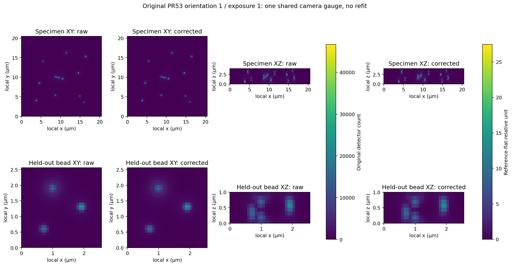
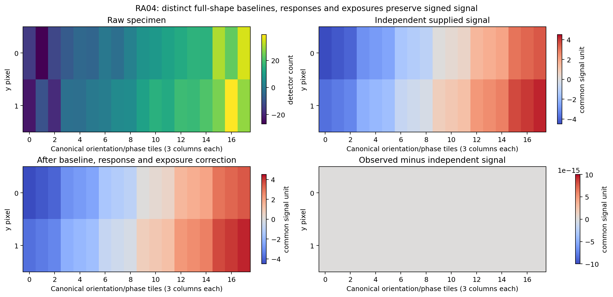
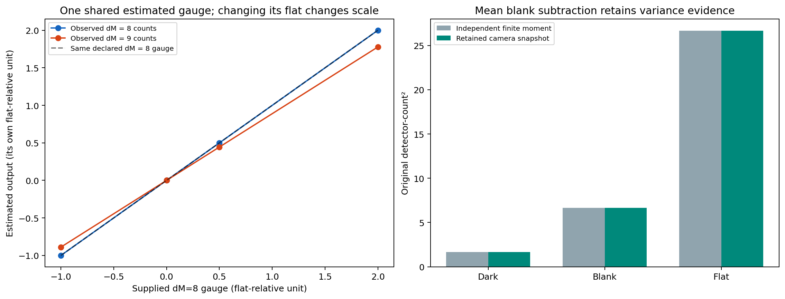
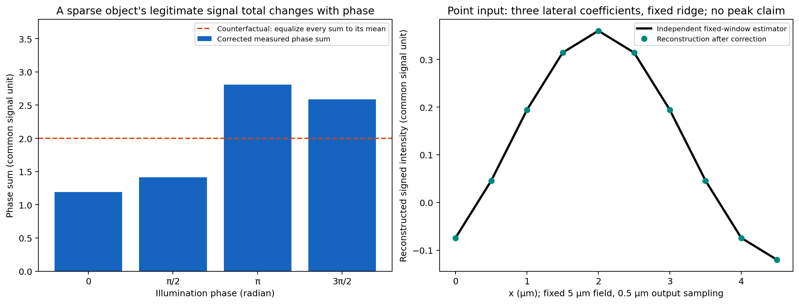

# RA04 — Preserve camera and intensity meaning

`correct_alignment_pair` gives specimen and bead frames one explicit declared signal gauge. It composes existing raw acquisition, scalar-camera and linear-response operations, then applies the supplied exposure division once. Signed corrected samples and all camera uncertainty ingredients remain available. [Usage and unit-chain table](../usage/reference-alignment-ra04.md), [public contract](../contracts/reference-alignment-ra04-v1.md) and [independently accepted test checkpoint](evidence/ra04/test-checkpoint.json) define the boundary.

These are measured correction/composition controls. They establish no improved source recovery, resolution, noise removal, owner-reference parity or real-instrument calibration. The original noisy acquisition, seeds, settings and frozen optical/specimen fits were not changed or rerun. Camera finite statistics were recomputed from the exact original dark/blank/flat images.

## Original recorded specimen and held-out bead



Original PR53 orientation 1 / exposure 1, before and after the new adapter. XY is the maximum over z; XZ is the maximum over y. Coordinates are local to each recorded volume. The specimen field is 20.48 × 20.48 × 4 µm; the held-out bead field is 2.56 × 2.56 × 1 µm. Physical aspect is retained. Both fields and projections share one raw-count display scale and its exact affine image in relative units; no individual peak normalization is used. The images therefore preserve the same spatial pattern while their units change. Maximum-intensity projections conceal depth and negative samples; the full-array counters below retain them.

One original camera estimate supplies the effective blank baseline **20.1973062104 counts** and response **1700.02569466 counts per reference-flat-relative unit**. Exposure factors are explicitly one under the recorded common-dose conditions. The adapter and independent explicit `(raw−M_B)/dM` composition agree exactly on every stored binary64 sample in all 15 exposures of each member:

| Member | Exposures | Canonical orientation/phase/z/y/x shape | Maximum absolute composition difference, relative unit | Negative samples retained | Full corrected range, relative unit |
|---|---:|---|---:|---:|---|
| Specimen | 15 | 3 × 5 × 32 × 256 × 256 | 0.0 | 5,693,052 | [-0.0163461778, 34.5008044] |
| Held-out bead | 15 | 3 × 5 × 8 × 32 × 32 | 0.0 | 1,951 | [-0.0106138436, 47.7360545] |

This is a conditional equation/composition comparison using the observed camera point statistics. It is not an independent accuracy measurement of those statistics or the optical inverse. The displayed color limits cover the selected orientation/exposure; the table covers all exposures. Distinct opaque source-group calibration labels are newly declared for the two RawAcquisition records and preserved. They are provenance labels, not measured instrument identities. Recorded geometry and the complete original observation manifest remain opaque source metadata.

The original within-frame count variances `(dark,blank,flat)` remain **(18.097903613, 35.342281845, 2916.443545392) counts²**. The empirical frame-mean standard errors remain **(0.004685188, 0.013735563, 0.065486988) counts**. Mean subtraction does not remove blank shot noise. These retained values are inputs for qualified uncertainty analysis, not standard deviations of corrected pixels or automatic reconstruction weights. The optional gain statistic remains separate from the output units and certifies no instrument calibration.

The 21 original array files total **267,061,888 B**, including NumPy headers. Each matches the original observation-manifest digest, and archive SHA256 `4de84ac559e2fcf93a2e038eea571366af54207d368cfb2f0bd50e78129257f0` was unchanged before/after restoration. The manifest SHA256 is `1aeae458173155d0609020d25b299e087e16ffa6e31453f744e8b048584ebd5c`. Full corrected arrays remain retained locally by adapter-source identity; their hashes and native file sizes are in [the numerical record](evidence/ra04/summary.json). Original bytes were not replaced by regenerated data.

## Independently supplied coefficient and exposure maps



Two orientations × three phases, each a 2 × 3 specimen image, are tiled in canonical order. The upper-left image is raw count data; the other signal panels use one common signed signal scale. Independently chosen full-shape baselines, responses and exposure factors invert the finite relation `C=O+r*t*S`. Exact dyadic controls give maximum absolute error **0** for the specimen and **0** for the distinct-shape bead member. All **18** negative specimen samples survive. The error panel has a fixed ±10⁻¹⁴ signal-unit display range; its actual values are all zero. That display range is not a measured noise floor or a general accuracy bound.

`O` is the effective subtraction baseline at that member's acquisition conditions. If it includes optical background, do not subtract a dark/blank mean again. Responses may convert different declared raw-unit labels into the shared output unit. Equal, different and missing calibration IDs remain opaque provenance. In estimated mode only, identical raw-unit labels express the caller's shared affine-calibration assertion; string equality cannot authenticate its physical applicability.

## Supplied and estimated gauges



The left panel uses independent signed signals `[-1,0,0.5,2]` and raw samples `12+8*S`. Deterministic three-frame, four-pixel dark/blank/flat controls have means `(4,12,20)` counts and variances `(5/3,20/3,80/3)` counts². Observed `dM=8` reproduces the independently supplied gauge exactly. Changing the finite flat mean to 21 counts changes `dM` to 9; the same raw data then returns `8*S/9` in that different observed gauge, with maximum difference **0.222222222** from the supplied `dM=8` gauge. Both curves agree exactly with their independently specified finite-gauge expectations. This demonstrates dependence on the selected reference; it is not a statistical accuracy study or instrument calibration.

The right panel keeps the original count² variances, including blank variance, exactly in the returned camera snapshot. No variance is subtracted away as a claim of uncertainty reduction. Repeatability's numerical target uses returned frame/group means as required by the existing scalar contract; independent source-moment accuracy checks remain separate. [Fresh B2 review](evidence/ra04/B2-review.md) records the resolved oracle counterexample and the complete risk/omission assessment.

## Reconstruction scaling and why frame-sum equalization is unavailable



A point of amplitude 2 at `(y,x)=(1,2)` µm on a fixed 3 × 5 detector grid has phase-dependent sums **1.19098301, 1.41221475, 2.80901699, 2.58778525 signal units**. Its modulation is 1/2 and lateral carrier is 1/5 cycles/µm. The dashed line is the explicitly labeled counterfactual of making every sum equal to its mean. It would erase legitimate modulation, so the target operation reports requested per-frame-sum equalization as unavailable. The bars are actual corrected data; that counterfactual is not an enabled product mode.

The right curve compares actual reconstruction after correction with the independently specified three-coefficient estimator. The sampled optical transfer function (OTF) is a fixed delta response on `(1,1)` µm detector pixels; the output samples `(0.5,0.5)` µm preserve the same 15 µm² field. Only x-frequency coefficients −1,0,+1 at y-frequency row zero are displayed. Regularization is `1/8` in squared effective-transfer units. At these modes `V=9/8`, hence `V/(V+1/8)=9/10`. This prescribed shrinkage is included in the expected amplitudes; no fitted output rescaling is used.

| Control | Source scale | Observed DC coefficient, signal unit | Maximum spectrum error, signal unit | Maximum image error, signal unit |
|---|---:|---:|---:|---:|
| signed constant | 1 | -1.8 | 0 | 0 |
| signed constant | 2 | -3.6 | 0 | 0 |
| point selected coefficients | 1 | 0.12 | 2.776e-17 | 5.551e-17 |
| point selected coefficients | 2 | 0.24 | 5.551e-17 | 1.11e-16 |

At point scale one, DC `3/25` times field area 15 µm² gives integrated intensity `9/5 signal·µm²`. The plot is the selected finite-window estimator, not recovered point shape, invariant peak intensity or a resolution claim. The signed constant remains negative. The full test checkpoint also exercises source scale 1/4.

## Numerical, mode and compatibility limits

The declared operation is sequential binary64 subtraction, response division and exposure division. A combined `response*exposure` denominator can overflow or round differently. Finite underflow and signed zero are accepted; nonfinite arithmetic stages have explicit errors. Domain validation precedes unavailable selection, while unavailable modes do not execute correction arithmetic. Tests independently cover scalar/full-shape forms, canonical coordinates, range, metadata, input preservation, NumPy/warning state and mutable-storage separation.

Estimated changed exposure is explicitly unsupported in this slice. With an additional applicable sensor/background exposure law, a dark-based decomposition can be valid; the scalar point record does not assert that new law. Nonpositive estimated flat contrast also returns a complete unavailable pair. No missing response or gain is replaced by an identity coefficient. Unknown physical gain does not turn relative units into photons.

The paired output is separate from raw acquisition records. Corrected arrays can enter compatible direct reconstruction calls. Existing image-only bead/specimen fitters still accept raw counts and perform their own normalization; passing these corrected arrays into those raw-count paths would normalize twice. This report does not migrate those interfaces or reevaluate source-recovery quality. No saturation repair, clipping, bleaching model, noise removal or camera-specific pixel heuristic was selected.

## Reproduction and provenance

Use a fresh checkout with Python 3.13.12 / uv 0.12.19. The product tests use locked NumPy 2.5.3, SciPy 1.18.1 and h5py 3.16.0. Figure rendering uses an isolated environment with the exported locked runtime and Matplotlib 3.10.7; it does not add a product dependency.

```sh
uv sync --locked --all-groups
mkdir -p artifacts/ra04
uv export --locked --no-dev --format requirements-txt --no-hashes > artifacts/ra04/plot-requirements.txt
uv venv --python .venv/bin/python artifacts/ra04/plot-venv
uv pip install --python artifacts/ra04/plot-venv/bin/python -r artifacts/ra04/plot-requirements.txt matplotlib==3.10.7
MPLCONFIGDIR=artifacts/ra04/plot-cache artifacts/ra04/plot-venv/bin/python docs/reports/render_reference_alignment_ra04.py --small-only
```

This reproduces the three public fixture figures without the original archive. For the original recorded figure, restore the 21 exact original array members and `complete.json` from archive prefix `pr53-full-study/artifacts/pr53-full-study/full-noisy-trial1/observations/` into `artifacts/ra04/original-observations/`, verify the published manifest/file hashes, then run without `--small-only`. The original archive remains required; regeneration is not an equivalent original input. The local restoration receipt and producer are retained in `artifacts/ra04/intake/`.

[The renderer](render_reference_alignment_ra04.py) records source/test/fixture/lock hashes and versions in [summary.json](evidence/ra04/summary.json), verifies input identities before/after numerical rendering, and preserves candidate-addressed full corrected arrays. Full environment/distribution, native resource and run records remain local under `artifacts/ra04/checks/`. The corrected final render took 2.236181625 s with native macOS peak resident set size **1,434,730,496 B**. The first render took 19.385420542 s and built the font cache; it and its original outputs remain retained. These are separate renderer-process observations, not product memory/timing guarantees or additive elapsed time. Only a diagnosed legend-layout change separates the render source revisions; the other three PNGs are byte-identical.

The [task pointer](../tasks/reference-alignment-ra04.md) identifies the sole local Current state. Exact final candidate, canonical full verification, fresh final review, required hosted-platform results and preservation-aware cleanup are recorded outside tracked candidate bytes in that local evidence and the PR technical appendix. Advisory percentage coverage does not replace behavior/risk review or required native report integrity.
