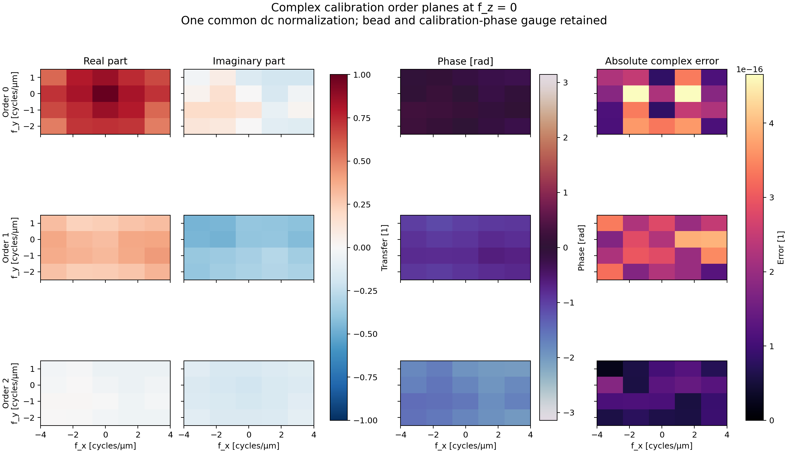
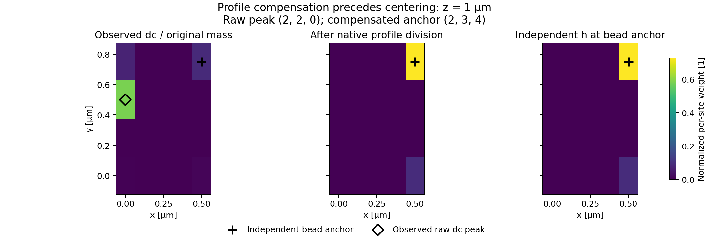
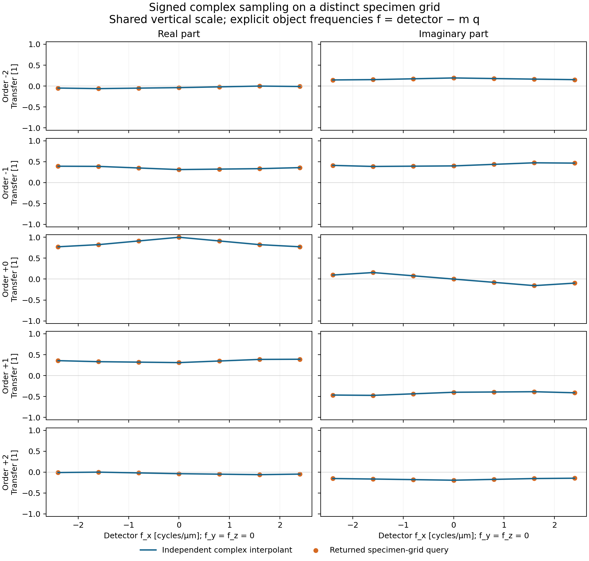

# Matched complex order calibration: retained numerical comparison

Camera-corrected bead volumes have a direct calibration path in [RA05](../contracts/reference-alignment-ra05-v1.md). This comparison exercises that path through the real public camera, calibration and frequency-sampling functions. It retains the original components and exact zero-order sum, removes a declared discrete bead profile on the native grid, and preserves relative complex order amplitude and phase.

The inputs describe a known finite per-site model. Phases, carrier, profile, sampling and matching instrument gauge are supplied. These observations establish the declared numerical behavior; they do not authenticate an instrument, estimate an arbitrary pupil or establish continuous-optics accuracy.



**Complex orders.** These are actual returned orders zero, one and two at axial frequency zero. Real and imaginary panels share one signed dimensionless scale across all orders; phase uses radians and error uses one shared absolute complex-error scale. Errors compare against a separate 70-digit Decimal fit of the represented phase design, direct finite Fourier sums, native profile division and centering. Image tiles extend half a bin for display. Only native bin centers define the closed sampling hull. No masking, support cleanup or per-order scaling is applied.

| Order | Maximum complex error [1] | Propagated allowance [1] |
|---|---:|---:|
| 0 | 4.965e-16 | 4.150e-09 |
| 1 | 3.925e-16 | 4.660e-09 |
| 2 | 1.779e-16 | 3.451e-09 |

The allowances include the public separation, transform, profile-conditioning, division and centering budgets plus an explicit independent-observer allowance. They are arithmetic conformance bounds, not measured optical uncertainty. The native profile magnitude minimum is 0.6; the requested all-node threshold is 0.15. The largest observed error is about 1.439e-07 of the smallest allowance. macOS `longdouble` has epsilon 2.220446049250313e-16; no extra precision is assumed.



**Bead correction.** At z = 1 µm, the raw zero-order component divided by its original mass has its peak at z/y/x = (2,2,0). Native profile compensation recovers anchor (2,3,4), also the independent shifted impulse-response peak. The three panels share one per-site-weight scale and show actual raw/compensated results beside independent h. x/y axes use µm. The compensated peak margin is 13/22 ≈ 0.590909, well above the propagated localization uncertainty. Compensation precedes centering and interpolation.

The supplied bead grid is (3,4,5), spaced (0.5,0.25,0.125) µm in z/y/x. Seven unequal phases are [0.02,0.77,1.81,2.63,3.59,4.72,5.62] rad. Carrier bins are (1,-1). The retained generator uses three unequal complex beam amplitudes and a nonseparable four-site h. The discrete profile weights are 8,1,1 at the declared sites, with its largest site away from index zero. It computes exposures from squared real-space fields; its h, beam coefficients, brightness and anchor are evaluator-only inputs.

The actual camera inputs use nonidentity offset, response and exposure maps. Corrected bead and specimen data declare one `reference_signal` output gauge despite different source units, grids and opaque identifiers. The adapter receives corrected data and the declared calibration inputs, without the evaluator's h, beam coefficients or brightness. The exact original mass is 1152921504606847093/36028797018963968 `reference_signal`, about 32. One common normalization removes bead brightness. Original components and mass retain their corrected unit; absolute throughput is not inferred.

For each native order m, the comparison forms C_m(k)/S, divides by P(k−m kc), and applies the bead-centering phase exp(+2πi k·b/N). Here C is the independent separated component transform, S is the original zero-order sum, P is the normalized profile transform, kc is the carrier, b is the anchor and N is the grid shape. Retained bead/calibration phase remains in the complex response. The profile factors are order dependent; h and illumination g multiply pointwise in real space before transformation.

The point control and the origin-point discrete-profile control both recover (2,3,4). Their maximum complex difference is 3.511e-16, against order-specific allowances no smaller than 5.126e-09. The finite-profile compensated response differs from the point control by at most 4.228e-16, against allowances no smaller than 6.014e-09. An independent three-times-amplitude cohort changes the normalized response by at most 2.483e-16; its observed original-mass ratio is 3.0000000000000004. This cross-call ratio is a floating-point observation, not an exact scaling assertion.



**Signed transfer consumption.** Orange points are actual returned samples for orders −2 through +2. Blue lines are the independent Cartesian complex interpolant. All rows share one dimensionless vertical scale. Detector x frequency runs from −2.4 to +2.4 cycles/µm with y = z = 0. The declared specimen grid is (5,8,10), spaced (0.4,0.125,0.125) µm. Its carrier bins (1,-2) give the same physical carrier (0,1,−1.6) cycles/µm as the calibration. For each signed order, object frequency is explicitly f = detector − m q; returned queries use detector = f + m q. The coordinate offset is (2,−3) calibration samples and the specimen-minus-calibration phase shift is −0.31 rad.

Maximum sampled complex error is 4.653e-16, against allowances no smaller than 3.451e-09. Separate retained non-Cartesian controls vary all three frequency axes. Negative orders reflect all physical coordinates before conjugation. At detector (0,+2,0) cycles/µm, order +1 rejects missing measured coverage while order −1 returns the reflected covered endpoint. Source frequency labels do not authorize wrapping or extrapolation. This example samples transfers; it adds no specimen reconstruction estimator.

A separate prediction check uncenters the measured response, multiplies by the independent native P(k−m kc) and original S, applies independent inverse finite sums and evaluates the represented phase basis. Maximum prediction error to the independent represented fit is 2.842e-14 `reference_signal`, against 6.524e-07; error to the corrected exposures is 2.842e-14. The independent fit residual is 3.553e-15. This is a prediction-consistency relation. The independent transfer comparison above supplies the separate accuracy check.

The [published input archive](data/reference-alignment-ra05-independent-v2.npz) is a byte-identical copy of the original pre-implementation synthetic observation archive, SHA256 `f9b108ce86f834cb4ebf613a601559d73bf863ef7ab8a8eb78b69d9da2a5a3d2`. Its original remains at `artifacts/ra05/A/independent_fixture_data_v2.npz`. The original actual run remains at `artifacts/ra05/figure-observation-1`: raw/map inputs, full returned record arrays/provenance, point/scaled controls, native comparisons, `observations.npz`, `observation.json`, source/environment fingerprints, timestamps and executed source snapshot. Nothing was regenerated for rendering.

One original metadata annotation incorrectly unraveled the raw spatial peak with an extra exposure-phase axis, recording [0,2,2,0]. Rendering derives the correct [2,2,0] from the retained spatial zero-order array and records that qualification in `artifacts/ra05/figure-render-1/render-manifest.json`. Original metadata and arrays remain unchanged. The published measurement source corrects this annotation and permits the declared kernel-generation control's bounded native-precision rounding on other platforms. The original run passed the stronger exact-array control. Neither publication correction changes numerical operations or API inputs/outputs of the observed run. The exact executed source remains retained for audit.

For a fresh observation, use new output directories. The scientific run uses the locked project environment; plotting uses a separate environment without changing project dependencies:

```sh
uv run --locked python docs/reports/reference_alignment_ra05_measure.py artifacts/ra05/reproduction-new
uv run --no-project --python 3.13.12 --with matplotlib==3.10.7 --with numpy==2.5.3 python docs/reports/reference_alignment_ra05_plot.py artifacts/ra05/reproduction-new artifacts/ra05/render-new
```

[Measurement source](reference_alignment_ra05_measure.py), [rendering source](reference_alignment_ra05_plot.py) and the [reviewed independent observer](../../tests/reference_alignment_ra05_fixture.py) expose the full procedure. The retained executed argv/logs use the own locked Python 3.13.12 environment and isolated Matplotlib 3.10.7 plotting environment on macOS arm64. Source and selected installed-runtime files match before/after generation; render inputs match before/after rendering; committed images are byte-identical copies of those renders. The base/system dynamic-library graph is not a complete authenticated build inventory. Standalone report programs are unshipped examples outside the configured runtime coverage scope; their observed runs supply separate evidence. Canonical local verification, independent candidate review and both hosted-platform proofs are separate requirements recorded outside tracked candidate bytes.
