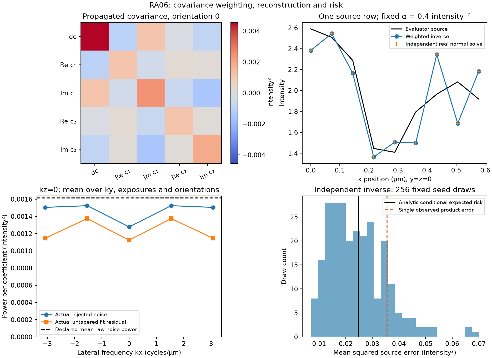

# RA06 covariance derivation and measured inverse

The additive estimator uses the full real observation map and a declared
exposure covariance. It preserves dependence between negative and positive
bands. Output taper follows the inverse. This report's original fixed design is
local `artifacts/ra06/figure-design-v1.json`, copied exactly into
[the public fixed settings](reference-alignment-ra06-design.json). Generated inputs are retained in
`artifacts/ra06/figure-inputs-1`, before any product observations. The
[measurement record](figures/reference-alignment-ra06/measurements.json) retains
array, source and figure identities. Final candidate and gate identities remain
in the sole Current state outside tracked bytes.



The top-left panel shows the actual propagated covariance, including nonzero
cross terms. The top-right compares one actual product row with the independent
real normal-system solve and evaluator source. The bottom-left shows actual raw
noise and fitted-residual power at kz=0, averaged over ky, exposures and
orientations; its dashed line is the declared mean raw Fourier noise power.
The bottom-right uses 256 saved Gaussian draws through the independently
assembled fixed inverse. Its orange line is one actual product reconstruction's
source error. All axes are linear. Intensity is an arbitrary declared common
gauge; covariance and power have squared intensity units. This finite model
establishes neither physical resolution gain nor an optimal penalty.

## Covariance and information

For represented phase design K, exposure covariance Sigma and an observation
vector y at one detector voxel, generalized least-squares separation gives

```
L = (K.T Sigma^-1 K)^-1 K.T Sigma^-1
z = L y
Psi = L Sigma L.T = (K.T Sigma^-1 K)^-1.
```

The product computes these with stable factorizations, not explicit inversion
of the normal matrix. The equations specify the mathematical meaning. For five
full-rank phases L=K^-1. For more phases, the fitted coordinates must use the
declared metric. Unweighted separation can discard relevant information when
exposure noise is unequal or correlated.

For any proposed real coordinate prediction h, let e=y-Kz. The orthogonality
identity `K.T Sigma^-1 e=0` gives

```
(y-Kh).T Sigma^-1 (y-Kh)
  = (z-h).T Psi^-1 (z-h) + e.T Sigma^-1 e.
```

The last term is independent of the specimen but remains part of the reported
raw residual objective. It can be nonzero for overdetermined off-model data.
Equal independent raw noise does not generally yield diagonal Psi under
unequal phases.

With M independent detector voxels and normalized Fourier coefficients, real
coordinate noise has covariance Psi/M at a frequency and pseudocovariance
Psi/M between opposite frequencies. Negative separated bands are conjugate
observations. Treating them as independent complex samples changes the metric.
The real observation matrix automatically retains these dependencies and the
source-coordinate penalty Gram matrix, including self-conjugate endpoints.

## Penalty conversion

The selected raw objective averages the covariance-weighted data residual over
M detector voxels, then adds `alpha*||x||²/P` for P real output voxels. Thus
alpha has inverse squared intensity units. In a matched decoupled subspace,
`Psi=diag(v0,v1/2,v1/2,v2/2,v2/2)` gives signed-band weights `1/v_m`.
Multiplying the whole objective by v_ref gives weights `v_ref/v_m` and the
squared-transfer denominator penalty `lambda_den=alpha*v_ref`.

For ideal orthogonal N-phase sampling with independent equal exposure variance
sigma², `v_m=sigma²/N`. An unweighted raw ridge beta satisfies
`beta=alpha*sigma²`, hence `lambda_den=beta/N`. Stored represented phases are
not exactly orthogonal; the independent exact represented phase-metric fixture
and the bounded white-noise limit are distinct comparisons. No empirical C
setting supplies these units or an automatic penalty-selection rule.

## Original observations and claim limits

The fixed demonstration uses two orientations, seven unequal phases, a
`1×3×5` detector grid, a `1×3×9` output grid, opposite integer lateral carriers,
complex order responses and differing correlated exposure variances. Detector
spacing is `(0.2,0.11,0.13)` micrometres in z/y/x. Alpha was fixed at
`0.4 intensity^-2` before any noisy observation or product output. Seeds, source,
kernel, full raw arrays and all settings are retained. No product function
receives evaluator source truth.

The report driver independently constructs the real spatial observation matrix
with finite Fourier sums. It solves the retained real normal system with
70-digit Decimal elimination. A comparison budget is computed before product
calls from machine epsilon, dimension, normal conditioning and a matrix-only
solution bound for the fixed public moderate-regime input bound of 16 intensity
units. This threshold does not depend on the realized noise or fitted source.
The product's raw residuals, separated covariance, untapered inverse and objective
are compared against that system. This observer complements the separate blind
A/B checkpoint; it is not an implementation-derived test oracle.

The observed inverse has rank 27 for 27 real unknowns. Its maximum coordinate
difference from the independent solve is `2.04281e-14` intensity units, below the
pre-call `2.21002e-6` budget. The normal residual infinity norm is `1.42109e-13`
in inverse intensity units. Separated-coordinate and covariance differences are
`1.33227e-15` intensity units and `4.33681e-18` intensity squared, respectively.
The raw data objective is `9.979270506602889`; the independent value is
`9.979270506602893`. The penalty objective is `1.6713920808021208`. Both objective
terms are dimensionless. The separate asymmetric taper changes the untapered
solution by exactly zero in this observation.

| Quantity | Mean squared source error, intensity squared |
|---|---:|
| Analytic conditional expected risk | 0.0247142203 |
| Mean of 256 fixed-seed draws through the independent inverse | 0.0242827965 |
| Single observed product reconstruction | 0.0355254028 |

A single observed source error is different from expected risk. Monte Carlo
outcomes are descriptive; they never set an acceptance threshold or select
alpha. The analytic expression is bias energy plus covariance trace, divided
by the output sample count, under the supplied zero-mean noise model. No constant
Wiener parameter is claimed optimal for generic photon noise, uncertain
calibration or an undeclared law.

Original inputs, each returned product fit, complete source/residual/noise
spectra, risk draws and argv/environment records remain in local
`artifacts/ra06/figure-inputs-1` and `figure-observation-1`. Both render versions
are retained. The final figure starts its power axis at zero and
uses a covariance color scale symmetric about zero. After observation, only
render behavior changed. Later formatting, docstrings and standard-library
import sorting preserve the computational syntax tree. Retained identities
establish that generation, reference solving, alpha and acceptance budgets did
not change. The published SVG only trims trailing whitespace; its normalized
XML and path tokens match the untouched original export. The PNG is an exact
byte copy of its original render.

The current implementation constructs a dense real observation matrix. This
example has 210 rows and 27 columns. Storage grows as `R*N*M*P`; dense
factorization can dominate larger problems. No scalable execution or
real-instrument noise model is established by this slice.

## Reproduction

Use the project's locked environment for the first two commands. The render
command uses a separate plotting environment with Python 3.13.12, NumPy 2.5.1
and Matplotlib 3.11.0. Set `RA06_PLOT_PYTHON` to that prepared interpreter.
Each destination must be new. The driver refuses to overwrite a prior
observation directory.

```sh
.venv/bin/python docs/reports/reference_alignment_ra06_measure.py design artifacts/ra06-reproduce-inputs
.venv/bin/python docs/reports/reference_alignment_ra06_measure.py observe artifacts/ra06-reproduce-observations --source artifacts/ra06-reproduce-inputs
MPLCONFIGDIR=artifacts/ra06-reproduce-plot-cache "$RA06_PLOT_PYTHON" docs/reports/reference_alignment_ra06_measure.py render artifacts/ra06-reproduce-render --source artifacts/ra06-reproduce-inputs --observed artifacts/ra06-reproduce-observations
```

The design stage reads the tracked fixed settings. Observation saves full
product/reference arrays, fixed-seed noise and risk draws, fits, normal-system
residuals, objective terms, environment/argv and hashes. Rendering reads those
observations without invoking or refitting the estimator. Reproduction is a new
run; it does not replace retained original evidence or imply bitwise equality
across numerical backends.
