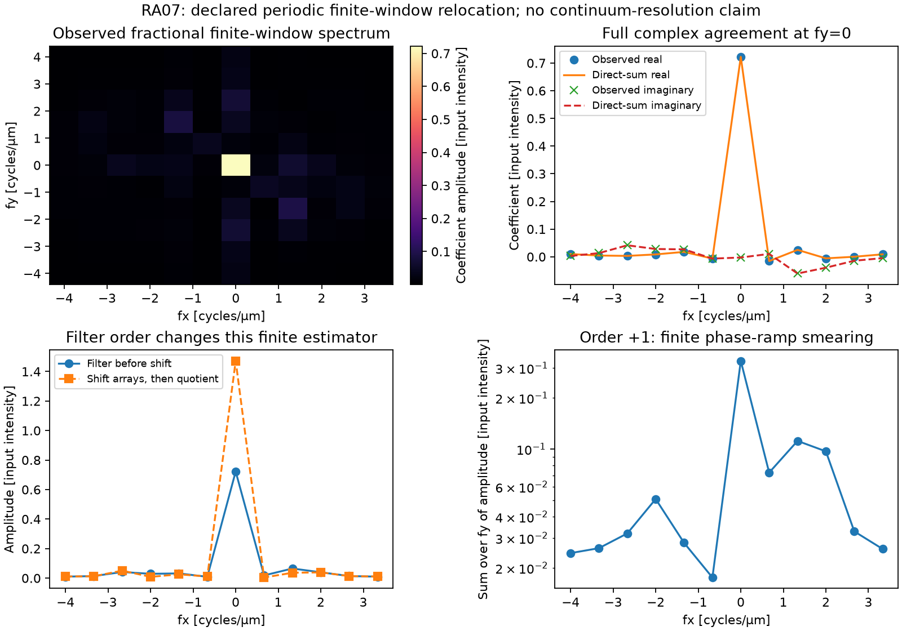

# Fractional volume placement and finite-window smearing

RA07 defines a finite filter-before-shift estimator for known physical lateral
carriers. It filters native separated bands, embeds their canonical coefficients
on the declared output grid and applies a fractional phase ramp. The
[contract](../contracts/reference-alignment-ra07-v1.md) fixes this representation
before tests or product output. The [usage example](../usage/reference-alignment-ra07.md)
states its units, output origin and limits.

The executed product agrees with the frozen independent finite sums. Maximum
complex errors are `8.34e-16` in spectrum and `4.90e-15` in volume, in input
intensity units. The selected operation and the different shift-first quotient
differ by `0.7495746746` intensity units for these same declarations. This
distinguishes finite estimators; it does not rank their physical accuracy.



**Synthetic inputs, executed outputs.** Top left shows the returned spectrum's
amplitude on the physical frequency grid. Top right compares its real and
imaginary coefficients with independent finite sums at `fy=0`. Bottom left
compares the selected filter-before-shift reference with the independently
defined shift-arrays-then-quotient reference. Bottom right shows the independent
order +1 component, including native off-bin window leakage and fractional
relocation, summed in amplitude over fy. Its amplitude axis is logarithmic;
all other axes and the color scale are linear. The full output grid is shown.
Frequency is cycles/µm and amplitude is input intensity. The component panel is
reference data, not a separately returned product field. No physical bandwidth
or resolution claim follows. [Machine-readable observations](figures/reference-alignment-ra07/measurements.json)
retain declarations, hashes and bounds.

| Observed quantity | Maximum error / difference, input intensity units |
|---|---:|
| Full complex spectrum versus direct sums | `8.339763171065059e-16` |
| Spectrum amplitude versus direct sums | `7.563394355258879e-16` |
| Full complex volume versus direct sums | `4.902106326503527e-15` |
| Different shift-first quotient versus selected reference | `0.7495746746425085` |

Original observation arrays have SHA-256
`ad17536b7c02aac368c17a556df9abe75a12757bb47d44af9fd892f14b81033d`.
The product was observed once. The first render and a layout-only second render
remain retained; the latter moves a legend away from the alternate model's
peak. The computational reference, observation code, inputs, expectations and
allowances are unchanged. No output-based retuning occurred.

## Independent comparison fixed before observation

The synthetic input has one orientation, seven unequal known phases and a
`(z,y,x)=(1,5,6)` detector volume. Spacing is `(0.5,0.25,0.25)` µm; lateral field
lengths are 1.25 µm and 1.5 µm. The supplied carrier `(0.5,-0.5)` cycles/µm is
exactly `(0.625,-0.75)` detector bins. Output `(1,11,12)` keeps the field of view
and index-zero origin. Gain is 1.2 and the fixed denominator penalty is 0.05 in
squared-transfer units. There is no noise estimation or truth-selected penalty.

On normalized detector positions `y=j_y/5`, `x=j_x/6`, the input components are

```text
dc = 2 + 0.2*cos(2*pi*(y-x))
c1 = 0.4*exp(2*pi*i*(0.4*y-0.7*x)) + 0.1*i*exp(2*pi*i*x)
c2 = 0.17*exp(2*pi*i*(-0.3*y+0.6*x))
```

Raw exposures use phases `(0,0.7,1.6,2.5,3.4,4.7,5.9)` radians and the normative
represented phasor-squared design. The full complex transfer rows are asymmetric
affine functions of native signed frequency indices, as specified in the
[reproducible driver](../../scripts/reference_alignment_ra07_comparison.py).
These arrays are synthetic declarations, not observed instrument calibration.
Accuracy expectations use the stored exposures and represented design, rather
than the unrounded generating waves.

Preparation saved original `inputs.npz`, `expectations.npz` and `design.json`
under `artifacts/ra07/figure-inputs-1`, before C implementation or any product
observation. The input SHA-256 is
`03fc918b8d9cd3b84fbe5a80a2df6116f24f4261deaba5efa2e655df7a4ef187`;
the expectation SHA-256 is
`fad4e03bc10a3d5985dd833eda437f15a424212079fd93b64f124622b0977efa`.

The first observer uses explicit finite synthesis matrices, exact rational
brackets and a tiny well-conditioned stored-phase normal-system solve. The
production phase solver must retain its singular-value-decomposition contract.
A separate observer uses 80-digit Decimal elimination, exact rational geometry
and componentwise finite sums. Before product observation, the observers agreed
within `7.96e-16` spectrum and `5.34e-15` volume intensity units. The original
input and expectation hashes remained identical.

The predeclared spectrum allowance is `4.0099699430310646e-6` intensity units;
the volume allowance is `5.293160324801005e-4`. Its input-derived expression is
`2**20*eps*max(1,abs(images))*cond(K)*(N+M+P)/min(1,min_denominator)**2`, with
volume allowance `P` times that value. Here `N=7`, `M=30`, `P=132`, phase
condition is about 1.84946 and minimum native denominator is 0.2462. This is a
conservative stored-input arithmetic allowance, not physical accuracy or a
universal backend theorem. The independent accepted test checkpoint supplies
additional, separately derived analytic and high-precision checks.

## What filtering order means here

The selected estimator queries each signed transfer at the native band's object
anchor plus the other band's carrier. It forms the common power denominator
there, filters the native coefficient, then relocates it by the output-grid
phase ramp. Fractional observation relocation uses a finite Fourier kernel;
transfer queries use complex Cartesian linear interpolation. They are distinct.

The comparison also computes a different finite operation: relocate the sampled
observation and transfer arrays first, then form an output-grid scalar quotient.
Its expectations are retained separately. It is not another production mode,
an assertion about unexecuted reference code, or an equivalent formula away from
integer shifts. The difference is fixed by the declared arrays and models.

At an exact integer carrier, the selected operation reduces to the accepted
integer fusion with identical support, gain, penalty and taper. The canonical
negative even Nyquist endpoint remains a single complex coefficient. No real
projection, endpoint splitting or extra output-count normalization applies.

## Representation and claim limits

The complete-window guard retains every translated native anchor. Fractional
Dirichlet tails can still occupy every output bin and cross the periodic seam;
they are retained as part of this finite representation. No compact support,
zero exterior or infinite-field recovery is inferred. The signed transfer
interpolants retain modular native reflection at even endpoints; RA05's physical
reflection sampler has different endpoint domains and cannot be substituted
silently.

This comparison separates arithmetic agreement from transfer-interpolation
error, finite-window leakage, calibration uncertainty and physical mismatch.
It demonstrates no continuum bandwidth, resolution gain, unknown-parameter
recovery, full raw workflow or experimental reference parity.

## Reproduce the finite comparison

Use fresh destination directories. Preparation and observation use the locked
project environment:

```sh
uv run --locked python scripts/reference_alignment_ra07_comparison.py prepare \
  --destination artifacts/reproduce-ra07-inputs
uv run --locked python scripts/reference_alignment_ra07_comparison.py observe \
  --source artifacts/reproduce-ra07-inputs \
  --destination artifacts/reproduce-ra07-observation
```

Render with a Python environment containing NumPy and Matplotlib:

```sh
MPLCONFIGDIR=artifacts/reproduce-ra07-plot-cache \
  python scripts/reference_alignment_ra07_comparison.py render \
  --source artifacts/reproduce-ra07-inputs \
  --observation artifacts/reproduce-ra07-observation \
  --destination artifacts/reproduce-ra07-render
```

The actual science run used Python 3.13.12, NumPy 2.5.3 and SciPy 1.18.1.
Rendering used a separate environment with Python 3.13.12, NumPy 2.5.1 and
Matplotlib 3.11.0 with the Agg backend. Rendering loads the saved arrays; it
does not refit the scientific expectations. The locked runtime has no new
plotting dependency. Native library rounding can change last bits between
environments; the stored-input allowances apply, not archive-byte equality.

Exact candidate, role/checkpoint, full local/hosted evidence, original artifacts
and cumulative accounting belong to the sole ignored Current state at
`artifacts/ra07/current-state.json`.
