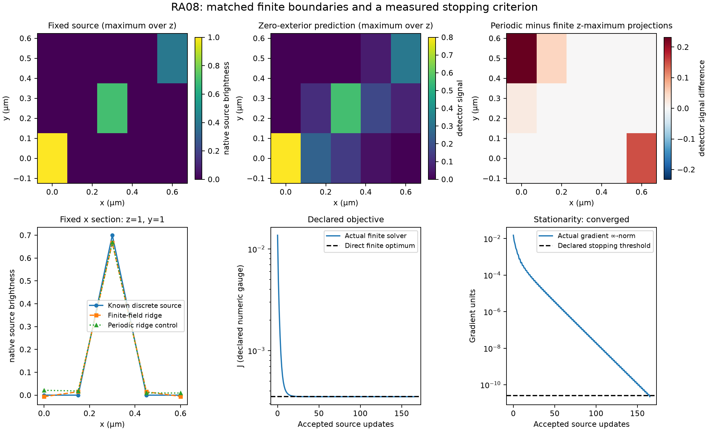
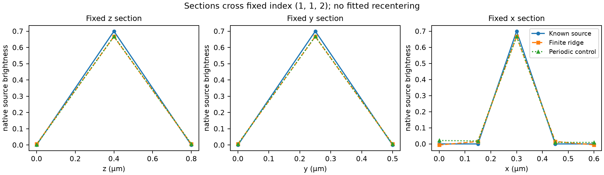

# Finite boundaries and objective stopping

The finite-field mode solves an explicitly declared discrete imaging problem
with zero source outside a fixed box. In this executed example it reaches the
requested gradient criterion after 165 source updates. A periodic boundary
changes predictions for the same fixed source and changes the ridge solution.
Physical exterior outside a real measured field remains unknown.



*Executed synthetic control: 3 × 3 × 5 source coefficients, two exposures and
90 detector entries. Top panels show maximum projections over the three native
z planes; the right panel subtracts the two prediction maxima. Color scales
are labeled separately. Lower panels show a fixed x section, actual objective
values and actual gradient infinity norms. Objective and stationarity use
logarithmic vertical scales. Dashed lines show the independent finite-matrix
optimum and declared stopping threshold. Coordinates and section indices were
fixed before observation. No fitted alignment or brightness equalization.*



*All sections cross index (1,1,2), at (0.4,0.25,0.3) micrometres in z/y/x.
Lines connect native samples. The periodic control and finite solve use the
same data, penalty, brightness gauge and source grid. Display interpolation
creates no additional source information.*

## Declared comparison

Source spacing is (0.4,0.25,0.15) micrometres. Three nonzero native source
coefficients have brightness 1, 0.7 and 0.4: two opposite corners and one
interior control. A supplied nonnegative 2 × 2 × 3 kernel has explicit origin
(0,1,1), retaining its even and asymmetric support. Kernel values already carry
detector signal per unit native source brightness. Their sum is 2.05 and is
not normalized. One illumination is constant; the second ranges from 0.9 to
1.1 along x.

The detector crop covers the declared source-sized box. Padding is (4,4,7),
the full linear-convolution workspace shape. It introduces no source unknowns
or observations. This backend evaluates direct finite overlaps without
allocating a fast Fourier transform (FFT) workspace; valid extra padding leaves
the map unchanged. Input residual weights, output taper and output zoom are
respectively all ones, all ones and one in these figures. Separate public tests
exercise nontrivial residual weights, crop, extra padding, output taper and zoom.

With M=90 detector entries and P=45 source coefficients, the selected
unconstrained objective is

```
J(x) = ||W(Ax-y)||²/(2M) + 0.02 ||x||²/(2P).
g(x) = A.T W²(Ax-y)/M + 0.02 x/P.
```

A is independently assembled from the stored kernel, illumination, origin and
crop. The periodic control wraps the kernel on the same source box. Both direct
ridge references solve their own small normal system with identical data,
weights and penalty. RA07's separate periodic spectral estimator retains its
own contract and normal equations. The periodic raw-matrix control here is
defined by this comparison's wrapped forward map.

## Actual observations

The fixed settings were absolute tolerance 1e-11, relative tolerance 1e-9 and
a 10,000-update resource budget. These settings preceded the product observation.
Initial gradient norm is 0.015179433333333336. The threshold is therefore
`1e-11 + 1e-9*rho0 = 2.5179433333333333e-11` in gradient units.

| Quantity | Observed or independently calculated result |
|---|---:|
| Solver status / accepted updates | converged / 165 |
| Independent final gradient infinity norm | 2.2139832951818372e-11 |
| Gradient roundoff allowance from the fixed pre-observation formula | 5.834624243804308e-14 |
| Stopping threshold | 2.5179433333333333e-11 |
| Actual finite objective | 0.00035127442598988545 |
| Direct finite optimum objective | 0.00035127442598988513 |
| Direct periodic optimum objective | 0.0004101189237252888 |
| Fixed-source periodic/finite prediction maximum difference | 0.232 detector signal units |
| Product/reference forward maximum difference | 0.0 on these stored inputs |
| Product/reference real-adjoint maximum difference | 4.440892098500626e-16 |
| Product/reference gradient maximum difference | 1.7889335846010823e-18 |
| Product/reference objective difference at returned source | 1.0842021724855044e-19 |
| Source maximum error against direct finite ridge optimum | 3.5904368176492563e-9 |
| Independent stationarity-based source-error allowance | 2.6782750533102372e-8 |

The independently calculated residual plus its roundoff allowance remains below
the threshold. A small objective change does not declare convergence. The
normal matrix's infinity-norm condition number is approximately 38.58. The
source-error allowance uses its independently calculated inverse norm and the
predeclared stopping/arithmetic budgets. This compares the source with the
discrete ridge estimator; it does not certify a continuous specimen.

The same problem with zero allowed updates returns `iteration_limit`,
`converged=False`, objective 0.013668105555555556 and gradient norm
0.015179433333333332. It retains the threshold above. Resource exhaustion is
visibly distinct from mathematical stopping.

## Estimator and information limits

Finite and periodic ridge sources have Euclidean errors 0.0657038487 and
0.3463850046 against this known discrete source, in native source-brightness
units. These values include the chosen estimator's bias and boundary model.
They are separate from numerical error against the direct finite ridge solution.
They establish no ranking for unknown real exterior or undeclared noise.

A separate analytic two-coefficient control uses A=I, observations (-1,2),
alpha=0.25 and M=P=2. Both observed solves converge in one update:

| Estimator | Returned source, rounded for display | Objective |
|---|---|---:|
| Unconstrained ridge | (-0.8,1.6) | 0.25 |
| Nonnegative ridge | (0,1.6) | 0.45 |

The active constraint changes the estimator. Its optimality condition uses the
Karush–Kuhn–Tucker (KKT) residual: gradient at positive coordinates and the
negative part at a zero coordinate. This result has no claim of equivalence
to linear Wiener filtering when constraints are active.

Two independent witnesses keep information floors distinct from source error.
For A=(1,1), sources (1,0) and (0,1) have identical observations but source
distance sqrt(2). Separately, `1+0.1*t` and
`1+0.1*t+0.2*sin(pi*t)` agree at the five integer sample locations, while the
saved between-sample witness differs by 0.2. This is an analytic sampling
ambiguity, not an optical-resolution or physical discretization-error bound.
A finer display cannot determine which between-sample source was present.
Neither witness is a nullspace claim about the positive-ridge 45-coefficient
comparison above.

## Reproduction and custody

Run from a checkout with the locked project environment. Use fresh destination
directories; preparation and observation reject an existing destination.

```sh
.venv/bin/python -m scripts.reference_alignment_ra08_comparison prepare \
  --destination artifacts/ra08-reproduction/reference
.venv/bin/python -m scripts.reference_alignment_ra08_comparison observe \
  --reference artifacts/ra08-reproduction/reference \
  --crosscheck artifacts/ra08-reproduction/reference/crosscheck.npz \
  --destination artifacts/ra08-reproduction/observed
```

Render stored arrays with a Matplotlib environment and its Agg backend:

```sh
MPLCONFIGDIR=artifacts/ra08-reproduction/plot-cache python -m \
  scripts.reference_alignment_ra08_comparison render \
  --reference artifacts/ra08-reproduction/reference \
  --observation artifacts/ra08-reproduction/observed \
  --destination artifacts/ra08-reproduction/rendered
```

Observation used locked Python3.13.12, NumPy2.5.3 and SciPy1.18.1. Rendering used
separate Python3.13.12, NumPy2.5.1 and Matplotlib3.11.0 with Agg. No plotting
dependency entered the project lock. Public preparation packages the frozen A
recipe. Supplemental regeneration reproduced four NumPy archives byte-for-byte
and the second observer arrays exactly on this host. Later regeneration does
not replace original pre-observation evidence.

Original A inputs/expectations, generation source, tiny constrained/unconstrained
controls, selfchecks, independent second observer, original observation arrays,
objective/optimality histories, original observed driver source, raw PNG/PDF
renders, PDF visual checks and command/environment receipts remain under
`artifacts/ra08` at their original paths. Original-input archive SHA256:
`88be02829d7c6ecc5460a274f92671bc6dd770d27f0ef603f1d9d40f7a51cf3f`.
Delivered PNGs are byte-identical copies of inspected raw renders.

The [task pointer](../tasks/reference-alignment-ra08.md) locates the sole local
Current state and cumulative ledger. Exact final candidate, full-local,
independent review, hosted-platform and actual-cleanup results stay outside
tracked candidate bytes. The [public contract](../contracts/reference-alignment-ra08-v1.md)
and independent controls bound this study. Small synthetic agreement and
measured coverage prove no complete behavior, physical exterior or continuum
resolution.
