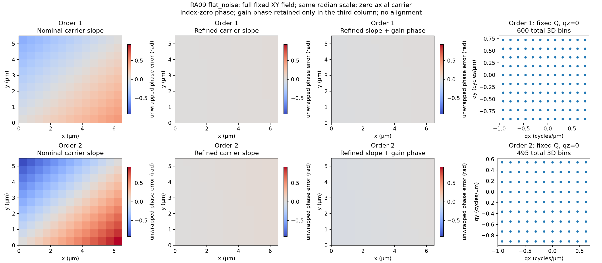
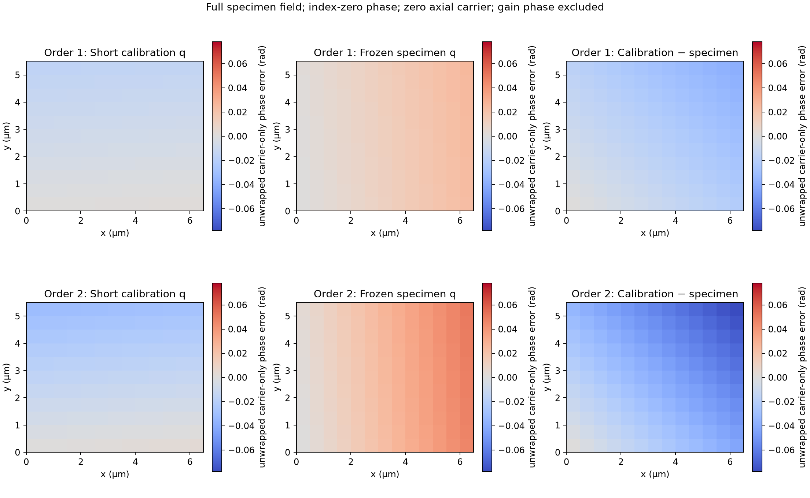
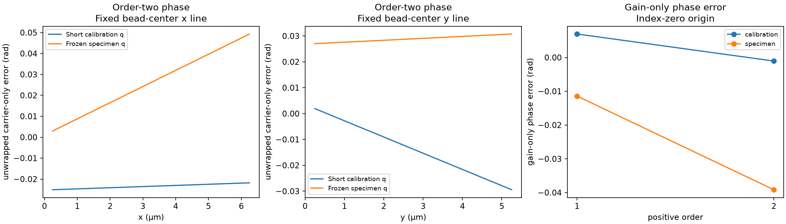

# RA09: continuous specimen carrier and relative complex gains

The new overlap fit recovers a continuous lateral carrier and two relative
complex order gains in the same finite comparison. It uses supplied known
exposure phases and fixed calibrated responses. It keeps every caller start
and reports unresolved global ambiguity, even when a local fit has rank two.
The [contract](../contracts/reference-alignment-ra09-v1.md) defines the score,
support, finite-step diagnostics and failure behavior. The
[usage guide](../usage/reference-alignment-ra09.md) describes the public call.

In the declared noiseless flat-response control, maximum order-two carrier
phase error across the stored field falls from `0.927978 rad` at the nominal
carrier to `1.47132e-9 rad`. Noise and finite-window model mismatch leave
measurable errors. A separate short calibration control happens to estimate
the carrier more accurately than the noisy specimen control in this run.
Neither the contract nor these observations promise the opposite ordering.

*The full fixed XY field for the noisy specimen control, with order one above
order two. The first two columns isolate nominal and fitted carrier slope;
the third includes the fitted relative-gain phase. Phase is unwrapped, in
radians, on the same color scale. The last column shows the `qz = 0` slice of
the fixed three-dimensional overlap sets: 600 and 495 samples in total.
Zero axial carrier makes the slope maps identical through z. These maps show
finite-model error against declared synthetic inputs, not confidence bounds.*

## Inputs fixed before fitting

This is a new small finite scene, not a modification of the original
[27-object benchmark](../benchmarks/reference-alignment-v1.json). It contains
three extended Gaussian objects on a `(5, 11, 13)` z,y,x array with spacing
`(0.25, 0.5, 0.5) µm`. Only the first object's declared center
`(0.65, 4.05, 3.85) µm` comes from the original benchmark's plane choice.
The other objects, dimensions and smooth profiles are new controls. Their
complete catalogue is generated by the
[independent preparation driver](../../scripts/reference_alignment_ra09_comparison.py).

The physical true carrier is `(0.28/5.5, 0.42/6.5)` cycles/µm in y,x.
The caller starts at nominal detector bins `(0.20, 0.50)` and searches the
fixed box with lower bins `(0.10, 0.20)` and upper bins `(0.50, 0.65)`.
These acquisition-like choices were sealed before the product fit. The true
carrier was loaded only for evaluation after all four original fit outputs
were saved and hashed. The search uses at most 256 evaluations per start;
finite-step diagnostic displacements are `(1e-4/5.5, 1e-4/6.5)` cycles/µm.

The flat transfer values are `1`, `0.72 exp(0.13i)` and `0.43 exp(-0.21i)`.
Relative positive-order gains are `0.5 exp(0.22i)` and `0.25 exp(-0.31i)`.
The noisy case adds independent Gaussian real/imaginary separated-band
components with standard deviation `0.002` relative units; dc remains real.
Band and held-out noise seeds are `2026103108` and `2026103109`.
This is declared separated-band noise, not an exposure-noise likelihood.

The mismatch control instead uses nonconstant complex transfers from a
zero-exterior finite convolution and detector crop. Its observation and
interpolated transfer need not satisfy an exact off-grid modulation identity.
A tiny `(3, 5, 5)` fixed-carrier control separately checks the objective and
gains without testing recovery. No result was used to retune inputs or bounds.

The overlap sets remain fixed throughout the search. Their 600/495 counts
use the contract's exact rational interpretation of the supplied binary64
geometry. The nominal decimal bin descriptions do not replace those actual
represented endpoints.

## Observed results

| Control | Fitted carrier y,x (cycles/µm) | Dimensionless score | Maximum order-two carrier phase error (rad) | Relative held-out prediction error |
| --- | --- | ---: | ---: | ---: |
| Flat, noiseless | 0.0509090908857, 0.0646153846202 | 1.12548e-19 | 1.47132e-9 | 2.01159e-10 |
| Flat, noisy | 0.0509683713864, 0.0652298545303 | 0.0476758 | 0.0500546 | 0.0345870 |
| Finite convolution mismatch | 0.0508371744991, 0.0648220821899 | 0.000172050 | 0.0155846 | 0.0220094 |

The relative prediction error is `||prediction − reference||₂ / ||reference||₂`
over the full stored three-dimensional field at held-out phase `0.41 rad`.
The known source is supplied only to this post-fit forward evaluation. This
is not specimen reconstruction. The noisy reference includes its independently
declared held-out noise. All three local fits report rank two and finite-step
stationarity, with 125–126 search evaluations; none exhausts its search budget.
These are diagnostics at the retained local point, not mathematical or global
stationarity certificates.

Independent direct finite Fourier sums and complex regressions agree with
all four product scores within `1.12e-16` absolute difference and gains within
`2.26e-16`. Every fixed overlap count agrees. The noiseless conditional phase
goal, declared before fitting as `0.03 rad`, passes. That goal was not selected
for the noisy or mismatch cases. The tiny fixed-box score is `0.0553856550`;
its rank-zero result supplies no carrier-recovery evidence.

For lateral position `(y, x)` measured from the spatial index-zero phase
origin, carrier slope error is

`Δφ_m = 2πm [(k̂_y − k_y)y + (k̂_x − k_x)x]`.

As a sanity check, the noisy carrier errors are approximately
`(5.92805e-5, 6.14470e-4)` cycles/µm. At the furthest stored phase coordinates
`(5, 6) µm`, order two gives
`4π × (5 × 5.92805e-5 + 6 × 6.14470e-4) = 0.0500546 rad`.
The gain phase adds a separate common offset: noisy order-one/order-two
offsets are `-0.0114209` and `-0.0391542 rad` at this fixed gauge.

## Calibration carrier versus specimen carrier

The [companion driver](../../scripts/reference_alignment_ra09_calibration_carrier_comparison.py)
fits the same public overlap operation to one separately sealed short
`(5, 5, 5)` extended-bead field, with the same spacing, physical carrier,
fixed responses and relative gains. Its noise standard deviation is also
`0.002` relative units, with independent seed `2026103110`; both overlap
sets contain 80 samples. This is a new calibration-like control, not an
execution of a historical bead/pupil fitter. It does not refit or select the
already frozen noisy specimen candidate.

*Both estimated carriers are evaluated over the same full specimen XY field
with unwrapped carrier-only phase error in radians. The difference column is
calibration minus specimen. Relative-gain phase is excluded here and plotted
separately below. In this fixed noise realization, the calibration estimate
has the smaller maximum slope error. One realization supplies no general
accuracy ordering, noise calibration or physical uniqueness claim.*

| Carrier source | Carrier y,x (cycles/µm) | Local score | Full-field maximum order-two slope error (rad) | Full-field relative prediction error |
| --- | --- | ---: | ---: | ---: |
| Short calibration | 0.0504099936343, 0.0646590611135 | 0.0125408 | 0.0313592 | 0.0342339 |
| Frozen noisy specimen | 0.0509683713864, 0.0652298545303 | 0.0476758 | 0.0500546 | 0.0345870 |

Local scores use different fields and overlap sets and are not comparable
likelihoods. Both local ranks are two; both retain unresolved global ambiguity.
The calibration score agrees with its independent calculation within
`1.74e-18`. Its search takes 124 evaluations without budget exhaustion.

*Order-two carrier slope along the predeclared catalogue-center x and y lines,
plus the separate per-order gain-phase offsets. Lines are not recentered or
aligned after fitting.*

## Fixed coordinates, projections and comparisons

Display sample centers use `(n + 0.5) × spacing`; phase uses `n × spacing`.
Thus display minus phase coordinates are `(0.125, 0.25, 0.25) µm` in z,y,x.
There is no half-cell gain-phase adjustment. Fixed section indices are
`(2, 8, 7)`, the nearest stored centers to the first declared object's center,
with actual display coordinates `(0.625, 4.25, 3.75) µm`. The same planes and
full field are used in every comparison. There is no additional post-fit
alignment, intensity rescaling or object selection.

The field figures below include XY maximum over z, XZ maximum over y, the
fixed XY section and fixed XZ section. Intensities share scales within each
figure; signed differences use a separate symmetric scale. Differences of
maximum projections are differences of the projections, not projections of
the signed difference volume. Only panels explicitly labelled peak-normalized
show each profile divided by its own maximum absolute value; these compare
shape and cannot establish absolute amplitude or throughput.

| Control | Full-field maxima and fixed sections | Phase and fixed support | Objective comparison | Profiles and overlap residual |
| --- | --- | --- | --- | --- |
| Noiseless | [Field](figures/reference-alignment-ra09/flat-noiseless-heldout-field.png) | [Phase](figures/reference-alignment-ra09/flat-noiseless-phase-support.png) | [Score](figures/reference-alignment-ra09/flat-noiseless-objective.png) | [Profiles](figures/reference-alignment-ra09/flat-noiseless-profiles.png) |
| Noisy | [Field](figures/reference-alignment-ra09/flat-noise-heldout-field.png) | [Phase](figures/reference-alignment-ra09/flat-noise-phase-support.png) | [Score](figures/reference-alignment-ra09/flat-noise-objective.png) | [Profiles](figures/reference-alignment-ra09/flat-noise-profiles.png) |
| Finite mismatch | [Field](figures/reference-alignment-ra09/finite-mismatch-heldout-field.png) | [Phase](figures/reference-alignment-ra09/finite-mismatch-phase-support.png) | [Score](figures/reference-alignment-ra09/finite-mismatch-objective.png) | [Profiles](figures/reference-alignment-ra09/finite-mismatch-profiles.png) |

The objective panels compare the selected joint order-one/order-two score
with a source-observation order-two-only comparator on the same predeclared
9 × 9 nodes and fixed support. They do not execute legacy C or establish
legacy parity. The integer profile labelled “Integer same Q” is the diagnostic
zero-bin carrier `(0, 0)`, **outside the metadata search box**, evaluated on
the same Q. It is not another permitted search candidate or a general
integer-versus-continuous optimizer comparison.

Additional retained comparisons show the
[short-field support and residual](figures/reference-alignment-ra09/calibration-objective-support-residual.png),
[calibration-carrier full-field prediction](figures/reference-alignment-ra09/calibration-q-full-field.png)
and [specimen-carrier full-field prediction](figures/reference-alignment-ra09/specimen-q-full-field.png).

## Reproduction and evidence limits

The two preparation drivers are committed. Their `prepare`, `observe` and
`render` modes separate fixed inputs, source-bound observations and plotting.
Use a fresh output directory: preparation and observation refuse to replace
sealed inputs/results. Observation requires an explicit coordinator
authorization string. The companion also requires the coordinator envelope
binding both actual source/runtime observations to the original specimen
freeze. The original arrays, native outputs and receipts remain at their
original local paths, linked from the [task pointer](../tasks/reference-alignment-ra09.md).

[Machine-readable measurements](figures/reference-alignment-ra09/measurements.json)
bind the public numbers and figure hashes to the sealed inputs, observed
freezes and actual implementation hashes. Observations used Python 3.13.12,
NumPy 2.5.3 and SciPy 1.18.1 on macOS arm64. Rendering used a separate retained
Python 3.13.12 environment with NumPy 2.5.1 and Matplotlib 3.11.0. No fit was
rerun for rendering. The
[presentation correction](../../scripts/reference_alignment_ra09_report_figures.py)
only wraps figure titles and bounds objective axes to their saved
sampled box endpoints; original renders remain intact.

The comparison establishes the declared finite objective and these synthetic
observations. It establishes no arbitrary continuous-optics likelihood,
unknown-phase or pupil recovery, absolute brightness, motion estimate,
continuum resolution, global uniqueness or real-data performance. Exact
candidate review, full verification, hosted checks and preservation-aware
cleanup remain separate delivery evidence, not scientific conclusions from
these figures.
