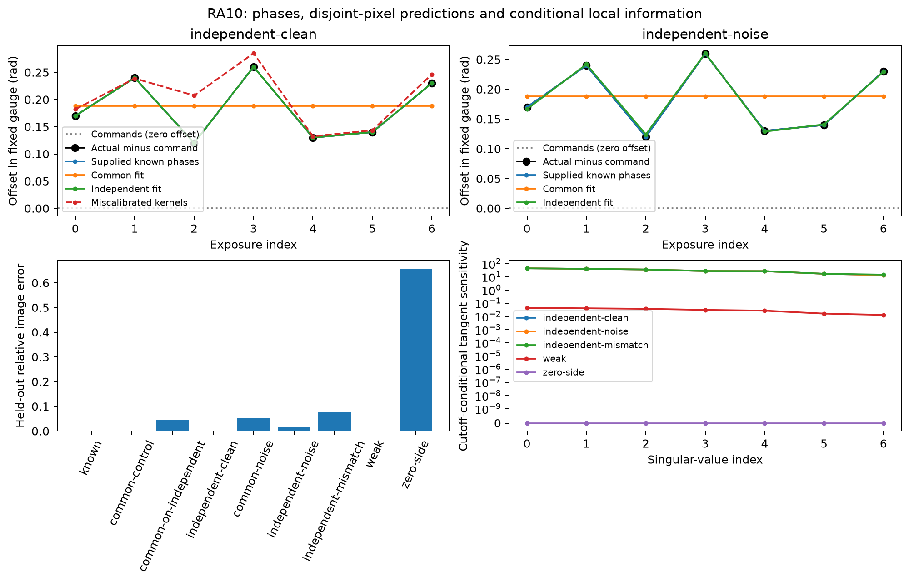
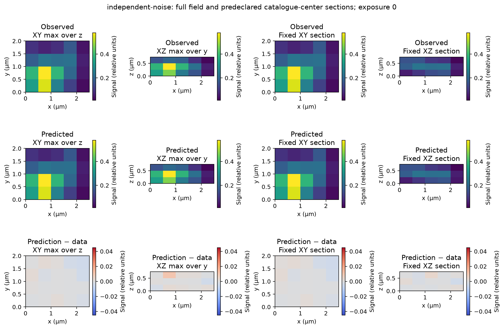
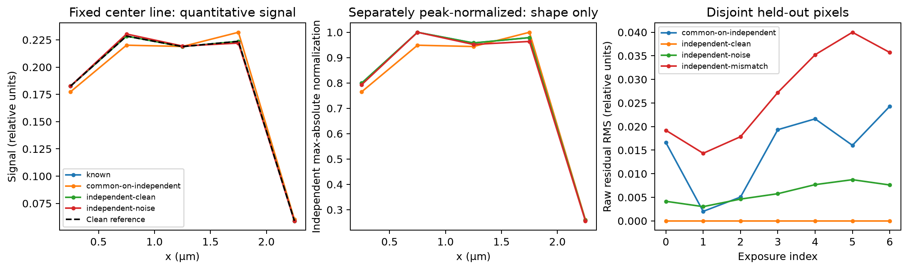

# RA10 — exposure phases in the fixed calibration gauge

The new finite-model adapter fits a common command offset or independent
exposure offsets while retaining one fixed carrier, calibrated response and
source-coordinate origin. It estimates one real source shared by all frames.
Pixels omitted from fitting provide a separate prediction check. Supplied known
phases remain the positive control. The [contract](../contracts/reference-alignment-ra10-v1.md)
and [usage guide](../usage/reference-alignment-ra10.md) define its conditional
meaning and public interface.

In the declared matched noisy example, independent phase inference reduces
held-out image error from **5.12% to 1.65%** compared with a common-offset fit.
Its maximum phase error is **0.00409 rad** in the predeclared calibration gauge.
Deliberately incorrect response kernels instead leave **7.56%** prediction
error despite full conditional local rank and finite-step stationarity.
These are observed synthetic outcomes, not instrument accuracy guarantees.



*The upper panels plot fundamental phase minus the commanded phase, in radians.
The command is the zero line. Actual phases were generated independently before
inference. Known-phase labels coincide with those actual phases; the known
source fit uses the noiseless control. Common and independent fits start from
zero command offsets. The miscalibration control uses the same actual phases
but different generating kernels. Below are errors on disjoint held-out pixels
and absolute cutoff-conditional tangent singular values. Neither rank nor
stationarity establishes physical uniqueness or calibrated uncertainty.*

## Fixed inputs and information premise

This is a new three-object control on a `(3,4,5)` z,y,x grid with spacing
`(0.25,0.5,0.5) µm`. It does not modify or complete the original
[27-object benchmark](../benchmarks/reference-alignment-v1.json).
Three extended Gaussian objects, their amplitudes, widths and positions are
fixed in the [independent preparation driver](../../scripts/reference_alignment_ra10_comparison.py).
The product receives no source truth. It fits a signed real source using a
truncated singular value decomposition (SVD), with relative cutoff `1e-10`.
No source positivity constraint, fitted throughput or source regularizer is used.

The physical lateral carrier is supplied as `(0.14,0.168)` y,x cycles/µm,
equivalently `(0.28,0.42)` bins over this field. It is fixed acquisition-like
metadata for this control, not another execution of the RA09 carrier fit.
The spatial phase origin is index zero. The finite displacement kernels have
shape `(3,3,3)` and explicit origin `(1,1,1)`. Their zero-order weights sum to
one; their first- and second-order weights are complex and asymmetric. Full
values are in the driver and sealed input arrays. Source and kernel exterior
are zero; detector crop is the complete stored field.

For source site `s`, detector site `d`, fundamental exposure phase `phi_p` and
`theta_s = 2*pi*(ky*sy*dy+kx*sx*dx)`, the independent generator evaluates

```text
mu[p,d] = sum_s x[s] * (K0[d-s+origin]
          + 2*Re(K1[d-s+origin]*exp(i*(theta_s+phi_p)))
          + 2*Re(K2[d-s+origin]*exp(2*i*(theta_s+phi_p)))) .
```

Terms outside kernel support are zero. There is no spatial wrapping, carrier
snapping, implicit voxel-volume factor or transfer interpolation. This is an
explicit sampled finite model. A sampled `VolumeOrderOtf` is not silently
converted to these kernels. RA09's finite Fourier overlap comparison remains
a different estimator. Existing periodic phase estimators are unchanged.

Seven nominal commands are `2*pi*p/7`. The common-offset control adds `0.17 rad`.
The independent control adds

```text
0.17 + [0, 0.07, -0.05, 0.09, -0.04, -0.03, 0.06] rad .
```

The primary common and independent searches start at zero offsets, with fixed bounds
`[-0.4,0.4] rad`, at most 256 source/objective evaluations per start and
`1e-4 rad` diagnostic displacements. These choices, the gauge, source catalogue,
mask, noise seed and clean-case `0.03 rad` phase goal were sealed before product
observations. No truth selects a seed, returned candidate, solver success,
phase alignment or slice after fitting.

The training mask excludes sites with both odd y and odd x indices, through
every z plane. It is shared by all exposures. Thus there are
`7*48=336` training values and `7*12=84` held-out values. Covariance whitening
cannot mix held-out pixels into training because it acts across exposures at
the same detector site. An entirely withheld frame would have an unknown
independent phase; its command alone would not provide a prediction label.

All fits use the fixed exposure covariance
`C = 4e-6*(I + 0.08*ones(7,7))` in squared relative signal units. The noisy
case draws independent detector-site vectors with exactly that covariance,
using seed `2026103111`. Its marginal standard deviation is
`sqrt(4e-6*1.08)=0.00207846` signal units. Noiseless controls retain the same
weighting for comparison. No phase-monitor uncertainty is estimated.

## Observed phase and prediction results

Held-out error below is `||prediction-data||2 / ||data||2`, using only the
84 omitted values and the **frozen returned product prediction**. No source or
phase is refitted on those pixels. The noisy reference includes its own held-out
noise. The weighted objective is the complete raw-space whitened squared
residual divided by `2*336`; with the stated covariance units it is dimensionless.

| Data and phase model | Weighted objective | Maximum phase error (rad) | Held-out relative image error | Conditional phase rank |
|---|---:|---:|---:|---:|
| Matched noiseless, supplied known phases | 2.99e-26 | 0, supplied | 2.61e-15 | Not inferred |
| Common-offset data, common fit | 1.41e-26 | 2.50e-16 | 2.83e-15 | 1/1 |
| Independent-error data, common fit | 9.29201 | 0.0714392 | 0.0445213 | 1/1 |
| Independent-error data, independent fit | 1.78e-26 | 8.88e-16 | 3.89e-15 | 7/7 |
| Noisy independent-error data, common fit | 9.72543 | 0.0716411 | 0.0512244 | 1/1 |
| Noisy independent-error data, independent fit | 0.384441 | 0.00409453 | 0.0165249 | 7/7 |
| Miscalibrated responses, independent fit | 6.73456 | 0.0873178 | 0.0755915 | 7/7 |
| Weak noiseless harmonics, independent fit | 2.03e-26 | 8.26e-14 | 1.33e-12 | 7/7 |
| No side harmonics | 2.24e-26 | Unavailable | 0.657180 | 0/7 |

The clean matched independent control passes its predeclared phase goal.
Errors near machine precision describe stored-input algebra in the exact
noiseless model, not physical phase accuracy. One noisy realization supplies
no confidence interval or general performance ordering.

Every inferred candidate retains `global_ambiguity="unresolved"`. All these
retained points meet the specified finite-step stationarity test; none exhausts
its search budget. That test is a clipped coordinate-secant diagnostic, not a
mathematical optimum certificate. Ten fit calls return eleven candidates,
including the two half-turn starts described below. Search and diagnostic
evaluation counts are retained separately in the original records.

The deliberate mismatch multiplies the generating first-order kernel by
`exp(0.05i)` and the second by `exp(-0.07i)`. Inference keeps the original
calibration. A fundamental phase change of `0.05 rad` would require a second-order
change of `0.10 rad`, so these changes cannot be removed by one common gauge
rotation. No accuracy goal was selected for this miscalibrated case.

Weak data scale both side kernels by `1e-3` and contain no added noise. Their
smallest phase singular value is `0.0127502`, versus `13.1683` in the strong
matched clean case. Full relative rank and a tiny noiseless error do not
establish robustness. With no side harmonics, phase sensitivity is zero. The
source rank also falls from 60 to 48; a nearly perfect training residual then
coexists with 65.7% held-out error. Its returned command phases are an arbitrary
uninformative representative, not a phase estimate with 0.26 rad accuracy.

The tangent diagnostic freezes the retained source subspace at the candidate.
Discarded nonzero source directions could still absorb phase changes in the
unrestricted source model. Its singular values are neither that model's
identifiability certificate nor the derivative of a reprofiled residual.

## Ambiguity and the fixed gauge

For five arbitrary coefficient images, write `Y=X(phi)*Ccoef`, with columns of
X equal to `1,cos(phi),sin(phi),cos(2*phi),sin(2*phi)`. Any invertible five-row
alternative design can fit exactly using `Ccoef'=inverse(X(psi))*Y`. In the
independent five-frame demonstration, doubled regular phase labels give a
maximum residual `2.22e-16` signal units. That does not imply that the alternative
coefficients arise from one shared source and the fixed kernels required here.

Seven frames reject the tested doubled-command alternative: its unrestricted
coefficient fit has relative residual `0.461073`. This excludes that particular
alternative, not all phase aliases or a global ambiguity.

In the separate second-order-only control, caller starts at offsets zero and
pi use the fixed box `[0,pi] rad`. They yield phase vectors separated by pi but
held-out errors below `1.02e-14`.
Both have local rank seven. The identity `exp(2i*(phi+pi))=exp(2i*phi)` explains
why these predictions agree. Both candidates are retained, without choosing a
physical winner. Independent per-exposure half-turn alternatives remain possible.

Calibration also has a representation freedom: changing every positive kernel
to `K_m*exp(-i*m*gamma)` and phases to `phi+gamma` preserves predictions. This
operation holds the kernels fixed and does not perform that transformation or
zero the first actual phase. The first generated phase is `0.17 rad`.

## Fixed fields, sections and profiles



*Exposure 0: full XY maximum over z, XZ maximum over y, and fixed XY/XZ sections.
The same signal scale applies to every field comparison. The signed row is
prediction minus observed data on one shared symmetric scale. A difference of
maximum projections is a difference of projections, not a projection of the
signed difference volume. These are raw-image predictions from the fitted
source; they are not a resolution or real-data recovery demonstration.*

Display sample centers are `(n+0.5)*spacing`; phase coordinates are `n*spacing`.
Their difference is `(0.125,0.25,0.25) µm` in z,y,x. No half-cell phase correction
is applied. The first catalogue object has center `(0.375,1.15,1.55) µm`.
Nearest stored centers, first on ties, fix section indices `(1,2,3)` and actual
display coordinates `(0.375,1.25,1.75) µm`. Exposure 0, all planes and the full
field were chosen before inference. No recovered peak selects a new section.
Physical aspect and axes in micrometres are retained; the coarse three-plane
z sampling is visible.

| Comparison | Full XY/XZ maxima, fixed XY/XZ sections and signed differences |
|---|---|
| Supplied known phases | [Field](figures/reference-alignment-ra10/known-field.png) |
| Common fit to independent errors | [Field](figures/reference-alignment-ra10/common-on-independent-field.png) |
| Matched noiseless independent fit | [Field](figures/reference-alignment-ra10/independent-clean-field.png) |
| Matched noisy independent fit | [Field](figures/reference-alignment-ra10/independent-noise-field.png) |
| Miscalibrated response | [Field](figures/reference-alignment-ra10/independent-mismatch-field.png) |



*The fixed catalogue-center x line compares raw quantitative signal on the left.
The middle uses the same curve colors, each divided by its own maximum absolute
value, and compares shape only. It cannot establish amplitude or throughput.
The right shows root mean square (RMS) residual on held-out pixels for every
exposure. No post-fit intensity rescaling or spatial alignment is applied to
the quantitative fields or error metrics.*

## Numerical agreement, provenance and limits

Independent direct finite sums at every retained product source agree with
returned predictions within `4.45e-16` signal units. The comparison driver's
complete raw objectives differ by at most `8.89e-15`. A
[second arithmetic route](figures/reference-alignment-ra10/independent-check-summary.json),
using real trigonometric sums and symmetric covariance whitening, has maximum
objective difference `1.42e-14`. A separate truncated-source
solve agrees with returned sources within `1.26e-12`, with the largest difference
in the weak case. Returned residuals equal prediction minus data. These are
agreement checks at all eleven retained candidates, not a uniqueness proof or
an audit of every internal search point.

Preparation imports no product code. Observation saves every returned candidate
and a hash-bound observation record before loading evaluator source/phase truth.
Known-phase control labels are explicitly supplied synthetic metadata, not
measurements from an instrument. The evaluator file is checked against its
predeclared identity. Rendering checks saved-input/output identities and never
reruns inference. The original preparation remains preserved; a later sealed
extension adds the mismatch example while every earlier array remains bit-identical.
Presentation corrections change labels/layout only; original successful renders
and the observation driver remain retained.

[Machine-readable measurements](figures/reference-alignment-ra10/measurements.json)
bind these numbers and seven figures to the sealed preparation and observation
freeze. Observation used Python 3.13.12, NumPy 2.5.3 and SciPy 1.18.1 on macOS
arm64. Rendering used a separate retained Python 3.13.12 environment with
NumPy 2.5.3 and Matplotlib 3.11.0, with
[resolved rendering requirements](figures/reference-alignment-ra10/render-requirements.txt).
The [task pointer](../tasks/reference-alignment-ra10.md) locates original local
arrays, outputs, source identities and review/check evidence.

The experiment establishes the stated finite objective and conditional
synthetic observations. It does not establish images-only joint calibration,
unknown carrier or pupil recovery, motion inference, a continuous-optics
likelihood, continuum resolution, global uniqueness or real-data performance.
Numerical figures do not replace exact-candidate verification, fresh scientific
review, separate hosted platform qualification or preservation-aware cleanup.
