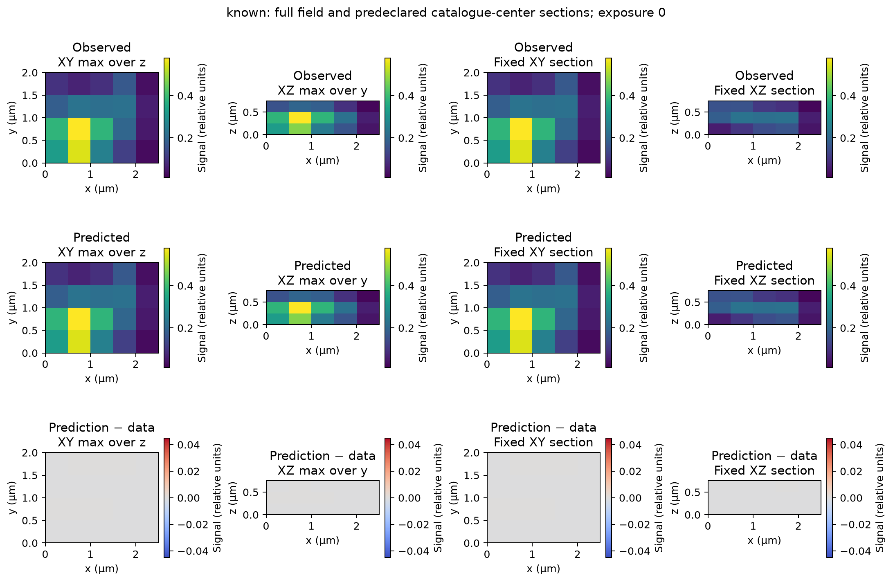
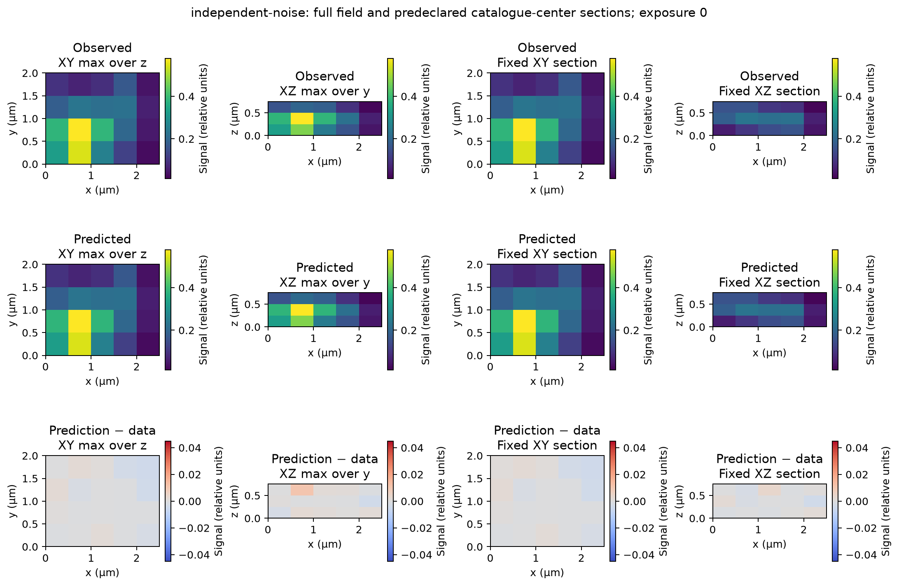
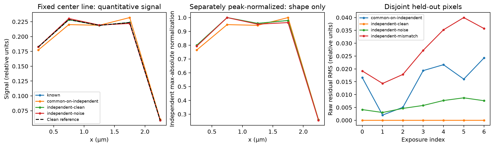

# RA11 — stationary inputs need no motion correction

The supplied synthetic evidence follows the no-motion branch. One specimen,
one finite imaging operator and one detector grid are shared across exposures;
illumination phase changes. The retained RA10 path passes sealed raw arrays
directly to phase inference, with no registration, resampling or physical
motion correction. RA11 documents that existing path and adds no estimator.

*Retained RA10 exposure 0, known-phase noiseless positive control. Observed and
predicted fields share the quantitative scale used for all five RA10 field
comparisons, in relative signal units. Columns show XY maximum over z, XZ
maximum over y and fixed XY/XZ sections. Axes are in micrometres (µm), with
physical aspect retained. The signed bottom row is prediction minus data on
the shared symmetric difference scale. For maxima, it is a difference of
projections, not a projection of the signed difference volume. Agreement is
conditional on supplied finite kernels/phases; it measures no displacement.*

## What is stationary

The unchanged [preparation and observation driver](../../scripts/reference_alignment_ra10_comparison.py)
constructs one three-object source on a `(3,4,5)` z,y,x grid, spacing
`(0.25,0.5,0.5) µm`. Source sites, complex displacement kernels, kernel origin
`(1,1,1)`, carrier `(0.14,0.168)` y,x cycles/µm and complete detector crop are
shared by seven frames. Exterior is zero. Only phase labels and declared noise
or response-control conditions vary. Observation calls `fit_exposure_phases`
directly, with no displacement estimator or drift correction.

This supports the **declared stationary construction and unchanged processing**,
not a detector of stationarity in unknown acquisitions. RA10 has no separately
validated physical camera/focus model. Its fixed finite kernels and detector
coordinates supply the limited premise. The [retained measurements](figures/reference-alignment-ra10/measurements.json)
give held-out relative image error `2.6141424565506283e-15` for the known-phase
control. This inherited finite-algebra agreement is no physical motion tolerance.

*Retained noisy RA10 evidence, same geometry and quantitative/difference scales
as above. Changed phase contrast does not imply motion. Held-out image error
is `0.016524895389686177` (1.65%), with no motion correction. One realization
establishes no general performance or physical stationarity guarantee.*

The predeclared first catalogue center is `(0.375,1.15,1.55) µm`. Nearest stored
sample centers, first index on ties, fix z,y,x indices `(1,2,3)` and display
coordinates `(0.375,1.25,1.75) µm`. Display centers are `(n+0.5)*spacing`;
phase coordinates remain `n*spacing`. No peak search, registration, fitted
scale, section reselection or half-cell phase correction is applied.

*Retained fixed-center x profiles. Left: quantitative relative signal. Middle:
each curve divided by its own maximum absolute value, labeled shape only;
these curves establish no amplitude agreement. Right: root mean square
held-out residual by exposure. Common-phase mismatch and independent-phase
fits all use no motion correction. These are predicted raw images, not
reconstructed-specimen resolution evidence.*

## Applicability matrix

| Input or mechanism | Applicable conclusion | Prerequisites before numerical correction |
|---|---|---|
| Retained stationary finite inputs | Use unchanged arrays; no physical motion correction. | None for this report branch. |
| Specimen moving relative to illumination/detection | Alignment can also change effective illumination phase under the existing specimen model. | Concrete mechanism, timing, boundaries, comparable references and legitimate phase/calibration inputs. |
| Image/camera coordinates moving after formation | Image translation has a different phase consequence from specimen motion. | Evidence for that post-formation transformation; no borrowed specimen-phase correction. |
| Focus/scan motion | The detection and axial-illumination arguments that move determine correction. | Recorded focus/scan relation and axial model. Integer lateral results imply no fractional/axial support. |
| Low-information, repeated-pattern or changing-intensity references | No physical motion conclusion here; ambiguity/unavailability remains explicit. | Comparable contrast/scale and information under the selected operation's contract. |
| Required owner motion without these inputs | That owner mode is unsupported, rather than silently treated as stationary. | Owner mechanism/reference provenance, new numerical contract and fresh native A/B/C/D. |

The [prior raw-reference analysis](raw-phase-motion-intake.md#three-distinct-motion-models)
derives distinct specimen, image-coordinate and focus relations. Its
[reference conditions](raw-phase-motion-intake.md#which-observations-can-form-comparable-references)
explain why unlike-phase cross-correlation alone is insufficient. A complete
cycle sum is comparable only when actual harmonic cancellation, common
specimen/kernel state and common intensity assumptions hold; frame count or
nominal commands alone do not establish them. The existing
[volume translation contract](../contracts/volume-translation-estimation-v1.md)
requires supplied comparable equal-intensity periodic references. It constructs
no reference and authenticates no mechanism. The
[integer specimen correction](../contracts/integer-drift-correction-v1.md)
retains its narrower known-motion assumptions. Neither operation changes.

## Historical benchmark and provenance limits

The [original full plan](../studies/full-noisy-study-2026-10-26/full-plan.json)
retains 27 objects. Its [generator](../../scripts/full_noisy_study.py) constructs
one specimen and reuses it across orientations/phases with the same camera
coefficients, optics and declared focus-plane grid. The focus stack is
prescribed; no exposure-dependent focus drift is introduced. Static
calibration-to-specimen origin conversion is not measured motion. RA11 reruns
none of that study and does not repair or complete its poor-recovery benchmark.
The three-object RA10 control remains separate.

The [RA11 manifest](evidence/reference-alignment-ra11-stationary.json) records
source/figure hashes and original input/freeze/output identities. RA11 rechecks
those bytes and associations without regenerating observations, refitting or
rendering new output. Original arrays, environment inputs and readiness/
preservation anchors remain at required paths; local paths stay in ignored
evidence. The [RA10 report](reference-alignment-ra10-comparison.md) retains the
complete experiment and rendering conventions.

Confidence is high in this declared applicability, conditional on the source
and byte identities. Supplied acquisition mechanism, timing, comparable
reference/intensity evidence or a changed optical/scan model could require a
different branch. No owner motion was supplied. Images-only calibration,
integrated raw workflow, full-scene recovery and owner-output parity remain
later uncompleted steps.
