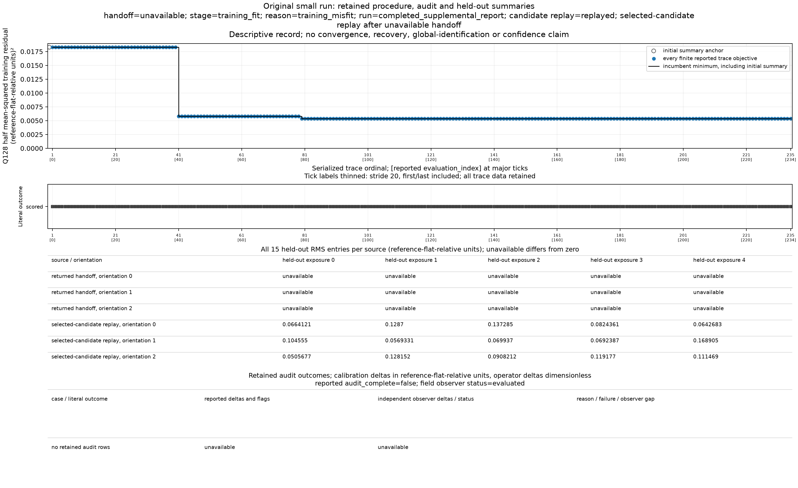
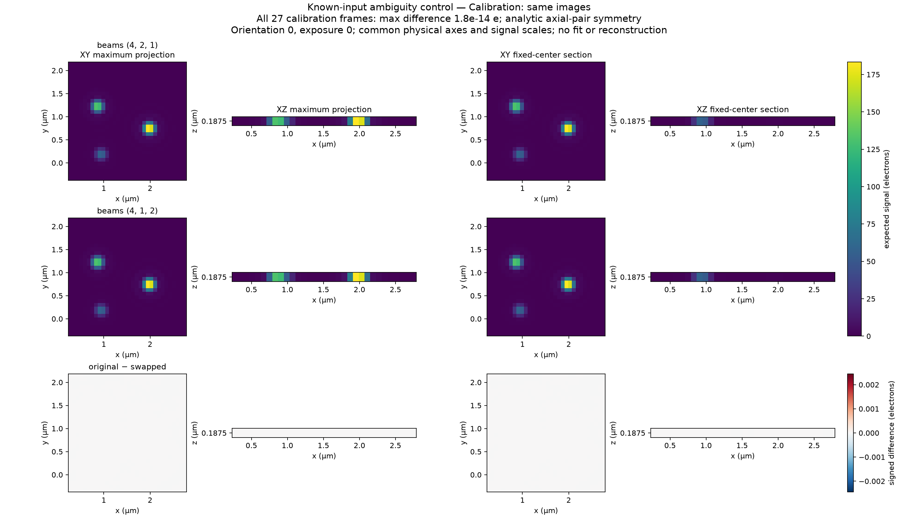
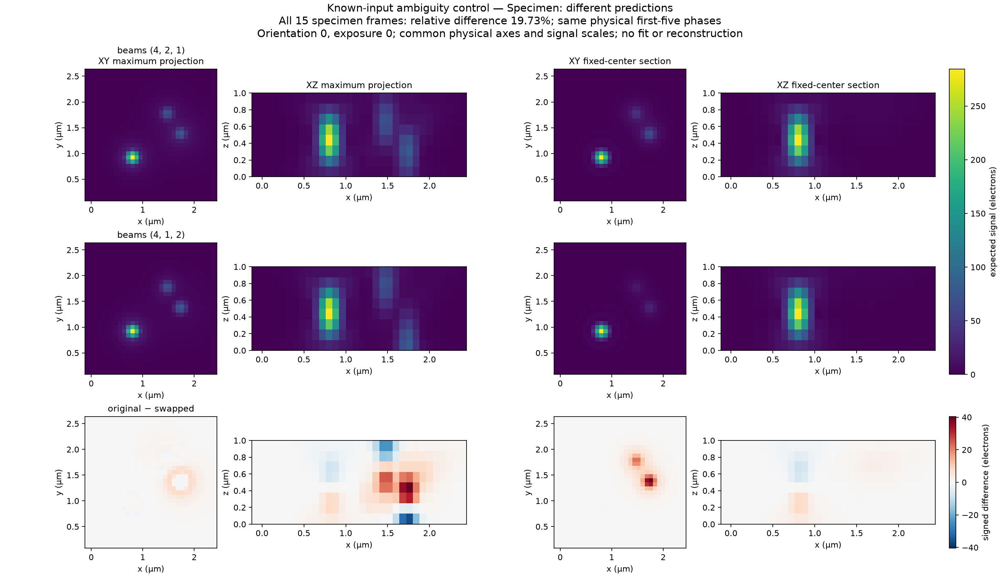
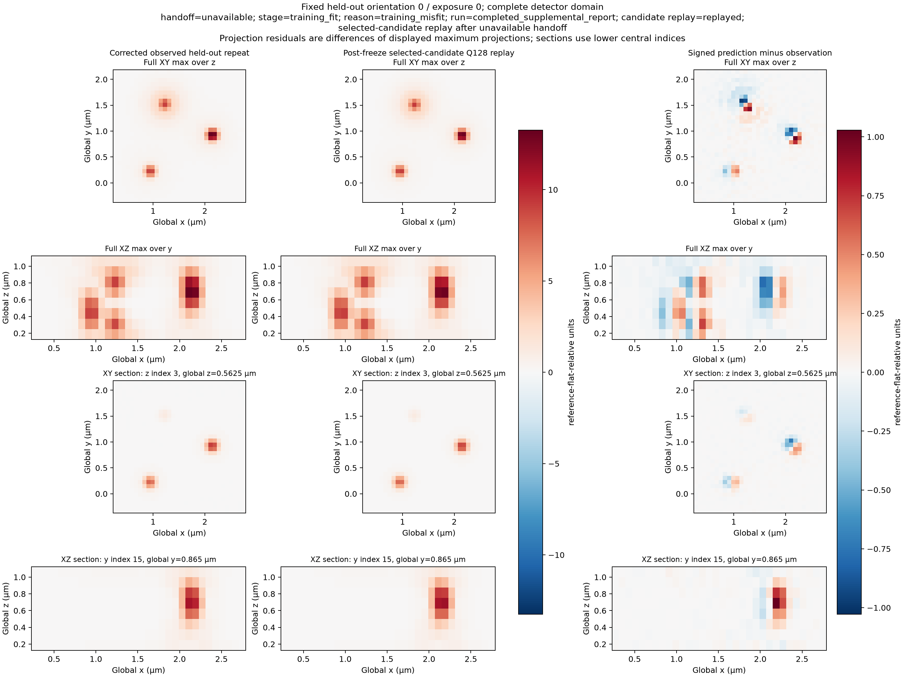

# RA12: predictive calibration handoff on the original small observations

**Version 1.0.**

The original small calibration returned **unavailable**, at `training_fit` with reason `training_misfit`. Its training root-mean-square (RMS) residual was **0.10346815963311173 reference-flat-relative units**, above the predeclared limit of **0.05**. The procedure retained a selected candidate, but returned no specimen descriptor, no completed ambiguity audit and no final handoff held-out prediction. A completed diagnostic replay does not change that scientific outcome. This run establishes no validated calibration-to-specimen transfer.

RA12 supplies a predictive estimate conditional on the stated finite clear-pupil, three-beam optical model. It is not a measurement of empirical instrument optics. Three finite spheres have radius 0.050 µm, with source refinement `(8,8,8)` and a pupil quadrature order 128, denoted Q128. The shared estimated camera record comes from observed dark, blank and flat groups. Raw counts are corrected once as `Y=(counts−estimated blank mean)/(estimated flat mean−estimated blank mean)`. Results remain in reference-flat-relative units; no true camera coefficient, photon scale or fitted intercept enters. See the [model and information boundary](../contracts/reference-alignment-ra12-v1.md#public-operations-and-selected-model).

The original calibration and declared specimen detector grids both have shape `(8,32,32)` in z/y/x order and spacing `(0.125,0.080,0.080)` µm. Their box-corner origins are `(0.125,−0.375,0.23)` µm and `(0,0,0)` µm, respectively. The specimen source grid is `(8,64,64)` at `(0.125,0.040,0.040)` µm, with half-cell locations. Carriers use cycles/µm and phases use radians. A successful handoff would preserve the common intensity and side-beam labeling and transfer each of the first five phases exactly once:

`phase_spec = wrap(phase_cal + 2*pi*carrier dot (origin_spec−origin_cal)_yx)`.

The receiving specimen fit already expects specimen-origin phases and raw counts in the same camera gauge. [Coordinate and transfer convention](../contracts/reference-alignment-ra12-expectations-v1.md#harmless-and-material-alternatives-must-remain-distinct).

The finite bead fit supplies the initial candidate. One bounded least-squares refinement then fixes its nine center coordinates and adjusts 38 coordinates: three relative brightnesses, two beam angles, six carrier coordinates and 27 exposure phases. The complete Q128 training objective includes the central image and all 27 structured images:

`residual = prediction − corrected observation`

`F = (sum central residual² + sum all structured residual²)/(2*M)`

`M = 28*8*32*32 = 229376`, and `training_RMS = sqrt(2*F)`.

Every detector site contributes. The [fixed evaluation manifest](../studies/reference-alignment-ra12/original-small/evidence.json) selected one seed sweep scale `(1.0,)`, refinement function-evaluation setting 40, training RMS limit 0.05, calibration comparison setting `1e−8` relative units and operator comparison setting `1e−6` dimensionless before inspecting the new results. No control was tuned or retried after the outcome.

| Frozen inference measurement | Observed value |
| --- | ---: |
| Initial Q128 objective | 0.01828377294048673 |
| Lowest recorded Q128 objective | 0.005352830028931546 |
| Training RMS | 0.10346815963311173 |
| Actual objective entries / successful entries | 235 / 235 |
| Solver-reported function / Jacobian evaluations | 6 / 6 |
| Best recorded evaluation index | 206 |

The sanity check is `sqrt(2*0.005352830028931546) = 0.10346815963311173`, which exceeds 0.05. The objective decreased, but the declared training check failed. The score ledger counts every actual objective entry, including finite-difference work; solver-reported counts describe a different accounting scope. Neither count establishes physical convergence or identification. The [refinement and early-gate contract](../contracts/reference-alignment-ra12-v1.md#observation-only-finite-refinement) requires retaining this unavailable outcome. Why the residual exceeds the limit has not been established here.

*Observed original run. All 235 objective/outcome records are shown; tick stride20 thins labels only. The objective has squared reference-flat-relative units and uses every site in all 28 training images. The held-out RMS panel retains all 15 candidate-replay values in relative units and marks every returned-handoff value unavailable. Empty audit panels reflect the early training gate. Source: the [observed-results bundle](../studies/reference-alignment-ra12/original-small/README.md) and its [unchanged-value public figure protocol](../studies/reference-alignment-ra12/original-small/figure-protocol.json).*

If training passes, the declared audit records **104 direct alternatives plus the seed's initial and frozen candidates**. It tests global sign/side exchange, beam and axial alternatives, center and carrier perturbations, and individual/common phase alternatives. Calibration-equivalent cases receive a whole-field specimen illumination comparison; a material surviving alternative makes the handoff unavailable. Infeasible and incomplete cases remain explicit. This finite list excludes no unsearched alternative. Global operator identification is always **unestablished**, and no statistical confidence guarantee is supplied. In this original run the early training gate produced an empty audit; that is not 106 passed comparisons. [Audit definition](../contracts/reference-alignment-ra12-v1.md#declared-finite-ambiguity-audit).

The known-input control below explains why such an audit matters. It is a separate constructed, noiseless **single-focus** calibration, with supplied beams `(4,2,1)` versus `(4,1,2)`. Axial symmetry cancels their odd interference term in the calibration spheres. The same exchange changes predictions for a separate specimen spanning several focus planes. It is not an image-only fit or an ambiguity result for the original eight-focus observations. The [mathematical expectation](../contracts/reference-alignment-ra12-expectations-v1.md#finite-sphere-ambiguity-that-changes-specimen-predictions) and [public numerical evidence](../studies/reference-alignment-ra12/known-input-control/evidence.json) state those premises.

*Known-input calibration control. The two supplied beam settings agree across all 27 calibration exposures to a maximum observed difference of `1.7764e−14` electrons. Displayed orientation 0, exposure 0 uses fixed catalogue-center sections and physical micrometre axes. Signal panels share an electron scale; signed differences use the declared optical arithmetic display scale. Source: the [predeclared public control bundle](../studies/reference-alignment-ra12/known-input-control/README.md), not the original calibration inference.*

*The corresponding supplied-model specimen predictions differ by up to `40.4553` electrons across 15 exposures; their difference/reference norm ratio is `0.197331`. These are prediction differences, not reconstruction errors or resolution gains. Sections use the predeclared first specimen sphere; projected differences subtract the displayed projections. Both arms share the same optical implementation. This control does not establish the cause of the original training misfit.*

After the original result was frozen, the independent caller replayed its retained candidate through the public source and optical interfaces. Three one-electron source constructions and nine optical calls produced all **8,192 central**, **221,184 training** and **122,880 held-out** prediction values. Relative brightness multiplies dimensionless unit responses outside the electron label. Replay gave `F=0.005352830028931548` and RMS `0.10346815963311176`; the RMS discrepancy from the frozen inference is `2.7755575615628914e−17`. This supports the recorded composition/objective agreement. It is not an independent numerical reference for the shared optical physics. The held-out replay remains a diagnostic prediction from an unavailable candidate; no returned handoff held-out payload exists for comparison.

*Fixed original held-out orientation0/exposure0, without refitting or frame selection. Columns are once-corrected observation, post-freeze candidate replay after the unavailable handoff, and signed displayed-prediction minus displayed-observation. Rows show full XY/XZ maximum projections and sections at global z0.5625 µm and y0.865 µm. Signal panels share ±13.2526 reference-flat-relative units; residual panels share ±1.02802 units. Axes use equal physical aspect. Projection residuals subtract the displayed projections. Exact scales, all 15 replay RMS values and byte identities are retained in [public evidence](../studies/reference-alignment-ra12/original-small/evidence.json).*

The separate complex-field observer evaluated all **921,600** declared orientation/exposure/axial-lag/half-cell-site values. It had no specimen descriptor to compare, and the original result supplied no equivalent audit cases. Thus there was no successful descriptor transfer comparison or operator-delta validation on the original observations. The supplemental report completed with status 0 and unchanged input, frozen-result, script and previously imported source identities; its execution status is separate from the scientific unavailable result.

The retained run recorded RA11 baseline Git HEAD `e5f918bc54d1622f92009bce143cffd4ac4a7477` while using the new handoff source bytes, SHA-256 `0f07f4b4f4c8d7c3bf046daf7d02fd173411de27b17726e354962688d29cdb18`. That baseline HEAD is not a commit containing those RA12 source changes. The [public frozen-result/source digest summary](../studies/reference-alignment-ra12/original-small/evidence.json) and [observed-results export](../studies/reference-alignment-ra12/original-small/README.md) identify the actual calculation. A later documentation commit has its own identity. Exact-candidate verification, required review and platform qualification are recorded separately in the pull request and local readiness evidence. This scientific report supplies no verification or delivery-readiness verdict and makes no empirical-optics, global-identification or confidence claim. Original observations and full receipts remain retained locally; the public bundle is an observed-results export, not a complete public reproduction package.
