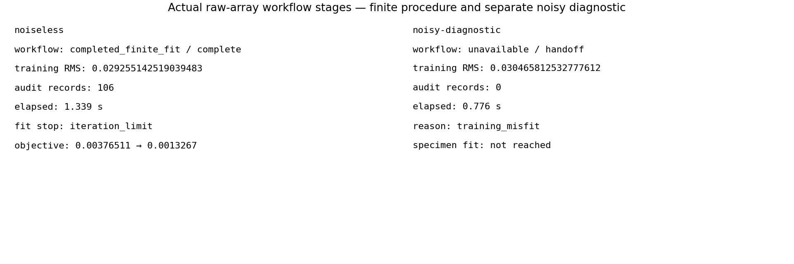
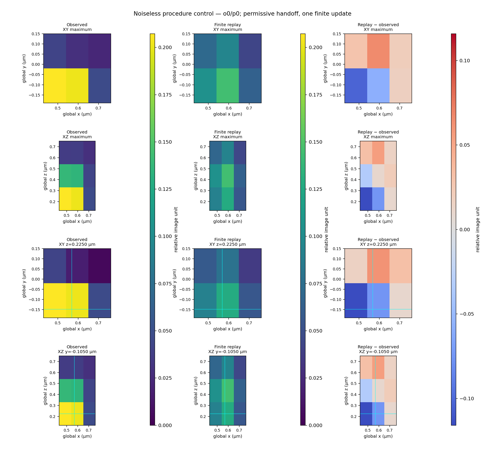
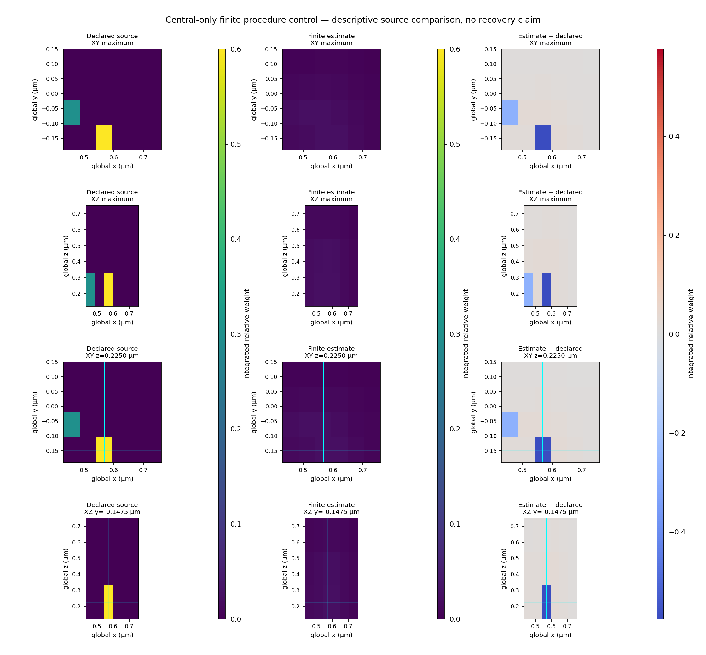
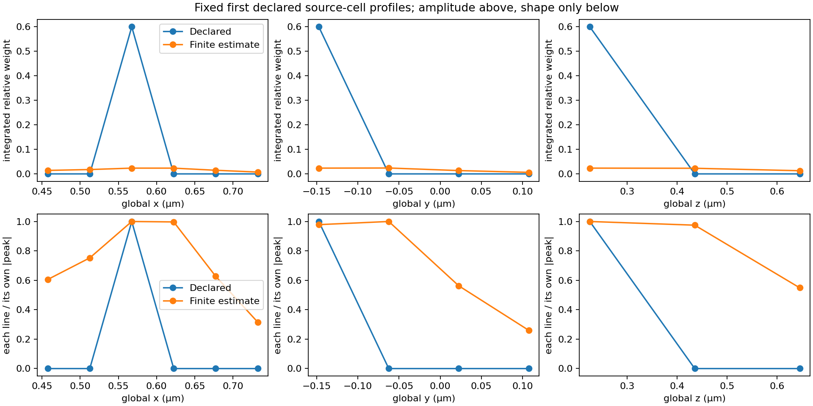

# RA13 — integrating raw-array scientific stages

The raw-array workflow now composes camera estimation, predictive calibration
handoff and the selected physical specimen fit. The fixed noiseless procedure
control completes one update; its relative source error is **96.77%**, so this is
not demonstrated source recovery. The separate noisy diagnostic stops explicitly
at calibration `training_misfit` and returns no specimen fit. Original RA12 noisy
observations and their unavailable result remain separate and unchanged.

The [contract](../contracts/reference-alignment-ra13-v1.md) and
[executed usage](../usage/reference-alignment-ra13.md) define complete upfront
validation, paired calibration labels, raw-count/phase ownership, provenance and
unavailable/partial outcomes. No new estimator, optical premise, output rescale,
convergence guarantee or recovery criterion was introduced.

## Fixed controls and actual results

The [public observations and parameters](../studies/reference-alignment-ra13/README.md)
were frozen before workflow execution. The noiseless arm is deliberately central-only,
with training limit 100 and operator comparison setting 1e6. Those permissive controls
exercise the procedure; they do not identify a calibrated structured illumination
microscopy (SIM) operator. Calibration comparison setting is 1e−8; one refinement
function-evaluation setting, one specimen update and regularization 0.01 are fixed.

The noisy arm adds a fixed 0.001-detector-count normal perturbation using seed 20261102
and sets its training limit to 0. That deliberately exercises rejection of a nonzero
training residual. It is not a realistic noise threshold, statistical test or claim
that valid noisy input must be rejected. Valid noisy handoffs may proceed diagnostically.
No settings were changed after either outcome, and no favorable seed or retry was selected.

| Observed quantity | Noiseless finite control | Noisy diagnostic |
| --- | ---: | ---: |
| Workflow outcome | `completed_finite_fit` | `unavailable` |
| Last stage | `complete` | `handoff` |
| Training RMS, reference-flat-relative image units | 0.0292551425190 | 0.0304658125328 |
| Audit records | 106 | 0, training stopped first |
| Specimen stop | `iteration_limit`, one update | Not reached |
| Initial total objective | 0.00376510838890 | Not available |
| Best total objective | 0.00132669946596 | Not available |
| Best data objective | 0.00132586302079 | Not available |
| Public optical replay data objective | 0.00132586305047 | Not available |
| Public replay RMS, relative image units | 0.0514949133501 | Not available |
| Relative source L2 error | 0.967703564368 | Not available |
| Measured workflow call time | 1.33946 s | 0.775795 s |

Here RMS means root-mean-square. The relative source error is
`||estimate−declared||₂/||declared||₂` on the same finite source grid. It is descriptive,
not an acceptance tolerance or continuum comparison. The finite total objective is
`J_data+J_penalty`; lower objective does not establish parameter/source recovery.
The replay data-objective discrepancy is about 2.97×10−11. Replay uses separately
assembled one-electron basis responses scaled by relative coefficients; its optical
physics is shared with the accepted public generator, not independently implemented.
Independent finite numerical observers belong to the reviewed integration tests.

The exact [observed evidence](../studies/reference-alignment-ra13/evidence.json)
records values, input/output identities, versions and figure hashes. The public
[finite evaluation arrays](../studies/reference-alignment-ra13/noiseless-evaluation.npz)
retain source, observations, predictions and signed residuals. Complete component
records/arrays, prospective protocol and source-identified producers remain local
at `artifacts/ra13/small-study/`. Public source/illumination references are separate
from the seven observations. The estimator caller never loads those references;
evaluation starts only after both inference outputs freeze.

## What the current algorithm produces

Actual recorded stages and finite outcomes, with RMS in relative image units and
objectives in squared declared relative numerical units. The noisy zero threshold
is a diagnostic control; the empty specimen result is deliberate and truthful.
Neither a successful process nor a finite iteration limit is convergence.

Orientation 0/exposure 0, full 3×2×3 detector field. Rows show XY and XZ maxima and
fixed sections at global z=0.2250 µm and y=−0.1050 µm. Columns are corrected
observation, finite-fit optical replay and replay minus observation. Signal panels
share the linear 0–0.207252 relative-image scale; differences share ±0.115814. Maximum
projection differences subtract the displayed projections, rather than projecting
the signed residual. Physical aspect is equal; no registration or brightness fit.

The full 3×4×6 source basis uses integrated reference-flat-relative weights. The
same first declared source-cell center fixes the sections: global z=0.2250 µm and
y=−0.1475 µm. Reference and estimate share the linear 0–0.6 weight scale; signed differences
share ±0.576471. The large amplitude/spatial discrepancy remains visible.
This degenerate one-update control establishes no recovery or resolution gain.

Profiles run through the predeclared first source-cell center, global z/y/x
(0.2250,−0.1475,0.5675) µm. The top row preserves quantitative integrated relative
weights. The bottom divides each line by its own absolute peak and shows shape
only. No fitted peak, interpolation, crop selection or recentering was used.

## Provenance, validation and limits

The scientific producer ran on clean commit
`1645df18b977a7df57da3877941674278493a860`, tree
`e8297176cf19a4a52ee251a28dcf7161e16ff918`, with unchanged before/after tracked
state. Workflow source SHA-256 was
`8943180d2123056e49e0b369fd1787e63bcad91ccfa636f496889fad3bb0de04`.
The final presentation commit is a separate identity; exact final verification
and review belong to the ignored task state, not this document's own bytes.

The caller saved 1,356 noiseless and 772 diagnostic payload/record files, each with
an identity. The post-freeze evaluator rehashed them unchanged. Executing the exact
usage snippet reproduced both outcome labels; that documentation replay is not an
independent scientific realization. The first render clipped labels and was kept
separately; a layout-only second render changed no numerical payload. All four
final PNG figures were visually checked. Python 3.13.12 / NumPy 2.5.3 / SciPy 1.18.1 were
used; isolated rendering used Matplotlib 3.10.7 and NumPy 2.5.3.

Process high-water samples were 95,469,568→111,329,280 bytes for the first call and
112,279,552→117,997,568 bytes for the second. They are overlapping process-history
observations, not isolated allocation measurements, additive peaks or memory
bounds. The canonical gate's same-run reader measurement is separate.

Fresh blind test review accepted the original integration checkpoint. Implementation
execution exposed one false oracle: treating valid optimizer status 0 as absent.
The same unexposed blind author corrected only that presence assertion; fresh B2
accepted the revised checkpoint and retained the unchanged oracle evidence. All 85
focused tests pass; no component implementation, fixture, tolerance, workflow,
dependency, coverage setting or policy changed. The product module remained unchanged
after the test correction. Full exact-candidate local verification, fresh scientific
D and both configured CI platforms remain final readiness obligations, recorded at
`artifacts/ra13/current-state.json`.

Noiseless finite controls validate only named arithmetic, wiring, gauge, prediction
and finite optimization obligations. Noisy outputs are diagnostic. Global operator
identification, statistical confidence, instrument accuracy, continuum/source
recovery, convergence and improved resolution remain unestablished. Full 27-object
experiments follow in RA14. The owner requested a stop before RA15 for discussion.
No reference executable, merge or release is authorized.
