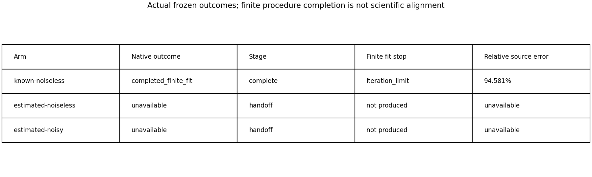
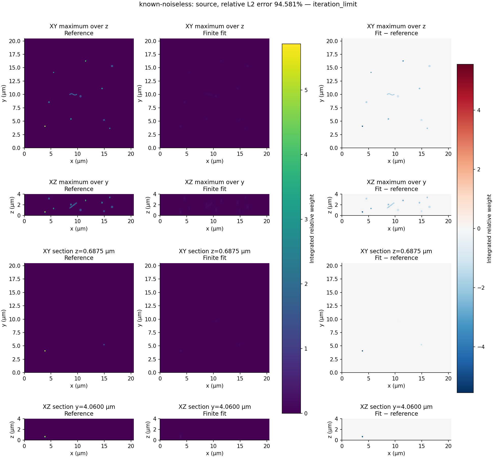
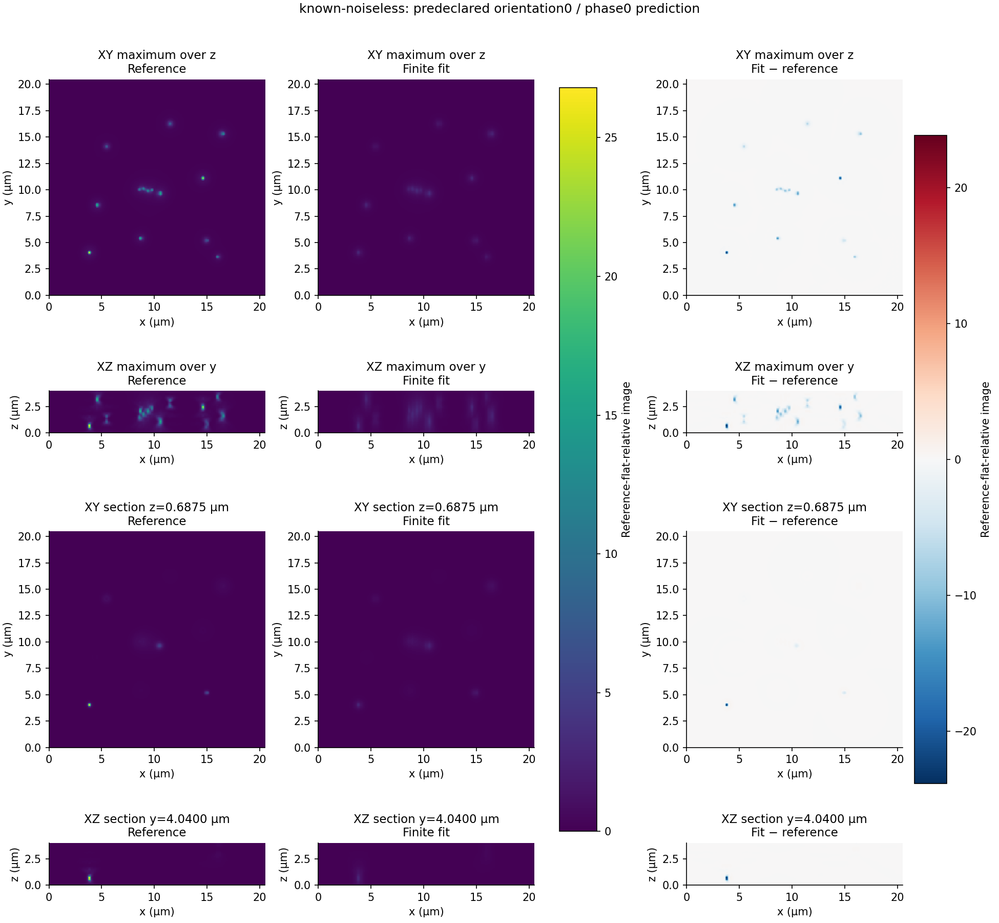
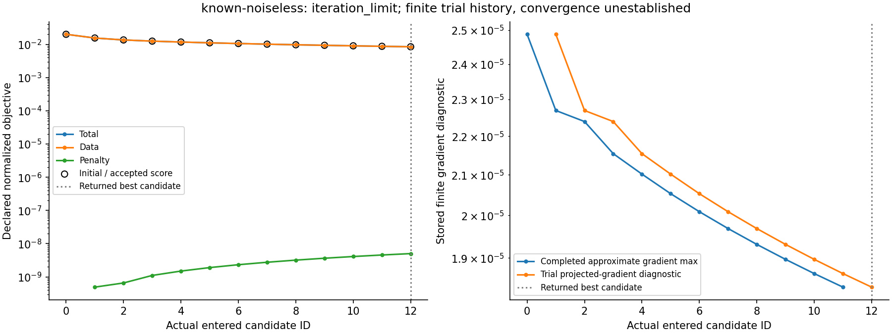
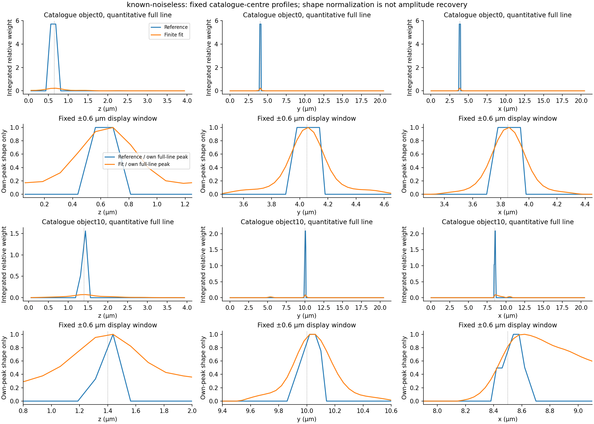
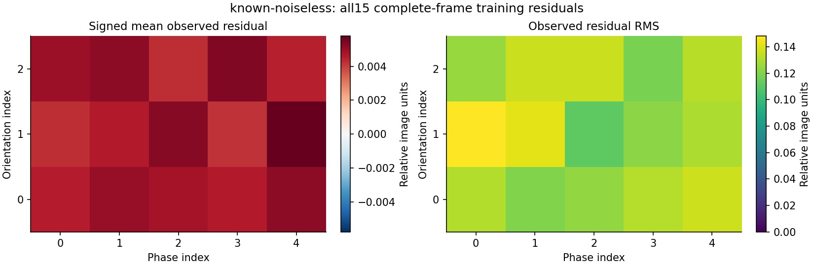
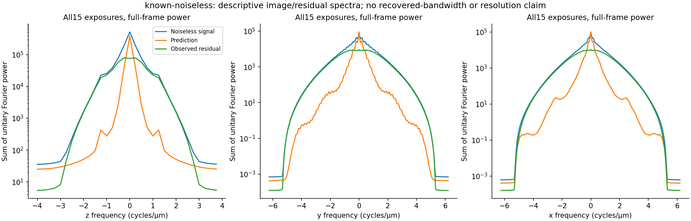
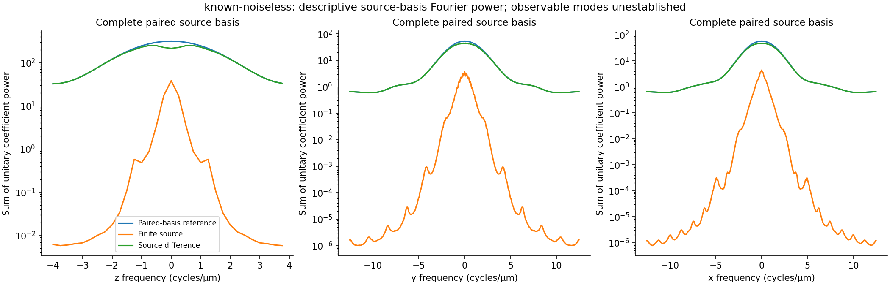
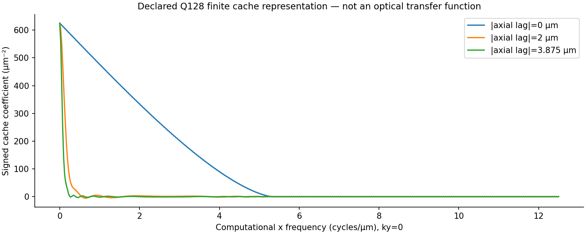

# RA14 — full-scene evaluation exposes unresolved recovery

The fixed 27-object experiment does **not** demonstrate full-scene recovery or
reference-method alignment. Supplying the true illumination produces a finite
12-update fit with **94.58% relative source error** and **64.86% noiseless-signal
prediction error**. Both raw-array estimated-illumination arms stop at calibration
`training_misfit` and produce no specimen source. These are retained scientific
outcomes, not a reason to relax the frozen settings.

The new [comparison module](../usage/reference-alignment-ra14.md) supplies only
existing-operator prediction replay and descriptive, stable array metrics. No
estimator, component, dependency or gate changed. The
[contract](../contracts/reference-alignment-ra14-v1.md) separates experiment
delivery, named independent finite numerical controls and full scientific alignment.
The last remains unestablished. RA01 adopted no full-scene recovery percentage or
universal resolution criterion; this diagnostic evaluation is not a physical-recovery
acceptance run. The roadmap's recovery/resolution obligation remains unfinished.

## Frozen experiment and actual outcomes

Every arm uses the original 27-object catalogue, a 32×256×256 detector box with
z/y/x spacing 0.125/0.08/0.08 µm, and a 32×512×512 inverse source basis with spacing
0.125/0.04/0.04 µm. The physical field is 4×20.48×20.48 µm. All three orientations
and five phases are retained: 15 complete frames, 2,097,152 samples each and
31,457,280 prediction samples in total. Source metrics cover all 8,388,608 coefficients.

The supplied-illumination control calls the existing physical fitter directly.
Its camera estimate comes from deterministic raw groups; true illumination is
explicitly supplied. The two estimated arms call the RA13 raw-array operation with
only their sealed observations and declared metadata/controls. Generation/evaluation
references live separately. All three inference results were closed and hashed before
truth-based evaluation. There was one call per arm, with no retry, seed selection,
threshold adjustment or outcome-based tuning.

| Observed quantity | Known/noiseless | Estimated/noiseless | Original estimated/noisy |
| --- | ---: | ---: | ---: |
| Native outcome | `completed_finite_fit` | `unavailable` | `unavailable` |
| Last stage | `complete` | `handoff` | `handoff` |
| Reason / finite stop | `iteration_limit` | `training_misfit` | `training_misfit` |
| Calibration training RMS | Not estimated | 0.102349924967 | 0.104257186850 |
| Frozen training limit | Not applicable | 0.05 | 0.05 |
| Scored specimen source | Yes, candidate 12 | None | None |
| Relative source L2 error | 0.945807158513 | Unavailable | Unavailable |
| Relative signal-prediction L2 error | 0.648557479402 | Unavailable | Unavailable |
| Arm elapsed, including persistence and pin checks | 747.080 s | 65.9657 s | 65.5696 s |

RMS means root-mean-square; L2 is the Euclidean norm. Relative error is
`||estimate−reference||₂/||reference||₂`, with one denominator for the entire array.
No per-frame ratios are averaged into the aggregate. Unavailable arms have no
source/prediction payload or fabricated specimen, profile or spectral metrics.



These are actual returned stages and source availability. A finite process success
and a preset iteration stop do not establish convergence, recovery or resolution.

The estimated arms use Q128 pupil integration, one prescribed seed sweep, 40 as
the refinement evaluation setting, training RMS limit 0.05, calibration comparison
setting 1e−8 and operator comparison setting 1e−6. Both refinements stopped with
`ftol` satisfied after six reported function and six Jacobian evaluations; neither
exhausted the evaluation cap. Each recorded 235 scored model entries and no infeasible
entries. The single seed sweep recorded 94 scored polls. Training rejection precedes
the ambiguity audit, held-out handoff and specimen phase transfer; those stages were
not reached. No ambiguity rejection or specimen-stage failure is inferred.

The noiseless failure rules out noise as the sole explanation. The records establish
no specific root cause or component contract violation. Fixed-profile/centre error,
coupled nuisance error and local optimization remain possible explanations; the
`ftol` stop is no proof of stationarity or global optimality. No repair is claimed.

## Source basis, camera gauge and numerical agreement

The matched noiseless generator uses Q128 and adjacent axial electron-mass pairs
from the archived 64×512×512 source. Pairing moves original sites by ±0.03125 µm;
it changes the represented physical source. With true gain `g=1.7 counts/electron`
and estimated deterministic contrast `d=1700 counts`, the frozen construction is:

```text
s_pair = RN64(s_fine[0::2] + s_fine[1::2])
x32 = RN32((g/d) × s_pair)
s_matched = RN64((d/g) × float64(x32)) electrons
```

RN32/RN64 denote the actual float32/float64 rounding. The generator consumes electron
masses; the inverse reference is `float64(x32)`, integrated reference-flat-relative
weights. No voxel-volume factor, fitted scale or registration is added. Float32
rounding has relative L2 error 2.91397127990×10−8, signed integrated-weight change
+2.41398810684×10−5 and zero lost nonzero coefficients. Backconversion measured zero
error for these represented arrays; that observation is not a general exact-arithmetic
guarantee. Sequential camera formation/correction has relative L2 roundoff
1.14596207792×10−16.

Deterministic dark/blank/flat means are 10/20.2/1720.2 detector counts. Physical gain
estimation is unavailable for these constant frames; positive contrast still defines
the valid relative gauge. The noisy means are 10.0022771024/20.1973062104/1720.223000869
counts, contrast 1700.02569466 counts and physical-gain estimate 1.694739834 counts/electron.
These one-realization comparisons establish no instrument accuracy or confidence interval.

For each source-bearing arm, evaluation separately forms optical signal `g×mu_e/d`,
corrected expected counts `(offset+g×(mu_e+background)−b)/d` and observed counts
`(raw−b)/d`, using that fit's actual blank `b` and contrast `d`. No physical gain
estimate is inserted into the relative reconstruction. Original noisy observations
come from Q256/finer-source generation, while noiseless controls use paired Q128
generation. Their difference therefore includes model mismatch and cannot isolate
a noise penalty. The noisy arm never reaches a source comparison.

A separate supplied-source replay after all inference freezes compares the existing
inverse operator with matched generator means across all 15 frames. Relative L2
discrepancy is 8.08657878537×10−8; RMS is 1.62098734472×10−8 in relative image units.
This is measured component agreement with shared physical premises, not independently
certified full-grid accuracy or source recovery. No independently qualified full-grid
operator bound was obtained. Named tiny direct-pupil matrix and metric controls have
independent reviewed oracles and meaningful inherited numerical allowances; their
limited validation does not extend to a full-scene recovery claim.

## What the known-input fitter actually produces



Full source XY/XZ maxima and fixed sections through the first original catalogue
centre. Reference and fit share one linear integrated-weight scale; differences use
a symmetric signed scale. Projection differences subtract displayed projections.
The source is a paired finite basis, not the original continuous specimen.



Orientation 0/phase 0 was selected before inference. Prediction and noiseless optical
signal use the actual camera gauge and common linear scale, with signed differences.
XY/XZ views have equal physical aspect. This is not a raw-noise residual.

The source error norm is 64.8872993042 against reference norm 68.6052106079. Signal
prediction error norm is 729.161715926 against reference norm 1124.28233284.
Observed prediction RMS is 0.130005963503; signed mean error is +0.00483380534829.
These large discrepancies remain visible without intensity alignment or recentering.



All 13 completely scored candidates retain their original identities and objectives.
The initial source plus 12 accepted updates reduced total objective from
0.0200909100206 to 0.00845078028589. Best data objective is 0.00845077527319 and penalty
is 5.01269950927×10−9, with fixed regularization 0.001 and eight permitted backtracking
trials. No trials were rejected. Gradient points belong to their own completed
candidate; the returned candidate has no fabricated terminal gradient. Positive
values use log axes. The original hard stop is `iteration_limit`, not convergence.
Public replay reproduces the data objective to about 3.5×10−18 absolute.



Preselected objects 0 and 10 use nearest native planes and full quantitative lines.
Separate shape rows divide each entire line by its own absolute peak and show a
fixed ±0.6 µm window; they do not demonstrate amplitude recovery. No fitted peak,
registration or interpolation is used. All 27 complete profile triples and actual
coordinates are retained, including lines not shown in this figure.



Each cell summarizes every detector voxel of that exposure, prediction minus
camera-normalized observed counts. Signed mean and RMS have separate declared scales.
These are training residuals, not held-out validation.





These untapered full-volume discrete Fourier transforms use unitary normalization,
physical frequency axes in cycles/µm and power sums over the other two axes.
Image curves sum all 15 exposures; source curves use the full paired basis. Power
retains squared relative-image or integrated-weight units. Zero values are omitted
only from log display. These are descriptive powers, not optical transfer functions,
observable modes, recovered bandwidth or resolution measurements.



Actual signed Q128 cache half-spectrum at fixed absolute axial lags 0/16/31 and ky=0,
in µm−2, without a pixel-area factor. This is an unnormalized lateral transform of a
finite computational embedding. Unused embedding values can affect this representation
without changing retained interactions; it is not a global 3D optical transfer function.

## Historical baseline, provenance and remaining work

The retained PR53 baseline has 95.3147256747% source error and 66.4297594261%
noiseless-signal prediction error. It uses different historical inference settings
and original fine/Q256 observations; it is neither a fresh repeat nor a noise-only
comparator. The current supplied-illumination control's 94.58% source error still
shows poor recovery. No matched conventional image, photon/exposure-budget comparison
or justified resolvability criterion is available. A 40 nm lateral source grid is
not a measured resolution improvement.

Original generation inputs were restored from 46 identified retained archive members
and verified against the original public inventory. Matched generation used tracked-clean
commit `81210cbb672230882165b3988d2cd3baed04eb76`, with all 57 declared material inputs
unchanged. Untracked A-owned test-file inventory was not captured in that generation
snapshot; those files were not material/imported generation inputs. Actual inference ran on clean commit
`a261bfd85d357e359d628fbb5097679898c9cba0`, tree
`40f136502f5f33ed5231cd66c40bed59783a589c`; all 241 declared material files were
unchanged before/after every arm. Both estimated calls performed the actual full
calibration; the earlier small RA12 failure was not substituted.

The [study evidence and source recipes](../studies/reference-alignment-ra14/README.md)
retain all-stage/native status, entered trial histories, closed array/hash manifests,
all15 metrics/spectra, fixed profiles, known-source replay and rounding ledgers.
Original raw/native arrays remain locally retained; public hashes/records do not
substitute for an available raw-data bundle. Python 3.13.12, NumPy 2.5.3 and SciPy
1.18.1 produced the scientific data. Isolated rendering uses Matplotlib 3.10.7 and
NumPy 2.5.3; project dependencies remain unchanged.

The known-input fitter/replay took 708.324/35.5192 s. The estimated noiseless/noisy
handoff calls took 62.5330/62.0876 s. Whole-arm native resident-memory high-water
values were 1,841,135,616 / 1,532,002,304 / 1,688,715,264 bytes. Per-stage entry/exit
high-water observations overlap process history; they are not isolated allocations,
additive peaks or portable bounds. Profiling overhead is included. The bounded
resource pilot's actual cache/forward/adjoint calls passed before heavy work, with
native peak 1,252,589,568 bytes; it certifies no full-grid accuracy or memory bound.

The first post-freeze evaluation wrote closed results, but `/usr/bin/time -l`
returned 1 because the sandbox denied `sysctl kern.clockrate`. The original source,
outputs and failure remain at their original paths. A second post-freeze evaluation
changed only its exclusive output directory and used corrected environment access;
it returned 0 with all 1,894 pinned material files and producer identity unchanged.
No inference was rerun. All non-metadata numerical fields and the other six closed output files matched
exactly across the two evaluations. Independent post-freeze reductions agreed with
ordinary reduction-roundoff differences: maximum image-spectrum energy disagreement
was 2.44×10−15 relative; all 27 centres and 81 quantitative profile lines matched.
The observer has no extra `longdouble` precision on this machine and supplies no
full-grid optical certification. All nine actual figures were visually inspected.

The sole task state at `artifacts/ra14/current-state.json` owns final exact-candidate
full-local, fresh D and both-platform CI evidence; hashes of this document's final
candidate belong outside its tracked bytes. No policy, cleanup pipeline or reference
executable is introduced. The owner requested stopping before RA15 for discussion.
Scientific alignment, source recovery, convergence, uncertainty, empirical instrument
accuracy and resolution improvement remain unestablished.
