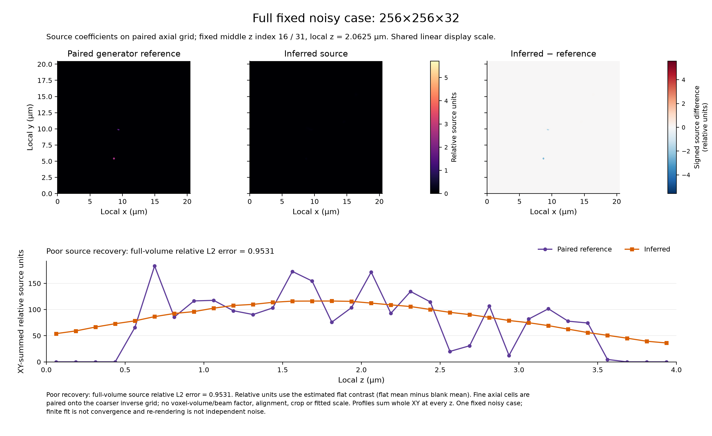
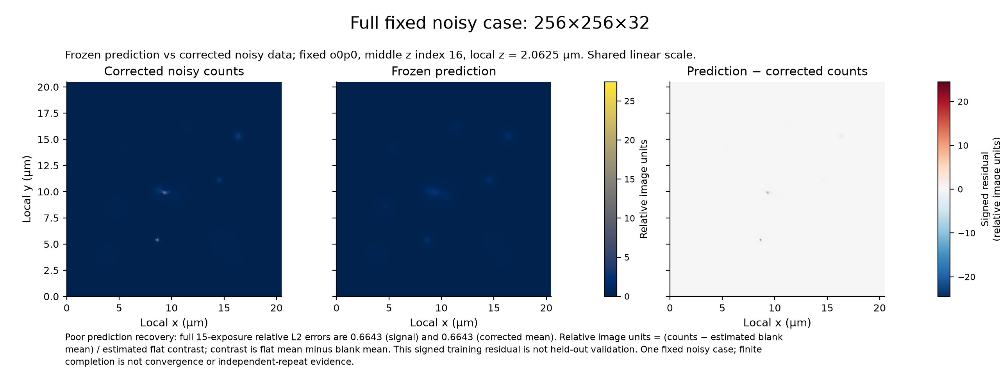

# Noisy image-only study: poor recovery at fixed finite settings

26 October 2026. Completed scientific trial report; software delivery verification is recorded separately.

**Recovery is poor at the predeclared finite settings.** The full 27-object run completed generation, image-only inference and evaluation, but relative source norm error was **0.9531473** and the two prediction errors were about **0.6643**. The specimen solver stopped at its 12-iteration limit. A completed finite workflow is not an accurate reconstruction or a convergence result. No parameter, seed or object was changed after inspecting these outcomes.

Both small and full workflows used three separate stage processes and produced `evaluated` reports with every requested comparison available. The full source comparison contains 8,388,608 coefficients and each full prediction comparison contains 31,457,280 values across 15 exposures. Small comparisons contain 32,768 coefficients and 122,880 prediction values. Exact metrics, all six bead permutations, both illumination gauges and signed residual summaries are retained in the [full evaluation](evidence/full-evaluation.json) and [small evaluation](evidence/small-evaluation.json).

| Scientific comparison | Small relative norm error | Full relative norm error |
| --- | ---: | ---: |
| Source coefficients in the fixed paired camera gauge | 0.8020570305422662 | 0.9531472567471975 |
| Predictions versus noiseless optical signal | 0.4023225658078001 | 0.6642975942609429 |
| Predictions versus camera-corrected expected counts | 0.4022914329406175 | 0.6642963723733037 |

For the full source, `65.38987897173227 / 68.60417265941477 = 0.9531472567471975`; for full signal predictions, `750.7576880954078 / 1130.152652337474 = 0.6642975942609429`. These are error/reference Euclidean norm ratios. The small case also has substantial error. Different fields, object catalogues, camera sizes and noise seeds mean this comparison does not isolate a field-size effect or a single cause of error.

For an estimate x_hat and fixed reference x_ref, relative Euclidean norm error is `sqrt(sum((x_hat-x_ref)^2))/sqrt(sum(x_ref^2))`. Thus 0.802 means an error norm about 80.2% of the reference norm; it is not a fraction of correctly recovered voxels or an accuracy score of `1-0.802`. A zero reference norm makes this relative metric unavailable. Stable full-field reductions preserve genuinely unavailable statistics rather than replacing them with zero.



**Full fixed noisy case: 256×256×32 — source coefficients.** The geometric middle plane is z index16 of32 (local z2.0625µm); XYspacing0.04µm and Zspacing0.125µm, with the whole20.48×20.48µm field shown. Reference and inferred coefficients share a linear color range0–5.7142 relative source units; signed(inferred−reference) uses±5.57245. Relative units use the estimated flat contrast d_hat (flat mean minus blank mean). Reference coefficients are exactly `(true_gain/d_hat)*(fine[2k]+fine[2k+1])`: paired fine axial cells on the coarser inverse basis, with no voxel-volume/beam factor, alignment, crop or fitted scale. Axial profiles sum the whole XY field at every z. Full-volume coefficient relative L2 error0.953147 shows poor recovery; finite-fit completion is not convergence or good-recovery evidence. This is one fixed noisy case, and re-rendering is not independent noise.

[PDF version](figures/source-comparison.pdf).



**Full fixed noisy case: 256×256×32 — frozen prediction and signed training residual.** Fixed orientation0, phase0 and geometric middle z index16 (2.0625µm), with the whole20.48×20.48µm field shown. Corrected raw counts `(counts−estimated blank mean)/d_hat` and frozen prediction share linear range-0.0146111–27.4361; prediction-minus-corrected-raw uses±24.4706. d_hat is the estimated flat contrast (flat mean minus blank mean), defining relative image units. These are training residuals, not held-out validation. Full15-exposure relative L2 errors are0.664298 against the noiseless signal reference and0.664296 against the corrected mean, showing poor prediction recovery. Global metrics use all31,457,280 values, not just the displayed slice. One fixed case and finite completion do not establish convergence or independent-repeat evidence.

[PDF version](figures/prediction-residuals.pdf). Exact display transforms, plot environment and source/evaluation hashes are in [figure provenance](figures/public-figure-provenance.json) and [standalone captions](figures/CAPTIONS.md). The plots were rendered separately with NumPy 2.5.1 and Matplotlib 3.11.0; the scientific trial used the recorded NumPy 2.5.3 environment. Inputs were not refitted or changed. Independent plot norm crosschecks differed from stored relative errors by 0, 1.11e-16 and 0 for source, signal and corrected mean; this records roundoff, not a new acceptance threshold.

## Declared experiment and interpretation

The [full plan](full-plan.json) contains all **27 specimen objects**, plus three separate calibration beads. The [small plan](small-plan.json) contains eight specimen objects and the same three calibration beads. Full detector shape is ZYX `(32,256,256)` at `(0.125,0.08,0.08)` micrometres: physical XYZ `20.48 × 20.48 × 4` micrometres. The small detector is `(8,32,32)`, or XYZ `2.56 × 2.56 × 1` micrometres. Calibration uses `(8,32,32)` in both cases. Camera frames are 256×256 for full and 32×32 for small. Origins, every catalogue row, illumination carrier/phase/amplitude, and all seeds are preserved in the plans; no object or seed is selected after fitting.

Each case has 82 predetermined distinct seed values: `3*8 + 1 + 3*9 + 3*5 + 3*5 = 82` camera, central-calibration, training, held-out and specimen streams. The exact [full seeds](full-seeds.json) and [small seeds](small-seeds.json) are value-preserving extracts. Distinct seed labels alone do not prove statistical independence. The repeated small generation is the same realization, not a second statistical trial.

Both plans use photon shot noise and Gaussian read noise: background 6 electrons per pixel per exposure, read-noise standard deviation 2.5 electrons, gain 1.7 detector counts/electron, offset 10 counts, and flat added signal 1000 electrons per pixel per exposure. These are generator settings, not fitted estimates. For optical mean mu electrons, the count model is `10 + 1.7*(Poisson(mu+6) + Normal(0,2.5^2))`; dark frames use zero background. As a units check, read-noise standard deviation is 4.25 counts and true flat-minus-blank contrast is 1700 counts. Inference sees the acquired frames, not these true coefficients.

The conditional optical model has a clear matched-index scalar pupil, excitation/emission wavelengths 0.488/0.525 micrometres, index 1.515, detection numerical aperture 1.4 and 2×2 pixel midpoint samples. Generator source refinements are 8×8×8 for calibration and 2×2×2 for specimen; generator pupil quadrature order is 256. This is a finite scalar model, not an empirical pupil-recovery or full physical-microscope validation.

The unchanged [inference settings](inference-settings.json) use all ten bead sweep scales `[1,0.5,0.25,0.125,0.0625,0.03125,0.015625,0.0078125,0.00390625,0.001953125]`, regularization 0.001, at most 12 specimen iterations, at most eight backtracking trials per iteration and pupil quadrature order 256. The complete 47-coordinate bead operation and its prescribed rescores precede the projected nonnegative 3D source fit. Finite polling, quadrature and an iteration limit do not establish global convergence, unique parameters or resolution recovery. In both runs the bead operation completed 940 planned polls, 470 pairs and ten sweeps, with no unprobed coordinates reported. In the full specimen fit the recorded total objective decreased from 0.02032736047514664 to 0.008985370756061319 over 12 accepted iterations, while recovery remained poor. This objective decrease is not independent validation. [Compact parameter estimates](evidence/full-parameter-estimates.json) retain the camera, frozen bead parameters, counts, held-out summaries and solver stop reason; no truth-aligned parameter variant was selected.

The source reference uses the paired estimated camera contrast d_hat and true gain g only in evaluation: `x_ref[k,y,x] = (g/d_hat)*(source_e[2*k,y,x]+source_e[2*k+1,y,x])`. It is fixed-index electron-mass aggregation into the coarse inverse axial basis. The lateral grids agree; paired axial centers and optical predictions need not. This discretization mismatch prevents interpreting the coefficient error as a continuum-source accuracy measurement. There is no fitted post-hoc scale, translation, crop or alignment.

For optical signal mean mu_e, predictions are compared separately with `g*mu_e/d_hat` and `(true_offset+g*(mu_e+true_background)-estimated_blank)/d_hat`, in reference-flat-relative units. The second retains camera-gauge/blank error; it is not a fitted intercept. Signed observed residuals use `prediction-(raw-estimated_blank)/d_hat`. Specimen residuals are training residuals, not held-out validation. Evaluation retains all six bead label permutations and both global illumination gauges; it never alters frozen output to select a truth-aligned result. The [protocol](protocol/full-noisy-study-v1.2.md) and [schema note](protocol/full-noisy-study-v1.2-schema-clarifications.md) give the exact comparisons and limits.

## Resources and retained attempts

| Case and stage | Wrapper exit | Native real time (s) | Supervisor elapsed (s) | Peak resident set size (bytes) |
| --- | ---: | ---: | ---: | ---: |
| Small generation, first attempt | 1 | 139.61 | 139.666179125 | unknown |
| Small generation, fixed-input repeat | 0 | 140.15 | 140.1789315 | 487243776 |
| Small inference | 0 | 46.39 | 46.421120625 | 504987648 |
| Small evaluation | 0 | 0.95 | 0.9675859169947216 | 184483840 |
| Full generation | 0 | 327.35 | 327.417925791 | 1509408768 |
| Full inference | 0 | 703.60 | 703.6608539169974 | 1904820224 |
| Full evaluation | 0 | 2.71 | 2.773099582991563 | 676478976 |

The first small generation sealed 46 valid files, but the restricted resource query then failed. Its wrapper exit was 1; direct driver exit and peak resident memory are unknown. A read-only resource-environment repair passed. The unchanged plan, settings and seeds were then repeated into new roots; all 46 files were byte-identical. The first artifacts and failed measurement are retained. This was a diagnosed measurement repair, not resampling or selection of a better scientific result.

Native real time is nested inside supervisor elapsed; adding them double-counts the same work. User/system CPU clocks are not additional elapsed time, and separate process peaks cannot be summed. Physical footprint is unknown. The observed full inference peak was 1,904,820,224 bytes (about 1.905 decimal GB); it is not physical footprint or a guarantee for other runs. Full sequential worker elapsed sums to 1033.851879291 seconds, excluding coordinator validation and waiting; this is not end-to-end workflow wall time. The 67 full protocol files contain 975,503,360 array-payload bytes and 978,255,623 regular-file bytes (58 NPY and nine JSON files). Storage bytes and resident-memory peaks measure different quantities. Generation memory and old different-geometry probes are not substitutes for this measurement. [Resource records](evidence/resources.json) preserve exact observations and unknowns.

## Reproduction and evidence

[Reproduction manifest](reproduction-manifest.json) records exact plan/settings/seed-file digests and trial source commit `1c209a4769c0caab0fb173287efbcac952ed01b1`; driver SHA-256 is `8f345cc696415379e54992bbbfd4fed91258853967784f45827df1eb1e032896`. These identify the actual scientific trial source. Python 3.13.12, NumPy 2.5.3, SciPy 1.18.1 and SIMrecon 0.1.0 were recorded on macOS 27.0.1 arm64 with little-endian arrays. Exact runtime metadata and the lock digest are in the manifest. Final delivery candidate hashes and local/D/continuous-integration receipts belong separately outside tracked report bytes; this report does not certify delivery checks.

Run from a checkout with the driver hash above and the recorded locked environment. The report directory was committed after the actual trial source; the following commands assume the checkout contains this report and identical driver bytes. Use fresh absent output roots whose parents already exist. `generate`, `infer` and `evaluate` are separate processes. For example, with this report directory bound to STUDY:

```sh
STUDY=docs/studies/full-noisy-study-2026-10-26
.venv/bin/python -m scripts.full_noisy_study generate --plan "$STUDY/full-plan.json" --out full-run
.venv/bin/python -m scripts.full_noisy_study infer --observations full-run/observations --out full-inference --sweep-scales '[1.0,0.5,0.25,0.125,0.0625,0.03125,0.015625,0.0078125,0.00390625,0.001953125]' --regularization 0.001 --max-iterations 12 --max-backtracking-trials 8 --pupil-order 256
.venv/bin/python -m scripts.full_noisy_study evaluate --observations full-run/observations --inference full-inference --private-truth full-run/private_truth --out full-evaluation
```

Use the small plan and distinct small output roots for the small case. Inference receives only observations and five explicit algorithm settings. Freeze and validate public outputs before evaluation opens truth. Public release of synthetic reproduction inputs does not authorize truth access during inference. This procedural separation is not an engineered filesystem sandbox. Identical seeds do not promise identical random streams across dependency versions or platforms.

The compact identities below bind primary artifacts. The [closed protocol inventory](evidence/closed-protocol-file-inventory.json) records all 67 files per completed case: 46 generation, 19 inference and two evaluation files. Raw large arrays remain local; their complete-file hashes, sizes, exact plans/settings/seeds and recorded versions support reproduction. [Generation digests](evidence/generated-bundle-digests.json) retain the original per-bundle list.

| Artifact | SHA-256 |
| --- | --- |
| Small observations manifest | `3caf82e25df323dedb101349440a206a1587eab32f4ee5366f425539e64b9a5e` |
| Small inference freeze | `1a5fc5afd32c39d56e3a2a41d1ae64754e7ea8dc3e3370b62dfc510cc78328c5` |
| Small evaluation | `5512410bb7c40a302656d23c4908fbd23777c53c27572b3de24e925f3fdc3e16` |
| Full observations manifest | `1aeae458173155d0609020d25b299e087e16ffa6e31453f744e8b048584ebd5c` |
| Full inference freeze | `919068b950240adb2f122c12a903efe83537bf4b3430691c8bbf6a912d64fdad` |
| Full evaluation | `2e6e5afaed797b4fc8feaa2dc6272488899071834fa88e45c0cc082fd0ac2ceb` |

The two observed full-data figures above are closed copies of the checked rendering. Captions disclose fixed slice, full-field display scales, camera-gauge units and comparison limits. The original complete scientific files remain local and unchanged; figures are not new noise realizations.

Both completed outcomes are consistent with a finite solver producing poor recovery under the declared model and finite settings. They do not identify the cause or demonstrate a resolution gain. No separate source/pixel/pupil/finite-field convergence study is claimed; the frozen bead quadrature rescores alone do not establish such convergence. Finite source and pixel quadrature, the scalar clear-pupil assumption, paired axial basis mismatch, estimated camera gauge, possible ambiguous parameters and training-residual interpretation remain material limits. Exact local verification, independent review and required-platform continuous-integration records are maintained separately in [PR53](https://github.com/david-hoffman/simrecon/pull/53). This scientific report creates no acceptance threshold or gate exception.
