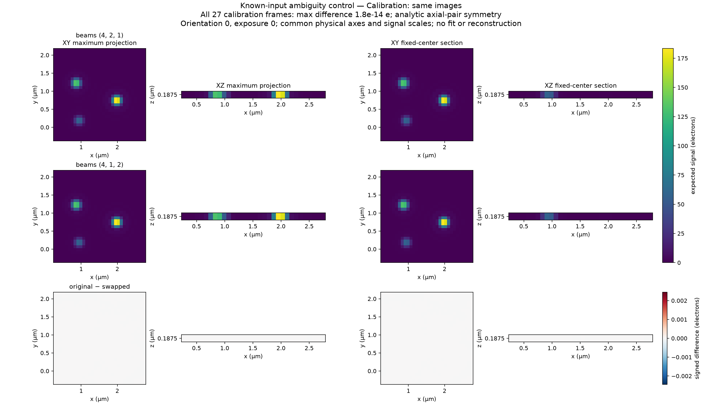
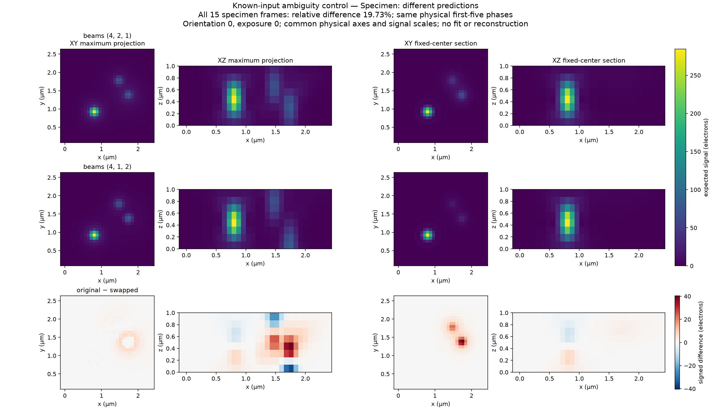
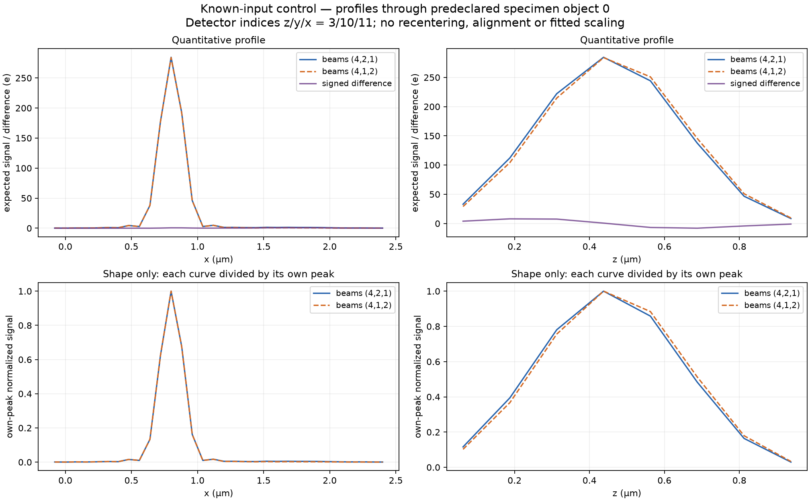

# One-focus ambiguity control

This constructed, noiseless control explains why the calibration handoff audits
specimen predictions. Both arms use supplied parameters. It is not an image-only
estimate, a reconstruction, or a result on the retained eight-focus observations.

Three finite calibration spheres share the sole focus plane. Exchanging side-beam
amplitudes `(4,2,1)` and `(4,1,2)` preserves their calibration images. The same
exchange changes predictions for a specimen spanning several focus planes.
The [expectation source](../../../contracts/reference-alignment-ra12-expectations-v1.md)
derives this symmetry independently of the numerical producer. Both numerical
arms use the same existing optical implementation; neither is an independent
numerical reference for that implementation.

The [predeclared manifest](manifest.json) gives every sphere center, radius and
brightness, grids, origins, optical settings, carriers and fixed phase errors.
The nine nominal phases are
`pi*(0,2/5,4/5,6/5,8/5,1/5,3/5,7/5,9/5)`.
Actual calibration phase `(o,j)` is nominal phase `j`, plus orientation offset
`o`, plus multiplier `o` times error `j`. Only the first five phases transfer to
the specimen, using the stated origin difference exactly once. Sources use the
public closed-midpoint sphere construction, pupil order128 and2×2 pixel samples.

With `theta=2*pi*q·r+phase`, `alpha=2*pi*kappa*(source_z-focus_z)` and squared
beam norm21, the original-minus-swapped illumination is
`(16/21)*sin(theta)*sin(alpha)`. Axially paired calibration source cells cancel
this odd term. That cancellation does not hold over the full specimen field.

Across all27 calibration exposures, the largest observed difference is
`1.7764e-14` electrons. Across all15 specimen exposures it is `40.4553` electrons;
the difference norm divided by the original prediction norm is `0.197331`.
These measure prediction differences, not recovery accuracy. The
[numerical export](evidence.json) retains full metrics, array identities, producer
and dependency identities, render settings, figure hashes and limitations.
Original arrays, producers and complete local provenance remain retained locally.

Calibration predictions agree to observed floating-point precision. Signal panels
share an electron scale; the signed difference scale is ±`2e-5` times the observed
unilluminated peak. XY and XZ projections and sections use physical coordinates
and the predeclared first calibration sphere, without peak selection.

The corresponding specimen predictions differ. Signal panels share an electron
scale and difference panels share a symmetric signed scale. Sections use the
nearest detector planes to the predeclared first specimen sphere. A displayed
projection difference is the difference between projections, not a projection
of the signed volume difference.

Profiles use the same fixed specimen location. Quantitative electron profiles and
separately normalized shape profiles have different purposes; peak normalization
does not remove the quantitative prediction difference. SVG versions accompany
all three figures for export.
