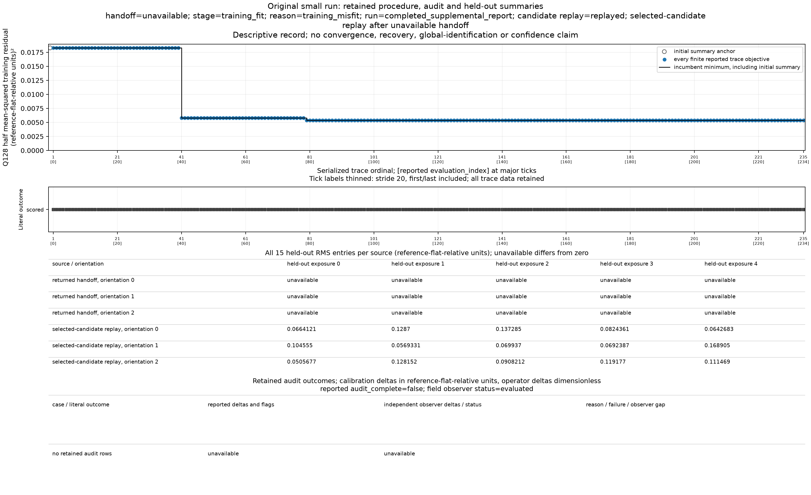
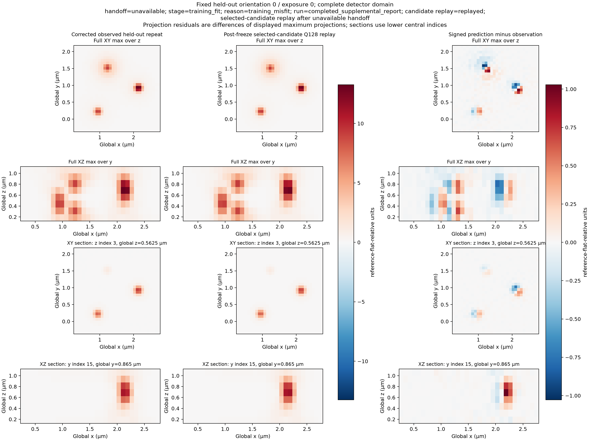

# Original small observation run: unavailable handoff, retained candidate replay

This is an observed-results export of the original small calibration run. It is not a fully publicly reproducible package: the 22 original observation files, complete frozen numerical payloads, caller/renderer scripts and full local receipts remain retained locally. PUBLIC aliases in the metadata identify those retained inputs by hash; they are not download locations. No original observation array, generator plan, seed, truth volume or private transcript is released here.

The observation-only handoff returned unavailable at training_fit/training_misfit. Its training root-mean-square (RMS) residual was 0.10346815963311173 reference-flat-relative units, above the fixed limit 0.05. No specimen descriptor, final handoff held-out prediction or completed audit was returned. All later candidate predictions remain diagnostic. No cause for the misfit is assigned.

The [numerical and provenance export](evidence.json) retains the predeclared controls and grids, all 235 refinement trace records, all 15 post-freeze candidate held-out RMS values, empty/unavailable handoff and audit comparisons, source and input identities, figure selections/scales and limitations. The [public figure protocol](figure-protocol.json) is explicitly a derivative of the hashed local protocol: its values are unchanged except local paths replaced by PUBLIC aliases.

Every one of the 235 objective and outcome points remains plotted. Major tick stride20 changes labels only. The objective uses the central image plus all 27 structured images, with F=sum(residual squared)/(2*229376); residual means prediction minus corrected observation. Objective units are squared reference-flat-relative units; RMS uses reference-flat-relative units. Missing handoff RMS and absent audit outcomes remain explicitly unavailable. [SVG](procedure-audit-heldout.svg).

Fixed held-out orientation0/exposure0. Columns show once-corrected observed counts, the frozen selected-candidate Q128 replay after the unavailable handoff, and signed displayed-prediction minus displayed-observation. Rows are full XY/XZ maximum projections and fixed XY/XZ sections at global z0.5625 micrometres and y0.865 micrometres. Axes have equal physical aspect. All signal panels share +/-13.252575308019619 relative units; all residual panels share +/-1.0280150707984745 relative units. Projected differences subtract the displayed projections. [SVG](heldout-frame-observed-replay-residual.svg).

The inference/replay used Python3.13.12, NumPy2.5.3 and SciPy1.18.1. Rendering used NumPy2.5.3, Matplotlib3.11.0 and the recorded DejaVu Sans font hash. The producer HEAD still named the RA11 baseline while new RA12 source bytes were present; exact source hashes identify the calculation separately from any later documentation or final-candidate commit. Verification, review and platform readiness evidence are recorded separately.

The four PNG/SVG files are byte-identical copies of the coordinator-inspected render4 outputs. Exporting them performed no new rendering, fitting, camera estimation, optical prediction or array load. Shared optical replay checks composition, not the underlying physical implementation. The 921600-value direct field observer had no successful descriptor/audit comparison. This bundle makes no reconstruction, continuum-accuracy, global-identification, statistical-confidence or empirical-optics claim.
