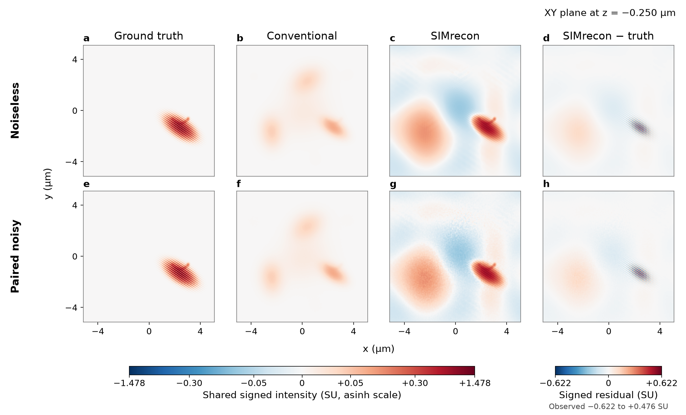
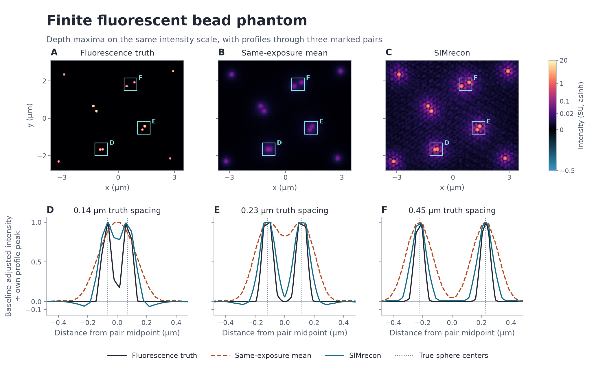
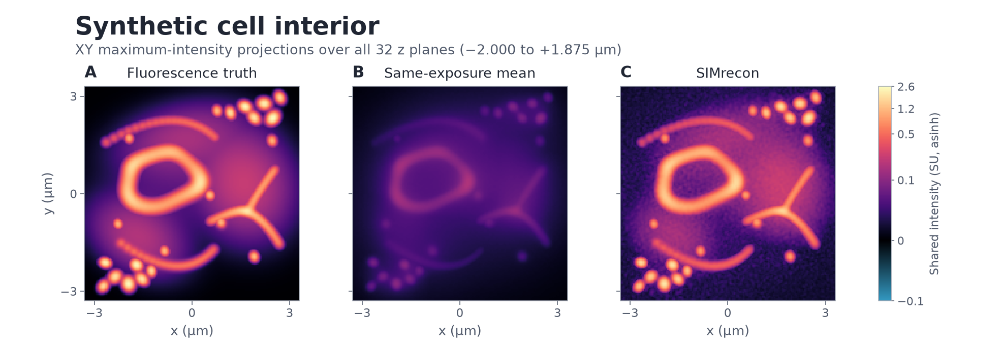
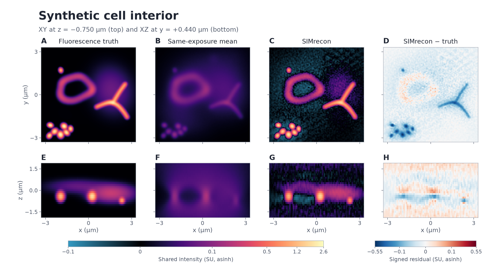
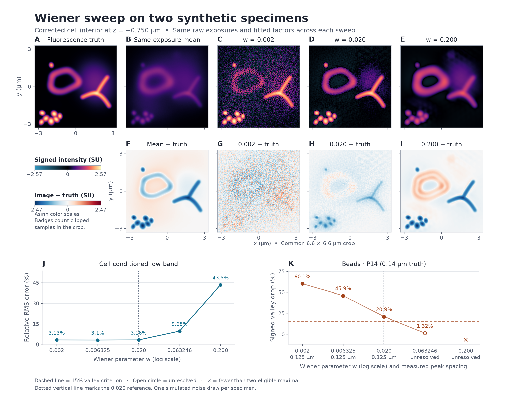

# Synthetic reconstruction study

These examples reconstruct four simulated specimens with known fluorescence.
Each uses the public three-dimensional workflow and a separate simulated bead
calibration. The paired structured specimen tests the same geometry without
noise and with simulated camera noise. The bead specimen probes local peak
separation. The cell-like volume tests a mixture of filaments, puncta and
diffuse signal at several depths.

## Acquisition and comparison

| Quantity | Value |
|---|---|
| Detector grid in Z × Y × X order | 32 × 128 × 128 |
| Reconstructed grid in Z × Y × X order | 32 × 256 × 256 |
| Detector pitch in Z, Y, X | 0.125, 0.080, 0.080 µm |
| Reconstructed pitch in Z, Y, X | 0.125, 0.040, 0.040 µm |
| Illumination | Three directions, five phases per direction |
| Emission wavelength | 525 nm |
| Numerical aperture | 1.4 |
| Immersion refractive index | 1.515 |
| Study Wiener setting | 0.020 |

The forward model simulates fluorescence under focal-relative patterned
illumination and a scalar detection pupil. The underlying three-beam geometry
is described by [Gustafsson and colleagues](https://pmc.ncbi.nlm.nih.gov/articles/PMC2397368/).
The examples use fixed synthetic sources and camera seeds. The noisy
structured arm changes specimen and calibration noise together. The bead and
cell cases share the noisy raw bead calibration. Each noisy case has one draw.

A full workflow run estimates the carriers and complex modulation from
the observed phase bands. It receives the simulated detector
frames, calibration and settings. The independently generated truth enters
the evaluation only. The conventional comparison averages the same 15
exposures after camera-offset subtraction. It uses the same signed source-unit
scale and output coordinates. One workflow output count represents
`(2² × 3) / (5 × 120,000) = 0.000020` simulation source units. The factor is
fixed across cases and Wiener settings.

## Observed examples

### Paired structured specimen



In the selected three-dimensional Fourier bins, the relative
root-mean-square error was about **56%** in the noiseless reconstruction and
**58%** in the noisy reconstruction. It was about **100%** for the exposure
average in both cases. The mask restricts the lateral radial frequency to
6.65–8.30 cycles/µm and absolute axial frequency to 0.25–0.75 cycles/µm,
with additional native-frequency and transfer-support conditions. Relative
error divides the error's root-mean-square magnitude by the truth's in
those bins.

### Fluorescent beads



The simulated spheres are 0.10 µm in diameter. SIMrecon separated the 0.14 µm
truth pair under the frozen two-peak rule and measured 0.125 µm between the
peaks. The valley lay 20.9% below the weaker peak. The same-exposure average
left that pair unresolved. Both paths separated the 0.45 µm control pair.
The line profiles are baseline-subtracted and divided by each trace's own
peak to compare shape.

### Synthetic cell interior



Each projected pixel takes the maximum signed intensity across all 32
sampled z planes, from −2.000 to +1.875 µm. The same intensity scale applies
across all three projections. The sections below retain the depth and
signed residual information.



The single-channel scene includes an irregular nuclear rim, branching tubules,
puncta and diffuse cytoplasm. The relative error in the predefined conditioned
low-frequency mask of 3,244 nonzero-frequency bins was **3.16%** for SIMrecon
and **78.92%** for the exposure average. The signed residual shows underestimation at some bright features.
The first cell layout failed a preset carrier-peak margin. The revised layout
was fixed before a fresh qualification and reconstruction.

## Wiener sweep

The sweep uses the same saved noisy bead and cell inputs. The public
Wiener parameter w ranges from 0.002 to 0.200. Consecutive values have
the same ratio, √10. The filter adds w² to its denominator, so that
term changes by a factor of 10 at each step. The table shows the displayed
values. The measured JSON retains the exact double-precision arguments.

| Public Wiener value w | Denominator term w² |
| ---: | ---: |
| 0.002 | 0.000004 |
| 0.006325 | 0.00004 |
| 0.020 | 0.0004 |
| 0.063246 | 0.004 |
| 0.200 | 0.04 |

The portable workflow runs each specimen at 0.020 to prepare its bands,
derive a transfer table from the simulated calibration, and fit carriers
and complex modulation.
An explicit filtering replay at 0.020 must match the full workflow bit
for bit. The other four values use those same stage inputs. An independent
calculation checks selected signed Fourier coefficients at each value.
Truth and the same-exposure average enter the scoring phase after the
public calls. Each specimen uses one simulated noise draw.

The 0.14 µm bead pair met the fixed rule at the three lowest settings,
with 0.125 µm measured peak spacing. The valley drop was 60.1%, 45.9%,
and 20.9%, respectively. At 0.063246 it fell to 1.3%, below the 15% rule.
The 0.200 profile had fewer than two eligible maxima.

Cell error in the 3,244 selected low-frequency bins ranged from 3.10% to
3.16% through 0.020, then rose to 9.68% at 0.063246 and 43.45% at 0.200.
Across the whole volume, 0.020 had the lowest root-mean-square error
among the five tested settings, at 0.01486 simulation source units. The
0.002 slice shows more grain. The 0.200 residual shows stronger
underestimation of fine features.

The measured study reran the 0.020 workflow and explicit replay for each
specimen, and measured both new interior settings. The two endpoint
observations per specimen come from the earlier sweep. The final scores
recheck those signed images against the revised grid after verifying their
inputs, axes, settings and fitted factors against the fresh replay.



*The image rows show the same crop of the cell at z = −0.750 µm. Each
signed color scale uses an inverse hyperbolic sine mapping. The plots show
measurements at all five logarithmically spaced settings. The dotted
vertical guide marks 0.020.*

[Measured rows and fixed-factor provenance](wiener-results.json) · [Sweep PDF](figures/wiener.pdf) · [Detailed caption](figures/wiener-caption.md)

The tracked `wiener-results.json` is a byte-for-byte copy of the local
`sweep-metrics.json` named in the figure sidecar. A portable rerun
measures all ten rows afresh and records its own provenance and digest.

## Reproduce the study

Run from the repository root with Python 3.13.12 and the locked dependencies.
The accepted byte-for-byte replay used NumPy 2.5.3 on macOS arm64. The
generator uses portable Python and NumPy. Exact floating-point bytes can
depend on the numerical build. Use the checker to confirm the input
identities before scoring a rerun.

```sh
uv sync --locked --all-groups
study=docs/studies/simulation-capstone
out=$(mktemp -d "${TMPDIR:-/tmp}/simrecon-study.XXXXXX")
export VECLIB_MAXIMUM_THREADS=1 OPENBLAS_NUM_THREADS=1 OMP_NUM_THREADS=1
export MKL_NUM_THREADS=1 BLIS_NUM_THREADS=1 NUMEXPR_NUM_THREADS=1

for case in clean noisy beads cell
do
    uv run --locked --no-sync python "$study/inputs/generate.py" "$case" "$out/input-$case" || exit 1
    uv run --locked --no-sync python "$study/inputs/check_inputs.py" "$case" "$out/input-$case" || exit 1
done

for case in clean noisy
do
    uv run --locked --no-sync python "$study/reconstruction/run_study.py" \
        "$case" "$out/input-$case" "$out/baseline-$case" || exit 1
done

for case in beads cell
do
    uv run --locked --no-sync python "$study/reconstruction/run_study.py" \
        "$case" "$out/input-$case" "$out/sweep-$case" --sweep --observe || exit 1
done
```

The generated arrays live in the temporary run directory. Keep it through
scoring and plotting. Use a fresh output directory for each invocation. A failed run can leave
partial files. Its status and progress log identify the last stage. A passing
input check requires the generator's complete manifest. To run a bead or
cell baseline without the sweep, call `run_study.py` for that case without
`--sweep --observe`.

`specimen.npy` stores native counts in
`(time, direction, phase, z, y, x)` order. `calibration.npy` stores the raw
bead in `(phase, z, y, x)` order. The calibration has 0.090 µm lateral sampling.
`truth.npy` and `conventional.npy` contain signed-scale reference volumes in
`(z, y, x)` order. The reconstruction files `w-*.npz` contain the signed
counts and coordinate vectors. The sweep writes one compact score row per
setting in `rows.jsonl` and common information in `case.json`. The cell
observer regenerates its independent reference transfer in memory from the
simulated calibration to select the scoring band. The
[runner notes](reconstruction/README-runner.md) describe every output and
show the explicit Apple Accelerate thread setting used in the measured run.

### Rebuild the figures

The [figure files](figures/) include lossless PNG and publication PDFs with
embedded text. The JSON sidecars record the input digests, physical slices,
signed intensity scales, display transforms, and rendered output digests.
The measured arrays stay outside Git. The baseline renderers verify each
reference file against its case and match each signed archive to its run
receipt and returned Wiener value of 0.020. The structured-pair renderer
also accepts the exact original archives listed in the historical results.
The plotted bead and cell reruns at 0.020 match the original signed image
arrays and axes byte for byte. Give each renderer a fresh output directory.
If a render fails after creating its directory, use a new directory for
the retry.

To rebuild the sweep figure, combine the two measured score files using
the locked Python interpreter.

```sh
uv run --locked --no-sync python "$study/reconstruction/collect_sweep.py" \
    "$out/sweep-beads" "$out/sweep-cell" "$out/wiener-results.json"
```

Use a separate plotting environment. The figures were rendered with Python
3.13.12, NumPy 2.5.1 and Matplotlib 3.11.0. Set `plot_python` to its Python
executable.

```sh
export MPLCONFIGDIR="$out/matplotlib-cache"

"$plot_python" "$study/plot/plot_structured_pair.py" \
    --noiseless "$out/input-clean/truth.npy" "$out/input-clean/conventional.npy" \
        "$out/baseline-clean/w-0.020.npz" \
    --noiseless-runtime "$out/baseline-clean/runtime.json" \
    --noisy "$out/input-noisy/truth.npy" "$out/input-noisy/conventional.npy" \
        "$out/baseline-noisy/w-0.020.npz" \
    --noisy-runtime "$out/baseline-noisy/runtime.json" \
    --out-dir "$out/plot-structured"

"$plot_python" "$study/plot/plot_phantoms.py" beads \
    --case-dir "$out/input-beads" --observations "$out/sweep-beads/w-0.020.npz" \
    --runtime-receipt "$out/sweep-beads/runtime.json" \
    --scores "$out/sweep-beads/bead-default-score.json" --output-dir "$out/plot-beads"

"$plot_python" "$study/plot/plot_phantoms.py" cell \
    --case-dir "$out/input-cell" --observations "$out/sweep-cell/w-0.020.npz" \
    --runtime-receipt "$out/sweep-cell/runtime.json" \
    --output-dir "$out/plot-cell"

"$plot_python" "$study/plot/plot_cell_mip.py" \
    --case-dir "$out/input-cell" --observations "$out/sweep-cell/w-0.020.npz" \
    --runtime-receipt "$out/sweep-cell/runtime.json" \
    --output-dir "$out/plot-cell-xy-mip"

"$plot_python" "$study/plot/plot_wiener.py" \
    --metrics "$out/wiener-results.json" \
    --cell-truth "$out/input-cell/truth.npy" \
    --cell-conventional "$out/input-cell/conventional.npy" \
    --cell-observations "$out/sweep-cell/w-0.002.npz" "$out/sweep-cell/w-0.020.npz" \
        "$out/sweep-cell/w-0.200.npz" \
    --output-dir "$out/plot-wiener"
```

The full detector cases are opt-in. On the recorded local Mac, a public
workflow call at the study geometry took about 3 min 25 s. Keep the full
study output outside Git. Remove the temporary run directory after copying
the figures or metrics you want to keep. The small example in the repository README
exercises the public API in seconds and uses a separate declared transfer.
The study examples exercise raw calibration and measured carrier search.

[Input provenance](inputs/provenance.json) · [Original accepted outcomes](historical-results.json)
· [Structured PDF](figures/structured-pair.pdf) · [Bead PDF](figures/beads.pdf)
· [Cell sections PDF](figures/cell.pdf) · [Cell XY projection PDF](figures/cell-xy-mip.pdf)
· [Wiener PDF](figures/wiener.pdf)

The figures show synthetic recovery under this model. Experimental recovery,
reproducibility across new noise draws and agreement with historical C
executables require separate evidence.
