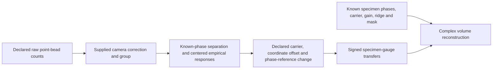

# Consume a paired empirical volume response

`adapt_empirical_volume_response` converts an explicitly paired, same-grid
empirical calibration response into the existing `VolumeOrderOtf` record for
known-parameter volume reconstruction. It removes the declared bead/carrier
phase and changes the separation phase reference. It preserves every complex
zero-order sample and the common relative normalization. The
[adapter contract](../contracts/empirical-transfer-consumption-v1.md) defines
its numerical boundary.

The caller declares that calibration and specimen share the finite grid,
spacing, axis directions, instrument response and focal-plane-relative model.
Pair one orientation/channel/time explicitly. Supply actual phases, physical
integer carriers and positive gains separately to reconstruction. Nominal
phase commands cannot replace actual phases. The adapter estimates none of
these quantities and does not certify the pairing or physical validity.



*Conceptual pipeline. Calibration retains a bead/phase gauge; the declared
adapter cancels it before the existing reconstruction uses the transfer once.
The diagram makes no physical accuracy or object-recovery claim.*

## Phase sign and coordinate setting

For stored response `E_m`, observed origin `b_hat`, lateral dimensions `Ny,Nx`
and exact integer carrier `(ky,kx)`, define

```text
rho = ky*(b_hat_y + oy)/Ny + kx*(b_hat_x + ox)/Nx   [cycles]
delta = specimen separation reference - calibration separation reference [rad]
F_0 = E_0
F_m = E_m * exp(-i*m*(2*pi*rho + delta)), m=1,2
```

`coordinate_offset_yx=(oy,ox)` maps stored indices into the fixed illumination
coordinates, in detector samples. Explicit `(0,0)` declares aligned origins.
If all stored volumes roll by `t`, change this offset by `-t` to keep the fixed
coordinates. Physical bead movement changes its illumination phase; a storage
roll changes indexing. The offset is neither subvoxel localization nor a
specimen translation correction.

If calibration separation uses physical phases plus `alpha_c`, and specimen
separation uses physical phases plus `alpha_s`, supply
`delta=alpha_s-alpha_c`. For the selected point-bead model,

```text
E_m = exp(i*m*(2*pi*rho-alpha_c)) * DFT(h*g_m)
F_m = exp(-i*m*alpha_s) * DFT(h*g_m)
```

Here DFT means the negative-exponent discrete Fourier transform. This equation
explains the sign; it is the finite model in the
[public model record](../models/synthetic-3d-acquisition-v1.md).
Independent per-step phase errors cannot be represented by this scalar delta.

## Direct signed response example

Directly constructed arbitrary algebraic records are permitted. They need no
positive zero-order DC, nonzero side order or physical certificate. This
example keeps a nonunit complex zero order and an exactly zero second order.

```python
import numpy as np
from simrecon import EmpiricalVolumeResponse, adapt_empirical_volume_response

shape = (2, 3, 4)
spacing = (0.25, 0.5, 0.125)  # z/y/x, micrometres
labels = np.arange(72).reshape(3, *shape)
values = ((labels % 11 - 5)/8 + 1j*(labels % 7 - 3)/16).astype(np.complex128)
values[0, 1, 1, 2] = -7.25 + 3.5j
values[2] = 0
frequencies = [
    np.arange(-(n//2), (n+1)//2, dtype=np.float64)/(n*d)
    for n, d in zip(shape, spacing, strict=True)
]
response = EmpiricalVolumeResponse(values, *frequencies, spacing, (1, 2, 3))
orders = adapt_empirical_volume_response(
    response, carrier_bins=(2, -3), coordinate_offset_yx=(-5, 7),
    phase_reference_shift_rad=-0.625, source="explicit same-grid algebraic pairing",
)
assert orders.values[0].tobytes() == values[0].tobytes()
assert np.count_nonzero(orders.values[2]) == 0
print(orders.values.shape)  # (3, 2, 3, 4)
```

Only `response` is positional. All four keywords are required. Every field and
declaration is validated even if side arrays or carriers are zero. The adapter
does not transform, center again, take magnitudes, conjugate positive orders,
normalize each order, insert a factor of two or reinterpret the responses as a
nonnegative point spread function (PSF).

## Raw point bead through known-parameter specimen reconstruction

The following runnable example generates noiseless finite periodic data on a
mixed odd/even grid. The kernel, bead and axial profiles belong only to the
generator. Calibration receives raw counts, a declared correction, group,
actual phases in its chosen reference and spacing. The later adapter receives
known carrier/reference declarations explicitly. This example supplies known
parameters; it does not implement an unknown-parameter or truth-hidden pipeline.

```python
import numpy as np
from simrecon import (
    adapt_empirical_volume_response, calibrate_raw_point_bead,
    declare_acquisition, reconstruct_volume,
)

shape = (2, 3, 4)
spacing = (0.25, 0.5, 0.125)  # micrometres
bead = (1, 2, 3)
carrier = (1, -1)
actual_cal = np.array([0.0, 0.73, 1.81, 2.54, 3.48, 4.31, 5.47])
actual_spec = np.array([0.1, 0.91, 1.62, 2.88, 3.66, 4.74, 5.81])
alpha_c, alpha_s = 0.3, -0.4  # declared separation references, radians

# Independent generation truth: unique zero-displacement detection peak.
h = np.full(shape, 1/256)
h[0, 0, 0] = 0.75
remaining = 0.25 - (h.size-1)/256
h[1, 1, 1] += remaining/2
h[0, 1, 2] += remaining/2
a0, plus, minus = 1+0j, 0.5+0.25j, 0.25-0.125j
power = abs(a0)**2 + abs(plus)**2 + abs(minus)**2
axial = np.exp(2j*np.pi*np.arange(shape[0])/shape[0])
g1 = (plus*a0.conjugate()*axial.conjugate() + a0*minus.conjugate()*axial)/power
g2 = plus*minus.conjugate()/power
kernels = (h, h*g1[:, None, None], h*g2)

def expose(components, phases):
    c, s = np.cos(phases), np.sin(phases)
    basis = np.column_stack((np.ones(len(phases)), c, s, c*c-s*s, (2*c)*s))
    dc, c1, c2 = components
    coefficients = np.stack((dc.real, 2*c1.real, -2*c1.imag, 2*c2.real, -2*c2.imag))
    return np.einsum("pj,jzyx->pzyx", basis, coefficients)

bead_phase = np.exp(2j*np.pi*(bead[1]/shape[1]-bead[2]/shape[2]))
bead_components = [16*np.roll(k, bead, axis=(0, 1, 2))*bead_phase**m
                   for m, k in enumerate(kernels)]
raw = 4 + 2*expose(bead_components, actual_cal)  # counts
acquisition = declare_acquisition(raw[None], config={
    "version": 1, "acquisition_kind": "sim_beads",
    "axes": ["orientation", "phase", "z", "y", "x"],
    "intensity_unit": "counts", "nominal_phases_rad": [[0.0]*len(actual_cal)],
})
calibration = calibrate_raw_point_bead(
    acquisition, group={"orientation": 0}, offset=4, response=2,
    output_unit="electrons", phases_rad=actual_cal+alpha_c, voxel_size_um=spacing,
)
orders = adapt_empirical_volume_response(
    calibration.response, carrier_bins=carrier, coordinate_offset_yx=(0, 0),
    phase_reference_shift_rad=alpha_s-alpha_c, source="declared synthetic bead/specimen pair",
)

specimen = np.arange(h.size).reshape(shape)/h.size + 0.25  # generator electrons
components = [np.zeros(shape, dtype=np.complex128) for _ in range(3)]
for j in np.ndindex(shape):
    phase = np.exp(2j*np.pi*(carrier[0]*j[1]/shape[1]+carrier[1]*j[2]/shape[2]))
    for m, kernel in enumerate(kernels):
        components[m] += 1.25*specimen[j]*phase**m*np.roll(kernel, j, axis=(0, 1, 2))
images = expose(components, actual_spec)  # expected electrons
output_yx = (shape[1]+4*abs(carrier[0]), shape[2]+4*abs(carrier[1]))
mask = np.ones((shape[0], *output_yx))
mask[..., ::2] = 0.625
mask[:, 0, :] = 0
result = reconstruct_volume(
    images[None], order_otfs=[orders], phases_rad=(actual_spec+alpha_s)[None],
    carriers_bins=np.array([carrier]), gains=np.array([1.25]),
    regularization=0.25, output_shape_yx=output_yx, apodization=mask,
)
print(result.volume.shape)  # (2, 7, 8)
```

The supplied camera relation is `raw = offset + response*signal`: offset has
counts, response has counts/electron, and corrected data have electrons.
Calibration discards bead brightness through a single common zero-order mass
normalization. Relative side gains and phase remain. The gain `1.25` enters
reconstruction once; it is not applied again by the adapter. Ridge has squared
transfer units; the mask multiplies spectrum amplitudes. Retain the complex
spectrum and volume, including the selected lift of even Nyquist bins.

The executed independent demonstrations in local ignored
`artifacts/empirical-calibration-consumption-20261011/C01/` use the B-reviewed
440-digit observer. `demonstrations.py` retains raw, expected and returned
arrays, generator truth, settings, errors and derived budgets in NPZ files;
`demonstration-hashes.json` pins their bytes. Both `(2,3,4)` and `(3,3,3)` native
grids include physical bead movement, joint storage roll with negative offset,
and a calibration reference change. Both doc code blocks are separately
executed by `usage_blocks.py` in those artifacts.

Three comparisons have different meanings: the adapter against exact stored
response components; calibration/adaptation against selected finite-model
transfers with propagated represented-data error; and reconstruction against
the exact represented phase-matrix estimator using the stored operator. A
separate model-transfer estimator records the change from replacing the stored
operator with generator-model truth. It does not assert extended-grid specimen
recovery. The following baseline numbers are rounded for display; retained
artifacts contain the full comparisons.

| Native grid | Spectrum budget, electrons | Volume budget, electrons | Maximum imaginary returned volume, electrons |
|---|---:|---:|---:|
| `(2,3,4)` | `6.68e-9` | `7.55e-7` | `0.0423` |
| `(3,3,3)` | `7.21e-9` | `1.07e-6` | `0.0290` |

These are derived absolute numerical allowances for these settings. They are
not arbitrary intensity tolerances or experimental promises. The
[reconstruction contract](../contracts/volume-recombination-v1.md) specifies
the informative regime and budgets. Aliasing, finite sampling, ridge, mask,
missing information and gauges still limit physical interpretation. The
[raw calibration usage](raw-point-bead-calibration.md) explains its inherited
normalization and provenance.

## Representation, copying and range

Values must be plain complex128-width arrays `(3,Nz,Ny,Nx)` with positive
spatial sizes and finite real/imaginary components. Frequency axes must be
plain float64-width vectors, finite and canonical centered increasing grids,
with exact zero at DC and nonzero off DC. Either endian, strided, reversed,
Fortran and read-only storage are accepted. Subclasses and masked arrays are
rejected. Spacing and origin require exact built-in tuple/list triples;
spacing converts to finite positive binary64 micrometres and origin requires
in-bounds nonboolean integers. The frozen response record may be subclassed.

Carrier and offset require exact built-in tuple/list pairs of nonboolean
Python/NumPy integers. Huge signed and unsigned integers are reduced exactly
modulo the native phase periods. They have no principal-window or native-index
cap here; reconstruction still interprets physical carriers without wrapping
and requires the complete output window. Phase shift accepts nonboolean
Python/NumPy real integer/floating scalars converting to finite binary64.
Huge finite shifts, subnormals and signed zero are valid. Source is an unchanged
nonblank opaque string; it verifies no provenance.

Every returned array independently owns native, C-contiguous mutable storage.
Converted spacing/origin are immutable Python tuples. Caller data and modes
remain unchanged on success and rejection; concurrent mutation is outside the
promise. Frequency values copy without resampling. All order-zero bits survive.
Integral carrier cycles with converted zero delta copy all orders bit for bit;
zero side transfers remain exact zero at any phase.

For each returned side sample, the dimensionless absolute error allowance is
`128*eps*(abs(Re E)+abs(Im E)) + 16*q`, with `eps=2^-52` and `q=2^-1074`.
Evaluate this allowance in sufficient precision; its component sum can exceed
binary64. It does not guarantee relative accuracy or retain every subnormal.
Safely finite final components must succeed under the contract's margin rule,
even if input complex magnitude overflows. Identity `Fmax+i*Fmax` is valid.
Nonfinite computed final components reject the whole call, without clipping or
partial output. Roundoff near maximum binary64 may decide acceptance. Allocation
`MemoryError` and unrelated exceptions propagate unchanged. There is no
whole-volume memory or large-grid performance guarantee.

Stable `SimreconError.code` values are
`invalid_empirical_transfer_response`, `invalid_empirical_transfer_carrier`,
`invalid_empirical_transfer_coordinate_offset`,
`invalid_empirical_transfer_phase_shift`, `invalid_otf_source` and
`unrepresentable_empirical_transfer`. Missing/extra/positional keyword arguments
raise ordinary Python `TypeError`.

This same-grid operation provides no independent-grid resampling, finite-bead
compensation, unknown phase/carrier inference, absolute throughput,
continuous-optics accuracy or experimental parity. Arbitrary valid records
remain algebraically usable without those physical claims.
